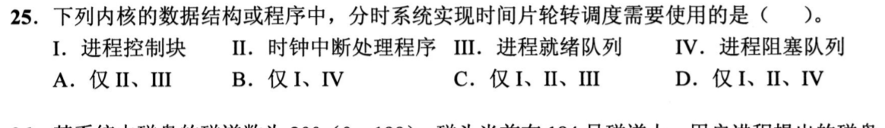
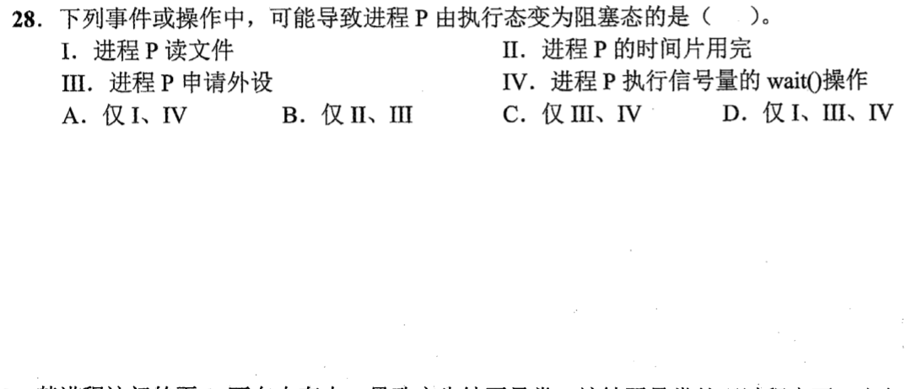
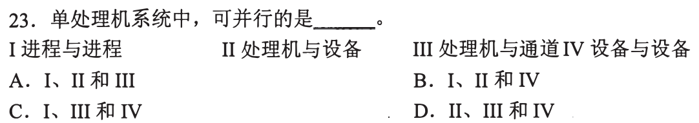
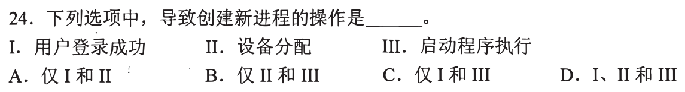
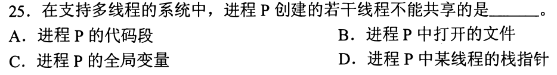
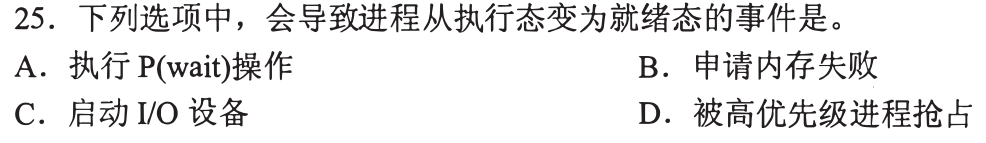
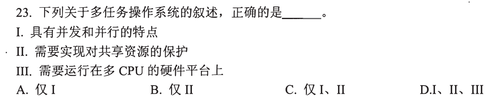
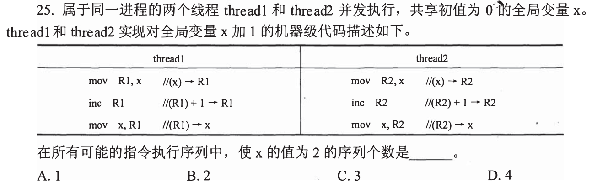
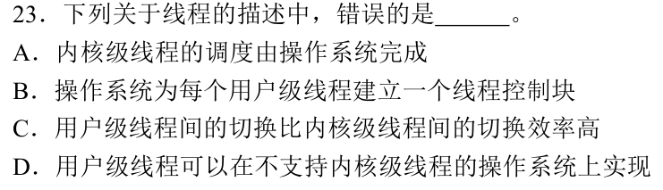

# 0825｜进程与线程：资源、执行和状态

[← 当天安排](../day03.md) · [原题单](../../src/0825.md)

**当前范围：2道2020—2026年题。** 旧题讲解在页末注释保留，暂不安排；本页是现有教学材料的年份更新，不要求刷完整份src题单。

卡住先读：完成本组所需的最少知识

进程拥有地址空间等资源，线程是调度执行单位。同一进程线程共享代码、全局变量、打开文件，各有寄存器上下文和栈。用户级线程由用户态线程库管理，内核级线程由OS管理。按题目常见的单核单硬件线程模型，同一时刻只有一条进程指令流在该核执行，但CPU与I/O设备、多个设备仍可并行。

运行→就绪是失去CPU但还能跑（时间片到、被抢占）；运行→阻塞是等待事件（I/O、资源或P操作等待）；阻塞→就绪是事件到来。x++包含读、改、写，两个线程可交错导致丢失更新，不能把一行高级语言当原子操作。

## 01 · 2021-25

先写选项和一句依据；概念题尝试45秒、计算题尝试90秒仍无入口，就展开下面的讲解。学习后遮住讲解，重新作答，保留真实状态。

核对与补学（作答后展开）

**答案：C。** 时间片轮转需PCB记录上下文、时钟中断计时、就绪队列轮换；不因采用轮转就必须用阻塞队列，选I、II、III。

## 02 · 2022-28

先写选项和一句依据；概念题尝试45秒、计算题尝试90秒仍无入口，就展开下面的讲解。学习后遮住讲解，重新作答，保留真实状态。

核对与补学（作答后展开）

**答案：D。** 读文件、申请外设和P操作都可能等待而阻塞；时间片用完转就绪，不转阻塞。选I、III、IV。

## 离开前的一个检查

时间片用完与等待磁盘读完，分别把运行进程送到哪里？

检查答案

时间片用完→就绪队列；等待磁盘数据→阻塞队列。判断标准是：现在若给CPU，它能不能继续执行。

## 暂缓材料（注释保留）

以下原题及讲解未删除，暂不计入当前训练。

<!-- 暂缓：2009-23；原文保留，当前不安排。
## 01 · 2009-23

先写选项和一句依据；概念题尝试45秒、计算题尝试90秒仍无入口，就展开下面的讲解。学习后遮住讲解，重新作答，保留真实状态。

核对与补学（作答后展开）

**答案：D。** 单处理器上的进程只能并发，CPU与设备、CPU与通道、设备彼此可同时工作，选II、III、IV。

-->

<!-- 暂缓：2010-24；原文保留，当前不安排。
## 02 · 2010-24

先写选项和一句依据；概念题尝试45秒、计算题尝试90秒仍无入口，就展开下面的讲解。学习后遮住讲解，重新作答，保留真实状态。

核对与补学（作答后展开）

**答案：C。** 用户登录成功、启动程序执行通常创建新进程；给已有进程分配设备不需要再创建进程。选I、III。

-->

<!-- 暂缓：2011-24；原文保留，当前不安排。
## 03 · 2011-24

先写选项和一句依据；概念题尝试45秒、计算题尝试90秒仍无入口，就展开下面的讲解。学习后遮住讲解，重新作答，保留真实状态。

核对与补学（作答后展开）

**答案：A。** 命令解释器作为普通程序在用户态运行；缺页处理、进程调度和时钟中断处理需要内核权限。程序能请求内核不等于自身全程在内核态。

-->

<!-- 暂缓：2011-25；原文保留，当前不安排。
## 04 · 2011-25

先写选项和一句依据；概念题尝试45秒、计算题尝试90秒仍无入口，就展开下面的讲解。学习后遮住讲解，重新作答，保留真实状态。

核对与补学（作答后展开）

**答案：D。** 代码、全局变量和打开文件属于进程共享资源；每个线程有自己的执行栈及栈指针，不能共用同一个栈指针上下文。

-->

<!-- 暂缓：2015-25；原文保留，当前不安排。
## 05 · 2015-25

先写选项和一句依据；概念题尝试45秒、计算题尝试90秒仍无入口，就展开下面的讲解。学习后遮住讲解，重新作答，保留真实状态。

核对与补学（作答后展开）

**答案：D。** 高优先级进程抢占后，原进程只缺CPU，进入就绪态；等待资源、I/O才会阻塞。P操作是否阻塞还要看信号量是否有资源。

-->

<!-- 暂缓：2018-23；原文保留，当前不安排。
## 06 · 2018-23

先写选项和一句依据；概念题尝试45秒、计算题尝试90秒仍无入口，就展开下面的讲解。学习后遮住讲解，重新作答，保留真实状态。

核对与补学（作答后展开）

**答案：C。** 多任务可以让CPU和设备并行，同时必须保护共享资源；并不要求多CPU，单CPU也能多任务。I、II成立，III不成立。

-->

<!-- 暂缓：2018-25；原文保留，当前不安排。
## 07 · 2018-25

先写选项和一句依据；概念题尝试45秒、计算题尝试90秒仍无入口，就展开下面的讲解。学习后遮住讲解，重新作答，保留真实状态。

核对与补学（作答后展开）

**答案：B。** 要最终x=2，后执行读取的线程必须读到另一个线程已经写回的1。因此一整个读改写先于另一个读改写，只有线程1先或线程2先两种序列。

-->

<!-- 暂缓：2019-23；原文保留，当前不安排。
## 08 · 2019-23

先写选项和一句依据；概念题尝试45秒、计算题尝试90秒仍无入口，就展开下面的讲解。学习后遮住讲解，重新作答，保留真实状态。

核对与补学（作答后展开）

**答案：B。** 用户级线程的控制结构由用户态线程库维护，操作系统并不为每个用户级线程建立可调度的内核线程控制块。

-->
