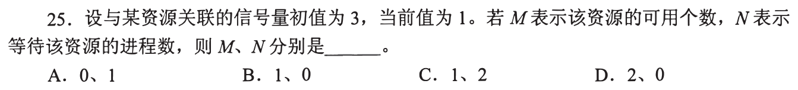
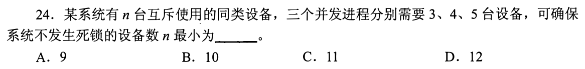
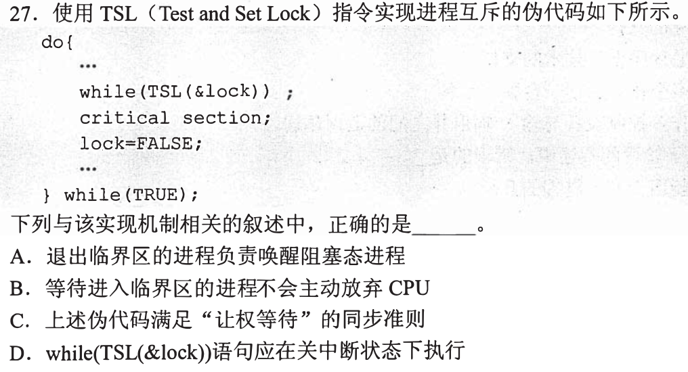
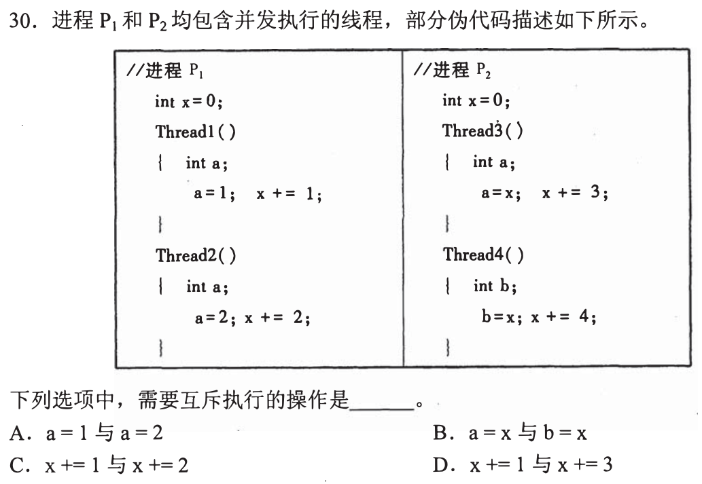
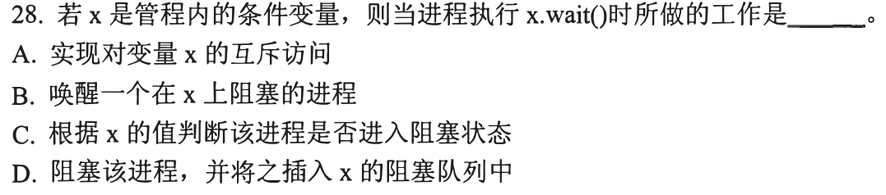
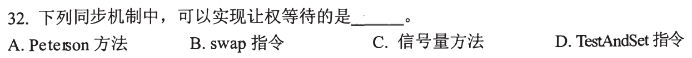
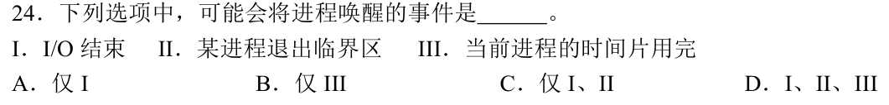

# 0826｜并发约束：资源数量与互斥对象

[← 当天安排](../day05.md) · [原题单](../../src/0826.md)

**当前范围：1道2020—2026年题。** 旧题讲解在页末注释保留，暂不安排；本页是现有教学材料的年份更新，不要求刷完整份src题单。

卡住先读：完成本组所需的最少知识

记录型信号量S>0表示可用资源数；S<0时−S为等待者数。P先减1，不足则阻塞；V增加并按需唤醒。互斥保护对同一共享对象的冲突访问，包括写与写、读与写。各线程私有的同名局部变量彼此独立。TestAndSet/Swap可实现原子抢锁，但循环自旋是忙等；阻塞型信号量才会让出CPU。管程条件变量的wait释放管程并进入条件等待队列，不用条件变量数值计数资源。

## 01 · 2026-26

先写选项和一句依据；概念题尝试45秒、计算题尝试90秒仍无入口，就展开下面的讲解。学习后遮住讲解，重新作答，保留真实状态。

核对与补学（作答后展开）

**答案：A。** S=−2表示2个在wait处阻塞；临界代码Q最多5个并发，当前已有5个获得许可，故m=5、n=2。这里的m指已进入Q尚未归还许可的在执行者，不是历史累计次数。

## 离开前的一个检查

初值5、当前值−3，是否只有2人取得了资源？

检查答案

不是。5份许可已被占用，另有3个等待者；负值的绝对值是等待人数。

## 暂缓材料（注释保留）

以下原题及讲解未删除，暂不计入当前训练。

<!-- 暂缓：2010-25；原文保留，当前不安排。
## 01 · 2010-25

先写选项和一句依据；概念题尝试45秒、计算题尝试90秒仍无入口，就展开下面的讲解。学习后遮住讲解，重新作答，保留真实状态。

核对与补学（作答后展开）

**答案：B。** 当前S=1>0，尚有1个资源，无等待者；不能用初值3减当前值1就得出等待2人。

-->

<!-- 暂缓：2014-24；原文保留，当前不安排。
## 02 · 2014-24

先写选项和一句依据；概念题尝试45秒、计算题尝试90秒仍无入口，就展开下面的讲解。学习后遮住讲解，重新作答，保留真实状态。

核对与补学（作答后展开）

**答案：B。** 最坏每进程各占最大需求减1，即2+3+4=9台仍都可能等；再多1台能使至少一个完成并释放，所以最少10台。

-->

<!-- 暂缓：2016-27；原文保留，当前不安排。
## 03 · 2016-27

先写选项和一句依据；概念题尝试45秒、计算题尝试90秒仍无入口，就展开下面的讲解。学习后遮住讲解，重新作答，保留真实状态。

核对与补学（作答后展开）

**答案：B。** while(TSL)在CPU上反复检查，不主动让出CPU，不符合让权等待；原子TSL不要求在用户代码中手工关中断。

-->

<!-- 暂缓：2016-30；原文保留，当前不安排。
## 04 · 2016-30

先写选项和一句依据；概念题尝试45秒、计算题尝试90秒仍无入口，就展开下面的讲解。学习后遮住讲解，重新作答，保留真实状态。

核对与补学（作答后展开）

**答案：C。** P1中的两个线程共享P1的x，x+=1与x+=2都写它，必须互斥。P1和P2的x属于不同地址空间；各线程局部a也不是同一对象。

-->

<!-- 暂缓：2018-28；原文保留，当前不安排。
## 05 · 2018-28

先写选项和一句依据；概念题尝试45秒、计算题尝试90秒仍无入口，就展开下面的讲解。学习后遮住讲解，重新作答，保留真实状态。

核对与补学（作答后展开）

**答案：D。** x.wait()使调用者阻塞，加入条件x的等待队列并释放管程控制；唤醒由signal完成，不能当P信号量读一个数值决定。

-->

<!-- 暂缓：2018-32；原文保留，当前不安排。
## 06 · 2018-32

先写选项和一句依据；概念题尝试45秒、计算题尝试90秒仍无入口，就展开下面的讲解。学习后遮住讲解，重新作答，保留真实状态。

核对与补学（作答后展开）

**答案：C。** 阻塞型信号量在等待资源时放弃CPU；Peterson、swap和TestAndSet的基本实现均为忙等。

-->

<!-- 暂缓：2019-24；原文保留，当前不安排。
## 07 · 2019-24

先写选项和一句依据；概念题尝试45秒、计算题尝试90秒仍无入口，就展开下面的讲解。学习后遮住讲解，重新作答，保留真实状态。

核对与补学（作答后展开）

**答案：C。** I/O完成可使等待者就绪；退出临界区可能释放资源并唤醒等待者；时间片耗尽只是当前运行者转就绪，不是唤醒阻塞者。

-->
