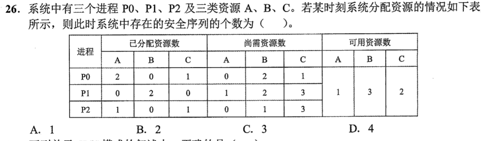
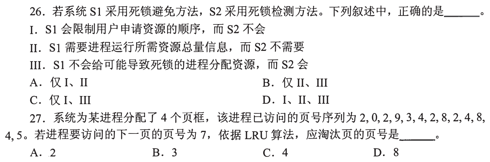
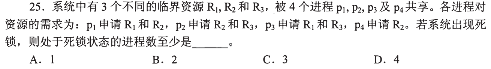
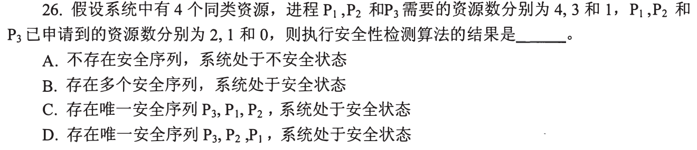

# 0827｜死锁与安全性：最坏占有和试运行

[← 当天安排](../day07.md) · [原题单](../../src/0827.md)

**当前范围：1道2020—2026年题。** 旧题讲解在页末注释保留，暂不安排；本页是现有教学材料的年份更新，不要求刷完整份src题单。

卡住先读：完成本组所需的最少知识

死锁需要互斥、占有并等待、不剥夺、循环等待四条件同时存在。预防主动破坏条件；避免在分配前检查安全序列，需知道最大需求；检测允许先分配，再查是否已死锁。不安全不等于已死锁。银行家检查用Work=Available，找Need≤Work者假想完成，再把Allocation加回Work；完成后释放的是原占有量，不能把Need额外重复加入。

## 01 · 2022-26

先写选项和一句依据；概念题尝试45秒、计算题尝试90秒仍无入口，就展开下面的讲解。学习后遮住讲解，重新作答，保留真实状态。

核对与补学（作答后展开）

**答案：B。** Available=(1,3,2)，起初只有P0可完成；释放(2,0,1)后Work=(3,3,3)，P1、P2任意顺序皆可。因此P0P1P2、P0P2P1，共2种。

## 离开前的一个检查

安全性模拟一个进程完成后，Work增加Need还是Allocation？

检查答案

增加原Allocation。模拟借给它的Need会随完成立即归还，净增量就是它原占有的资源。

## 暂缓材料（注释保留）

以下原题及讲解未删除，暂不计入当前训练。

<!-- 暂缓：2009-25；原文保留，当前不安排。
## 01 · 2009-25

先写选项和一句依据；概念题尝试45秒、计算题尝试90秒仍无入口，就展开下面的讲解。学习后遮住讲解，重新作答，保留真实状态。

核对与补学（作答后展开）

**答案：C。** 每进程最多3台，最坏各占2台还等1台。8台被4个进程各占2台时可死锁；3个进程最多卡住6台，还有2台可让一个完成，故最少K=4。

-->

<!-- 暂缓：2015-26；原文保留，当前不安排。
## 02 · 2015-26

先写选项和一句依据；概念题尝试45秒、计算题尝试90秒仍无入口，就展开下面的讲解。学习后遮住讲解，重新作答，保留真实状态。

核对与补学（作答后展开）

**答案：B。** 避免需最大资源需求且拒绝可能造成不安全的分配；检测不需预报最大需求，也可能先分配到后来死锁。按固定顺序申请是预防，不是避免的必需做法，I错。

-->

<!-- 暂缓：2016-25；原文保留，当前不安排。
## 03 · 2016-25

先写选项和一句依据；概念题尝试45秒、计算题尝试90秒仍无入口，就展开下面的讲解。学习后遮住讲解，重新作答，保留真实状态。

核对与补学（作答后展开）

**答案：C。** p1要R1、R2，p2要R2、R3，p3要R1、R3；任意两人不具备互相等待对方不同资源的完整环，三人各占一种可成环，至少3个。p4只要R2，不能自己形成环。

-->

<!-- 暂缓：2018-26；原文保留，当前不安排。
## 04 · 2018-26

先写选项和一句依据；概念题尝试45秒、计算题尝试90秒仍无入口，就展开下面的讲解。学习后遮住讲解，重新作答，保留真实状态。

核对与补学（作答后展开）

**答案：A。** Available=4−2−1=1；Need分别2、2、1。先P3可完成但原分配为0，Work仍1；P1、P2仍都不能完成，故无安全序列。

-->
