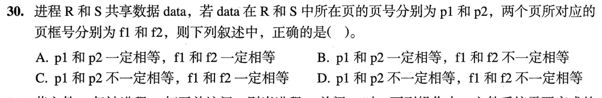
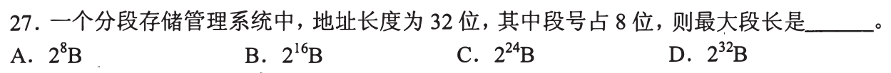
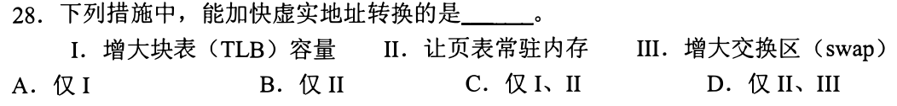
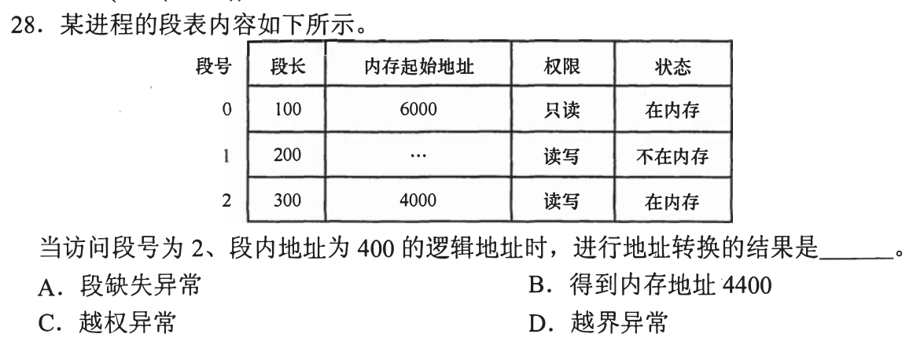
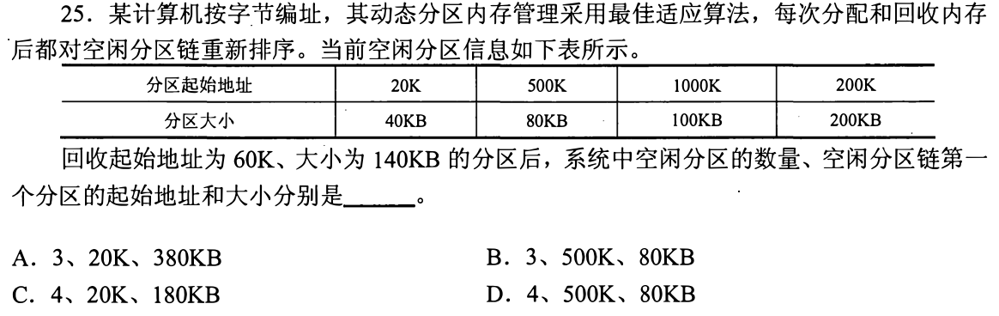

# 0828｜内存边界：先查合法性，再做地址加法

[← 模块入口](../README.md) · [原题单](../../src/0828.md)

本页是已写草稿收尾后的独立模块，未据此新增每日安排。

**当前范围：1道2020—2026年题。** 旧题讲解在页末注释保留，暂不安排；本页是现有教学材料的年份更新，不要求刷完整份src题单。

卡住先读：完成本组所需的最少知识

分区通过基址与界限保护；分段地址=(段号,段内偏移)，先检查段号、偏移<段长、权限与驻留状态，再将段基址+偏移得到物理地址。TLB提高地址翻译命中；页表驻内存避免取页表再访问外存，增大swap容量并不直接加速翻译。共享页可被不同进程映射到不同虚拟页号，但同一数据最终落在相同物理页框。空闲分区回收先按地址合并，再按分配算法重排。

## 01 · 2023-30

先写选项和一句依据；概念题尝试45秒、计算题尝试90秒仍无入口，就展开下面的讲解。学习后遮住讲解，重新作答，保留真实状态。

核对与补学（作答后展开）

**答案：C。** R与S可用不同虚拟页号p1、p2映射共享数据，但共享同一物理页框，f1=f2。别把各自地址空间的编号当成全局编号。

## 离开前的一个检查

段长300、偏移300合法吗？两个进程共享同一物理页，虚拟页号必须相同吗？

检查答案

偏移从0开始，合法0—299，300越界；虚拟页号可以不同，物理页框应相同。

## 暂缓材料（注释保留）

以下原题及讲解未删除，暂不计入当前训练。

<!-- 暂缓：2009-26；原文保留，当前不安排。
## 01 · 2009-26

先写选项和一句依据；概念题尝试45秒、计算题尝试90秒仍无入口，就展开下面的讲解。学习后遮住讲解，重新作答，保留真实状态。

核对与补学（作答后展开）

**答案：A。** 界地址/基址与限长寄存器限制进程合法访问范围。程序代码、数据、栈是内容类别，不是分区管理的主要地址保护机制。

-->

<!-- 暂缓：2009-27；原文保留，当前不安排。
## 02 · 2009-27

先写选项和一句依据；概念题尝试45秒、计算题尝试90秒仍无入口，就展开下面的讲解。学习后遮住讲解，重新作答，保留真实状态。

核对与补学（作答后展开）

**答案：C。** 32位地址中段号8位，段内偏移24位，最大段长2²⁴B。段数上限与单段长度不要对调。

-->

<!-- 暂缓：2014-28；原文保留，当前不安排。
## 03 · 2014-28

先写选项和一句依据；概念题尝试45秒、计算题尝试90秒仍无入口，就展开下面的讲解。学习后遮住讲解，重新作答，保留真实状态。

核对与补学（作答后展开）

**答案：C。** 增大TLB容量可减少未命中，页表常驻内存可减少翻译等待；swap容量大小不直接加快虚实地址转换。

-->

<!-- 暂缓：2016-28；原文保留，当前不安排。
## 04 · 2016-28

先写选项和一句依据；概念题尝试45秒、计算题尝试90秒仍无入口，就展开下面的讲解。学习后遮住讲解，重新作答，保留真实状态。

核对与补学（作答后展开）

**答案：D。** 段2长度300，偏移400越界；不能先算4000+400=4400当合法物理地址。该段已驻内存且可读写，因此不是段缺失或越权。

-->

<!-- 暂缓：2017-25；原文保留，当前不安排。
## 05 · 2017-25

先写选项和一句依据；概念题尝试45秒、计算题尝试90秒仍无入口，就展开下面的讲解。学习后遮住讲解，重新作答，保留真实状态。

核对与补学（作答后展开）

**答案：B。** 回收[60K,200K)，与左侧[20K,60K)和右侧[200K,400K)合成[20K,400K)，大小380KB。另有80KB、100KB，共3区。最佳适应按大小升序，首区是500K处80KB。

-->
