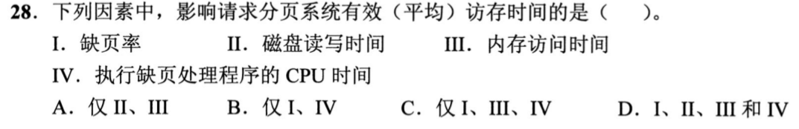
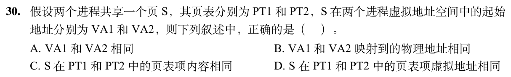
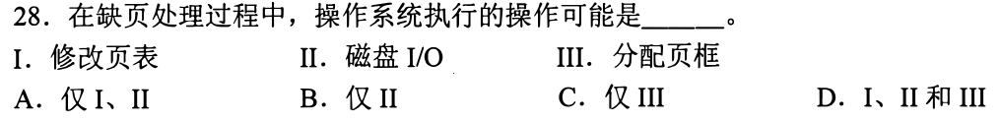
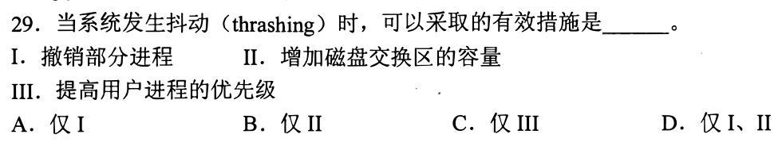
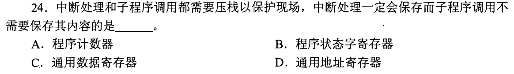
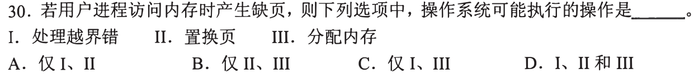
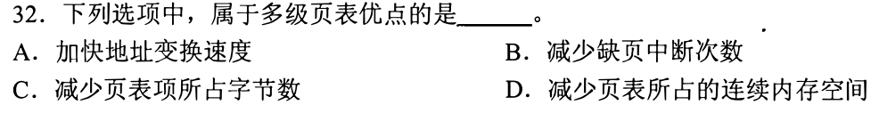
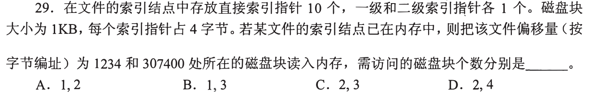
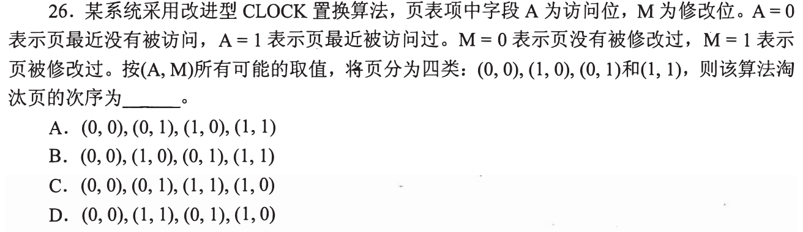
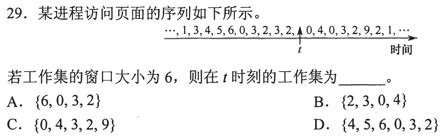

# 0829｜页面驻留：缺页、工作集与置换

[← Day 11](../day11.md) · [原题单](../../src/0829.md)

**当前范围：2道2020—2026年题。** 旧题讲解在页末注释保留，暂不安排；本页是现有教学材料的年份更新，不要求刷完整份src题单。

卡住先读：完成本组所需的最少知识

缺页处理中可分配页框、必要时换出旧页、读磁盘、改页表，再重启原指令；合法虚拟页未驻留与地址越界不同。抖动是驻留页不足、频繁换进换出，应降低多道程度让工作集留住；增大磁盘swap容量不解决内存争用。工作集取最近Δ次访问的不同页集合。改进CLOCK优先考虑未访问且未修改(0,0)，再(0,1)，再(1,0)、(1,1)。本组有一道文件索引题，直接在对应题后补足索引计算，不让你另查。

## 01 · 2020-28

先写选项和一句依据；概念题尝试45秒、计算题尝试90秒仍无入口，就展开下面的讲解。学习后遮住讲解，重新作答，保留真实状态。

核对与补学（作答后展开）

**答案：D。** 缺页率决定走慢路径概率；磁盘读写、内存访存、CPU处理异常均贡献耗时，I—IV都影响。

## 02 · 2026-30

先写选项和一句依据；概念题尝试45秒、计算题尝试90秒仍无入口，就展开下面的讲解。学习后遮住讲解，重新作答，保留真实状态。

核对与补学（作答后展开）

**答案：B。** 共享同一页意味着两个进程所见数据映射到同一物理页；虚拟起址可不同，页表项权限等内容可不同，页表项自身的存放地址也不必相同。

## 离开前的一个检查

工作集窗口6内访问1,2,1,3,2,4，工作集有几个页？

检查答案

不同页{1,2,3,4}，4个；窗口长度是访问次数，不是必须有6个不同页。

## 暂缓材料（注释保留）

以下原题及讲解未删除，暂不计入当前训练。

<!-- 暂缓：2011-28；原文保留，当前不安排。
## 01 · 2011-28

先写选项和一句依据；概念题尝试45秒、计算题尝试90秒仍无入口，就展开下面的讲解。学习后遮住讲解，重新作答，保留真实状态。

核对与补学（作答后展开）

**答案：D。** I改页表、II磁盘I/O、III分配页框都可能出现。即使有空闲页框也要装入并建立映射；无空闲时还需置换。

-->

<!-- 暂缓：2011-29；原文保留，当前不安排。
## 02 · 2011-29

先写选项和一句依据；概念题尝试45秒、计算题尝试90秒仍无入口，就展开下面的讲解。学习后遮住讲解，重新作答，保留真实状态。

核对与补学（作答后展开）

**答案：A。** 撤销或挂起部分进程可减少驻留需求，抑制抖动；加swap容量不增加物理页框，提高用户进程优先级也不修复工作集不足。

-->

<!-- 暂缓：2012-24；原文保留，当前不安排。
## 03 · 2012-24

先写选项和一句依据；概念题尝试45秒、计算题尝试90秒仍无入口，就展开下面的讲解。学习后遮住讲解，重新作答，保留真实状态。

核对与补学（作答后展开）

**答案：B。** 中断需保留原PSW以恢复中断前权限及标志；普通子程序调用需要返回地址，但不必按中断规则自动保存PSW。本题不是页面置换题，按实际原题作答。

-->

<!-- 暂缓：2013-30；原文保留，当前不安排。
## 04 · 2013-30

先写选项和一句依据；概念题尝试45秒、计算题尝试90秒仍无入口，就展开下面的讲解。学习后遮住讲解，重新作答，保留真实状态。

核对与补学（作答后展开）

**答案：B。** 合法地址产生缺页，可置换页或分配内存（II、III）；越界是非法地址错误，不是“把缺的页调来”就能修的缺页。

-->

<!-- 暂缓：2014-32；原文保留，当前不安排。
## 05 · 2014-32

先写选项和一句依据；概念题尝试45秒、计算题尝试90秒仍无入口，就展开下面的讲解。学习后遮住讲解，重新作答，保留真实状态。

核对与补学（作答后展开）

**答案：D。** 多级页表把页表分散到多个页内，无需为整张大页表分配一片连续空间；单项大小不因此缩小，翻译也可能增加查表次数。

-->

<!-- 暂缓：2015-29；原文保留，当前不安排。
## 06 · 2015-29

先写选项和一句依据；概念题尝试45秒、计算题尝试90秒仍无入口，就展开下面的讲解。学习后遮住讲解，重新作答，保留真实状态。

核对与补学（作答后展开）

**答案：B。** 每块1KiB、指针4B，一级索引可指256块。偏移1234在第1号数据块，10个直接指针可覆盖，只读1个数据块；307400/1024取整=300，超过10+256=266块范围，需两级索引：读二级索引块、一级索引块、数据块，共3次。inode已在内存不另计。

-->

<!-- 暂缓：2016-26；原文保留，当前不安排。
## 07 · 2016-26

先写选项和一句依据；概念题尝试45秒、计算题尝试90秒仍无入口，就展开下面的讲解。学习后遮住讲解，重新作答，保留真实状态。

核对与补学（作答后展开）

**答案：A。** 按访问优先、修改次之排序：(0,0)最优，(0,1)次之，再(1,0)、(1,1)。修改位1换出需回写，代价较高。

-->

<!-- 暂缓：2016-29；原文保留，当前不安排。
## 08 · 2016-29

先写选项和一句依据；概念题尝试45秒、计算题尝试90秒仍无入口，就展开下面的讲解。学习后遮住讲解，重新作答，保留真实状态。

核对与补学（作答后展开）

**答案：A。** t之前最近6次为6,0,3,2,3,2，不同页为{6,0,3,2}；不能把t之后的0,4等未来访问算进去。

-->
