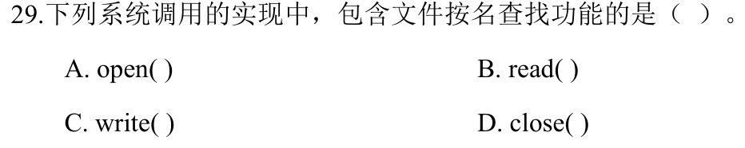
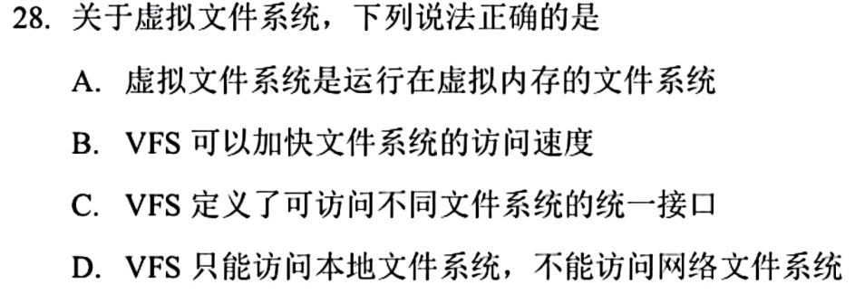

# 0830｜文件按名查找与统一接口

[← Day 13](../day13.md) · [原题单](../../src/0830.md)

**本日指定 2 题。** 先写选项和一句依据，卡住再展开补学。

卡住先读：本组判据

open 先按路径查目录。read、write 和 close 通过已打开的描述符定位文件。

## 01 · 2024-29

核对与补学（作答后展开）

**答案：A。** open 接收路径名，必须查找文件。后三者接收已分配的文件描述符。

## 02 · 2025-28

核对与补学（作答后展开）

**答案：C。** VFS 为不同底层文件系统提供统一接口，可分派到本地或网络文件系统。“虚拟”描述接口抽象，访问速度取决于实现和缓存。

## 离开前的一个检查

连续 read 两次，会重复查找路径吗？

检查答案

不会，描述符已关联打开文件对象。

