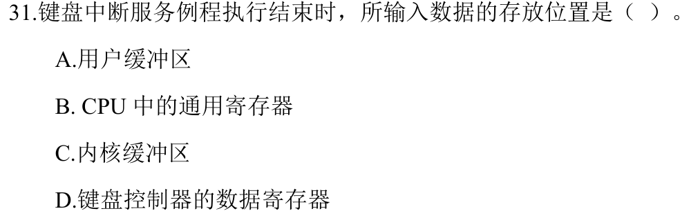
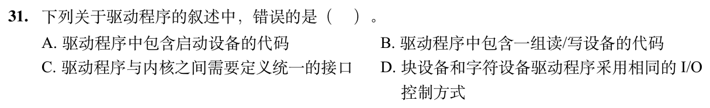

> **已有讲解模块。** 本页仅收录部分题目的讲解；完整2020—2026题单及当天指定题见[全量每日安排](../README.md)，不把做完本模块视作完成对应src全题单。

# 0831｜键盘中断与设备驱动

[全量每日安排](../README.md) · [原题单](../../src/0831.md)

**本日指定 2 题。** 先写选项和一句依据，卡住再展开补学。

卡住先读：本组判据

控制器暂存输入，中断例程取走并交给内核。用户进程在后续获得结果。

## 01 · 2024-31

核对与补学（作答后展开）

**答案：C。** 中断例程把字符放入内核缓冲区。CPU寄存器只是临时载体，用户缓冲区属于后续交付。

## 02 · 2026-31

核对与补学（作答后展开）

**答案：D。** 块设备和字符设备的传输单位与设备特性不同，I/O控制方式可以不同。它们仍可在内核规定的接口下提供启动和读写操作。

## 离开前的一个检查

中断到来时等待输入的进程已运行吗？

检查答案

没有。驱动取走字符，进程满足条件被唤醒后仍要等待调度。

