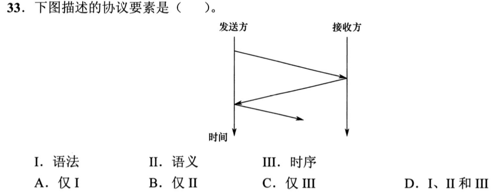
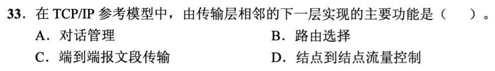
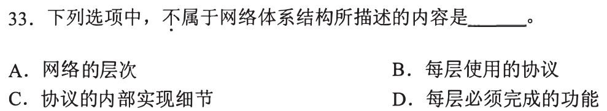
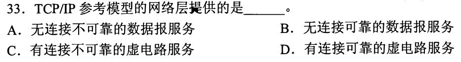
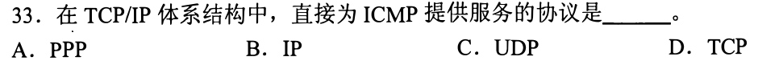
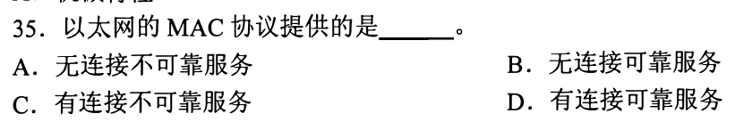

# 0901｜分层：服务对象与协议职责

[← 当天安排](../day02.md) · [原题单](../../src/0901.md)

**当前范围：2道2020—2026年题。** 旧题讲解在页末注释保留，暂不安排；本页是现有教学材料的年份更新，不要求刷完整份src题单。

卡住先读：完成本组所需的最少知识

OSI七层由低到高：物理、数据链路、网络、传输、会话、表示、应用。网络层负责跨网络选路转发；传输层把两端进程连接起来。TCP/IP常用四层模型中，传输层下方是网际层。上层协议通过下层封装得到服务，ICMP封装在IP中，不能因为含有控制消息就归到TCP。

连接与可靠性是两个维度：IP是无连接、不可靠的数据报服务；以太网MAC也是无连接不可靠，不提供确认重传保证。协议三要素：语法是格式、语义是含义与动作、时序是先后及同步约定；网络体系结构描述分层、协议和功能，不规定内部代码实现。

## 01 · 2020-33

先写选项和一句依据；概念题尝试45秒、计算题尝试90秒仍无入口，就展开下面的讲解。学习后遮住讲解，重新作答，保留真实状态。

核对与补学（作答后展开）

**答案：C。** 箭头图在这里展示发送接收的先后关系，对应时序。图中没有给出报文格式字段，也没有说明各消息的具体控制含义，不应把语法、语义一起选入。

## 02 · 2021-33

先写选项和一句依据；概念题尝试45秒、计算题尝试90秒仍无入口，就展开下面的讲解。学习后遮住讲解，重新作答，保留真实状态。

核对与补学（作答后展开）

**答案：B。** 传输层直接下层是网络层，负责路由选择；对话管理属于会话层，端到端报文段传输属于传输层，结点到结点流控属于链路层。

## 离开前的一个检查

IP不可靠，是否意味着其上的TCP也不可能可靠？

检查答案

不意味着。层间提供不同服务：TCP在IP之上通过序号、确认、重传等建立可靠传输。下层不保证可靠，并不禁止上层实现可靠。

## 暂缓材料（注释保留）

以下原题及讲解未删除，暂不计入当前训练。

<!-- 暂缓：2009-33；原文保留，当前不安排。
## 01 · 2009-33

先写选项和一句依据；概念题尝试45秒、计算题尝试90秒仍无入口，就展开下面的讲解。学习后遮住讲解，重新作答，保留真实状态。

核对与补学（作答后展开）

**答案：B。** 自下而上首次提供端到端服务的是传输层。链路层关注相邻结点，网络层负责主机之间的数据报转发。

-->

<!-- 暂缓：2010-33；原文保留，当前不安排。
## 02 · 2010-33

先写选项和一句依据；概念题尝试45秒、计算题尝试90秒仍无入口，就展开下面的讲解。学习后遮住讲解，重新作答，保留真实状态。

核对与补学（作答后展开）

**答案：C。** 体系结构规定功能、层次及协议。协议由什么代码、电路实现属于实现细节，不属于体系结构描述。

-->

<!-- 暂缓：2011-33；原文保留，当前不安排。
## 03 · 2011-33

先写选项和一句依据；概念题尝试45秒、计算题尝试90秒仍无入口，就展开下面的讲解。学习后遮住讲解，重新作答，保留真实状态。

核对与补学（作答后展开）

**答案：A。** IP不先建立连接，也不保证交付、不重复或按序，因此是无连接不可靠数据报服务。可靠性可由更高层实现。

-->

<!-- 暂缓：2012-33；原文保留，当前不安排。
## 04 · 2012-33

先写选项和一句依据；概念题尝试45秒、计算题尝试90秒仍无入口，就展开下面的讲解。学习后遮住讲解，重新作答，保留真实状态。

核对与补学（作答后展开）

**答案：B。** ICMP报文装进IP数据报，直接提供承载服务的是IP，而不是TCP或UDP。

-->

<!-- 暂缓：2012-35；原文保留，当前不安排。
## 05 · 2012-35

先写选项和一句依据；概念题尝试45秒、计算题尝试90秒仍无入口，就展开下面的讲解。学习后遮住讲解，重新作答，保留真实状态。

核对与补学（作答后展开）

**答案：A。** 以太网MAC可检测部分传输差错并丢弃坏帧，但不提供确认重传，所以不是可靠服务；发送前也不建立连接。

-->
