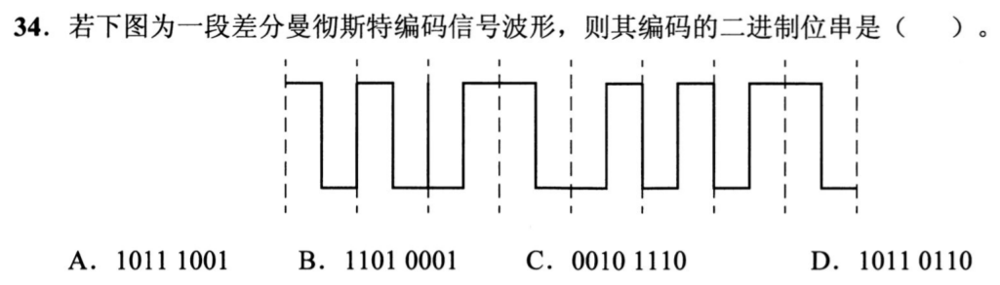
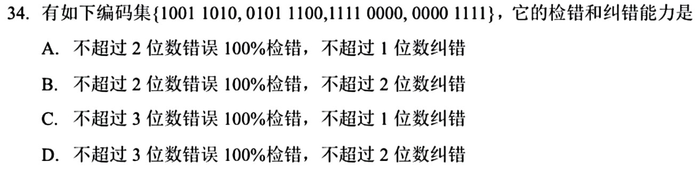
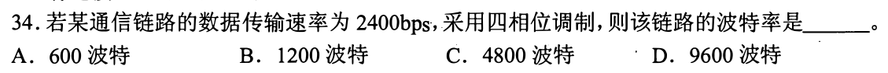
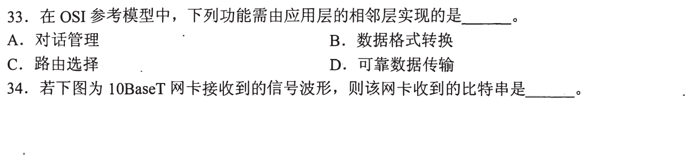
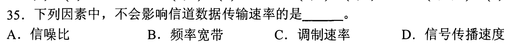
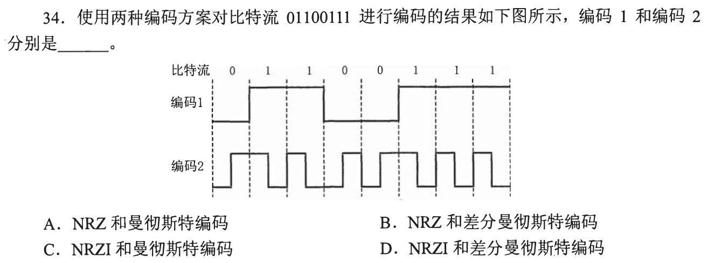

> **已有讲解模块。** 本页仅收录部分题目的讲解；完整2020—2026题单及当天指定题见[全量每日安排](../README.md)，不把做完本模块视作完成对应src全题单。

# 0902｜信号与编码：速率、波形和码距

[全量每日安排](../README.md) · [原题单](../../src/0902.md)

**当前范围：3道2020—2026年题。** 旧题讲解在页末注释保留，暂不安排；本页是现有教学材料的年份更新，不要求刷完整份src题单。

卡住先读：完成本组所需的最少知识

比特率R=波特率B×log₂M，M为每个码元可区分状态数；四相位M=4，每码元2bit。传播速度决定传播时延，不直接决定每秒发送多少bit。奈氏理想带宽上限2Wlog₂M；香农有噪声上限Wlog₂(1+S/N)，dB先转换为线性功率比。

曼彻斯特每bit中点跳变，用中点方向判0/1；以太网约定中点低→高为0，高→低为1。差分曼彻斯特每bit中点也跳变，但用位起始边界是否跳变判值（常用有跳0、无跳1）。NRZ按电平判值。码距是两个码字不同位数，最小距离d可检d−1位错、纠⌊(d−1)/2⌋位错。

## 01 · 2021-34

先写选项和一句依据；概念题尝试45秒、计算题尝试90秒仍无入口，就展开下面的讲解。学习后遮住讲解，重新作答，保留真实状态。

核对与补学（作答后展开）

**答案：A。** 差分曼彻斯特看每个位起点是否跳变，而非中点方向。由图逐位判得10111001；每位中点的必有跳变只用于时钟同步。

## 02 · 2024-34

先写选项和一句依据；概念题尝试45秒、计算题尝试90秒仍无入口，就展开下面的讲解。学习后遮住讲解，重新作答，保留真实状态。

核对与补学（作答后展开）

**答案：C。** FSK用不同频率表示0和1；ASK改变幅度，PSK改变相位，DPSK用相邻码元相位差。

## 03 · 2025-34

先写选项和一句依据；概念题尝试45秒、计算题尝试90秒仍无入口，就展开下面的讲解。学习后遮住讲解，重新作答，保留真实状态。

核对与补学（作答后展开）

**答案：C。** 逐对异或：最小汉明距离为4。因此最多保证检出3位错，最多纠正1位错；两位错的纠错球会重叠，不能保证纠2位。

## 离开前的一个检查

16种码元状态、1000波特，最大比特率多少？最小码距5可纠几位？

检查答案

每码元log₂16=4bit，比特率4000bit/s；码距5可纠⌊4/2⌋=2位，检4位。

## 暂缓材料（注释保留）

以下原题及讲解未删除，暂不计入当前训练。

<!-- 暂缓：2011-34；原文保留，当前不安排。
## 01 · 2011-34

先写选项和一句依据；概念题尝试45秒、计算题尝试90秒仍无入口，就展开下面的讲解。学习后遮住讲解，重新作答，保留真实状态。

核对与补学（作答后展开）

**答案：B。** 四相位每码元2bit，2400/2=1200波特；波特是码元每秒，不要再乘2。

-->

<!-- 暂缓：2013-34；原文保留，当前不安排。
## 02 · 2013-34

先写选项和一句依据；概念题尝试45秒、计算题尝试90秒仍无入口，就展开下面的讲解。学习后遮住讲解，重新作答，保留真实状态。

核对与补学（作答后展开）

**答案：A。** 10BaseT用曼彻斯特编码。把图按8个位周期分段，只看每位中点方向，低→高为0、高→低为1，得到00110110。位边界的跳变不另算一位。

-->

<!-- 暂缓：2014-35；原文保留，当前不安排。
## 03 · 2014-35

先写选项和一句依据；概念题尝试45秒、计算题尝试90秒仍无入口，就展开下面的讲解。学习后遮住讲解，重新作答，保留真实状态。

核对与补学（作答后展开）

**答案：D。** 信噪比、带宽和调制速率影响数据传输速率；信号在介质中的传播速度主要影响传播时延。

-->

<!-- 暂缓：2015-34；原文保留，当前不安排。
## 04 · 2015-34

先写选项和一句依据；概念题尝试45秒、计算题尝试90秒仍无入口，就展开下面的讲解。学习后遮住讲解，重新作答，保留真实状态。

核对与补学（作答后展开）

**答案：A。** 编码1按0低1高保持电平，是NRZ；编码2每位中点跳变且用跳变方向表示0/1，是曼彻斯特，不是差分曼彻斯特。

-->

<!-- 暂缓：2018-34；原文保留，当前不安排。
## 05 · 2018-34

先写选项和一句依据；概念题尝试45秒、计算题尝试90秒仍无入口，就展开下面的讲解。学习后遮住讲解，重新作答，保留真实状态。

核对与补学（作答后展开）

**答案：C。** 形状属于机械特性，引脚功能属于功能特性，电平属于电气特性；MAC等物理地址属于链路层，不是物理层接口规范。

-->
