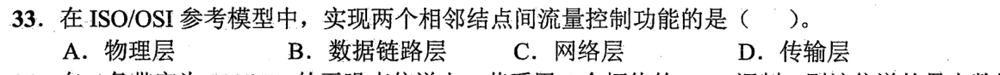
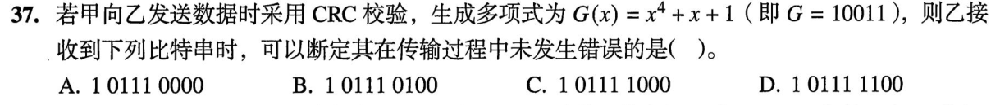
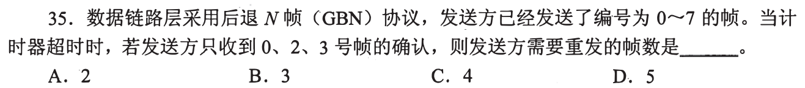
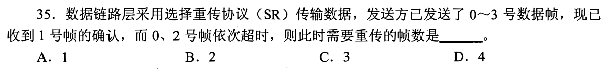
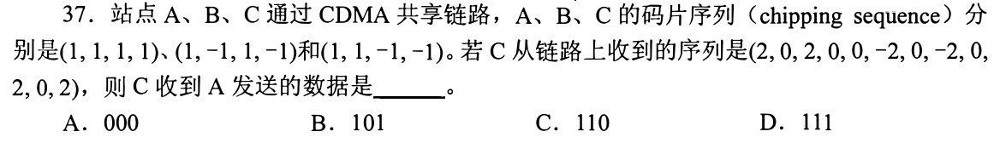
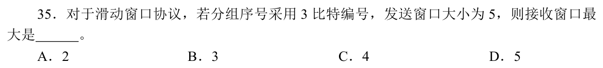

> **已有讲解模块。** 本页仅收录部分题目的讲解；完整2020—2026题单及当天指定题见[全量每日安排](../README.md)，不把做完本模块视作完成对应src全题单。

# 0903｜链路可靠性：确认、窗口和检错

[全量每日安排](../README.md) · [原题单](../../src/0903.md)

**当前范围：2道2020—2026年题。** 旧题讲解在页末注释保留，暂不安排；本页是现有教学材料的年份更新，不要求刷完整份src题单。

卡住先读：完成本组所需的最少知识

GBN累积确认：确认k表示截至k均收到；超时从最早未确认帧起重发。SR分别确认，只重发超时未确认帧。序号空间2^k至少覆盖发送窗口与接收窗口之和；对称SR窗口不超过2^(k−1)。CRC按模2多项式除法做异或除法，余数为0仅表示校验通过，不证明绝无错误。同步CDMA按一个比特周期切出整组码片，与目标用户的码片序列点乘再除序列长度。按常用约定，+1和−1分别对应发送1和0，结果为0表示该用户本周期未发送。

## 01 · 2022-33

先写选项和一句依据；概念题尝试45秒、计算题尝试90秒仍无入口，就展开下面的讲解。学习后遮住讲解，重新作答，保留真实状态。

核对与补学（作答后展开）

**答案：B。** 相邻结点之间流量控制属数据链路层；传输层处理端到端流量控制。看清题目限定的通信对象。

## 02 · 2023-37

先写选项和一句依据；概念题尝试45秒、计算题尝试90秒仍无入口，就展开下面的讲解。学习后遮住讲解，重新作答，保留真实状态。

核对与补学（作答后展开）

**答案：D。** 101111100对10011做模2除法余数为0000，其他候选余数非零，故按题意选D。严格说CRC通过只能说明未检出差错，不能逻辑保证传输绝无错误；可检出范围取决于生成多项式。

## 离开前的一个检查

CRC余数为0能否证明绝对无错？GBN收到ACK3后ACK1丢失需补发1吗？

检查答案

不能证明绝对无错；GBN的ACK3累积确认0—3，不因ACK1丢失补发1。

## 暂缓材料（注释保留）

以下原题及讲解未删除，暂不计入当前训练。

<!-- 暂缓：2009-35；原文保留，当前不安排。
## 01 · 2009-35

先写选项和一句依据；概念题尝试45秒、计算题尝试90秒仍无入口，就展开下面的讲解。学习后遮住讲解，重新作答，保留真实状态。

核对与补学（作答后展开）

**答案：C。** 收到0、2、3的累积确认说明0—3均已收到。4—7共4帧未确认，GBN超时须全重发。

-->

<!-- 暂缓：2011-35；原文保留，当前不安排。
## 02 · 2011-35

先写选项和一句依据；概念题尝试45秒、计算题尝试90秒仍无入口，就展开下面的讲解。学习后遮住讲解，重新作答，保留真实状态。

核对与补学（作答后展开）

**答案：B。** SR独立处理：0、2超时各重发，已确认的1不重发，尚未超时的3此刻不因别帧超时而重发，共2帧。

-->

<!-- 暂缓：2014-37；原文保留，当前不安排。
## 03 · 2014-37

先写选项和一句依据；概念题尝试45秒、计算题尝试90秒仍无入口，就展开下面的讲解。学习后遮住讲解，重新作答，保留真实状态。

核对与补学（作答后展开）

**答案：B。** 每4个码片一组，与A=(1,1,1,1)点乘/4：第一组1、第二组−1、第三组1，对应101。不是用C的码片，因为问恢复A的数据。

-->

<!-- 暂缓：2019-35；原文保留，当前不安排。
## 04 · 2019-35

先写选项和一句依据；概念题尝试45秒、计算题尝试90秒仍无入口，就展开下面的讲解。学习后遮住讲解，重新作答，保留真实状态。

核对与补学（作答后展开）

**答案：B。** 3位序号空间8，发送窗口5，接收窗口最多8−5=3，避免新旧帧序号混淆。

-->
