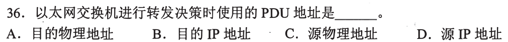
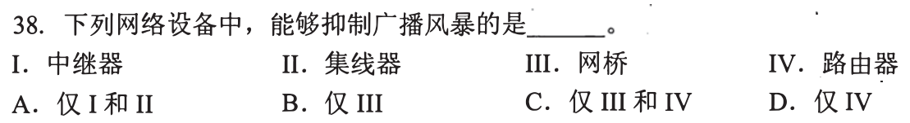
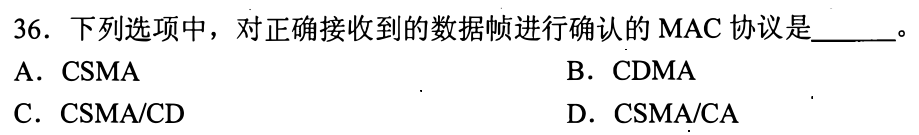
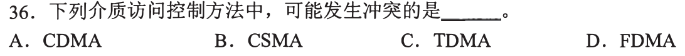
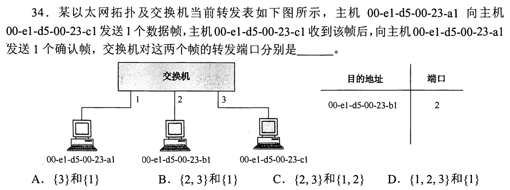
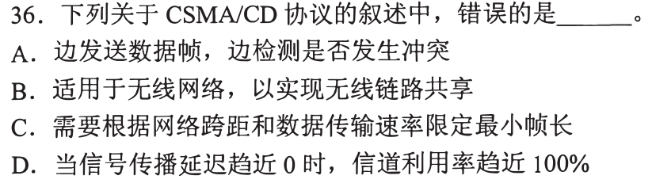
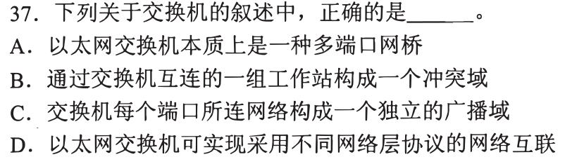
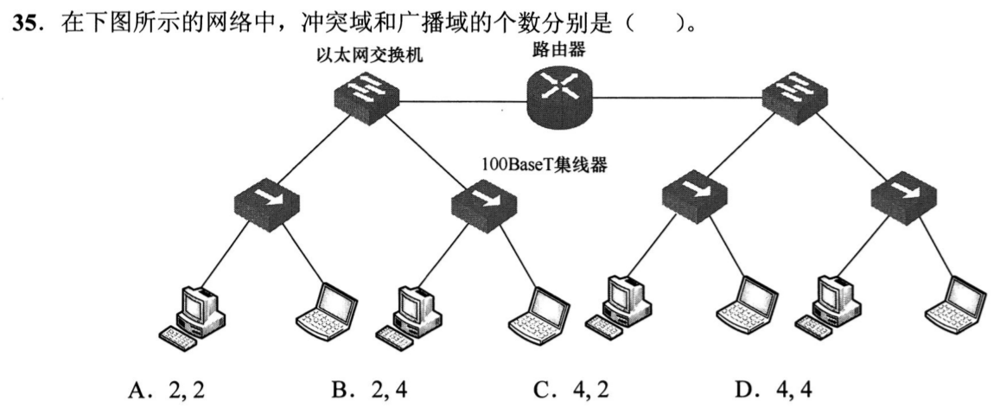
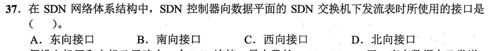
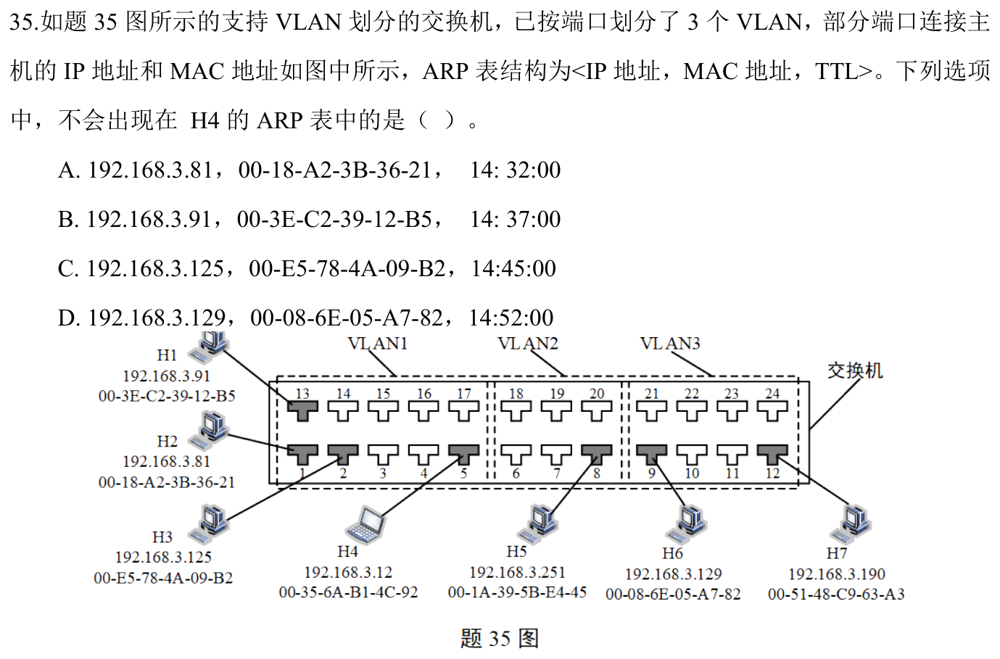

# 0904｜局域网：学习源地址，按目的地址转发

[← 当天安排](../day08.md) · [原题单](../../src/0904.md)

**本轮范围：10道快速题。** 先尝试，卡住再展开讲解；原题前的旧提示不作为依据。本页答案与说明按原图独立核对。

卡住先读：完成本组所需的最少知识

交换机收到帧先学习源MAC→入口，再查目的MAC：已知则定向转发，未知则向同VLAN除入口外泛洪；目的在入口侧则过滤。交换机隔离冲突域，路由器或VLAN隔离广播域。集线器连成的部分共享一个冲突域。传统共享以太网CSMA/CD边发边检测冲突；无线CSMA/CA用避免机制及确认。SDN控制器下发流表用南向接口，上层应用用北向接口。

## 01 · 2009-36

先写选项和一句依据；概念题尝试45秒、计算题尝试90秒仍无入口，就展开下面的讲解。学习后遮住讲解，重新作答，保留真实状态。

核对与补学（作答后展开）

**答案：A。** 转发查目的MAC（物理地址），学习使用源MAC。不要把学习表的输入字段和查表字段混起来。

## 02 · 2010-38

先写选项和一句依据；概念题尝试45秒、计算题尝试90秒仍无入口，就展开下面的讲解。学习后遮住讲解，重新作答，保留真实状态。

核对与补学（作答后展开）

**答案：D。** 路由器不直接转发链路广播，划分广播域，可抑制广播风暴跨域传播；中继器、集线器不隔离广播，网桥默认也传播广播。

## 03 · 2011-36

先写选项和一句依据；概念题尝试45秒、计算题尝试90秒仍无入口，就展开下面的讲解。学习后遮住讲解，重新作答，保留真实状态。

核对与补学（作答后展开）

**答案：D。** 无线CSMA/CA采用收到帧后的ACK机制；以太网CSMA/CD不对每个正确帧发MAC确认。

## 04 · 2013-36

先写选项和一句依据；概念题尝试45秒、计算题尝试90秒仍无入口，就展开下面的讲解。学习后遮住讲解，重新作答，保留真实状态。

核对与补学（作答后展开）

**答案：B。** CSMA先听后发仍可能因传播时延而同时发送，故可能冲突。TDMA、FDMA、理想正交CDMA通过预分配时频码资源分离。

## 05 · 2014-34

先写选项和一句依据；概念题尝试45秒、计算题尝试90秒仍无入口，就展开下面的讲解。学习后遮住讲解，重新作答，保留真实状态。

核对与补学（作答后展开）

**答案：B。** 首帧a1从端口1入，先学a1→1，目的c1未知，发{2,3}；回复帧c1→a1时已知a1→1，只发{1}。

## 06 · 2015-36

先写选项和一句依据；概念题尝试45秒、计算题尝试90秒仍无入口，就展开下面的讲解。学习后遮住讲解，重新作答，保留真实状态。

核对与补学（作答后展开）

**答案：B。** CSMA/CD适用于有线共享介质，不能直接用于无线；无线一般采用CSMA/CA。最小帧长约束是为了在发送结束前检测最远端冲突。

## 07 · 2015-37

先写选项和一句依据；概念题尝试45秒、计算题尝试90秒仍无入口，就展开下面的讲解。学习后遮住讲解，重新作答，保留真实状态。

核对与补学（作答后展开）

**答案：A。** 交换机本质是多端口网桥。其端口分别隔离冲突域但不默认隔离广播域，也不是网络层协议转换器。

## 08 · 2020-35

先写选项和一句依据；概念题尝试45秒、计算题尝试90秒仍无入口，就展开下面的讲解。学习后遮住讲解，重新作答，保留真实状态。

核对与补学（作答后展开）

**答案：C。** 四个集线器各连到交换机独立端口，形成4个共享冲突域；中间路由器把左右分成2个广播域。按题图只统计所示以太网冲突域。

## 09 · 2022-37

先写选项和一句依据；概念题尝试45秒、计算题尝试90秒仍无入口，就展开下面的讲解。学习后遮住讲解，重新作答，保留真实状态。

核对与补学（作答后展开）

**答案：B。** 控制平面向数据平面下发流表用南向接口；北向连接应用与控制器。

## 10 · 2024-35

先写选项和一句依据；概念题尝试45秒、计算题尝试90秒仍无入口，就展开下面的讲解。学习后遮住讲解，重新作答，保留真实状态。

核对与补学（作答后展开）

**答案：D。** H4在VLAN1，能ARP解析同广播域的H1、H2、H3；H6在VLAN3，其MAC不会通过普通跨VLAN ARP出现在H4表。IP看似同网段也不能越过VLAN广播隔离。

## 离开前的一个检查

收到源A、目的B的帧，表内没有B，学习什么、向哪里发？

检查答案

学习A对应入口；在同VLAN除入口外泛洪，不能因为B未知就丢弃，也不把B记在入口。

