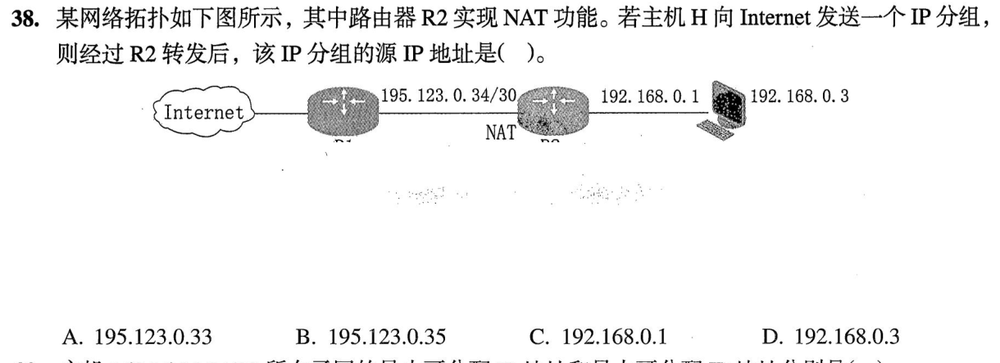
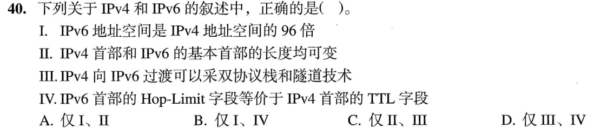
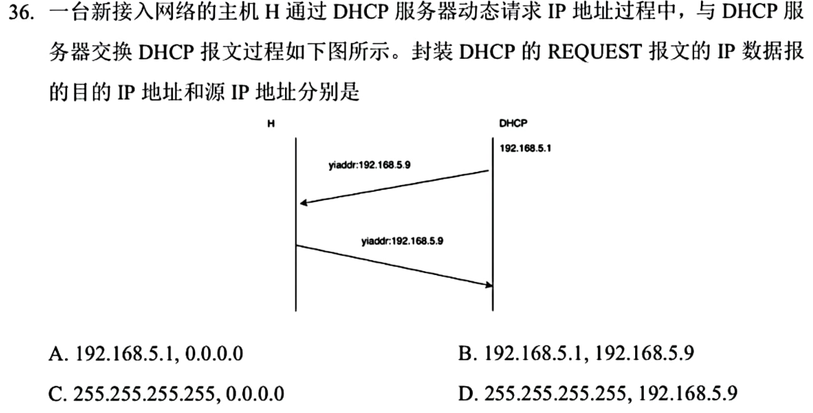
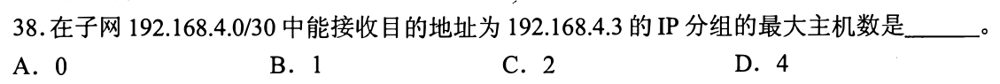
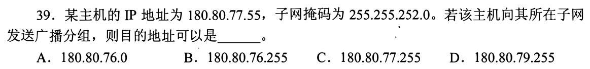
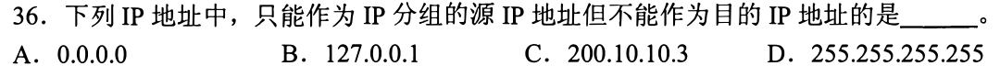

> **已有讲解模块。** 本页仅收录部分题目的讲解；完整2020—2026题单及当天指定题见[全量每日安排](../README.md)，不把做完本模块视作完成对应src全题单。

# 0905｜网络地址：掩码、广播与NAT

[全量每日安排](../README.md) · [原题单](../../src/0905.md)

**当前范围：4道2020—2026年题。** 旧题讲解在页末注释保留，暂不安排；本页是现有教学材料的年份更新，不要求刷完整份src题单。

卡住先读：完成本组所需的最少知识

网络号=IP按位与掩码，主机位全0为网络地址，全1为定向广播。传统子网可用主机数2^h−2；/30有4地址、2可用主机。0.0.0.0可用于尚未获地址主机的源地址，255.255.255.255为本地受限广播目的。NAT出网把私网源地址替换为公网出口地址，回包按映射送回。IPv6地址128位，基本首部固定40B；Hop Limit对应IPv4的逐跳TTL。DHCP初次申请时客户端尚不能把提供的地址当正式源地址使用。

## 01 · 2022-35

先写选项和一句依据；概念题尝试45秒、计算题尝试90秒仍无入口，就展开下面的讲解。学习后遮住讲解，重新作答，保留真实状态。

核对与补学（作答后展开）

**答案：B。** 第三字节72与192按位与得64；第四字节与0得0，所以网络地址183.80.64.0（/18）。

## 02 · 2023-38

先写选项和一句依据；概念题尝试45秒、计算题尝试90秒仍无入口，就展开下面的讲解。学习后遮住讲解，重新作答，保留真实状态。

核对与补学（作答后展开）

**答案：A。** 图中公网链路195.123.0.32/30，可用.33、.34；R1已占.34，R2的公网出口只能是.33，故NAT后源地址195.123.0.33。

## 03 · 2023-40

先写选项和一句依据；概念题尝试45秒、计算题尝试90秒仍无入口，就展开下面的讲解。学习后遮住讲解，重新作答，保留真实状态。

核对与补学（作答后展开）

**答案：D。** III双栈/隧道可过渡，IV Hop Limit等效TTL；地址空间比是2^(128−32)=2⁹⁶倍，不是96倍；IPv6基本首部固定，II错。

## 04 · 2025-36

先写选项和一句依据；概念题尝试45秒、计算题尝试90秒仍无入口，就展开下面的讲解。学习后遮住讲解，重新作答，保留真实状态。

核对与补学（作答后展开）

**答案：C。** 新接入主机对OFFER发初次REQUEST时使用源0.0.0.0、目的255.255.255.255广播，通知各服务器选择结果。题目问目的在前、源在后，顺序别倒。

## 离开前的一个检查

192.168.5.130/25网络号和广播地址？

检查答案

网络号192.168.5.128，广播192.168.5.255；可用主机.129—.254。

## 暂缓材料（注释保留）

以下原题及讲解未删除，暂不计入当前训练。

<!-- 暂缓：2011-38；原文保留，当前不安排。
## 01 · 2011-38

先写选项和一句依据；概念题尝试45秒、计算题尝试90秒仍无入口，就展开下面的讲解。学习后遮住讲解，重新作答，保留真实状态。

核对与补学（作答后展开）

**答案：C。** 192.168.4.0/30地址.0—.3，.3是该子网广播地址，两台可用主机.1、.2都能接收，最大2。

-->

<!-- 暂缓：2012-39；原文保留，当前不安排。
## 02 · 2012-39

先写选项和一句依据；概念题尝试45秒、计算题尝试90秒仍无入口，就展开下面的讲解。学习后遮住讲解，重新作答，保留真实状态。

核对与补学（作答后展开）

**答案：D。** 掩码255.255.252.0为/22，第三字节范围76—79，主机位全1得到180.80.79.255。77.255不覆盖整个/22。

-->

<!-- 暂缓：2017-36；原文保留，当前不安排。
## 03 · 2017-36

先写选项和一句依据；概念题尝试45秒、计算题尝试90秒仍无入口，就展开下面的讲解。学习后遮住讲解，重新作答，保留真实状态。

核对与补学（作答后展开）

**答案：A。** 0.0.0.0可作主机启动时的源地址，不能作一般IP目的地址；255.255.255.255反而是广播目的，不能作源。

-->
