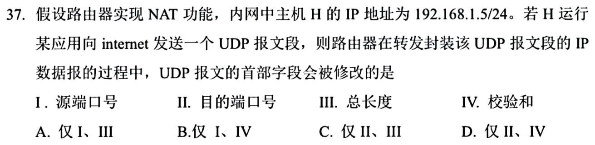
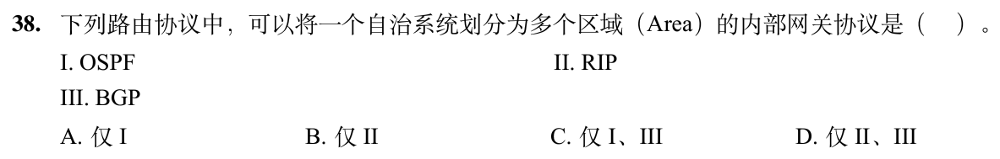
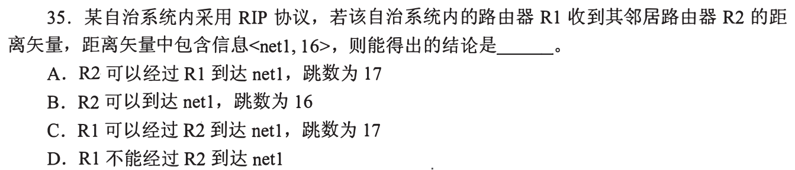
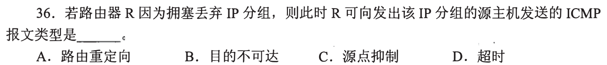
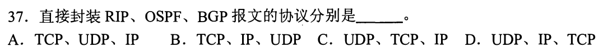

# 0906｜控制转发：协议承载与NAT字段

[← Day 12](../day12.md) · [原题单](../../src/0906.md)

**当前范围：2道2020—2026年题。** 旧题讲解在页末注释保留，暂不安排；本页是现有教学材料的年份更新，不要求刷完整份src题单。

卡住先读：完成本组所需的最少知识

RIP是距离向量，16表示不可达；OSPF是链路状态，可在AS内分Area；BGP在自治系统间交换路由。直接承载分别是RIP/UDP、OSPF/IP、BGP/TCP。ICMP报告网络控制差错；历史题目会出现旧机制，应按原题年代认识。NAPT出网可改源地址和源端口，UDP校验和包含IP伪首部与UDP头，地址/端口变化均可能导致重算，不改变应用数据长度。

## 01 · 2025-37

先写选项和一句依据；概念题尝试45秒、计算题尝试90秒仍无入口，就展开下面的讲解。学习后遮住讲解，重新作答，保留真实状态。

核对与补学（作答后展开）

**答案：B。** NAPT可能改源端口，源IP也变，UDP校验和涉及这些字段故需更新；目的端口与总长度不随普通地址端口转换改变。选I、IV。

## 02 · 2026-38

先写选项和一句依据；概念题尝试45秒、计算题尝试90秒仍无入口，就展开下面的讲解。学习后遮住讲解，重新作答，保留真实状态。

核对与补学（作答后展开）

**答案：A。** OSPF支持一个AS分成多个Area；RIP没有这种区域分层机制，BGP是外部网关协议，不符合题目“内部网关”。

## 离开前的一个检查

OSPF报文先装进TCP吗？出网NAPT是否通常修改目的应用端口？

检查答案

OSPF直接封装IP；出网NAPT通常改源端口，目的应用端口保持指向远端服务。

## 暂缓材料（注释保留）

以下原题及讲解未删除，暂不计入当前训练。

<!-- 暂缓：2010-35；原文保留，当前不安排。
## 01 · 2010-35

先写选项和一句依据；概念题尝试45秒、计算题尝试90秒仍无入口，就展开下面的讲解。学习后遮住讲解，重新作答，保留真实状态。

核对与补学（作答后展开）

**答案：D。** R2向net1报告16，在RIP中已经是无穷大不可达；R1不能理解成经R2还能17跳可达。

-->

<!-- 暂缓：2010-36；原文保留，当前不安排。
## 02 · 2010-36

先写选项和一句依据；概念题尝试45秒、计算题尝试90秒仍无入口，就展开下面的讲解。学习后遮住讲解，重新作答，保留真实状态。

核对与补学（作答后展开）

**答案：C。** 按2010原题的历史ICMP分类，拥塞时请求源减少发送用“源点抑制”。此项用于理解旧真题，不据此要求现代网络配置该机制。

-->

<!-- 暂缓：2017-37；原文保留，当前不安排。
## 03 · 2017-37

先写选项和一句依据；概念题尝试45秒、计算题尝试90秒仍无入口，就展开下面的讲解。学习后遮住讲解，重新作答，保留真实状态。

核对与补学（作答后展开）

**答案：D。** RIP直接装UDP，OSPF直接装IP，BGP直接装TCP，顺序UDP、IP、TCP。路由协议都与网络层相关，不代表承载方式相同。

-->
