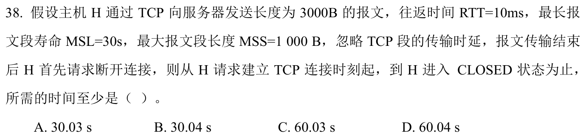
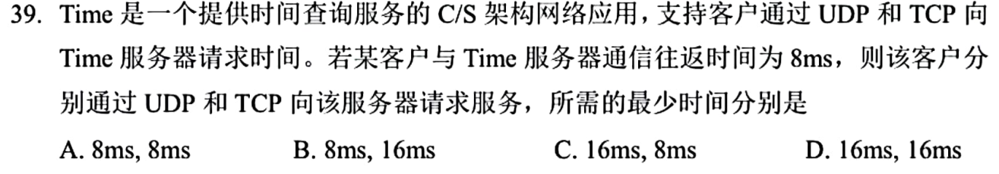

# 0907｜按事件算 TCP 建连、数据和关闭时间

[← Day 14](../day14.md) · [原题单](../../src/0907.md)

**本日指定 2 题。** 先写选项和一句依据，卡住再展开补学。

卡住先读：本组判据

第三次握手可附带请求。按窗口算发送轮次。主动关闭端发出最后 ACK 后等 2MSL。

## 01 · 2024-38

核对与补学（作答后展开）

**答案：D。** 建连至可发数据耗时1RTT。按题目采用的起始窗口1MSS，3个段分1+2两轮，耗时2RTT。主动关闭最短再花1RTT，随后等2MSL。合计60.04s。

## 02 · 2025-39

核对与补学（作答后展开）

**答案：B。** UDP请求和应答只花1RTT即8ms。TCP建连1RTT，第三次握手附请求，收到回应再花1RTT，共16ms。

## 离开前的一个检查

已建立连接的单次请求还要算建连吗？

检查答案

无需计入已结束的握手。

