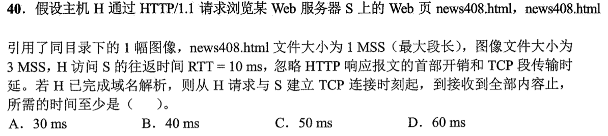
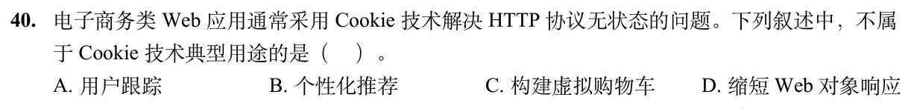

# 0908｜Web对象请求与 Cookie

[← Day 16](../day16.md) · [原题单](../../src/0908.md)

**本日指定 2 题。** 先写选项和一句依据，卡住再展开补学。

卡住先读：本组判据

先得到HTML，再请求它引用的对象。复用连接时仍要看拥塞窗口。

## 01 · 2022-40

核对与补学（作答后展开）

**答案：B。** 握手1RTT，HTML请求与1MSS响应1RTT。按本题参考解采用的初始1MSS慢开始，图像请求时窗口2MSS，3MSS图像分两轮，共4RTT=40ms。若题目另给足够大的发送窗口，图像可一轮发完，合计3RTT。

## 02 · 2026-40

核对与补学（作答后展开）

**答案：D。** Cookie可携带会话标识，用于跟踪、推荐和购物车。缩短对象响应依赖缓存与传输等机制。

## 离开前的一个检查

连接仍可复用，取同服务器的图像需重新握手吗？

检查答案

不需重新握手。

