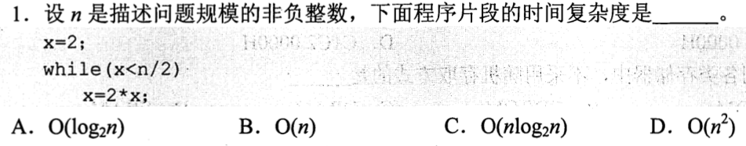
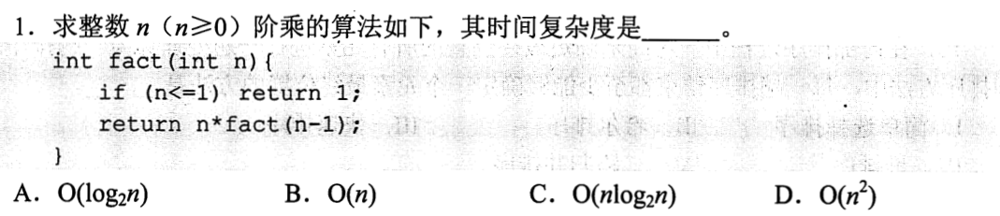
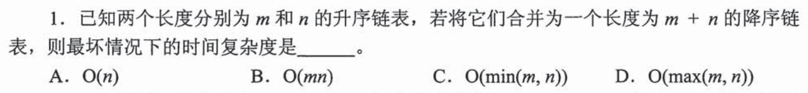
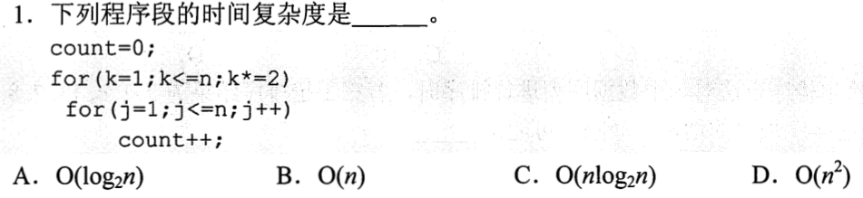
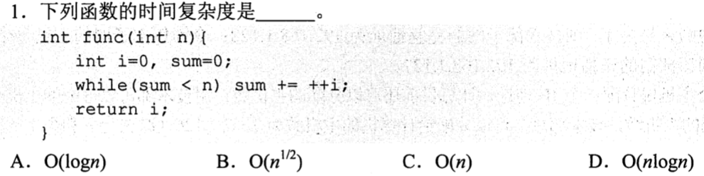
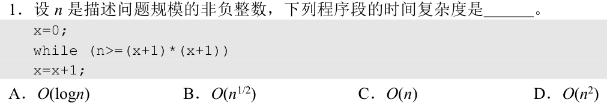
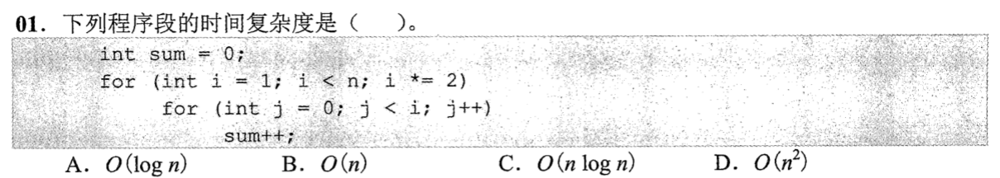
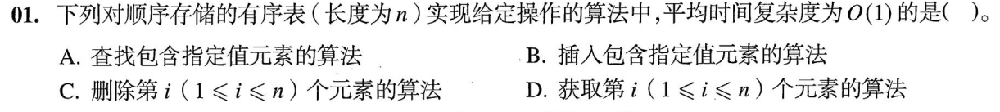
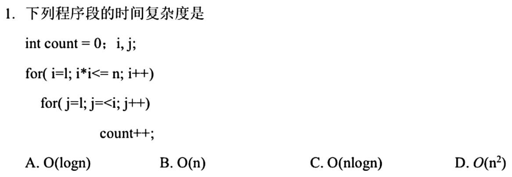

# 0731 Answer｜增长量级：从代码运行到复杂度

> 原题：[0731 题单](0731.md) · [考场路线与保底](0731-route.md) · 对照版本：[Sonnet版](0731-answer-sonnet.md) · [GPT版](0731-answer-gpt.md)
> 
> **能力线总览**：时间复杂度不是公式死记，而是输入规模 $n$ 怎样驱动代码中的“基本操作执行次数”增长。
> 本篇以严格的 **$i+1$ 能力生长链** 展开：
> 1. 单循环倍增（变量轨迹）$\to$
> 2. 递归调用链（调用次数而非返回值）$\to$
> 3. 无代码过程（按题干约束数操作）$\to$
> 4. 双层循环独立（何时可直接相乘）$\to$
> 5. 终止变量反解（谁在真正控制退出）$\to$
> 6. 代数边界反解（单步推进但条件带方次）$\to$
> 7. 双层循环关联（内层依赖外层必须逐轮求和，等比收敛）$\to$
> 8. 物理存储代价（操作 = 定位 + 搬移）$\to$
> 9. 综合熔铸（二次边界 + 等差求和，透视等差与等比的估算本质）。

---

<a id="q01"></a>
## 01 · 2011-01｜单变量循环：写出变量轨迹，数到达边界的步数



### 1. 能力承接与新台阶（$i \to i+1$）
* **已有能力（$i$）**：会读基础循环代码；知道时间复杂度只看核心语句随规模 $n$ 变大时的增长趋势，忽略常数系数与低阶项。
* **本题新增（$+1$）**：**写出关键变量的取值轨迹**，用初等数列规律反解出“执行多少轮到达终止边界”。

### 2. 草稿纸第一步
不要盯着 `while` 语法发呆，抓出驱动循环前进的核心语句 `x = 2 * x`，在草稿纸上写出变量 `x` 前几轮的具体数值：

```text
初始值: x = 2
第 1 轮后: x = 4 = 2^2
第 2 轮后: x = 8 = 2^3
第 3 轮后: x = 16 = 2^4
...
第 t 轮后: x = 2^(t + 1)
```

### 3. 机理推演
* **何时退出**：循环条件是 `x < n/2`，即当 $x \ge n/2$ 时退出。
* **代数反解**：
  $$2^{t+1} \ge \frac{n}{2} \implies t + 1 \ge \log_2\left(\frac{n}{2}\right) = \log_2 n - 1 \implies t \ge \log_2 n - 2$$
  执行轮数 $t$ 严格与 $\log_2 n$ 呈线性关系。因此时间复杂度为 $O(\log_2 n)$。

### 4. 选项裁决与陷阱拆解

| 选项 | 成立需要什么代码特征 | 题面证据 | 裁决 |
|---|---|---|---|
| **A. $O(\log_2 n)$** | 变量通过**固定乘法/除法**成倍逼近边界 | `x = 2 * x` 呈几何级数爆炸，只需对数步即达边界 | **正确** |
| **B. $O(n)$** | 变量通过**固定加法/减法**单步累进（如 `x++`、`x += 2`） | 本题是乘法，不是加法 | 错误 |
| **C. $O(n \log_2 n)$** | 外部存在一层规模为 $n$ 的循环包裹该对数循环 | 只有一个单层循环 | 错误 |
| **D. $O(n^2)$** | 两重均为线性规模的嵌套循环 | 只有一个单层循环 | 错误 |

> **考场陷阱**：
> 1. 看到边界写着 `n/2`，误以为“规模减半会改变增长量级”。
>    * **刹车信号**：在渐进分析中，常数因子不改变量级；在对数运算里，除以 2 只是减去常数 1（$\log_2(n/2) = \log_2 n - 1$），依然是 $O(\log n)$。
> 2. 只有当更新方式变成加法（`x = x + 2`）时，步数才是 $\frac{n/2}{2} = \frac{n}{4} = O(n)$。**量级由更新方式（乘还是加）决定，不由边界上的常数决定。**

---

<a id="q02"></a>
## 02 · 2012-01｜递归函数：数调用树的展开深度，不看返回值多大



### 1. 能力承接与新台阶（$i \to i+1$）
* **已有能力（$i$）**：沿用 01 的思想——将抽象过程落实为离散轨迹，并数核心动作的发生次数。
* **本题新增（$+1$）**：将“追踪循环变量”转变为“**展开递归调用链**”。明确区分：**函数的计算结果数值** $\neq$ **计算过程花费的时间**。

### 2. 草稿纸第一步
看到递归函数，草稿纸上立刻画出调用关系链（展开 3 层直到触碰基例）：

```text
fact(n)
  └─→ fact(n - 1)
        └─→ fact(n - 2)
              └─→ ...
                    └─→ fact(1)   [触发 n <= 1，开始逐层返回]
```

### 3. 机理推演
* **递归总时间计算模型**：
  $$\text{总时间} = \text{总递归调用次数} \times \text{单次调用内部自身的非递归工作量}$$
* **调用次数**：参数从 $n$ 每次严格递减 1 到达 1，是一条单链，没有分支分叉，调用深度共 $n$ 层。
* **单次开销**：每一次函数体内部，只执行了一次条件判断 `n <= 1`、一次减法 `n - 1`、一次乘法 `n * ...`，均是与输入规模无关的常数工作（$O(1)$）。
* **总开销**：$n \times O(1) = O(n)$。

### 4. 选项裁决与陷阱拆解

| 选项 | 成立需要什么结构 | 题面证据 | 裁决 |
|---|---|---|---|
| **A. $O(\log_2 n)$** | 递归参数规模每次折半（如 `fact(n/2)`） | 参数是 `n - 1`，步长为 1 | 错误 |
| **B. $O(n)$** | 递归调用呈无分叉的单链展开，深度正比于 $n$ | 每次只发起一个子调用，共 $n$ 层 | **正确** |
| **C. $O(n \log_2 n)$** | 分治法且每层需要线性合并（如归并排序） | 无分叉，单层开销仅为 $O(1)$ | 错误 |
| **D. $O(n!)$** | 每次调用产生 $n$ 个子分支的多路递归树（如全排列枚举） | 只有一条链 | 错误 |

> **考场陷阱**：
> * 很多初学者误选 **D**（$O(n!)$），原因在于脑海中知道“阶乘的值是 $n!$”，把**返回值的数学大小**与**执行该计算所花费的步数**混为一谈。
> * **刹车信号**：算 100 的阶乘，代码只需要做 100 次乘法，而不是做 $100!$ 次运算！时间复杂度度量的是计算机 CPU 执行了多少条指令，不是变量存了多大的数。

---

<a id="q03"></a>
## 03 · 2013-01｜无代码题目：顺着题干约束，在草稿上拼装最小操作流



### 1. 能力承接与新台阶（$i \to i+1$）
* **已有能力（$i$）**：会计算明确代码片段的步数（01/02）。
* **本题新增（$+1$）**：**面对没有现成代码的纯文本算法题**，如何根据题设的输入性质与目标要求，还原出完成任务所需的最优操作流，并评估“最坏情况”。

### 2. 草稿纸第一步
拆解题干关键词，顺着信息流入的顺序推演：
1. **两个递增有序链表**（长分别为 $m$ 和 $n$）：已各自排好序。这意味着两表各自的当前最小节点一定就在各自的表头，无需全局扫描找最小值。
2. **合并为一个递减有序链表**：输出需要逆序（从大到小）。
3. **最坏情况**：两链表的数据交替出现，无法提前跳过整段。

在草稿纸上模拟一组极小实例（例如表 A: `1 -> 3 -> 5`，表 B: `2 -> 4`）：

```text
比较 A 头 (1) 与 B 头 (2) → 选出较小者 1
将 1 置入新链表；

比较 A 头 (3) 与 B 头 (2) → 选出较小者 2
若要结果递减，如何处理新挑出的 2？
→ 使用【头插法】：把 2 插入到 1 的前面，新链表变为：2 -> 1
```

### 3. 机理推演
* **如何实现“递减”**：
  * 从两个升序链表中逐次挑出**当前最小值**；
  * 将挑选出来的最小值通过**头插法**插入到结果链表前端；
  * 头插法只需修改新节点的 `next` 指针，耗时严格为 $O(1)$；
  * 整个归并过程走完，越晚挑出的大数越排在前面，自然形成递减有序链表！无需任何额外排序或翻转。
* **总步数评估**：
  * 每比较一次，至少将一个节点移入新表；
  * 最坏情况下，两表的所有节点都需要参与比较与移动，总操作节点数为 $m + n$；
  * 每一个节点的操作开销均为常数 $O(1)$，总耗时与 $m + n$ 成正比。
* **为什么选项表述为 $O(\max(m, n))$**：
  * 数学夹逼：$\max(m, n) \le m + n \le 2 \max(m, n)$；
  * $m + n$ 与 $\max(m, n)$ 在渐进意义下阶数完全相同。

### 4. 选项裁决与陷阱拆解

| 选项 | 对应了什么错误思路 | 事实依据 | 裁决 |
|---|---|---|---|
| A. $O(m)$ | 认为只取决于其中一个链表 | 两个链表的节点全部要处理 | 错误 |
| B. $O(n)$ | 同上 | 同上 | 错误 |
| C. $O(m \times n)$ | 误以为合并需要两重暴力循环（类似于未排序双重比对） | 双指针归并只需要单趟扫描 | 错误 |
| **D. $O(\max(m, n))$** | 两个有序链表两路归并的标准代价为 $m + n$ | $m + n$ 与 $\max(m, n)$ 同阶 | **正确** |

> **考场陷阱**：
> 1. 被“递减”吓住：以为升序变降序需要先归并再把整个链表反转一遍，甚至以为需要用插入排序反复后移。
>    * **破解机制**：链表头插法天然自带逆序功能且开销仅为 $O(1)$。
> 2. 误判最坏情况：以为只要一个链表空了就结束，错猜 $O(\min(m, n))$。
>    * **注意**：剩下的那个较长链表，其余元素依然需要逐个取下、头插接入新表中，不可能“瞬间完成”。

---

<a id="q04"></a>
## 04 · 2014-01｜双层嵌套循环：何时可以直接将外层与内层相乘



### 1. 能力承接与新台阶（$i \to i+1$）
* **已有能力（$i$）**：掌握 01 中乘法倍增循环的对数步数判定；掌握基本循环的计数方式。
* **本题新增（$+1$）**：**双层嵌套循环的复杂度解耦条件**——什么时候可以直接用“外层轮数 $\times$ 内层轮数”？

### 2. 草稿纸第一步
检查内层循环的初始化、步进与终止条件：

```c
for (k = 1; k <= n; k *= 2)   // 外层：k 倍增
    for (j = 1; j <= n; j++)  // 内层：j 从 1 步进到 n
        count++;
```

**关键观察**：内层循环的边界是 `j <= n`，初始化是 `j = 1`。**内层执行的次数完全不含外层变量 `k`！**

### 3. 机理推演
* **内层独立性**：无论外层 `k` 此时等于 1、2、4 还是 $2^t$，内层循环每次都雷打不动地从 1 执行到 $n$，每轮净跑 $n$ 次。
* **外层轮数（复用 01 的结论）**：
  $$k = 1, 2, 4, 8, \dots, 2^t \le n \implies t \approx \lfloor \log_2 n \rfloor$$
  外层共执行约 $\log_2 n + 1$ 轮。
* **相乘法则的成立条件**：
  $$\text{总次数} = \sum_{\text{外层}} (\text{内层执行次数}) = \sum_{t=0}^{\log_2 n} n = (\log_2 n + 1) \times n = O(n \log_2 n)$$
  因为内层每轮耗时恒为常值 $n$，可以将内层开销提到求和号外，直接做乘法。

### 4. 选项裁决与陷阱拆解

| 选项 | 成立条件 | 题面证据 | 裁决 |
|---|---|---|---|
| A. $O(\log_2 n)$ | 只有一个对数循环，或内层只有常数次 | 内层每轮跑 $n$ 次 | 错误 |
| B. $O(n)$ | 只有一个单层线性循环 | 外层有 $\log_2 n$ 轮 | 错误 |
| **C. $O(n \log_2 n)$** | 外层对数轮，内层各独立执行线性 $n$ 轮 | 外层倍增 $\times$ 内层与外层无关的单步步进 | **正确** |
| D. $O(n^2)$ | 外层线性 $n$ 轮且内层线性 $n$ 轮 | 外层是 `k *= 2`，不是 `k++` | 错误 |

> **考场陷阱**：
> * 见到两层嵌套 `for`，甚至不看循环变量的步进方式，就凭第一眼印象蒙一个 $O(n^2)$。
> * **判断铁律**：看嵌套循环必须看两件事：① 外层变量怎么变（加法还是乘法）；② 内层循环的边界里**带不带外层变量**。

---

<a id="q05"></a>
## 05 · 2017-01｜终止条件反解：谁在真正决定循环停下



### 1. 能力承接与新台阶（$i \to i+1$）
* **已有能力（$i$）**：列变量轨迹（01）；区分计算量与语法表面形态（02/04）。
* **本题新增（$+1$）**：**识别“假象步进”与“真实终止变量”**。代码中虽然有变量在做单步加一，但决定循环何时终止的另有其人。

### 2. 草稿纸第一步
审视 `while (sum < n) sum += ++i;`。
* 步进看起来是 `++i`（容易联想到单步加一）；
* 但守卫循环大门的是 `sum < n`！
草稿纸上并排记录每轮执行完毕后，`i` 和 `sum` 的真实变化情况：

```text
初始:   i = 0, sum = 0
第 1 轮: i = 1, sum = 1
第 2 轮: i = 2, sum = 1 + 2 = 3
第 3 轮: i = 3, sum = 1 + 2 + 3 = 6
第 4 轮: i = 4, sum = 1 + 2 + 3 + 4 = 10
...
第 t 轮: i = t, sum = 1 + 2 + 3 + ... + t
```

### 3. 机理推演
* **求和公式**：经过 $t$ 轮后，变量 `sum` 的值为等差数列前 $t$ 项和：
  $$\text{sum} = \frac{t(t + 1)}{2} \approx \frac{t^2}{2}$$
* **反解轮数 $t$**：循环在 $\text{sum} \ge n$ 时停下：
  $$\frac{t^2}{2} \ge n \implies t^2 \ge 2n \implies t \approx \sqrt{2n} = O(\sqrt{n})$$
* **复杂度结论**：整个函数总共循环了 $t$ 轮，单轮是 $O(1)$ 的加法，总时间为 $O(\sqrt{n})$（题面中写作 $O(n^{1/2})$）。

### 4. 选项裁决与陷阱拆解

| 选项 | 诱惑来源 | 真实矛盾 | 裁决 |
|---|---|---|---|
| A. $O(\log n)$ | 误以为逼近速度很快 | `sum` 增长是二次方累加，非指数爆炸 | 错误 |
| **B. $O(n^{1/2})$** | 反解二次累加终止条件 $\frac{t^2}{2} \approx n$ | 轮数 $t \approx \sqrt{2n}$ | **正确** |
| C. $O(n)$ | 看到 `++i` 就以为是线性加法，以为循环执行了 $n$ 轮 | 控制退出的不是 `i < n`，而是累加后的 `sum < n` | 错误 |
| D. $O(n \log n)$ | 毫无根据的猜测 | 单重循环无法产生该量级 | 错误 |

> **考场陷阱**：
> * 很多考生秒选 C（$O(n)$），因为潜意识里把 `while` 后的条件看成了 `i < n`。
> * **刹车信号**：只要条件里的变量不是循环每轮加 1 的那个简单计数器，就必须停下来，写出条件变量关于轮数 $t$ 的表达式再求解！

---

<a id="q06"></a>
## 06 · 2019-01｜代数边界反解：单步步进但终止条件自带方次



### 1. 能力承接与新台阶（$i \to i+1$）
* **已有能力（$i$）**：掌握 05 中从终止条件反解执行轮数的方法。
* **本题新增（$+1$）**：05 的非线性来自于变量累加求和（$\sum i$）；本题变量依然是极其纯粹的**单步加一（`x = x + 1`）**，但**判断条件本身直接给出了代数多项式关系**。

### 2. 草稿纸第一步
写出 $t$ 轮循环后，变量 `x` 的值：

```text
初始:    x = 0
第 1 轮后: x = 1
第 2 轮后: x = 2
...
第 t 轮后: x = t
```

### 3. 机理推演
* **代入终止条件**：
  循环条件是 `n >= (x + 1) * (x + 1)`。
  循环持续的条件为：$(t + 1)^2 \le n$。
  循环退出的临界点为：$(t + 1)^2 > n$。
* **解不等式**：
  $$t + 1 > \sqrt{n} \implies t > \sqrt{n} - 1$$
* **执行次数**：
  循环执行的总步数 $t = \lfloor \sqrt{n} \rfloor = O(\sqrt{n})$（即 $O(n^{1/2})$）。

### 4. 选项裁决与陷阱拆解

| 选项 | 常见错误心态 | 为什么不成立 | 裁决 |
|---|---|---|---|
| A. $O(\log n)$ | 觉得开方增长慢，错联想成对数 | 对数是几何翻倍，此处是代数开方 | 错误 |
| **B. $O(n^{1/2})$** | 严谨将 $x=t$ 代入代数式反解 $t$ | $t \approx \sqrt{n}$ | **正确** |
| C. $O(n)$ | 看到循环体内仅有 `x = x + 1`，草率断定是线性 | 步进虽是 1，但跑不到 $n$ 步就因平方超出边界提前退出 | 错误 |
| D. $O(n^2)$ | 看到代码里有 `(x+1) * (x+1)` 的乘方，条件反射选平方 | 平方是放在条件左边做开方限制，不是把循环拉长到 $n^2$ | 错误 |

> **方法对照（05 vs 06）**：
> * **05（累加开方）**：变量本身单步加 1，但每轮把历史值累加起来，总和自然膨胀为 $\approx t^2/2$，在 $\text{sum} \ge n$ 时停下。
> * **06（代数开方）**：变量不做历史累加，但在门槛处通过自乘 $(t+1)^2$ 放大，同样在到达 $n$ 时停下。
> * 两者殊途同归，本质都是在求解方程 $t^2 \sim n$ 的正根 $t \sim \sqrt{n}$。

---

<a id="q07"></a>
## 07 · 2022-01｜双层关联循环：内层依赖外层，必须逐轮求和（等比收敛）



### 1. 能力承接与新台阶（$i \to i+1$）
* **已有能力（$i$）**：04 解决了“双层循环彼此无关时可直接相乘”；01 掌握了倍增序列 $1, 2, 4, 8, \dots$ 的特征。
* **本题新增（$+1$）**：**内层循环的上界直接依赖外层循环变量（`j < i`）！此时绝对不可直接做乘法，必须逐轮列出内层开销并求和。**

### 2. 草稿纸第一步
观察两层循环的关系：
* 外层：`for (int i = 1; i < n; i *= 2)` $\implies i$ 经历倍增序列 $1, 2, 4, 8, \dots$
* 内层：`for (int j = 0; j < i; j++)` $\implies$ 当外层为 $i$ 时，内层执行的次数恰好是 **当时的 $i$ 次**！

在草稿纸上逐轮对应：

```text
外层轮次:   第 1 轮    第 2 轮    第 3 轮    第 4 轮    ...   最后一轮
i 的取值:     1         2         4         8        ...      L
内层执行:     1 次      2 次      4 次      8 次     ...      L 次
```
其中最后一项 $L$ 是严格小于 $n$ 的最大 2 的整数次幂（满足 $n/2 \le L < n$）。

### 3. 机理推演
* **求总执行次数**：总次数 $S$ 是所有轮次内层次数的总和：
  $$S = 1 + 2 + 4 + 8 + \dots + L$$
* **等比数列求和的本质**：
  这是一个公比为 2 的等比数列。由等比求和公式：
  $$S = \frac{1 \cdot (2^{\text{项数}} - 1)}{2 - 1} = 2L - 1$$
* **量级定界**：
  因为循环条件是 $i < n$，所以最后一项 $L < n$。
  代入得：
  $$S = 2L - 1 < 2n$$
  总执行次数被 $2n$ 牢牢封顶，且 $L \ge n/2$，故 $S > n - 1$。
  因此，$S$ 严格处于 $n - 1$ 到 $2n$ 之间，时间复杂度是极其干净的 **$O(n)$**！

### 4. 选项裁决与陷阱拆解

| 选项 | 错误路线拆解 | 漏洞所在 | 裁决 |
|---|---|---|---|
| A. $O(\log n)$ | 误以为既然外层只有 $\log n$ 轮，总时间就是对数级 | 忽视了内层随 $i$ 膨胀的工作量 | 错误 |
| **B. $O(n)$** | 正确识别等比求和，最后一项占统治地位：$S = 2L - 1 < 2n$ | 执行总次数严格受 $2n$ 约束 | **正确** |
| C. $O(n \log n)$ | **最强诱惑项**：直接拿“外层轮数 $\log n$”乘上“内层最大可能次数 $n$” | **偷换前提**：只有每轮都跑满 $n$ 才能相乘；本题前期轮次极小（1, 2, 4），绝不能按峰值算满 | 错误 |
| D. $O(n^2)$ | 毫无根据的盲目猜测 | 远远达不到二次方 | 错误 |

> **深度剖析：为什么相乘会错？**
> * 很多同学在考场选了 **C**（$O(n \log n)$），心想：“外层跑了 $\log n$ 圈，内层最大跑到 $n$，那不就是 $n \log n$ 吗？”
> * **错在哪里？**：
>   只有当内层**每一圈**都执行 $n$ 次时（如同 04 题），总和才是 $n \log n$。
>   在等比数列中，**最后一项的大小就超过了前面所有项之和**！
>   $1 + 2 + 4 + \dots + 64 = 127$；前面的所有开销加在一起，还没有最后两项大。
>   因此，总和始终被最大项 $L$ 控制在同数量级，绝不会额外多出一个 $\log n$ 因子。

---

<a id="q08"></a>
## 08 · 2023-01｜物理存储特性：一个完整操作 = 定位代价 + 搬移代价



### 1. 能力承接与新台阶（$i \to i+1$）
* **已有能力（$i$）**：03 建立了在数据结构上数基本操作的能力。
* **本题新增（$+1$）**：**顺序存储结构（数组）的本质物理特征**。建立解题铁律：**评估数据结构上的操作代价，必须拆解为“定位”与“后继搬移/更新”两段**。

### 2. 草稿纸第一步
回顾顺序表在内存中的存储本质：一片连续的内存块。
* **物理寻址公式**：
  $$\text{第 } i \text{ 个元素的内存地址} = \text{起始基地址} + (i - 1) \times \text{单个元素所占字节数}$$
* 这是一次极其纯粹的乘法与加法计算，无论整个表里有 10 个还是 10 亿个元素，CPU 算出一个地址所需的时间完全相同（$O(1)$ 随机存取）。

### 3. 机理推演（四选项逐一拆解）

我们对顺序表上的四个典型操作进行两段式拆解：

| 选项与操作 | 第一段：定位代价 | 第二段：维持结构特性的搬移代价 | 总时间复杂度 | 是否满足 $O(1)$ |
|---|---|---|---|:---:|
| **A. 有序顺序表中查找给定值** | 有序表可折半查找：需 $O(\log n)$ 步比对 | 纯读操作，无搬移（0 步） | $O(\log n)$ | 否 |
| **B. 有序顺序表中插入给定值** | 折半查找插入位置：$O(\log n)$ | **致命瓶颈**：为保持后续连续，插入点之后的元素必须整体后移一位，平均搬移 $\frac{n}{2}$ 个元素（$O(n)$） | $O(n)$ | 否 |
| **C. 顺序表中删除第 $i$ 个元素** | 通过下标直接算地址：$O(1)$ | **致命瓶颈**：删掉后留出空洞，必须将第 $i+1$ 到第 $n$ 个元素整体前移填补，平均搬移 $\frac{n - 1}{2}$ 个元素（$O(n)$） | $O(n)$ | 否 |
| **D. 顺序表中访问第 $i$ 个元素** | 通过下标直接算地址：$O(1)$ | 纯读操作，不需要任何数据搬移（0 步） | **$O(1)$** | **是** |

### 4. 考场陷阱与反思
* **陷阱 1（误选 C）**：“既然题目说删除第 $i$ 个元素，位置已经直接通过 $i$ 给定了，不用花时间找，那不就是 $O(1)$ 吗？”
  * **刹车信号**：定位只花 $O(1)$，但顺序表的铁律是**物理空间必须紧密相连**。你把中间抽走一个人，后面所有人必须往前挪动一个座位！挪座位的代价是 $O(n)$。
* **陷阱 2（关于“有序”的迷思）**：“有序”二字只在**按值查找**时有用（让线性查找优化为折半查找 $O(\log n)$）；对于按位访问没有帮助，更救不了插入删除时的大规模物理搬移。
* **横向对比**：如果本题换成**单链表**：
  * 访问第 $i$ 个：必须从头指针顺藤摸瓜数 $i$ 次，是 $O(n)$；
  * 删除已知指针所指节点：只需修改指针指向，无需搬移数据，是 $O(1)$。

---

<a id="q09"></a>
## 09 · 2025-01｜综合融会：代数边界截断 + 依赖外层的等差求和



### 1. 能力承接与新台阶（$i \to i+1$）
* **已有能力（$i$）**：
  * 06 的代数终止条件反解（$i^2 \le n$ 限制循环轮数）；
  * 07 的内层依赖外层（必须逐轮展开求和）。
* **本题新增（$+1$）**：**将代数边界与关联求和融为一体**，并透彻理解：**为什么等差分布可以粗估，而等比分布绝不能粗估？**

### 2. 草稿纸第一步
观察两层循环的代码结构：
```c
int sum = 0;
for (int i = 1; i * i <= n; i++)
    for (int j = 1; j <= i; j++)
        sum++;
```
1. **外层轮数边界**：条件是 `i * i <= n`，步长是 `i++`。
   由 06 的代数反解法可知：$i$ 从 1 遍历到 $m = \lfloor \sqrt{n} \rfloor$。外层共执行约 $\sqrt{n}$ 轮。
2. **内层单轮次数**：条件是 `j <= i`，说明第 $i$ 轮时，内层恰好执行 $i$ 次。

在草稿纸上列出各轮对应表：

```text
外层 i:    1    2    3    4    ...    m (其中 m = ⌊√n⌋)
内层执行:  1    2    3    4    ...    m
```

### 3. 机理推演
* **求总执行次数**：
  $$S = \sum_{i=1}^{m} i = 1 + 2 + 3 + \dots + m = \frac{m(m + 1)}{2}$$
* **代入 $m \approx \sqrt{n}$**：
  $$S = \frac{\sqrt{n}(\sqrt{n} + 1)}{2} = \frac{n + \sqrt{n}}{2} = \frac{1}{2}n + \frac{1}{2}\sqrt{n}$$
* **主导项判定**：随着 $n \to \infty$，常数系数 $\frac{1}{2}$ 和低阶项 $\frac{1}{2}\sqrt{n}$ 均被忽略，整体增长量级为 **$O(n)$**（选 B）。

### 4. 深度对比：为什么 09 可以粗算，而 07 粗算必错？

在很多考研辅导中，常有人用“轮数 $\times$ 最大一轮”直接估算复杂度。
让我们把 07 题与 09 题放在一张解剖台上做一次最深刻的横向对照：

| 对比维度 | 07 · 2022-01 | 09 · 2025-01 |
|---|---|---|
| **各轮内层执行次数序列** | $1, 2, 4, 8, \dots, n$（**等比级数**） | $1, 2, 3, 4, \dots, \sqrt{n}$（**等差级数**） |
| **总轮数** | $\log_2 n$ 轮 | $\sqrt{n}$ 轮 |
| **最后一轮的最大开销** | 约 $n$ 次 | 约 $\sqrt{n}$ 次 |
| **粗暴相乘（轮数 $\times$ 最大项）** | $\log_2 n \times n = \mathbf{n \log_2 n}$ | $\sqrt{n} \times \sqrt{n} = \mathbf{n}$ |
| **实际数学求和真实值** | $\sum 2^k \approx \mathbf{2n}$ | $\sum i \approx \mathbf{\frac{1}{2}n}$ |
| **粗暴相乘的结果对错** | **彻底错误（虚高了一个 $\log n$ 量级）** | **恰好同阶（真实值只是粗乘的一半）** |

#### 为什么会有这种本质区别？
1. **等差数列（09 题）**：数据是均匀铺开的。
   * 序列的“平均值”等于首项加末项除以二，也就是最大项的 $\frac{1}{2}$；
   * 平均值与最大项是**同一数量级**的常数倍关系（$\frac{1}{2}$ 倍）；
   * 所以用“轮数 $\times$ 最大项”只会多估出 2 倍，在渐进复杂度记号 $O(\cdot)$ 抹掉常数后，**结果碰巧依然正确**。
2. **等比数列（07 题）**：数据是极端头轻脚重的。
   * 绝大部分项都在底部的微小数值徘徊（1, 2, 4, 8...），整个数列的均值极其微小；
   * 真正能达到 $n$ 数量级的，全世界只有最后那么一两项；
   * 如果给所有 $\log n$ 轮都强行按最大项 $n$ 算满，就相当于把整个序列凭空拔高了 $\log n$ 倍，导致量级直接爆炸升阶！

> **考场终极准则**：
> 凡是遇到“内层循环上界带外层变量”的题目，**永远不要投机取巧直接相乘**。
> 花 10 秒钟在草稿纸上把前 3 轮写出来：
> * 若是加法步进（等差），总和与“项数 $\times$ 末项”同阶；
> * 若是翻倍步进（等比），总和直接被“末项”封顶收敛；
> 按规律老老实实求一次和，永远不会被命题人的陷阱捕获。

---

### 本篇收官：从 0731 带走的解题肌肉记忆

做完这九道题，我们已经完成了从“猜代码复杂度”到“严格推演操作量”的能力跃迁：

1. **第一笔永远写轨迹**：把循环变量或递归调用的前 3 步写在草稿纸上（01、02）；
2. **终止由真实控制变量决定**：步进是加法还是乘法？终止条件是直接比较还是带平方/求和？反解该变量才是真实的循环轮数（05、06）；
3. **两层循环先看耦合度**：
   * 内层无关，外层轮数 $\times$ 内层轮数直接相乘（04）；
   * 内层相关，列出各轮老实求和：等比数列看最后一项封顶（07），等差数列看均值同阶（09）；
4. **数据结构看物理开销**：把操作切分成“定位”和“维持特性的搬移”两段分别评估，不被“已知位置”或“已排序”等局部有利条件蒙蔽（03、08）。
