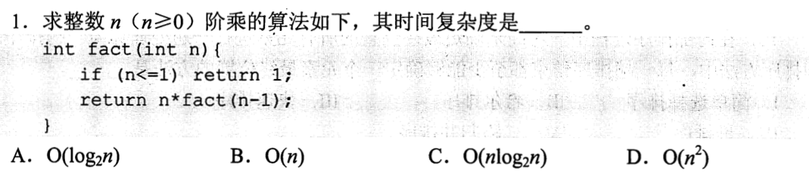
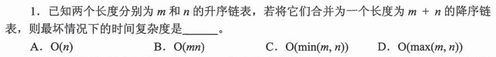
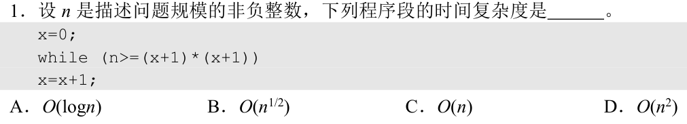
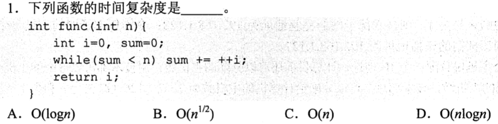
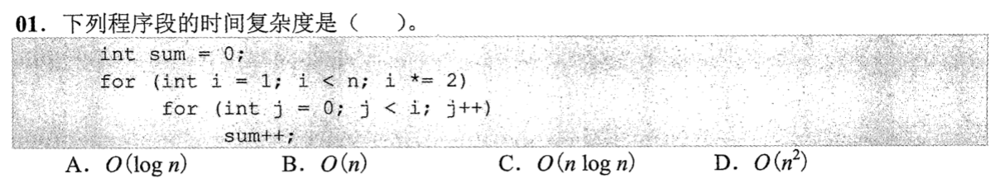
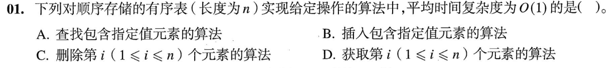
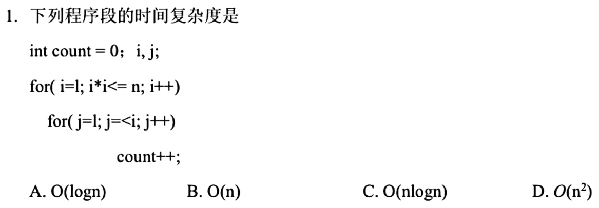
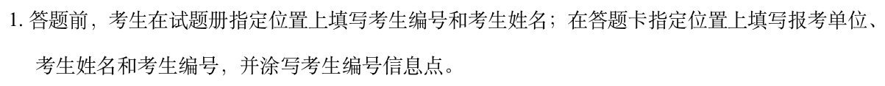

# 0731｜时间复杂度：循环执行次数

> 这组题直接分成两截：
> 前面是**快速拿分题**，单变量乘除或简单加减，扫一眼 30 秒选完走人；
> 后面是**耗时攻坚题**，很会套壳子伪装，别光靠眼睛看，草稿纸代个数字算两步，防止手滑翻车。

---

## 一、 快速拿分题（扫一眼定答案）

### 01 · 2012-01
> *单路递归，每层规模减一，递归树就是一条单链，复杂度就是 $O(n)$。*

### 02 · 2013-01
> *内层循环变量直接平方逼近 $n$，开方就是 $\sqrt{n}$，带进外层直接出结果。*

### 03 · 2019-01
> *虽然循环体里有分支判断，但核心变量是以乘除方式翻倍跳步，依然是对数级。*

---

## 二、 耗时攻坚题（伪装很深，代入小数字验算）

### 04 · 2017-01
> *调和级数典型。外层加一，内层步长受外层控制（$j += i$），内层每轮步数是 $n/i$，累加起来是 $O(n\log n)$。*

### 05 · 2022-01
> *大坑题！外层在翻倍，内层跟着外层跑，表面很像 $O(n\log n)$。真拿草稿纸写一下 $1+2+4+\dots+n \approx 2n$，其实是 $O(n)$！*

### 06 · 2023-01
> *内外层变量互相制约，看清两变量谁先撞到边界。*

### 07 · 2025-01
> *最新压轴。多条件联合退出，结合了遍历片段，按最坏情况走一遍。*

### 08 · 2026-01
> *顺序表相对次序保持不变，表头插入或删除需要把后面所有元素挨个后移或前移，必定移动多个元素；表尾操作若未满直接读写，无需移动。*

