# 0801｜位置关系：指针、下标与压缩存储

> 这组题直接分成两截：
> 前面是**快速拿分题**，链表指针调整和存储概念，按部就班连线 30 秒搞定；
> 后面是**耗时攻坚题**，矩阵压缩和地址换算，千万别心算公式，在草稿纸上代入特殊值校验基准下标，稳拿计算分。

---

## 一、 快速拿分题（连指针看图秒选）

### 01 · 2016-01
> *单链表顺藤摸瓜，从头结点地址开始顺着 next 链找第 3 个结点，纯送分。*
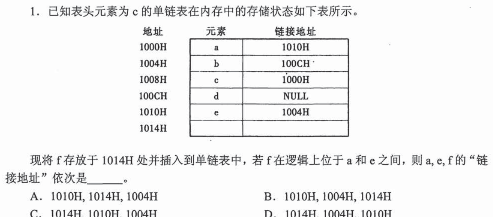

### 02 · 2016-02
> *双向循环链表头尾插入，先连新结点的两条腿，再改两边旧结点的指针，顺序别搞反。*
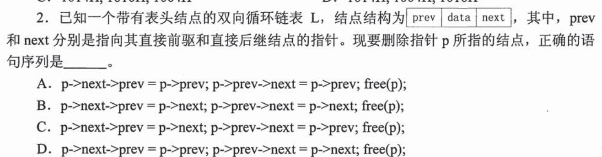

### 03 · 2017-03
> *稀疏矩阵存储结构：顺序用三元组表，链式用十字链表，纯概念送分。*
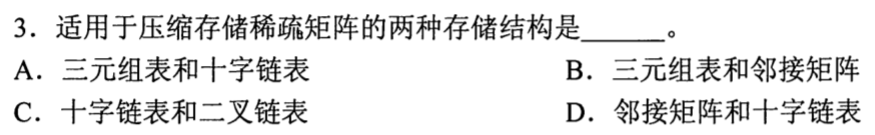

### 04 · 2021-01
> *循环单链表删首结点：头结点的后继指向被删结点的下一个，如果被删的是尾结点注意更新尾指针。*
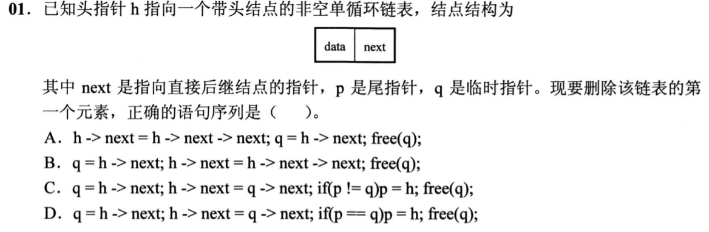

### 05 · 2023-02
> *双向链表结点插入四步法，先让新结点的前驱后继到位，再修改原有相连指针。*
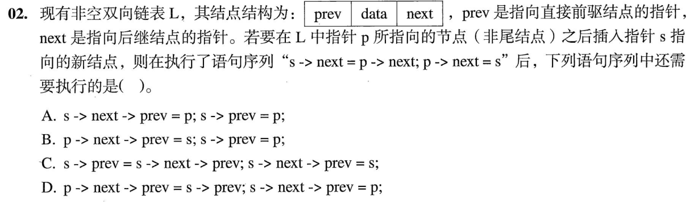

### 06 · 2023-03
> *三元组表只记了非零元坐标和数值，想要还原完整矩阵，行数、列数、非零元总数一个都不能少。*
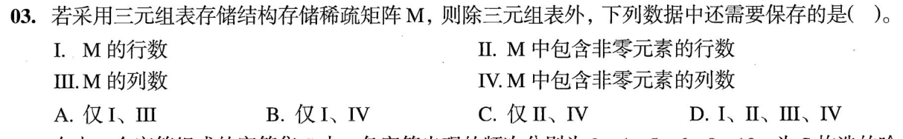

### 07 · 2024-01
> *单链表遍历指针操作，老老实实拿笔画两个结点模拟一遍指针移动，防止眼花。*
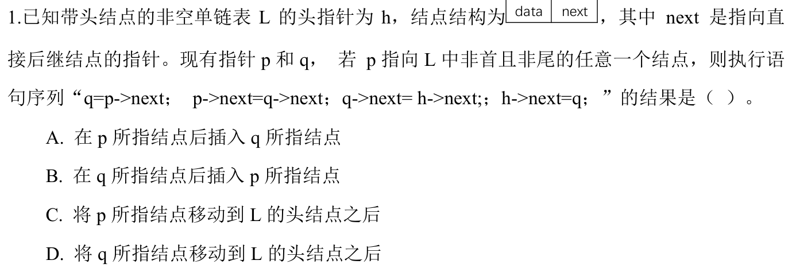

---

## 二、 耗时攻坚题（矩阵压缩与地址折算，草稿纸代小值验证）

### 08 · 2013-01
> *边比较边头插合成降序链表，最坏情况要比 $m+n-1$ 次，时间复杂度 $O(m+n)$。*
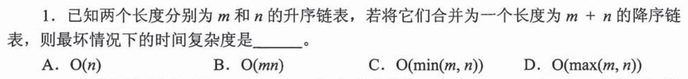

### 09 · 2016-04
> *三对角矩阵压缩：第一行 2 个，中间每行 3 个。不要硬背公式，代入第一行第二行验证下标基准。*
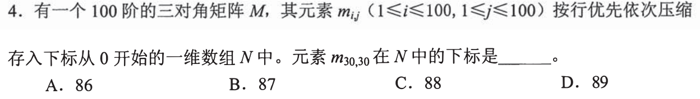

### 10 · 2018-03
> *对称矩阵上三角行优先存：第 $i$ 行有 $12-i+1$ 个元素，前面行数等差数列求和，算完代 $i=1, j=1$ 校验。*
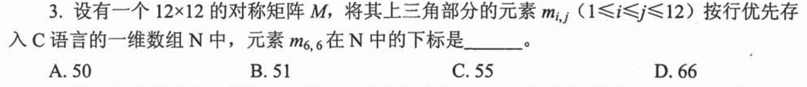

### 11 · 2020-01
> *看清是**列优先**！上三角矩阵按列存，第 $j$ 列正好有 $j$ 个元素，累加前 $j-1$ 列加行偏移，比行优先还好算。*
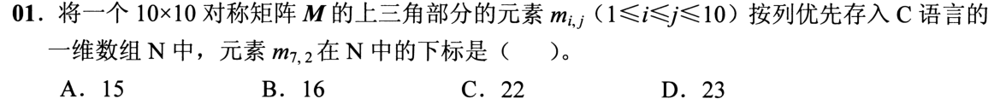

### 12 · 2021-03
> *二维数组行优先：用已知两点地址列二元一次方程算出每行元素数，再求目标地址，稳扎稳打。*
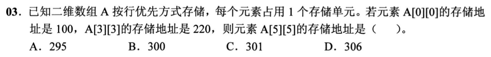

### 13 · 2026-01
<!-- 2026 压轴题位，已在 paper_html/408-2026.html 就绪 -->

### 14 · 2026-02
<!-- 2026 压轴题位，已在 paper_html/408-2026.html 就绪 -->
