# 0802｜受限容器：栈与队列的状态推进

> 这组题直接分成两截：
> 前面是**快速拿分题**，出栈序列判定和中缀转后缀，记住“先进后出”核心规则扫一眼秒选；
> 后面是**耗时攻坚题**，受限双端队列、混合容器重排以及带容量上限推演，别凭空脑补，在草稿纸上画桶老实走两步。

---

## 一、 快速拿分题（规则焊死，扫一眼秒选）

### 01 · 2011-02
> *出栈序列经典：压在栈底的元素出来时只能逆序出，不可能违背先进后出。*
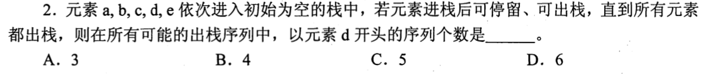

### 02 · 2013-02
> *第一个出栈是 3，说明 1、2 此时还在栈里压着；下一个出来的要么是 2，要么是新进来的 4，其他都不可能。*
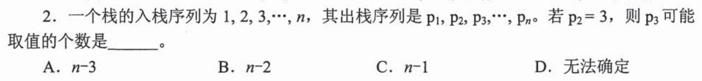

### 03 · 2017-02
> *尾递归或单向循环直接用循环改写即可，不一定非要用栈；概念题抓住反例秒杀。*
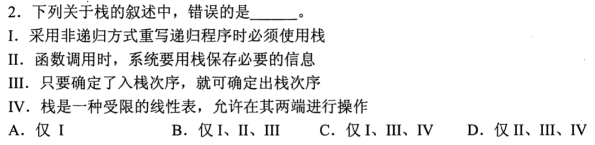

### 04 · 2020-02
> *Push 和 Pop 状态逐步推演，按题目顺序画个小桶压入弹出，半分钟定答案。*
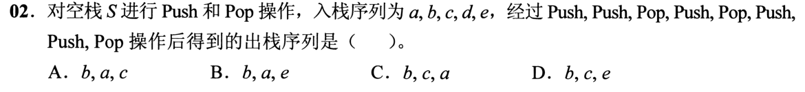

### 05 · 2024-02
> *中缀转后缀：画出简单二叉表达式树后序遍历，或者按运算符优先级顺手一写，送分题。*
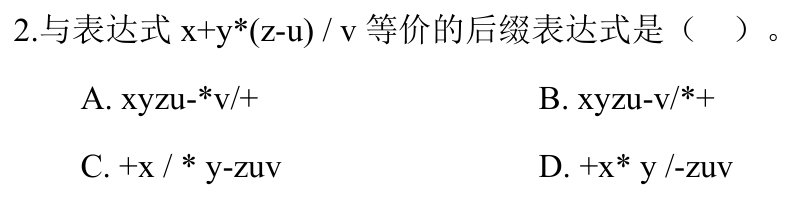

---

## 二、 耗时攻坚题（受限队列与容量边界，草稿纸模拟推演）

### 06 · 2010-01
> *加了“不允许连续三次退栈”的约束，把各选项写出 push/pop 序列，数一数有没有连着 3 个 pop。*
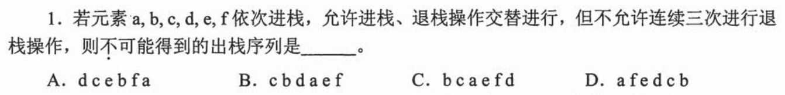

### 07 · 2010-02
> *受限双端队列（两端可入，单端可出），老老实实在草稿纸上模拟两头塞元素的过程，别靠心算硬猜。*
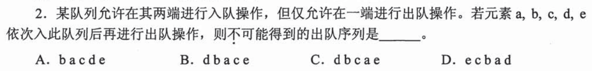

### 08 · 2015-01
> *递归工作栈深度：画出单路递归展开链，最深的递归嵌套层数加上主函数帧就是工作栈最大深度。*
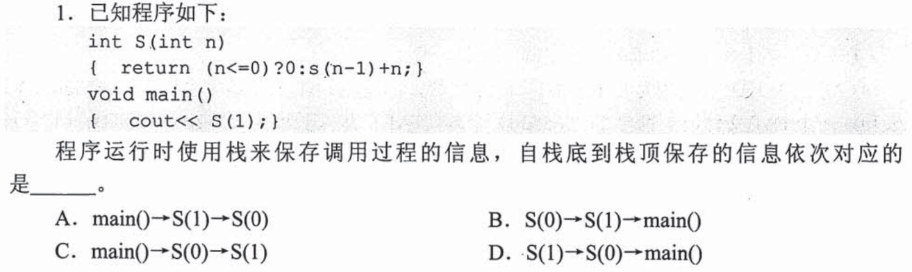

### 09 · 2016-03
> *列车轨道重排本质是并联栈分配，每条轨道内部必须单调，看最少需要几条轨道才能保证整体有序。*
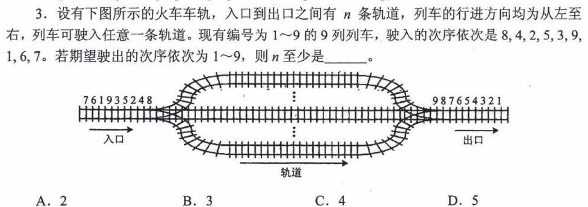

### 10 · 2018-01
> *双栈协同算符优先：看清操作数弹出的先后顺序，减法和除法千万别把左右操作数搞颠倒。*
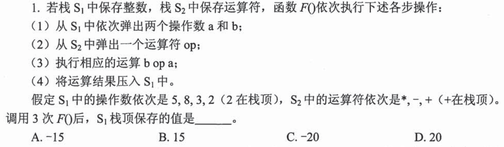

### 11 · 2018-02
> *栈与队列混合倒腾，分清谁是 FIFO 谁是 LIFO，草稿纸上画两行走一遍。*
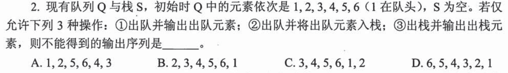

### 12 · 2021-02
> *一端仅能入队，另一端既能入又能出。抓住唯一能出队的那一端推导各元素何时现身。*
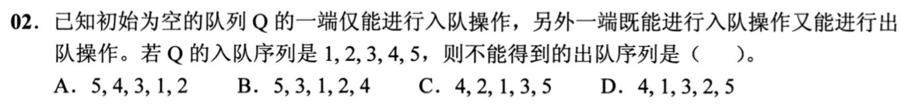

### 13 · 2022-02
> *符号排列进出栈判定，找准是否存在类似 $i < j < k$ 但出栈却变成 $k$ 先出紧接着 $i$ 出而 $j$ 卡在中间的非法模式。*
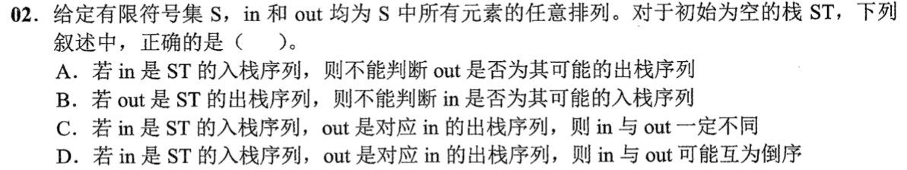

### 14 · 2025-02
> *带栈容量上限（容量为 3）的括号匹配！遇到左括号入栈，栈深一旦达到 4 立即溢出崩溃。*
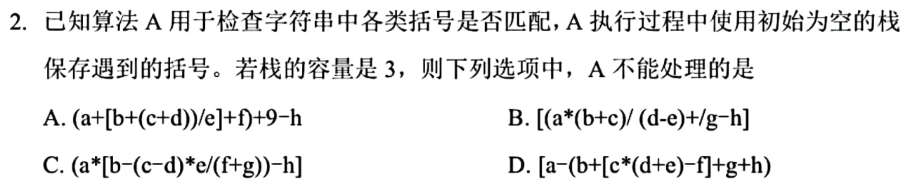

### 15 · 2026-42（大题联动）
> *有向图拓扑排序与关键路径综合大题。从邻接矩阵出发计算各顶点入度，推导拓扑序列并分析事件最早发生时间。*
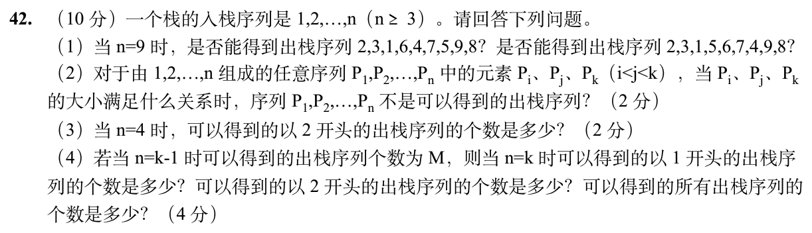
