# 0803｜树的形状：遍历序列如何约束结构

> 这组题直接分成两截：
> 前面是**快速拿分题**，树与森林的边数节点公式、遍历对应关系，掌握基本性质 20 秒报答案；
> 后面是**耗时攻坚题**，前中后序多序列定树形、线索化指针虚实、顺序存储数组下标校验，草稿纸上必须落笔画出树枝，切忌凭空虚构。

---

## 一、 快速拿分题（性质公式焊死，秒选走人）

### 01 · 2016-05
> *森林边数公式：$E = V - T$（边数 = 总顶点数 - 树的棵数），一秒出答案。*
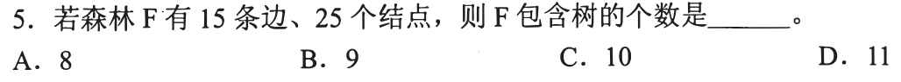

### 02 · 2017-04
> *先序（根左右）和中序（左根右）相同，左子树必须全为空，即所有非叶结点只有右子树。*
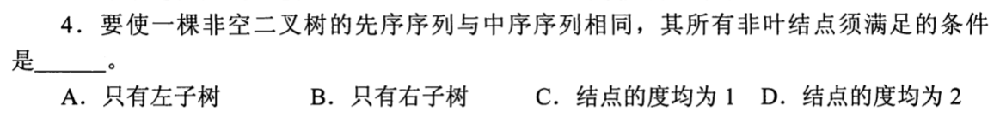

### 03 · 2018-04
> *每个非叶结点都有 2 个孩子，叶子数为 $k$，总度数为 $2k-2$，总结点数固定为 $2k-1$。*
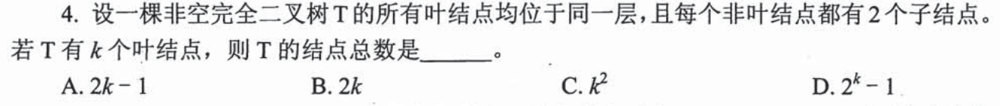

### 04 · 2019-02
> *牢记对应法则：树的后根遍历 = 对应二叉树的中序遍历；树的先根遍历 = 对应二叉树的先序遍历。*
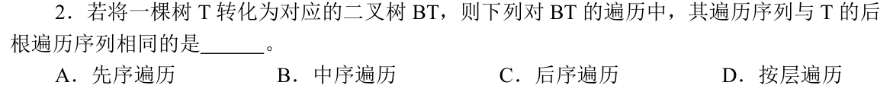

### 05 · 2022-04
> *满 3 叉树前 $h$ 层最多有 $(3^h - 1)/2$ 个结点，把 244 代入不等式直接锁定最小高度。*
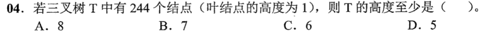

### 06 · 2023-05
> *给出树形和后序序列，后序最后是根，从叶到根顺藤把每个字母填回树中，再写先序。*
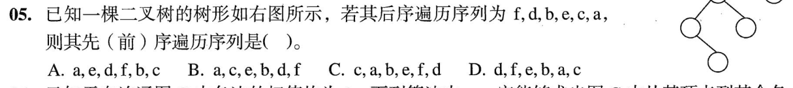

### 07 · 2024-03
> *中序遍历里 $v$ 有两个孩子，排在 $v$ 前面紧邻的一定是左子树的最右下结点，排在 $v$ 后面紧邻的一定是右子树的最左下结点。*
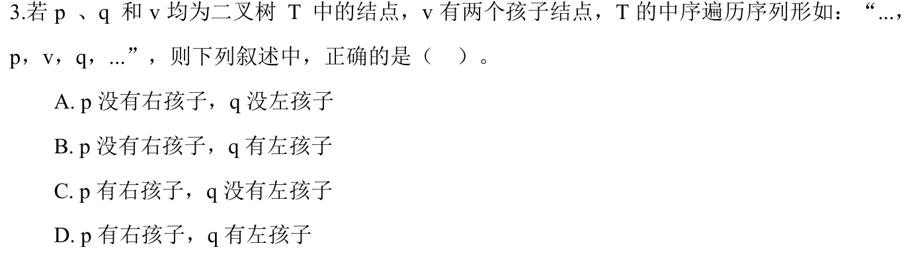

### 08 · 2025-04
> *基本性质辨析：完全二叉树可以有度为 1 的结点（最多 1 个），森林和二叉树可一一双向映射转换。*
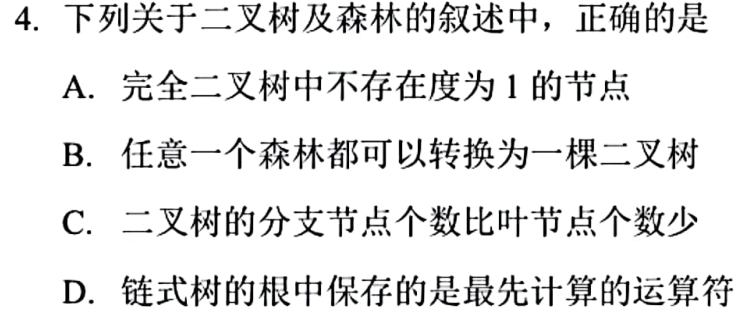

---

## 二、 耗时攻坚题（双序列还原树形、线索化虚实、草稿纸严密画图）

### 09 · 2009-06
> *森林“左孩子右兄弟”双向映射：二叉树中祖父结点，在森林里可能是祖先或兄弟，分清两层分支的实际含义。*
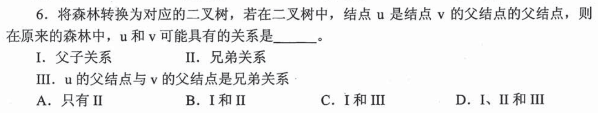

### 10 · 2010-03
> *后序线索二叉树：必须先在草稿纸上写出完整的后序遍历序列，再根据“左前驱右后继”核对虚线箭头。*
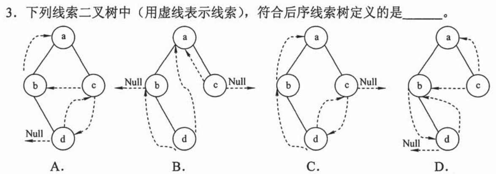

### 11 · 2011-05
> *先序和后序正好完全颠倒，说明整棵树每个非叶结点都只有 1 个孩子，有 $n-1$ 个单分支结点，每个可左可右，形态数为 $2^{n-1}$。*
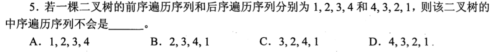

### 12 · 2014-04
> *中序线索化：写出中序序列，找到结点 $x$，左线索指向中序前驱，右线索指向中序后继，注意叶结点的空指针才变线索。*
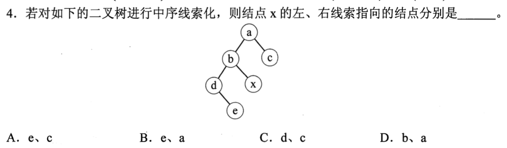

### 13 · 2015-02
> *先序序列固定求不同二叉树形态总数，本质等价于入栈顺序固定求出栈序列种数，直接套卡特兰数 $C_4 = 14$。*
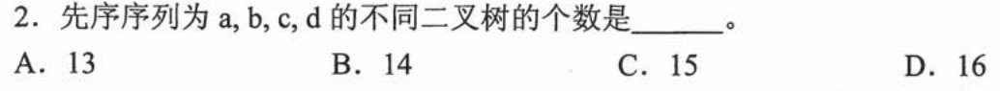

### 14 · 2017-05
> *由给定树形与后序序列反填结点，后序末尾是根，从右子树向上回溯定位同层兄弟。*
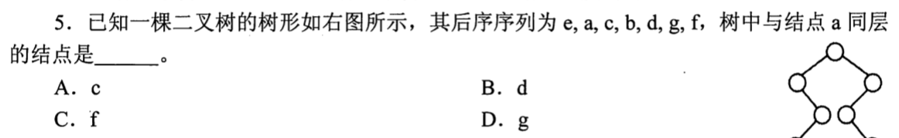

### 15 · 2020-03
> *二叉树顺序存储最坏情况是单枝树，退化成链表时下标会达到 $2^h - 1$，空间浪费极大。*
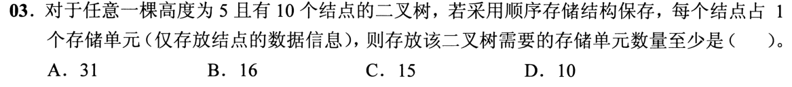

### 16 · 2020-04
> *森林先根中根求二叉树后序遍历：先用先根和中根还原出原森林各棵树，再转二叉树做后序，两步都不能漏。*
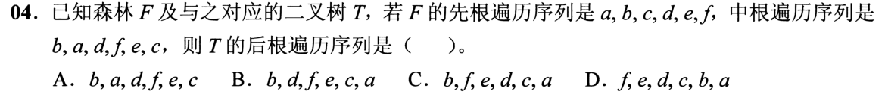

### 17 · 2021-04
> *经典二叉树反推森林：先根据先序和中序画出二叉树，再顺着右孩子链切开还原成森林各棵树。*
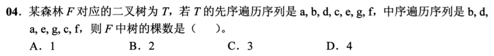

### 18 · 2022-03
> *中序遍历里 $p$ 在 $q$ 之前相邻，画出两种合法拓扑（$p$ 是 $q$ 的左子树最右下，或 $q$ 是 $p$ 的祖先且 $p$ 在其左侧），排除荒谬关系。*
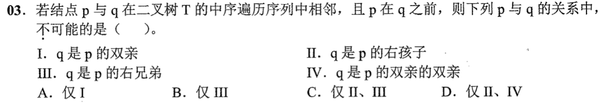

### 19 · 2025-03
> *顺序存储数组检验：下标为 $i$ 的结点，左孩子必须在 $2i$，右孩子必须在 $2i+1$，如果父结点为空（-1）则子结点绝不能存在。*
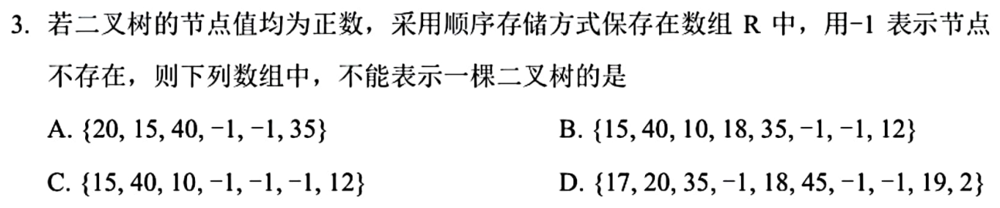

### 20 · 2026-03
> *根据层序遍历序列确定根结点，在中序遍历序列中切分左、右子树，递归恢复二叉树树形后再写出后序遍历序列。*
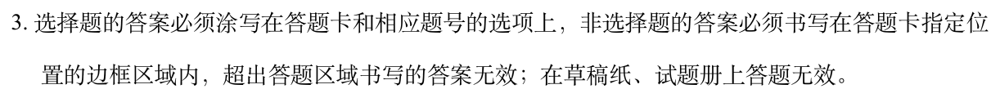

### 21 · 2026-04
> *森林转二叉树采用“左孩子右兄弟”法则。根结点的兄弟在二叉树中形成右斜单链，要使总高度最小，应尽量将树高较小的树排在右侧，或者根据各树内部高度组合。*
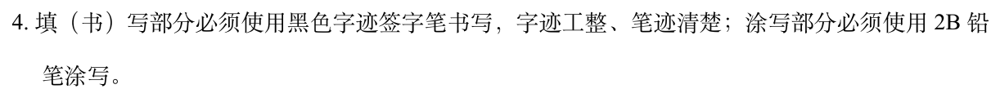
