# 0804｜编码代价：哈夫曼树与前缀码

> 这组题直接分成两截：
> 前面是**快速拿分题**，前缀编码无冲突判定与总结点数 $2n-1$ 公式，扫一眼 20 秒收工；
> 后面是**耗时攻坚题**，动手画哈夫曼合并树、多叉补虚结点以及反推路径权值，千万别在脑子里飘，草稿纸画树合并最保险。

---

## 一、 快速拿分题（前缀规则与结点公式，秒选走人）

### 01 · 2010-06
> *哈夫曼树只有度为 0 和度为 2 的结点，绝无度为 1 的结点；树形态由权值决定，绝非一定是完全二叉树。*
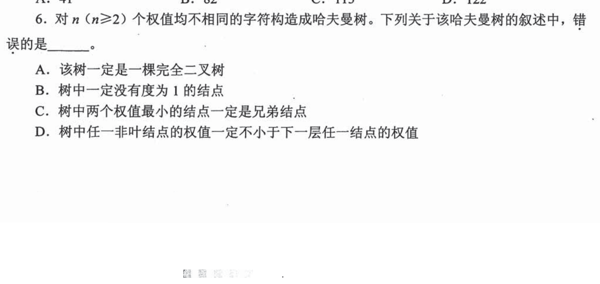

### 02 · 2014-06
> *前缀编码原则：任何一个短编码都绝不能是其他长编码的前缀，抓出包含前缀冲突的选项秒杀。*
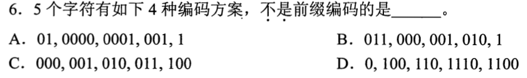

### 03 · 2019-03
> *哈夫曼树总结点公式：$N = 2n - 1$。已知 $N=115$，一秒算出叶结点数 $n=58$。*
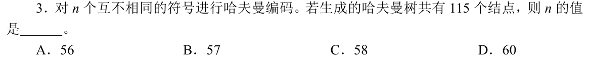

### 04 · 2022-05
> *哈夫曼编码 WPL 必达到理论最优（小于等于定长编码），但为了压缩高频字符，部分低频字符路径变长，树高可能大于定长树。*
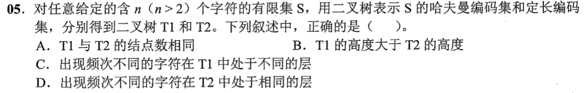

---

## 二、 耗时攻坚题（手动画树合并、多叉补虚、分值算清）

### 05 · 2013-04
> *三叉哈夫曼树神坑！$m$ 叉哈夫曼树必须先检查 $(n-1) \bmod (m-1)$，6 个结点除以 2 余 1，说明必须先补 1 个权值为 0 的虚叶结点再合并！*
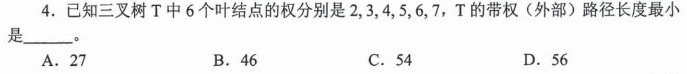

### 06 · 2015-03
> *根到叶结点的权值序列反推：路径上的权值必须严格递减且满足父结点等于左右子结点权值之和，拿选项反推分支结构。*
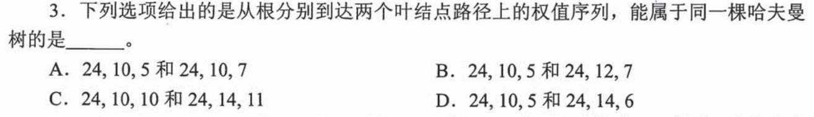

### 07 · 2017-06
> *给出一组实际编码，先顺着编码前缀在草稿纸上画出二叉树骨架，再反求各叶结点的深度与代价。*
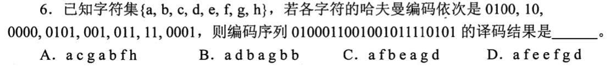

### 08 · 2018-05
> *6 个字符频次建树：草稿纸排好序，每次拎最小的两个加起来放回去重新排序，老实画树连编码。*
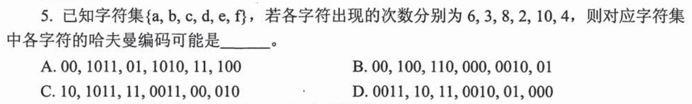

### 09 · 2021-05
> *求最小 WPL：巧算方法是将所有非叶结点（每次合并产生的新权值）全部累加一次，免去逐个叶子乘深度的繁琐计算。*
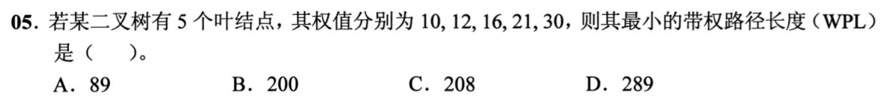

### 10 · 2023-04
> *频次建树出现相同权值时左右分支顺序不影响带权路径长度，但会改变具体编码，看清题目选项约束。*
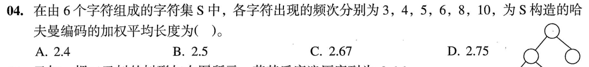

### 11 · 2025-05
> *最新真题：7 个字符频次合并，耐下性子合并 6 次，算准最终各层叶结点的深度。*
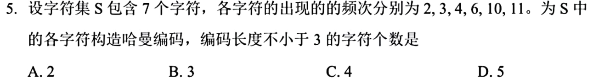

### 12 · 2026-05
> *带权路径长度最小即构建哈夫曼树。7个权值每次挑最小的两个合并，画出哈夫曼树后直接数结点 e 的深度及同层叶结点。*
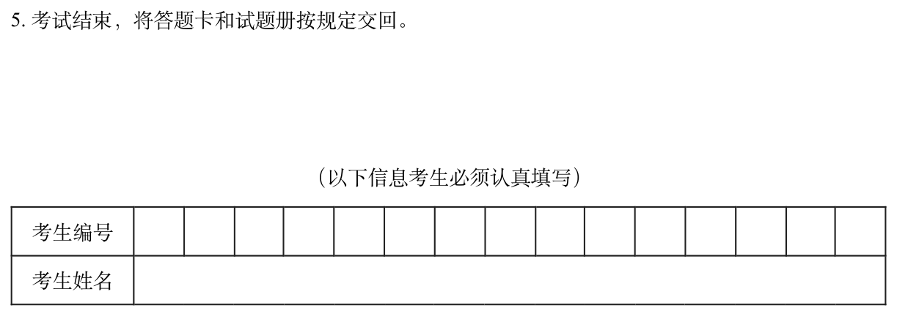
