# 0805｜有序树：从局部旋转到多路分裂

> 这组题直接分成两截：
> 前面是**快速拿分题**，二叉排序树的大小范围与 B/B+ 树基础性质，死扣定义 20 秒速选；
> 后面是**耗时攻坚题**，平衡二叉树旋转调整、B 树插入分裂与删除下溢合并，草稿纸画树推演，千万不要脑内空转。

---

## 一、 快速拿分题（定义性质焊死，秒选走人）

### 01 · 2016-10
> *B+ 树最大特点：叶结点用指针连成单链表支持顺序查找，内部结点仅作索引不存记录。*
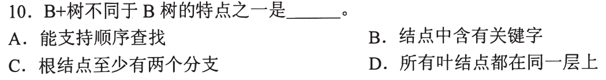

### 02 · 2018-06
> *二叉排序树“左小右大”，沿着树枝看清父子与祖先的大小关系，看图直接写不等式。*
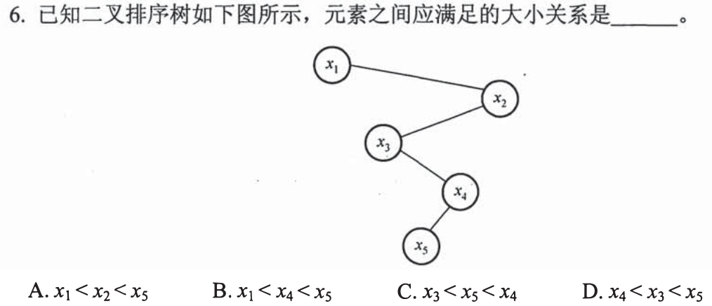

### 03 · 2020-05
> *关键字序列生成二叉排序树：第一个是根，后面的数比根小往左走、比根大往右走，拿选项逐个放进去试。*
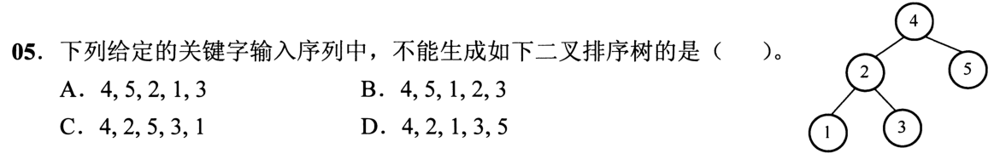

### 04 · 2023-07
> *B 树性质正误辨析：插入可能触发根结点分裂从而增加树高；删除非终端结点可以转化为终端结点删除，不一定会导致树高降低。*
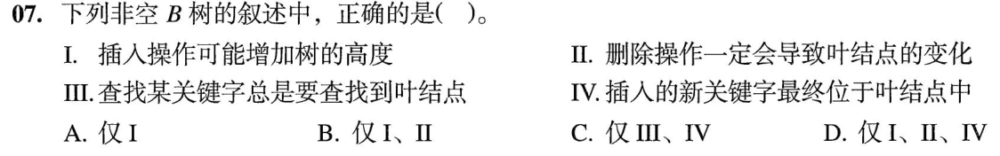

### 05 · 2024-07
> *二叉搜索树子树取值区间：子树 $T$ 在某结点的左边或右边，上下界严格受祖先结点约束，列出开区间即可。*
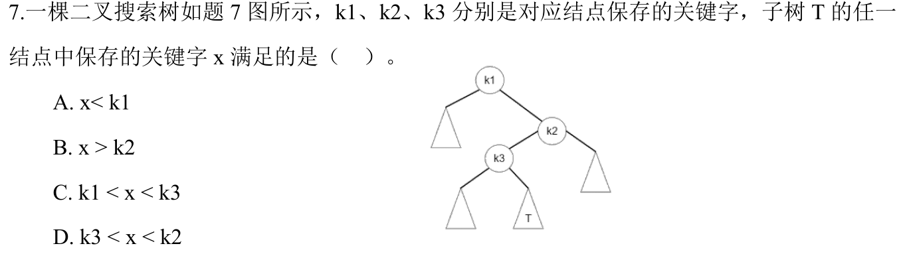

### 06 · 2011-07
> *二叉排序树查找序列判断：区间收缩法！每经过一个结点，目标必须落在收窄后的合法区间内，一旦回头跨界立即排除。*
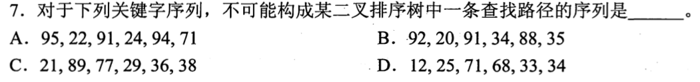

---

## 二、 耗时攻坚题（AVL旋转平衡、B树分裂合并，画图推演）

### 07 · 2010-04
> *AVL 树插入新结点后找“最小不平衡子树”，判断是 LL、RR、LR 还是 RL，旋转后中间大小的结点升为新根。*
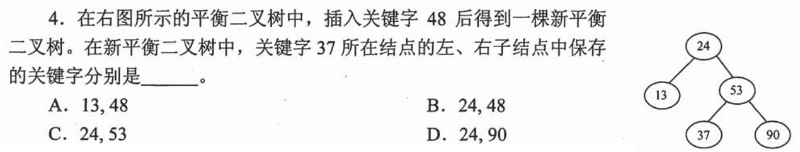

### 08 · 2012-04
> *高度为 $h$ 的 AVL 树最少结点数递推公式：$N_h = N_{h-1} + N_{h-2} + 1$（类似斐波那契数列），草稿纸列出 1, 2, 4, 7, 12, 20... 直接报答案。*
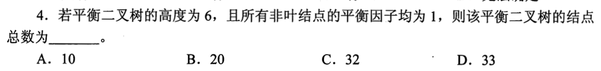

### 09 · 2018-08
> *3 阶 B 树（2-3树）关键字最少情况：根结点 1 个关键字（2 个孩子），其余非叶结点均只有 1 个关键字（2 个孩子），按满二叉树结构算每层结点数。*
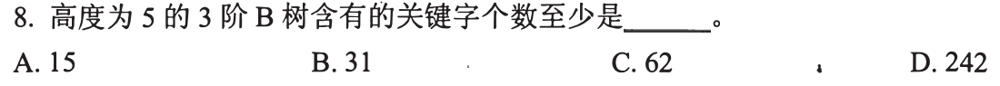

### 10 · 2019-04
> *在平衡二叉树中删去结点 $v$ 再重新插入 $v$：由于删除和插入可能触发完全不同的旋转调整，树形可能发生剧烈改变。*
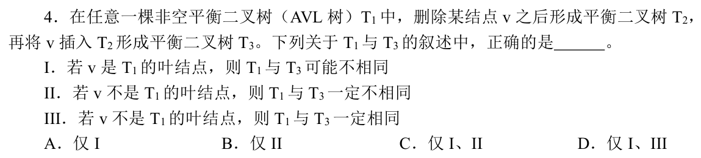

### 11 · 2020-10
> *4 阶 B 树插入关键字：每个结点最多 3 个关键字，放入第 4 个必须分裂，取中间数（$\lceil m/2 \rceil$）提拔到父结点，老实走一遍插入流程。*
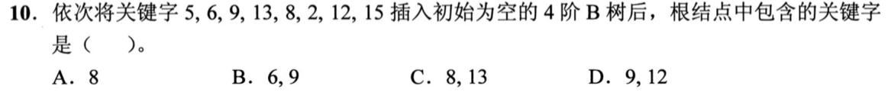

### 12 · 2021-06
> *AVL 树插入 23 导致根结点的左孩子失衡，找到最小不平衡子树做一次旋转，看清旋转中心。*
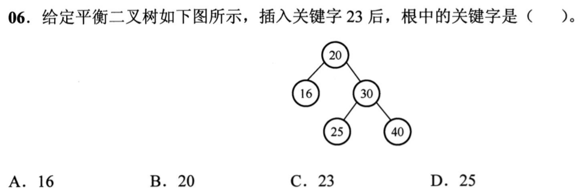

### 13 · 2021-09
> *3 阶 B 树第 2 层有 4 个关键字，推导第 2 层结点的可能组合及其子树分支数，算出总结点数范围。*
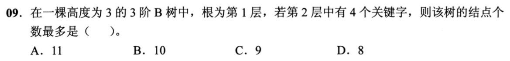

### 14 · 2022-08
> *5 阶 B 树删除关键字：结点下溢后优先向兄弟“借”，兄弟不够借则拉下父结点关键字与兄弟“合并”，画图确认合并后形态。*
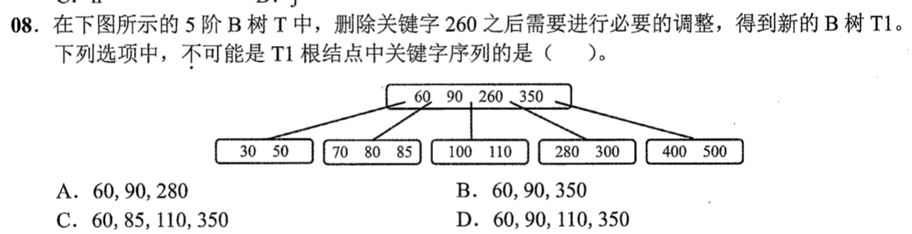

### 15 · 2025-08
> *7 个关键字构成 4 阶 B 树的形态数：分析 7 个数是挤在 1 个结点、还是分裂成 1 个根带 2 个或 3 个子结点的不同组合方式。*
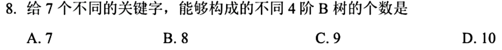

### 16 · 2026-08
> *高度为 4 的平衡二叉树，根结点的左、右子树高度差至多为 1。利用 AVL 树各高度最少结点数递推式 $N_h = N_{h-1} + N_{h-2} + 1$，求左右子树结点数最大差值。*
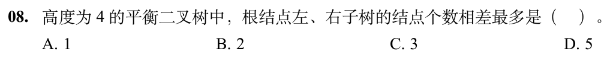
