# 0806｜图的骨架：表示、遍历与连通

> 当前显示 **6 题**（2020—2026 年）；**6 题暂缓**，原文保留在文件末尾的 HTML 注释中，未删除。

## 当前题单（2020—2026）

### 01 · 2020-06
> *DFS 访问语句移到退出递归前：这变成了图的“后序遍历”，对于有向无环图输出的就是逆拓扑有序序列。*
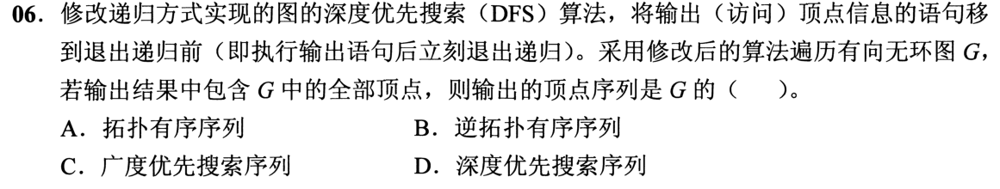

### 02 · 2022-06
> *无向图点边关系概念辨析：$|V| > |E|$ 时必然无法保证连通（连通至少需要 $|V|-1$ 条边），抓反例秒杀。*
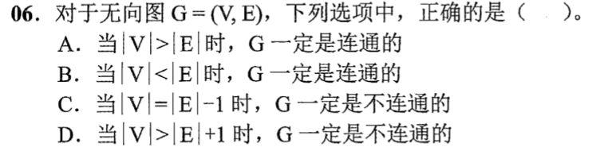

### 03 · 2023-06
> *所有边权值均为 1 的无向连通图，求单源最短路径直接用 BFS 广度优先搜索，时间复杂度最优。*
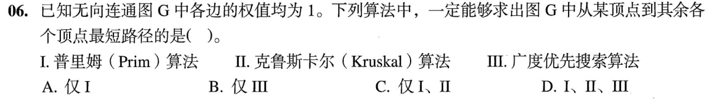

### 04 · 2024-04
> *邻接多重表数度数：顶点对应的边链表中串接了几条包含该顶点的边记录，度数就是几，看图数连线即可。*
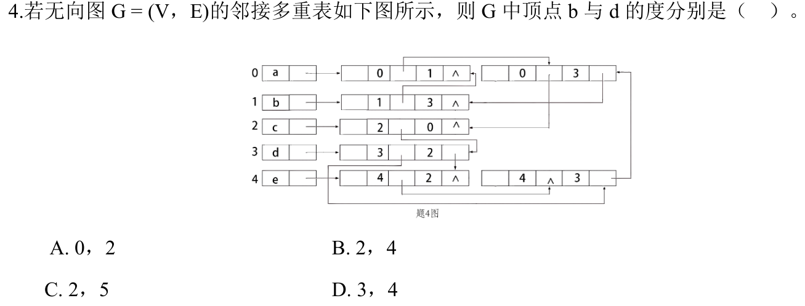

### 05 · 2025-06
> *图的基本概念辨析：有向无环图的拓扑序列不一定唯一，强连通图可以没有入度为 0 的点，抓准典型反例。*
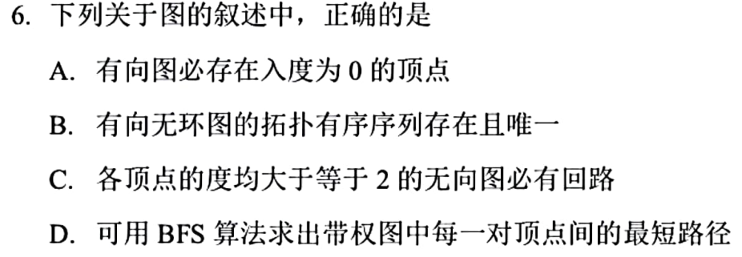

### 06 · 2026-06
> *普通邻接表只直接保存出边表，要计算某个顶点的入度，必须遍历全图所有顶点的边表，时间复杂度为 $O(n+e)$。*
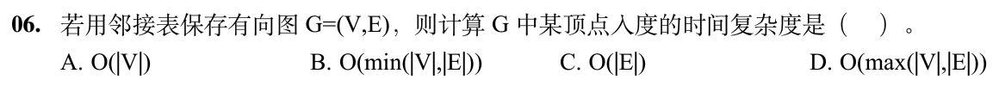

## 暂缓题目

以下题目仅暂时不处理；完整题目条目保留在 Markdown 源文件的 HTML 注释内，预览不显示题目。

<!-- 暂缓题：2009-07；暂时不处理，未删除。
### 01 · 2009-07
> *无向图握手定理：每条边给两个顶点各贡献 1 个度，所有顶点度数之和必然等于 $2E$，必为偶数。*
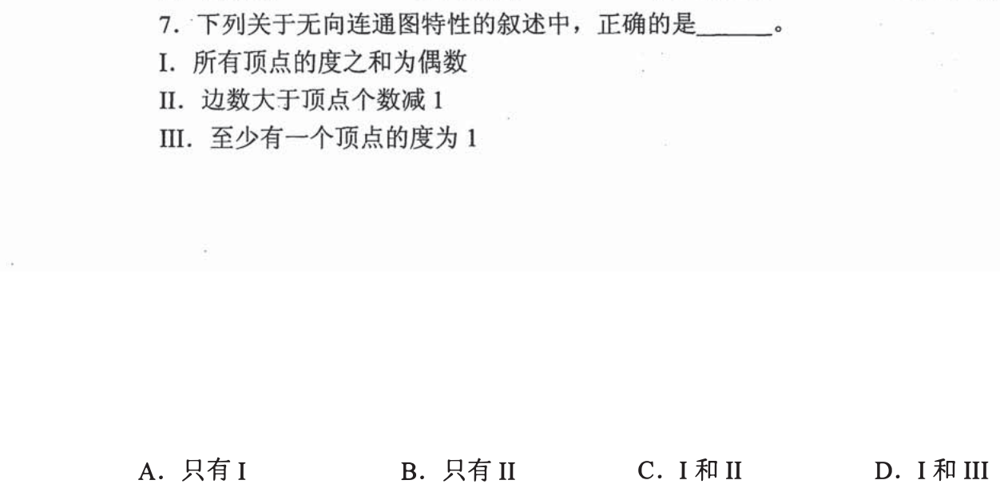
-->

<!-- 暂缓题：2010-07；暂时不处理，未删除。
### 06 · 2010-07
> *极值思考：要保证 7 个顶点在“任何情况下”都连通，考虑最坏情况——先让 6 个点构成完全图（$C_6^2 = 15$ 条边），再加上 1 条边连上孤立点，总共 16 条边。*
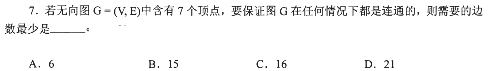
-->

<!-- 暂缓题：2013-08；暂时不处理，未删除。
### 07 · 2013-08
> *BFS 遍历序列检验：严格按队列“入队一层、访问一层”的次序走，先访问结点的所有邻接点必须排在后访问结点的邻接点前面。*
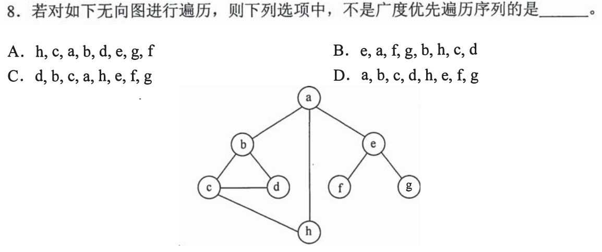
-->

<!-- 暂缓题：2016-06；暂时不处理，未删除。
### 08 · 2016-06
> *DFS 深度优先搜索检验：一条路走到底、走不通再回溯，草稿纸画出递归栈，核对每次回溯后的下一个分支。*
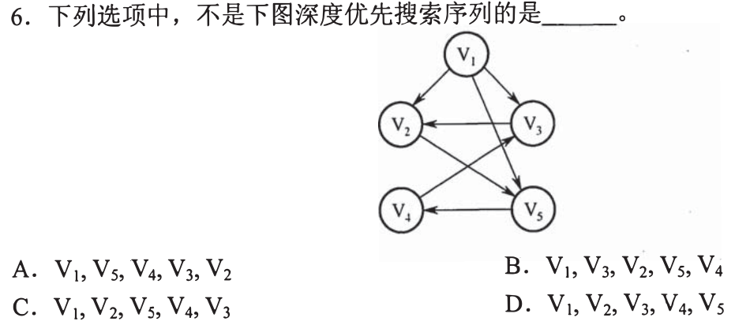
-->

<!-- 暂缓题：2017-07；暂时不处理，未删除。
### 09 · 2017-07
> *握手定理极值列方程：已知度为 4 和度为 3 的顶点数，其余顶点度数小于 3，利用度数和 $= 2E = 32$ 建立不等式求总顶点数上下界。*
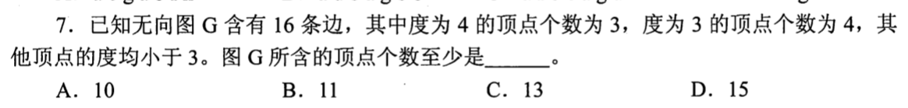
-->

<!-- 暂缓题：2019-06；暂时不处理，未删除。
### 10 · 2019-06
> *表达式化为有向无环图（DAG）：相同操作数和相同子表达式只保留一个顶点，所有操作符复用共享输入，画出合并后的 DAG 数点。*
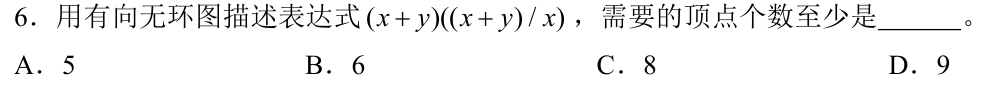
-->
