# 0807｜图上的推进：拓扑、最短路与关键路径

> 这组题直接分成两截：
> 前面是**快速拿分题**，上三角邻接矩阵特征、最小生成树代价唯一性与算法选型，抓住原理 20 秒报答案；
> 后面是**耗时攻坚题**，Dijkstra 逐步松弛入队时序、AOE 网关键活动时间余量算数以及 Kruskal 避圈判定，必须在草稿纸上画表记录过程，绝不死磕盲猜。

---

## 一、 快速拿分题（概念特征焊死，秒选走人）

### 01 · 2012-06
> *邻接矩阵主对角线及以下元素全为 0，说明所有边都从编号小的点指向编号大的点，本身就是天然拓扑序，拓扑序列必然存在。*
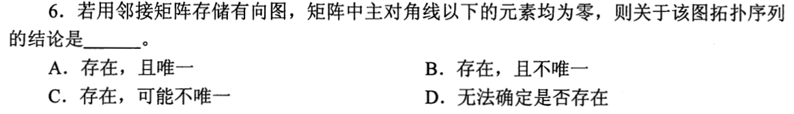

### 02 · 2012-08
> *最小生成树基本定理：总权值代价绝对唯一；只有在各边权值互不相同时生成树形态才唯一；权值最小的边一定包含在某棵最小生成树中。*
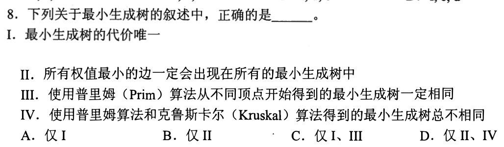

### 03 · 2016-07
> *邻接表存储的图做拓扑排序：每个顶点入度统计一次，每条弧遍历一次，时间复杂度为 $O(V+E)$。*
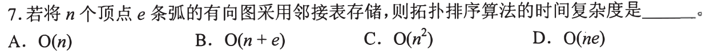

### 04 · 2018-07
> *拓扑排序检验：顺着选项核对，一旦发现有后面的点反向指向前面的点（逆向弧），立即排除。*
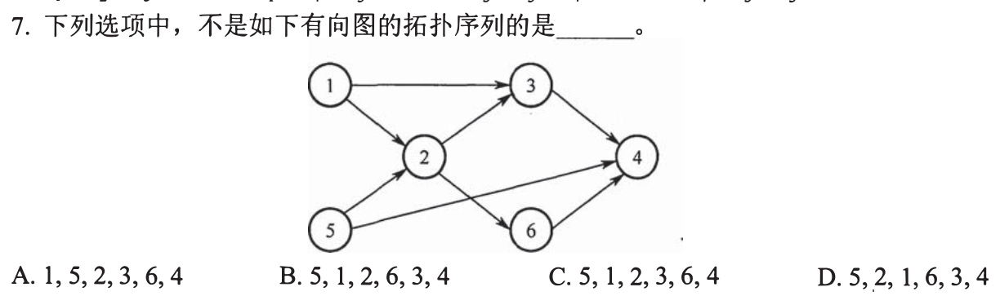

### 05 · 2020-08
> *AOE 网基本概念：关键路径是从源点到汇点“路径长度（权值和）最长”的路径，而不是边数最多的路径。*
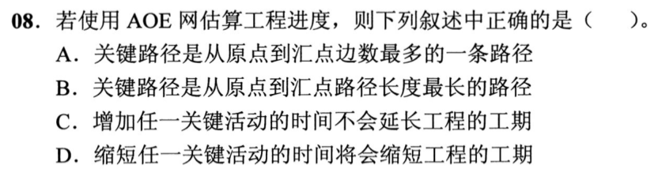

### 06 · 2023-06
> *无权图或边权全相等的图求单源最短路径，直接上 BFS 广度优先遍历，线性时间搞定。*

---

## 二、 耗时攻坚题（Dijkstra状态推进、AOE网算工期余量、生成树时序）

### 07 · 2013-09
> *AOE 网缩短工期：必须同时压缩所有关键路径上的关键活动；只压缩其中一条分支，其他关键路径依然卡死总工期。*
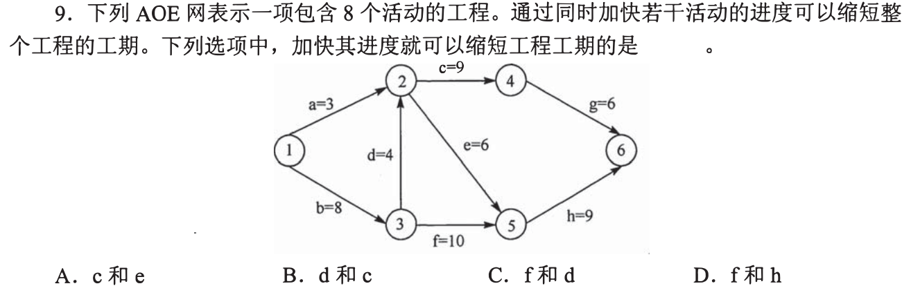

### 08 · 2015-06
> *Kruskal 与 Prim 选边差异：Kruskal 在全局按权值从小到大挑边（只要不连成环），而 Prim 必须紧贴当前连通分量往外长，看清第二条边选出的差异。*
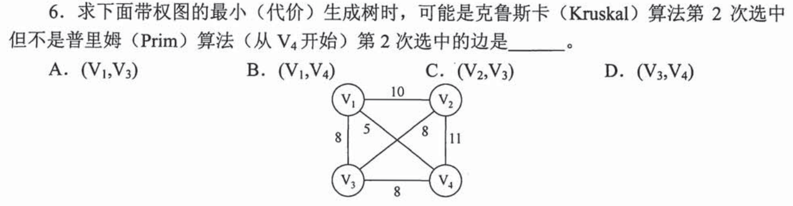

### 09 · 2016-08
> *Dijkstra 算法选点顺序：每一步把当前距离源点最近且尚未加入集合的顶点敲定，按距离递增次序依次加入，草稿纸画表格记每轮结果。*
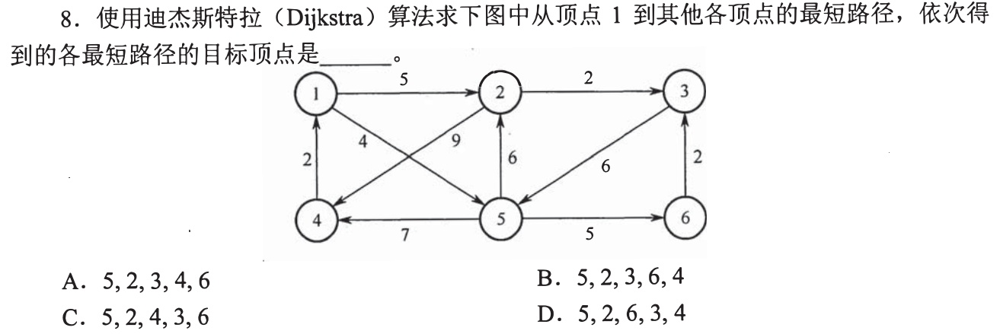

### 10 · 2019-05
> *AOE 网事件时间算活动时间：正向求各事件最早发生时间 $ve$，逆向求各事件最迟发生时间 $vl$，活动 $d$ 的最早开始等于起点 $ve$，最迟开始等于终点 $vl$ 减耗时。*
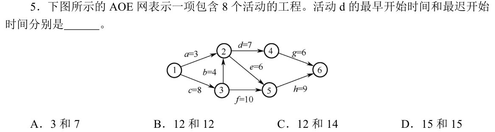

### 11 · 2020-07
> *Kruskal 算法执行推演：将所有边按权值从小到大排好，从权值最小的边开始收录，遇到形成环路的边跳过，数清楚加到第几条边。*
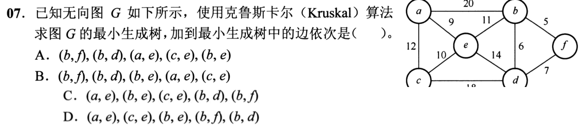

### 12 · 2021-07
> *拓扑排序不同序列计数：画出入度为 0 的候选分支，分支之间互相独立可以任意穿插交错，用排列组合乘法原理算总方案数。*
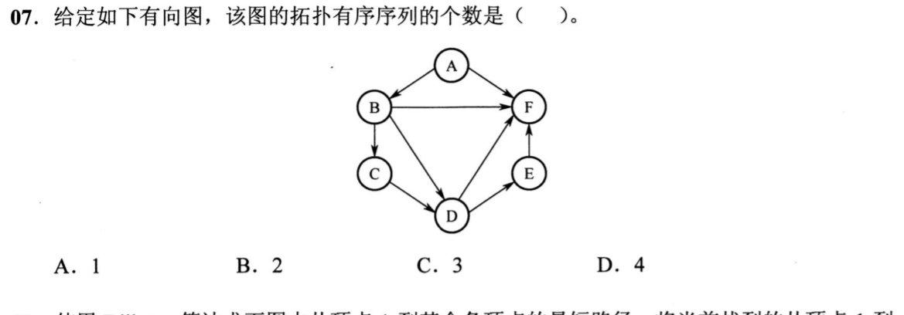

### 13 · 2021-08
> *Dijkstra 距离松弛过程跟踪：选定一个顶点后，只更新其直连出边顶点的距离，看清题目问的是“在哪一步松弛之后”的状态数组。*
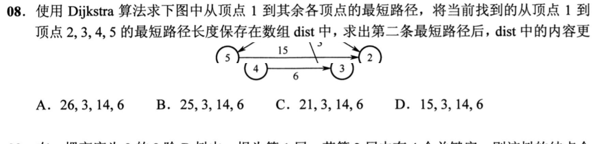

### 14 · 2022-07
> *AOE 网时间余量计算：活动时间余量 $= l(i) - e(i)$，算完所有活动的时间差，余量为 0 的是关键活动，找余量最大的那个。*
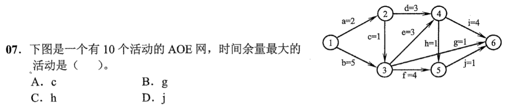

### 15 · 2026-07
<!-- 2026 压轴题位，已在 paper_html/408-2026.html 就绪 -->
