# 0808｜查找落点：折半、分块与散列

> 当前显示 **7 题**（2020—2026 年）；**8 题暂缓**，原文保留在文件末尾的 HTML 注释中，未删除。

## 当前题单（2020—2026）

### 01 · 2022-09
> *散列表平均查找长度（ASL）的三大决定因素：散列函数、处理冲突的方法、装填因子 $\alpha$，与关键字本身的编码形式无关。*
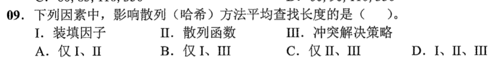

### 02 · 2023-08
> *600 个元素折半查找最多比较次数：判定树高度 $h = \lfloor \log_2 600 \rfloor + 1 = 9 + 1 = 10$，一秒出答案。*
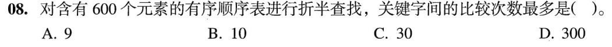

### 03 · 2023-09
> *散列表根据现有冲突形态逆向推导关键字落点：顺着线性探测的溢出轨迹逐格回推。*
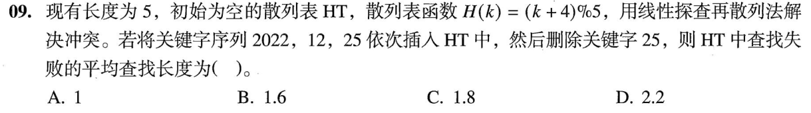

### 04 · 2024-05
> *折半查找的前提是“顺序存储”且“关键字有序”，单链表和静态链表无法在 $O(1)$ 时间内跳步取中间元素，不适合直接折半查找。*
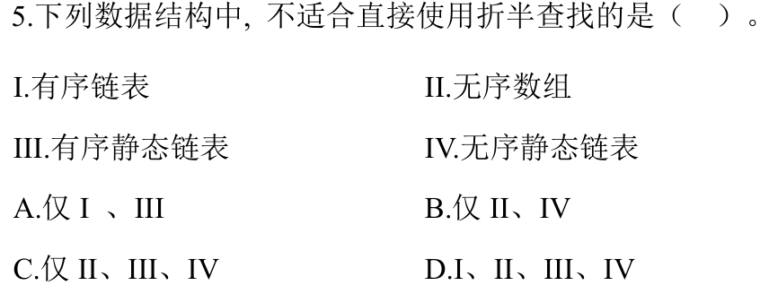

### 05 · 2025-07
> *400 个元素分块查找：将每块大小取为 $\sqrt{400} = 20$，块间顺序查找平均比较 $(20+1)/2 = 10.5$ 次，块内查找也平均 $10.5$ 次，两项相加得最优 ASL。*
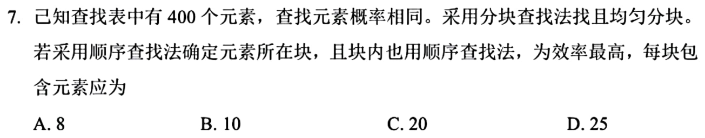

### 06 · 2025-09
> *散列表冲突处理原理：线性探测再散列只要表未满（装填因子 $< 1$），每次探测步长与表长互质，就一定能探测到空闲单元。*
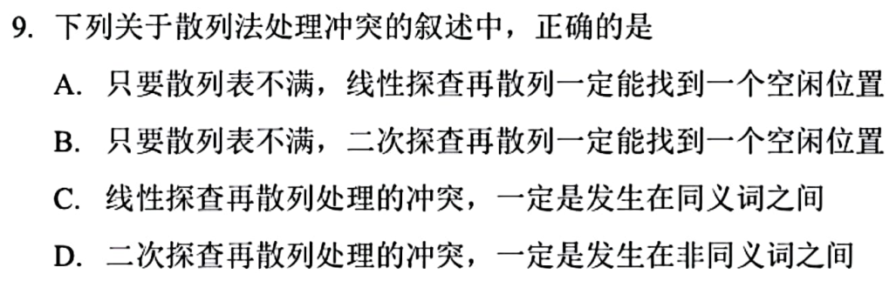

### 07 · 2026-41（大题联动）
> *二叉搜索树（BST）算法设计大题。树上查找与关键字修改：写出递归或非递归遍历查找算法，并在更新关键字后注意维持 BST 的有序性。*
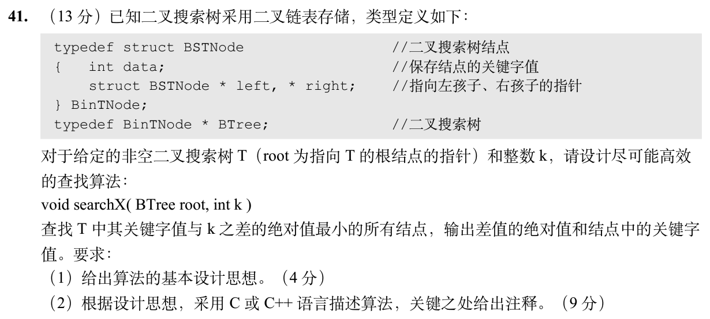

## 暂缓题目

以下题目仅暂时不处理；完整题目条目保留在 Markdown 源文件的 HTML 注释内，预览不显示题目。

<!-- 暂缓题：2011-09；暂时不处理，未删除。
### 01 · 2011-09
> *提高散列表查找效率：关键在于降低装填因子（增大表空间）和设计良好的冲突处理方法，盲目增大装填因子只会增加冲突。*
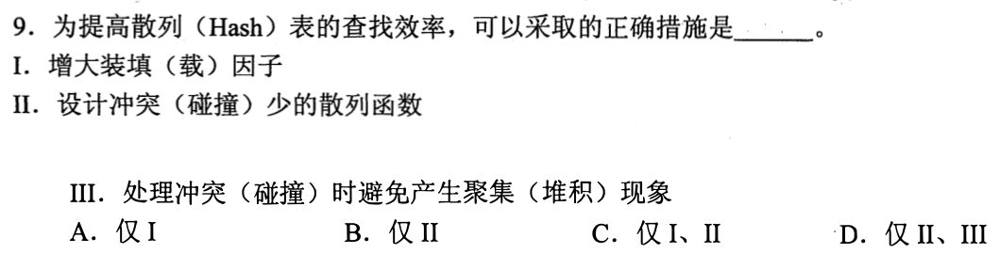
-->

<!-- 暂缓题：2017-08；暂时不处理，未删除。
### 02 · 2017-08
> *折半查找判定树铁律：对于任意非叶结点，其左右子树的内部结点个数之差绝对不超过 1，左高右低或左低右高不能悬殊。*
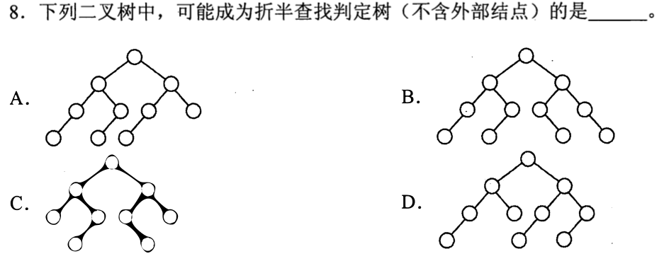
-->

<!-- 暂缓题：2017-09；暂时不处理，未删除。
### 03 · 2017-09
> *B+ 树叶结点包含全部关键字且串成双向链表，最适合频繁进行大范围查询和顺序扫描的数据库索引场景。*
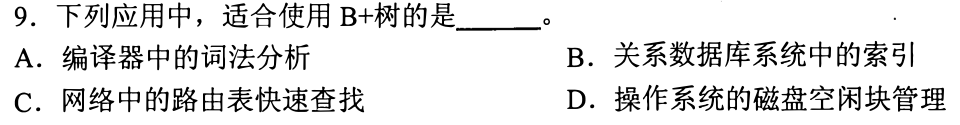
-->

<!-- 暂缓题：2010-09；暂时不处理，未删除。
### 08 · 2010-09
> *长度 16 的有序表折半查找不存在的元素：画出判定树，查找失败对应外部结点，看外部结点分布在第 4 层还是第 5 层，比较次数对应层数。*
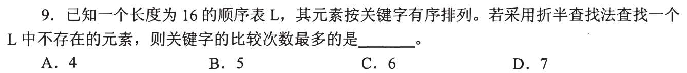
-->

<!-- 暂缓题：2015-07；暂时不处理，未删除。
### 09 · 2015-07
> *折半查找比较序列合法性：用区间收缩法，当前比较元素把合法范围分成两半，后面的比较元素必须落在当前有效区间内，跨界即非法。*
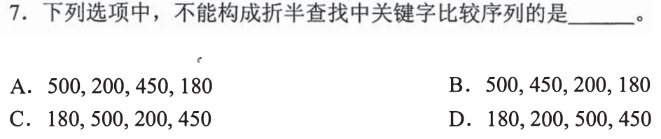
-->

<!-- 暂缓题：2016-09；暂时不处理，未删除。
### 10 · 2016-09
> *伪代码查找算法复杂度跟踪：分析循环变量的跳步方式，代入特定规模算出最坏比较次数。*
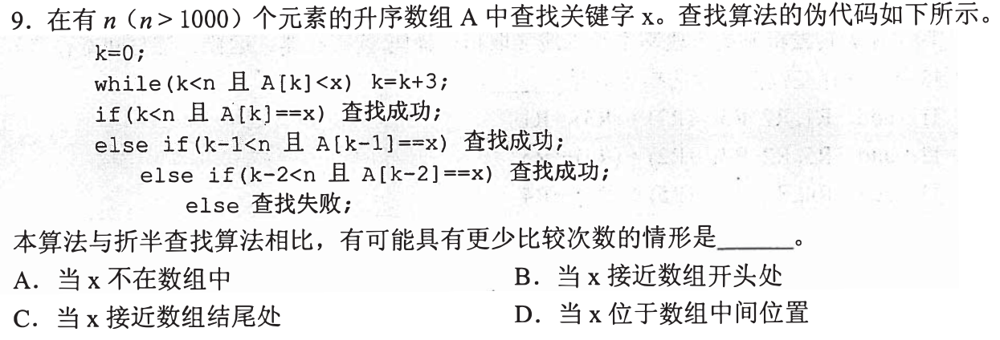
-->

<!-- 暂缓题：2018-09；暂时不处理，未删除。
### 11 · 2018-09
> *散列表求查找成功 $ASL_{succ}$：草稿纸画表格，按线性探测填入各元素，记录每个元素插入时比较的次数，累加除以关键字总个数。*
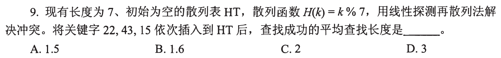
-->

<!-- 暂缓题：2019-08；暂时不处理，未删除。
### 12 · 2019-08
> *散列表求查找失败 $ASL_{fail}$：神坑在分母！失败查找从散列函数可能的落点（$0 \sim 6$）出发，数到下一个空单元停止，7 种可能各自数步数，累加除以 7！*
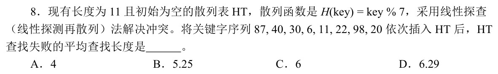
-->
