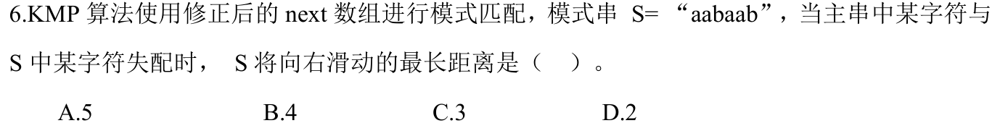
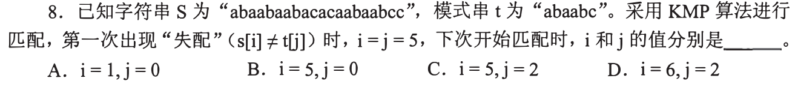
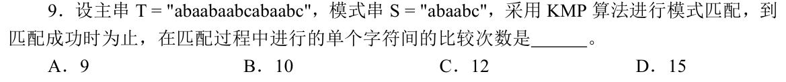

# 0809｜失配之后：KMP如何保留已经知道的部分

> 这组题直接分成两截：
> 前面是**快速拿分题**，手算 next/nextval 数组与滑动距离，算准最长相等前后缀长度秒解；
> 后面是**耗时攻坚题**，KMP 匹配全过程单字符比较总次数，必须在草稿纸上把主串和模式串上下对齐，逐轮推移画线计数，切忌心算丢步。

---

## 一、 快速拿分题（手撕数组与滑动距离，秒定答案）

### 01 · 2024-06
> *失配向右滑动距离：滑动距离等于当前失配下标减去回退位置（$j - nextval[j]$），求出 nextval 数组找最大差值，1 分钟稳稳拿下。*

---

## 二、 耗时攻坚题（KMP单字符比较总次数，草稿纸画线对齐）

### 02 · 2015-08
> *KMP 模式匹配流程跟踪：先写出模式串的 next 数组，顺着主串逐字符比对，失配时主串指针不回溯、模式串指针跳到 next 值继续比。*

### 03 · 2019-09
> *考场最易手滑题！算单字符比较总次数：在草稿纸第一行写出主串，下面一行对齐模式串，每比一次画一笔，失配后直接把模式串右移对齐继续画，连比带移直到完全匹配，一笔不漏数出总和。*

