# 0810｜排序过程：一趟以后什么已经确定

> 这组题直接分成两截：
> 前面是**快速拿分题**，时空复杂度、算法稳定性口诀与大根堆性质，扫一眼 20 秒拿分；
> 后面是**耗时攻坚题**，快排划分判定、堆建树与删除调整、基数分配及序列形态逆推，在草稿纸上动手画树排位置，抓牢“一趟之后哪些元素落定最终位置”。

---

## 一、 快速拿分题（性质口诀焊死，秒选走人）

### 01 · 2017-10
> *选归并而不选直接插入：核心在于归并排序最坏时间复杂度仍是 $O(n\log n)$ 且具备稳定性。*
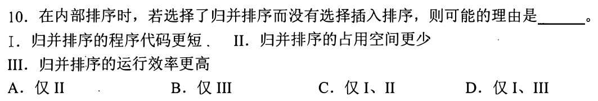

### 02 · 2017-11
> *更换为链式存储后效率大降：凡是依赖数组随机下标快速跳步定位的算法（如折半插入、希尔排序、堆排序），改链表后直接退化。*
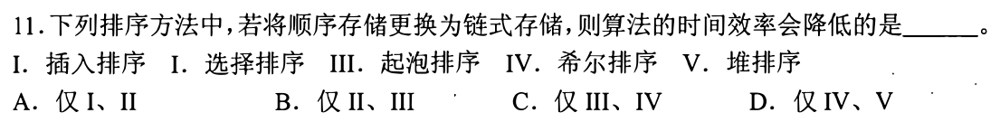

### 03 · 2019-07
> *选择排序算法除时空效率外，还必须综合考虑数据规模、存储结构（顺序/链式）以及是否要求保持原有相对顺序（稳定性）。*
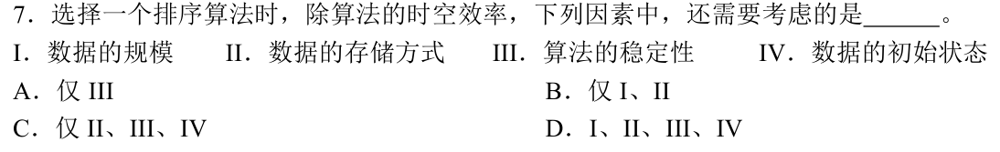

### 04 · 2020-09
> *堆的本质：堆在逻辑上是一棵完全二叉树，在物理上采用顺序数组存储，大根堆满足根大于等于左右孩子。*
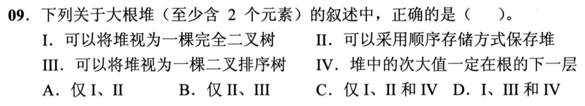

### 05 · 2020-11
> *基本有序时直接插入优于简单选择：直接插入遇到前驱小于等于自身时立即终止本轮扫描，比较次数大幅减少；而简单选择必须每次盲目比满剩余全部区间。*
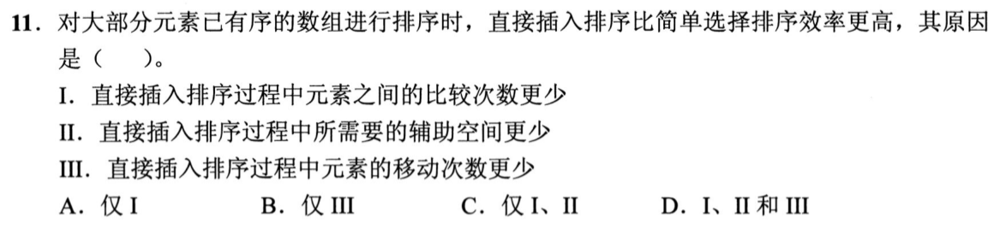

### 06 · 2022-10
> *二路归并核心操作：将两个各自有序的子表合并为一个整体有序的新表，不要跟快排的划分混为一谈。*
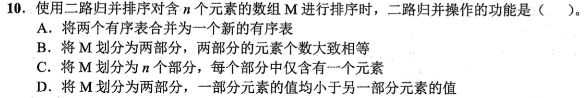

### 07 · 2022-11
> *直接插入相对快速排序的优势场景：待排序序列规模较小，或者数据本身已经基本有序。*
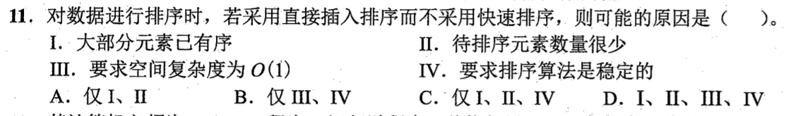

### 08 · 2023-10
> *不稳定性经典口诀：“快、些、选、堆”（快速排序、希尔排序、简单选择排序、堆排序）全都不稳定，其余基础排序均稳定。*
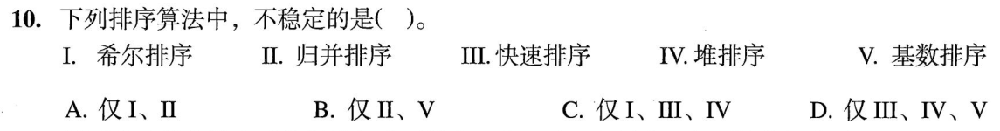

### 09 · 2025-10
> *最坏情况下元素移动次数最少：简单选择排序每趟仅做一次交换，移动次数上限仅为 $3(n-1) = O(n)$，远少于起泡或插入。*
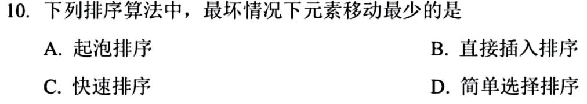

---

## 二、 耗时攻坚题（快排划分检验、堆建树与删除下滤、过程逆推）

### 10 · 2018-10
> *希尔排序第 1 趟结果反推步长：看相隔 $d$ 个位置的子序列是否各自有序，拿选项中的步长 $d$ 带入验证。*
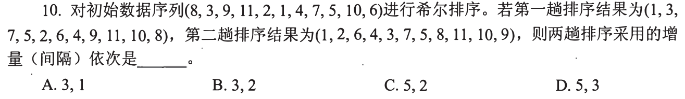

### 11 · 2018-11
> *初始无序序列直接建大根堆：从最后一个非叶结点 $\lfloor n/2 \rfloor$ 开始，逆序向前逐个下滤调整，草稿纸画完全二叉树照步推演。*
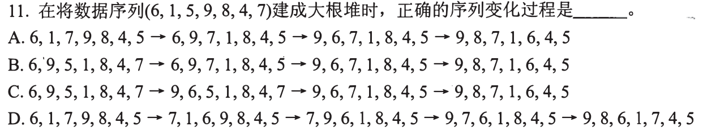

### 12 · 2019-10
> *快排第 2 趟结果检验：两趟排序后必有至少 2 个元素落入最终有序位置，且这 2 个元素必须把数组分割为“左边都比它小、右边都比它大”的独立区间。*
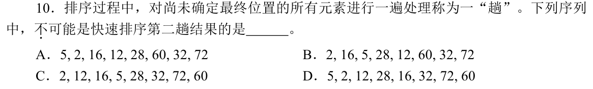

### 13 · 2021-10
> *基数排序（最低位优先 LSD）：第 1 趟只看个位数，将元素分配到 0~9 号队列，再按队列先进先出顺序收集，写出个位数排序后的序列。*
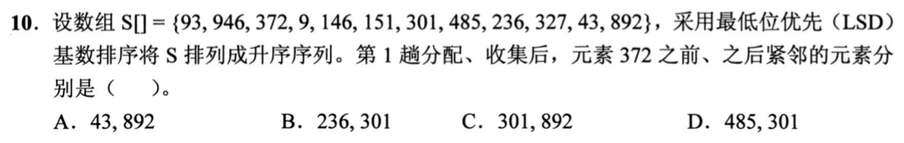

### 14 · 2021-11
> *逐个插入建立大根堆：每来一个新元素先放到数组末尾，然后顺着父结点链向上过滤比较，与直接建堆的自底向上不同，看清插入次序。*
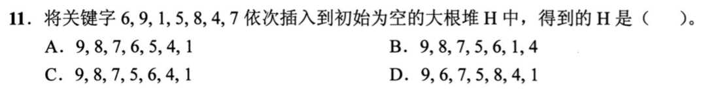

### 15 · 2023-11
> *快速排序单趟划分找枢轴：找出一个元素，使得该位置左侧所有数都小于它、右侧所有数都大于它，该元素就是选中的枢轴。*
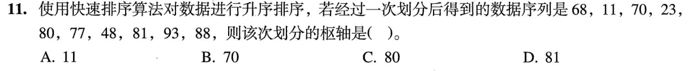

### 16 · 2024-08
> *快排最坏划分分析：若每次枢轴都划出 $0$ 和 $n-1$ 个元素，递归树退化为单链，比较次数达到 $O(n^2)$。*
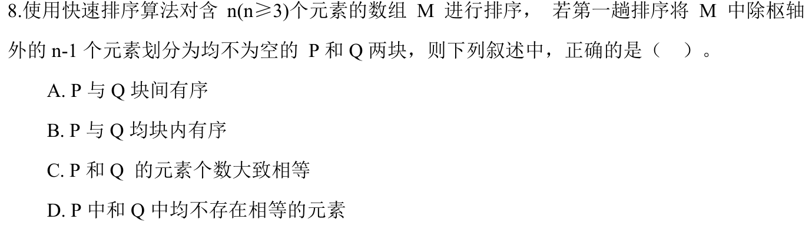

### 17 · 2024-09
> *大根堆连续两次删除堆顶：每次删除将末尾元素移至堆顶，然后自顶向下沿较大孩子分支下滤，连续走两遍删除下滤流程。*
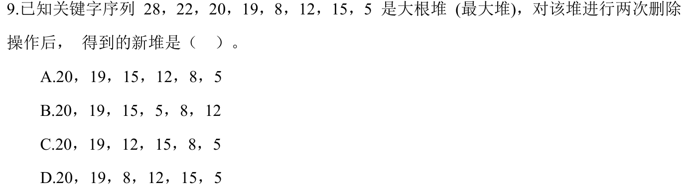

### 18 · 2024-10
> *3 个有序序列二路归并比较次数：按指定归并次序，两两合并时最坏比较次数等于两序列长度之和减 1，累加各次归并比较次数。*
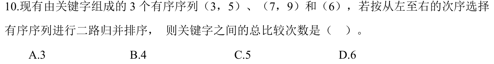

### 19 · 2025-11
> *观察每趟变化特征反推排序类型：看每趟是全局变有序、还是单侧元素位置焊死、还是局部滑动插入，比对各算法典型行为。*
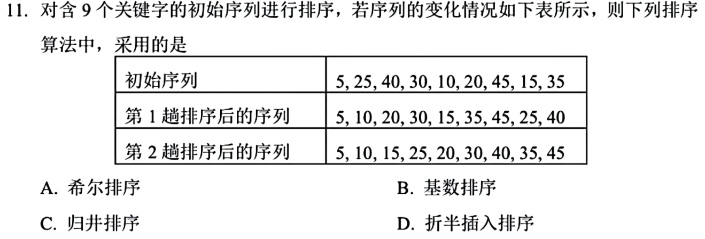

### 20 · 2026-09
<!-- 2026 压轴题位，已在 paper_html/408-2026.html 就绪 -->

### 21 · 2026-10
<!-- 2026 压轴题位，已在 paper_html/408-2026.html 就绪 -->
