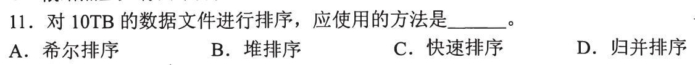
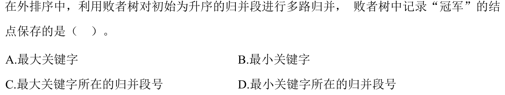
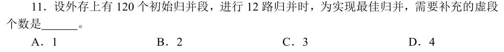

# 0811｜外存归并：内存装不下以后怎样排序

> 这组题直接分成两截：
> 前面是**快速拿分题**，海量数据选型与败者树节点定义，抓牢基础定义 15 秒出答案；
> 后面是**耗时攻坚题**，多路最佳归并树补虚段与归并趟数推导，熟记 $(n-1) \bmod (k-1)$ 取模公式，防手滑算错。

---

## 一、 快速拿分题（海量选型与败者树定义，秒选走人）

### 01 · 2016-11
> *10TB 海量数据远超内存容量，必须采用外部排序，而外排序的绝对主力算法就是多路归并排序。*

### 02 · 2024-11
> *败者树本质：每个非叶结点记录本轮比较的“败者”（升序时关键字较大的那个段号），而“胜者”（较小者）继续向上挑战，树顶上方指针记录最终总冠军。*

---

## 二、 耗时攻坚题（最佳归并树补虚段、归并趟数算清）

### 03 · 2019-11
> *最佳归并树补虚段铁律：$k$ 叉哈夫曼树必须满足 $(n_0 - 1) \bmod (k - 1) = 0$。代入 $n_0 = 120, k = 12$，算出 $(120 - 1) \bmod 11 = 119 \bmod 11 = 9 \ne 0$，必须补足 $11 - 9 = 2$ 个长度为 0 的虚段！*

### 04 · 2026-11
<!-- 2026 压轴题位，已在 paper_html/408-2026.html 就绪 -->
