# 0812｜位模式的解释权：整数、浮点与类型转换

> 这组题直接分成两截：
> 前面是**快速拿分题**，标准编码对号入座、十进制转浮点、补码最值，1 分钟内口算锁定；
> 后面是**耗时攻坚题**，深藏符号扩展、截断强转、大小端拼字节与结构体对齐，草稿纸画齐格子再下笔。

---

## 一、 快速拿分题（编码直接套用，口算速决）

### 01 · 2011-13
> *标准 IEEE 754 编码。整数 8 化为 1000B，小数 0.25 化为 0.01B，对准符号、阶码和尾数直接写出十六进制。*
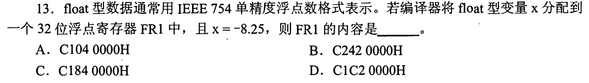

### 02 · 2013-13
> *十六进制直接反解。首位为 1 判负，阶码减 127 算出指数，尾数补上隐含的 1 秒出真值。*
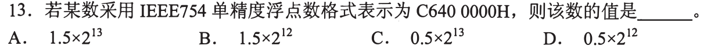

### 03 · 2015-13
> *8 位补码 3 个 1 求最小整数。符号位必须占一个 1，其余 1 尽量排在高位数值位，直接还原真值。*
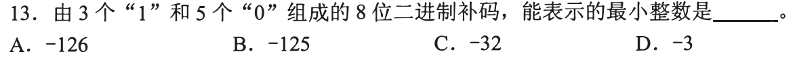

### 04 · 2018-14
> *IEEE 754 最小规格化正数。阶码取最小合法值 1（对应指数 -126），尾数全 0，即 $1.0 \times 2^{-126}$。*
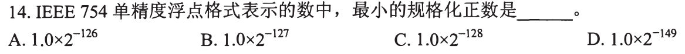

### 05 · 2021-14
> *能否精确表示看小数。十进制小数化二进制若不能有限除尽（分母含有 2 以外质因子）就必定产生舍入误差。*
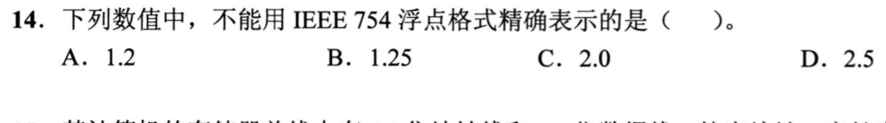

### 06 · 2022-13
> *32 位补码范围，标准常识送分题，$-2^{31} \sim 2^{31}-1$ 秒选。*
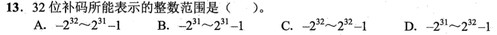

### 07 · 2022-14
> *-0.4375 转 IEEE 754。小数 $7/16 = 0.0111B = 1.11 \times 2^{-2}$，对准偏置阶码直接定位。*
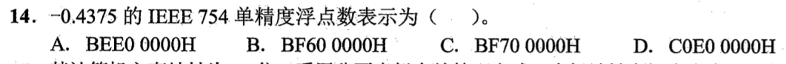

### 08 · 2023-13
> *-8190 转补码。直接写出正数 $8190 = 8192 - 2$，取反加一或从低位找第一个 1 取反，快速拿下。*
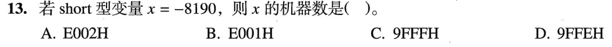

### 09 · 2023-14
> *浮点机器数 8020 0000H。阶码全 0 为非规格化数，隐含位是 0 不是 1，直接读出阶码和有效数。*
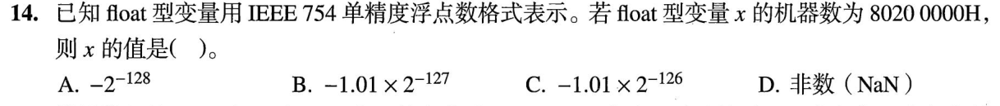

### 10 · 2025-13
> *4730 0000H 浮点转真值。符号为正，拆出阶码和有效位直接计算。*
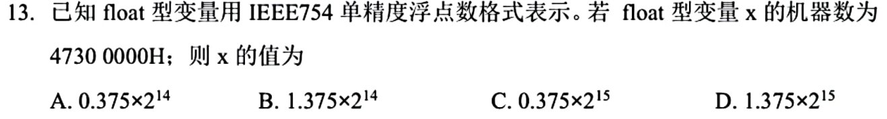

---

## 二、 耗时攻坚题（强转截断、大小端与边界对齐，画格子推导）

### 11 · 2009-12
> *有符号与无符号类型连续转换。有符号短整型赋给长整型先做符号扩展，再转无符号时位模式不变只改解释方式。*
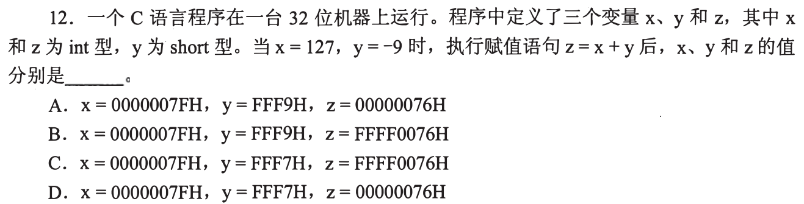

### 12 · 2010-14
> *int、float、double 跨类型赋值保真性。抓住 float 只有 24 位有效位（含隐含位），超出该范围的大整数强转必丢精度。*
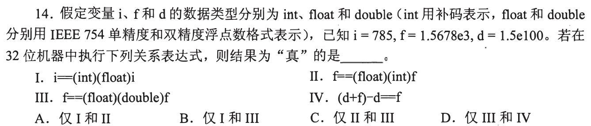

### 13 · 2012-13
> *无符号与有符号 short 强转 int。高位补 0 还是符号扩展决定了最终比大小的正负走向，草稿纸写全位模式。*
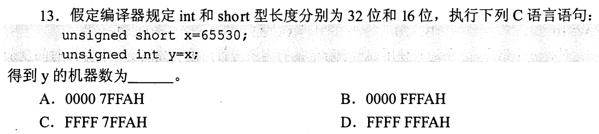

### 14 · 2012-14
> *float 能表示的最大正整数。受限于 24 位有效位，当数值超过 $2^{24}$ 时相邻整数将无法全部精确表示。*
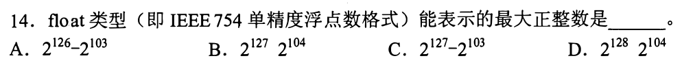

### 15 · 2012-15
> *结构体大小端与边界对齐。画出 4 字节一行的内存格子，每个变量严格按其自身大小的整倍数地址对齐并补齐填充字节。*
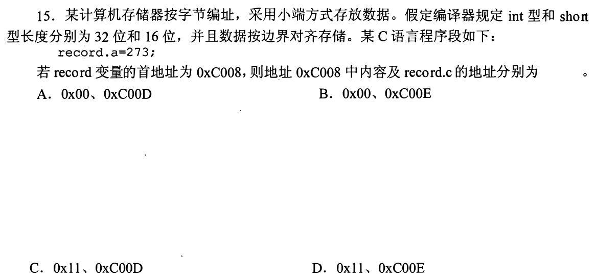

### 16 · 2014-14
> *浮点数溢出与特殊编码。严格区分正负无穷、NaN 和最大规格化数，结合寄存器位模式判定。*
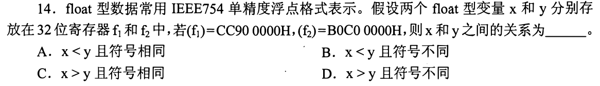

### 17 · 2015-14
> *浮点加减运算各环节排查。对阶只能小阶向大阶看齐（尾数右移），对阶过程绝不会引起阶码上溢。*
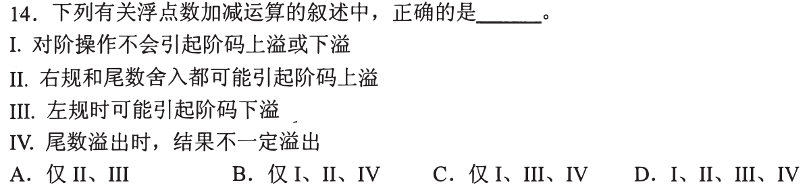

### 18 · 2016-14
> *double 型小端存放。低位字节存放在低地址，在内存连续字节序列里从前往后倒序拼出数值。*
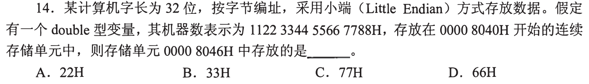

### 19 · 2018-13
> *32 位机器数补码直接减法。列竖式按位减，无符号借位看 CF，带符号溢出看最高位与符号位进位异或。*
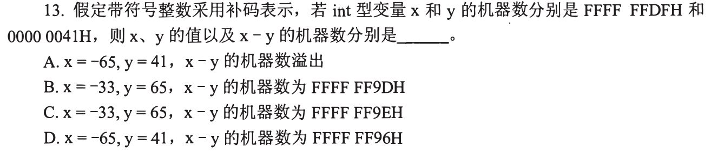

### 20 · 2018-15
> *汇编机器代码结合小端存储。立即数按字节倒序塞在指令后半段，根据操作码和操作数位置准确剥离。*
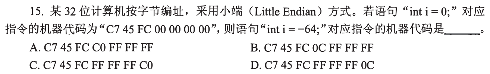

### 21 · 2019-13
> *负数赋给 unsigned short 再转 float。多重类型连续强转，一步步写出每阶段的十六进制机器数。*
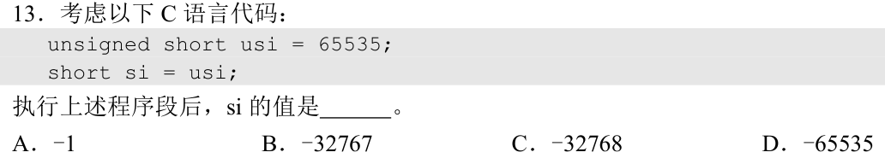

### 22 · 2019-15
> *基址寻址结合大端存储。基址加负偏移算出物理地址，再从高位字节往低位字节拼装操作数。*
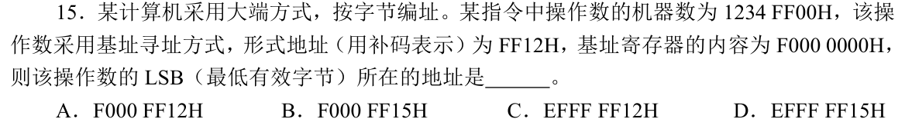

### 23 · 2020-13
> *同一十六进制串在 int 和 float 两种解释下的数值比较。分别按补码和 IEEE 754 还原真值后再比大小。*
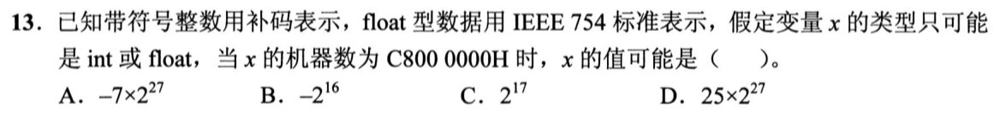

### 24 · 2020-14
> *结构体嵌套与小端存储。注意嵌套结构体内部对齐和整体边界收尾对齐的双重约束。*
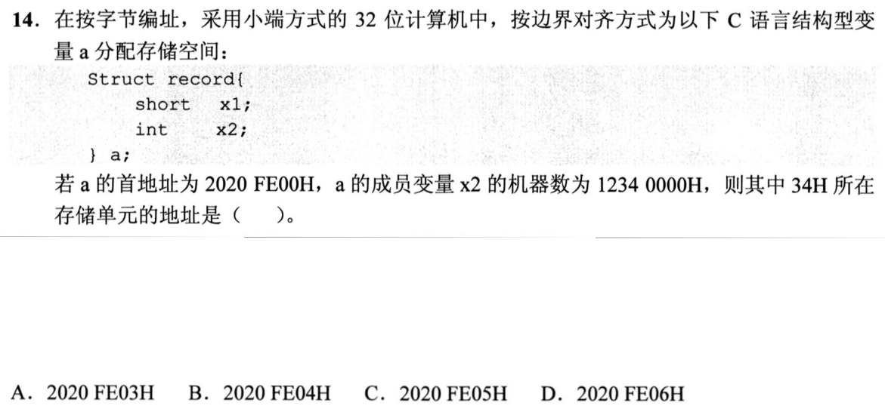

### 25 · 2024-12
> *int 强转 short 再到 unsigned short。低位截断后看清是按补码符号扩展还是无符号零扩展，别跳步。*
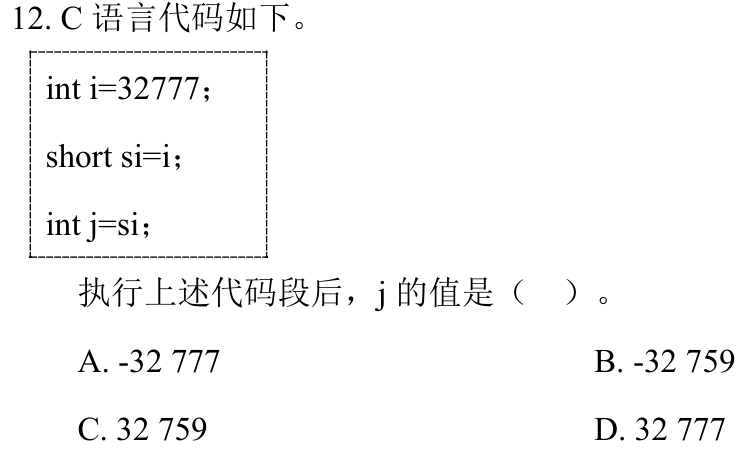

### 26 · 2024-14
> *大范围整型参数的定点/浮点方案权衡。平衡表示范围与有效精度要求，确保表数不失真。*
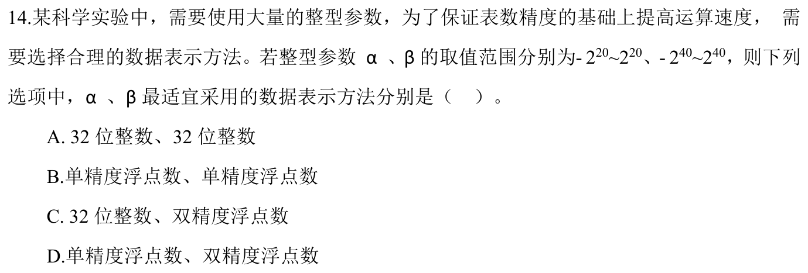

### 27 · 2025-12
> *short 赋值与类型强转。看清右值常量的位宽截断和符号扩展机制。*
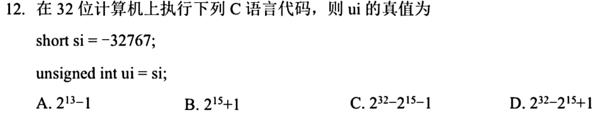

### 28 · 2025-15
> *结构体数组对齐与小端跨元素取数。先算单个结构体含尾部填充的总跨度，再按小端读指定字节。*
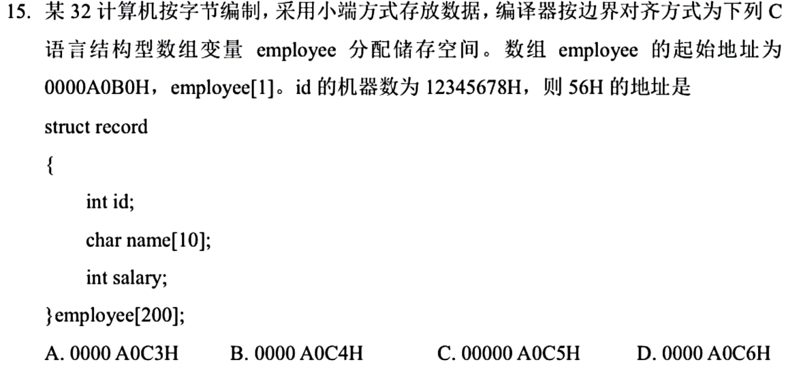

### 29 · 2026-14
<!-- 2026 压轴题位，已在 paper_html/408-2026.html 就绪 -->
