# 0813｜有限位运算：溢出、标志与乘除

> 这组题直接分成两截：
> 前面是**快速拿分题**，逻辑移位、算术移位和单标志位直接读，30 秒口算锁定；
> 后面是**耗时攻坚题**，带符号/无符号溢出判断、减法逆向推导标志位，老老实实列出二进制加减才稳妥。

---

## 一、 快速拿分题（移位规则与单标志，口算秒出）

### 01 · 2011-17
> *无符号比较转移条件。`bgt`（大于）要求既不能有借位（CF=0），也不能相等（ZF=0），概念直接套用。*
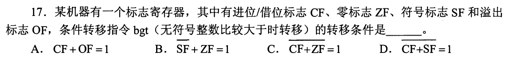

### 02 · 2018-16
> *移位基本操作。逻辑右移高位补 0，算术右移高位补符号位，看准操作类型直接写。*
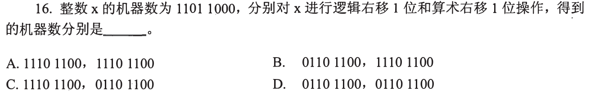

### 03 · 2021-13
> *16 位补码机器数大小比较。首位 0 为正、1 为负，负数内部补码越大其真值绝对值越小（真值越大）。*
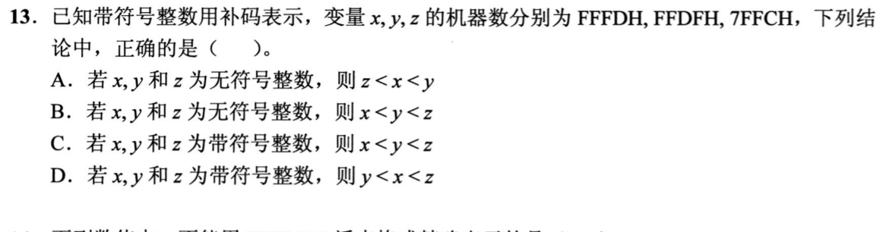

### 04 · 2024-15
> *阵列乘法器是纯组合逻辑，单个时钟周期内即可完成；而传统移位累加乘法器需要多周期推进。*
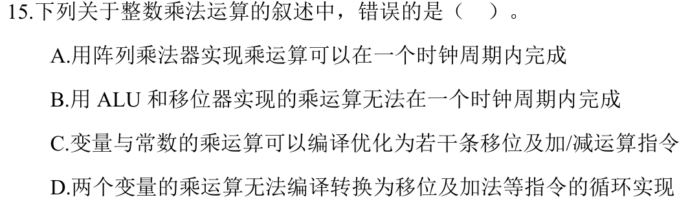

---

## 二、 耗时攻坚题（溢出与借位标志，手算二进制排查）

### 05 · 2010-13
> *8 位补码加减溢出判断。同号相加才可能溢出，看最高数值位进位与符号位进位是否异或为 1。*
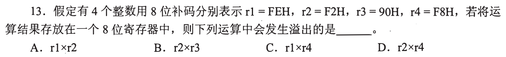

### 06 · 2013-14
> *变量运算 $z = 2x + y/2$。乘 2 算术左移，除以 2 算术右移（负数高位补 1），草稿纸列出二进制位运算。*
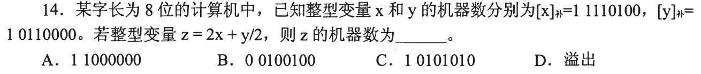

### 07 · 2014-13
> *8 位补码运算溢出判定。正数减负数变成两正数相加，检查结果是否突破 127 上限。*
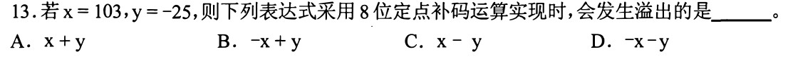

### 08 · 2016-13
> *short 转 unsigned short 与符号保留。深入硬件 ALU 层面，理清符号标志与数值溢出的触发本质。*
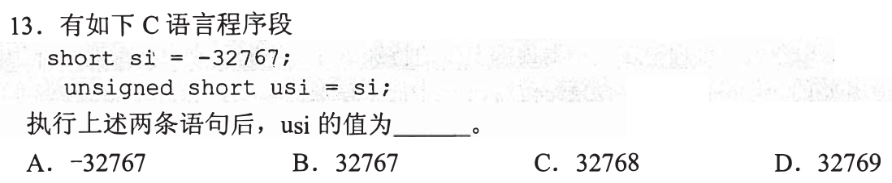

### 09 · 2018-19
> *减法指令 `sub` 生成 CF 和 OF。核心原则：加补码无进位即为无符号有借位（$CF = C_{out} \oplus 1$）。*
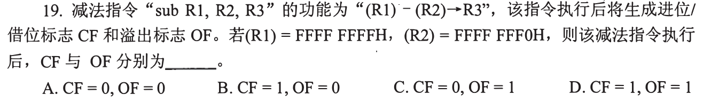

### 10 · 2023-16
> *整数比较中 OF 和 CF 联动。带符号数比大小看 $SF \oplus OF$，无符号数比大小直接看 CF。*
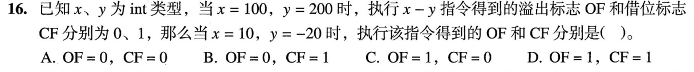

### 11 · 2025-14
> *8 位补码做减法。转成加相反数的补码，准确推导出结果机器数和溢出标志 OF。*
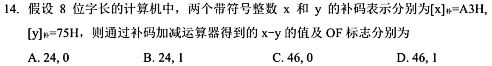

### 12 · 2026-13
> *补码算术右移时高位补符号位，算术左移时低位补 0。注意算术左移可能导致符号位改变（溢出），仔细推演每一步二进制位。*
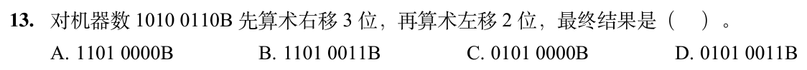
