# 0814｜存储器拼装：容量、长宽与片选

> 这组题直接分成两截：
> 前面是**快速拿分题**，概念辨析、引脚复用与总容量简单除法，1 分钟稳稳拿走；
> 后面是**耗时攻坚题**，片选译码高位覆盖、交叉编址冲突推演、突发传输周期累计，拿草稿纸画好地址切分。

---

## 一、 快速拿分题（器件特性与引脚常识，稳稳收下）

### 01 · 2010-16
> *RAM 易失需供电维持，ROM 非易失断电保密，标准基础概念白送分。*
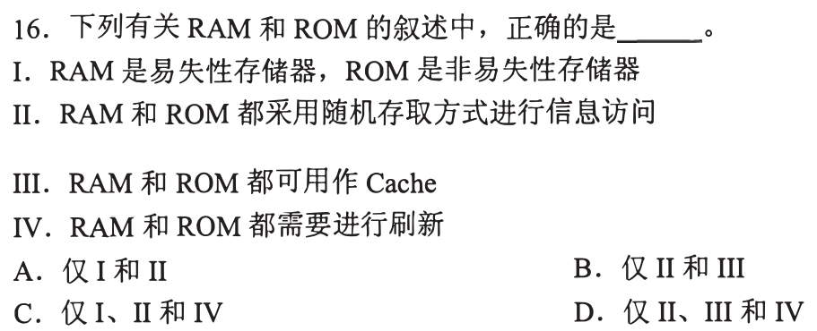

### 02 · 2011-14
> *随机存取的本质是存取时间与物理存储单元位置无关，光盘 CD-ROM 依赖寻道旋转，不属于随机存取。*
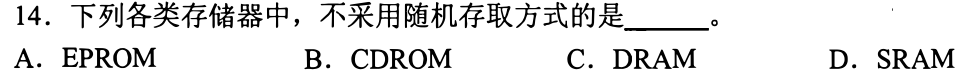

### 03 · 2011-15
> *MAR 位数由主存地址空间决定，而非由实际安装的主存芯片大小决定，别掉入数字陷阱。*
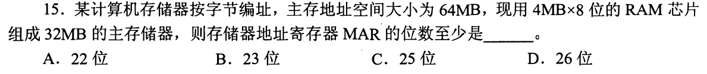

### 04 · 2012-16
> *Flash 闪存特性。写前必须整块擦除，写入速度显著慢于读取速度。*
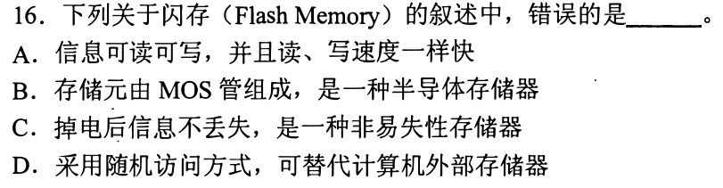

### 05 · 2014-15
> *DRAM 芯片地址线复用。行地址和列地址通过同一组地址引脚分时送入，地址线数量直接减半。*
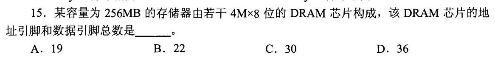

### 06 · 2015-17
> *需要周期性刷新的只有 DRAM 及其派生品（SDRAM），SRAM 靠双稳态触发器工作无需刷新。*
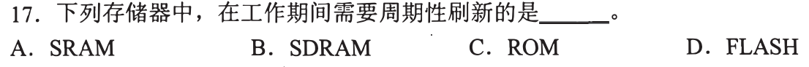

### 07 · 2017-18
> *MM（主存）在 CPU 外通过总线访问，CS（控制存储器）在 CPU 内部存放微程序，概念天差地别。*
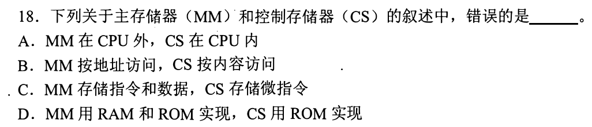

---

## 二、 耗时攻坚题（片选高位译码、交叉冲突与突发时序）

### 08 · 2009-15
> *ROM 和 RAM 混合拼装。先按地址高位划出 ROM 和 RAM 独立区域，再分别算字扩展与位扩展芯片片数。*
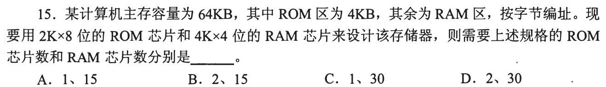

### 09 · 2010-15
> *存储芯片地址范围反推。根据单个芯片容量扣除低位地址线，高位地址线通过译码器输出定位所属芯片区间。*
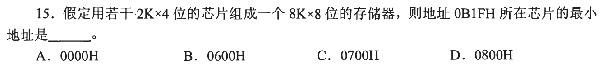

### 10 · 2015-18
> *4 体低位交叉编址冲突排查。连续地址在各体间轮转，若后续地址打在尚未恢复的存储体上就会发生排队延迟。*
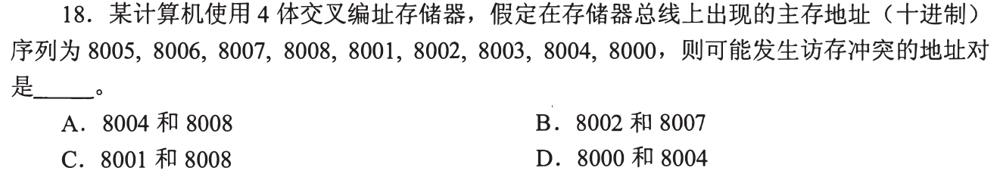

### 11 · 2016-16
> *64KB 主存扣除中间 ROM 保留区。计算剩余有效 RAM 空间，再按给定的 SRAM 芯片规格求所需总片数。*
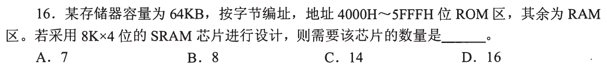

### 12 · 2017-13
> *4 体交叉编址且总线 32 位。注意按字节还是按字编址，检查 double 型跨界访问是否会引发多轮存取周期。*
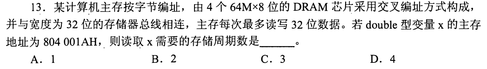

### 13 · 2018-17
> *DRAM 行列数配置与引脚最小化。阵列做成方形引脚数最少，行数越少则刷新周期内需要逐行刷新的行数越少。*
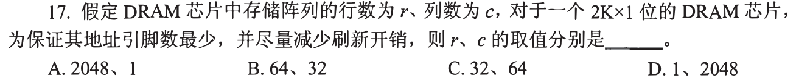

### 14 · 2021-15
> *24 位地址线按字编址。先将字编址空间折算为字节容量，再计算 512K×8 位芯片所需数量。*
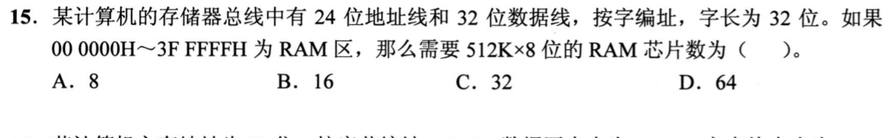

### 15 · 2022-17
> *DRAM 突发传输时序计算。首地址送出加行列建立开销，后续连续数据只需列脉冲，分段累加总周期。*
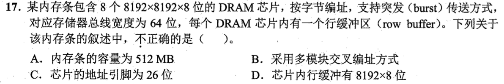

### 16 · 2023-15
> *30 根地址线按比例划分为 RAM 和 ROM。算清高位片选逻辑以及填满全部地址空间所需的芯片片数。*
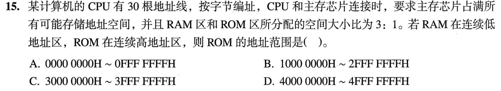

### 17 · 2026-15
> *8 个 DRAM 芯片低位交叉编址，主存地址的最低 3 位用于选片（芯片编号 0～7）。将两个十六进制地址转换后对比低 3 位，相同则位于同一芯片。*
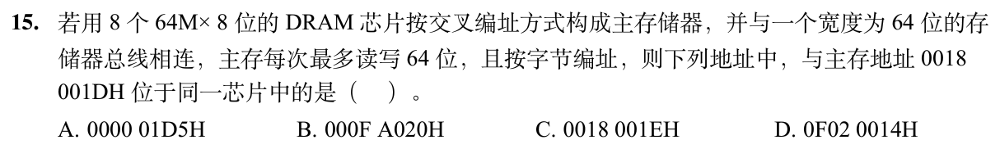
