# 0815｜Cache访问：地址切分、局部性与替换

> 当前显示 **5 题**（2020—2026 年）；**7 题暂缓**，原文保留在文件末尾的 HTML 注释中，未删除。

## 当前题单（2020—2026）

### 01 · 2020-15
> *TLB 和 Cache 对比。TLB 缺失访问主存页表，Cache 缺失访问主存数据，搞清两者分工。*

### 02 · 2021-16
> *32 位地址直接映射回写 Cache。算准 Tag 位数、有效位、脏位，单行总位数乘总行数求总容量。*
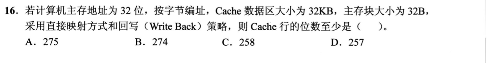

### 03 · 2022-16
> *8 路组相联 Cache。每组有 8 个 Cache 行，硬件必须同时并行比较这 8 行的 Tag，因此需要 8 个比较器。*
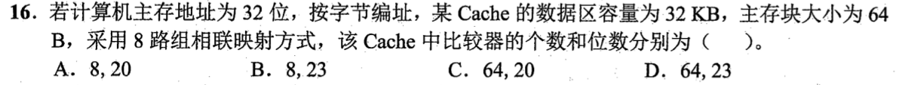

### 04 · 2024-16
> *层次存储系统数据交换粒度。Cache 与主存之间以块为单位，主存与外存之间以页为单位。*
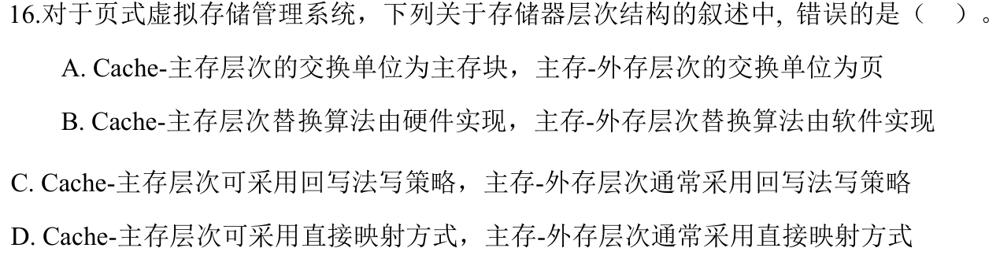

### 05 · 2026-18
> *4路组相联映射：Cache 行数 1024，每组 4 行，共有 256 组（组号占 8 位）。主存地址切分为 Tag、组号、块内偏移，提取组号字段直接得出。*
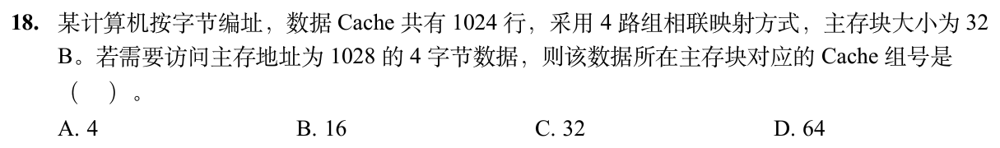

## 暂缓题目

以下题目仅暂时不处理；完整题目条目保留在 Markdown 源文件的 HTML 注释内，预览不显示题目。

<!-- 暂缓题：2009-21；暂时不处理，未删除。
### 01 · 2009-21
> *命中率标准计算。总访存 1000 次，未命中 50 次，命中 950 次，命中率直接为 95%。*
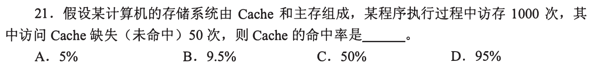
-->

<!-- 暂缓题：2014-16；暂时不处理，未删除。
### 02 · 2014-16
> *指令 Cache 与数据 Cache 分离。核心在于避免流水线取指段和访存段同时争用单一 Cache 的结构冒险。*
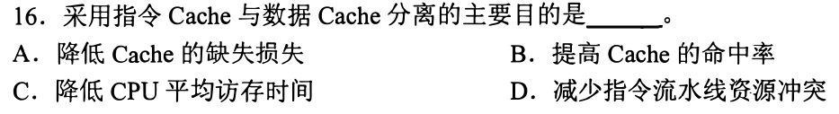
-->

<!-- 暂缓题：2009-14；暂时不处理，未删除。
### 06 · 2009-14
> *16 块 2 路组相联映射。先算出共有 8 个组，主存地址扣掉 32B 块内地址后，主存块号模 8 得到组号。*
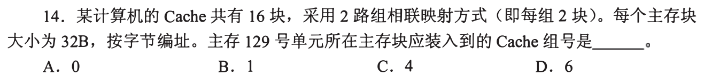
-->

<!-- 暂缓题：2012-17；暂时不处理，未删除。
### 07 · 2012-17
> *2 路组相联结合 LRU 替换推演。画出两组 Cache 格子，顺着访存序列一步步模拟调入和淘汰。*
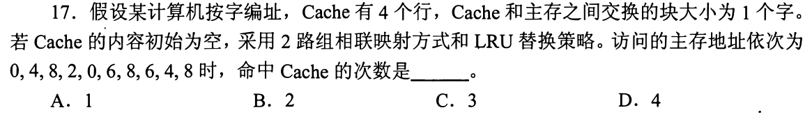
-->

<!-- 暂缓题：2015-15；暂时不处理，未删除。
### 08 · 2015-15
> *直接映射总容量计算。主存块 4 字 = 16B，地址剥离出块内、行号、Tag，回写策略需额外加 1 位脏位和 1 位有效位。*
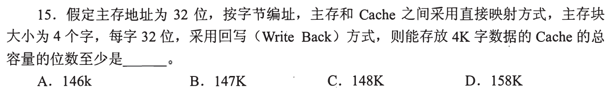
-->

<!-- 暂缓题：2016-15；暂时不处理，未删除。
### 09 · 2016-15
> *C 语言二维数组遍历命中率。结合数组按行存放特性与 Cache 块容量，算清跨块边界时的缺失次数。*
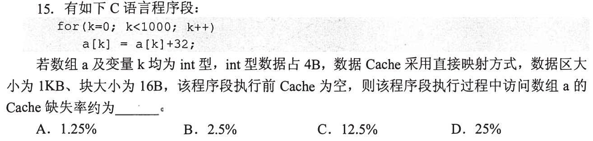
-->

<!-- 暂缓题：2017-14；暂时不处理，未删除。
### 10 · 2017-14
> *循环步长跨 Cache 行推导。一次访存载入整块，后续若步长跳出本块则每次都缺失，精确推算缺失率。*
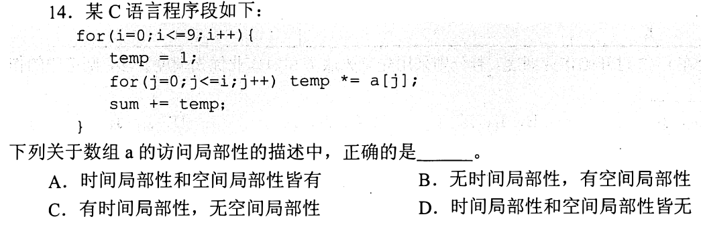
-->
