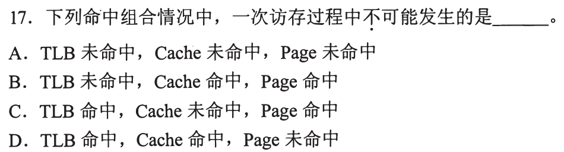
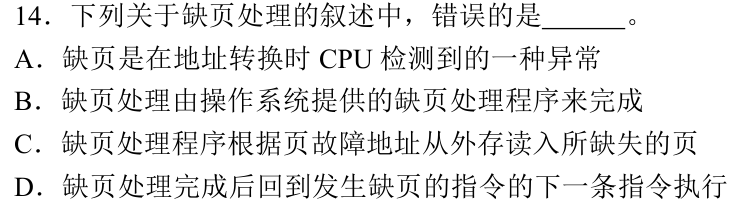
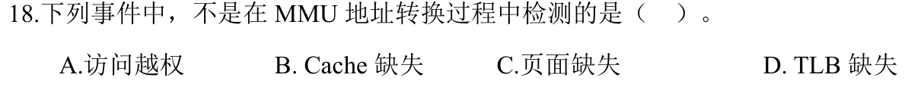
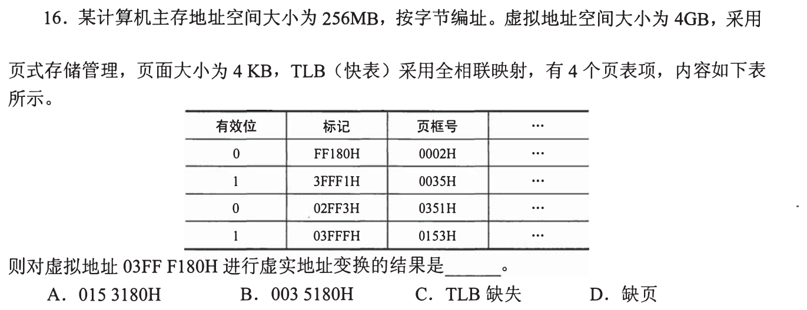
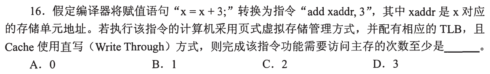
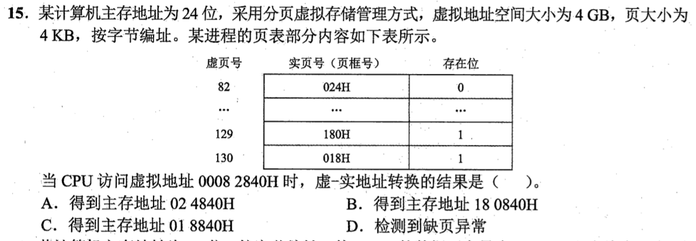
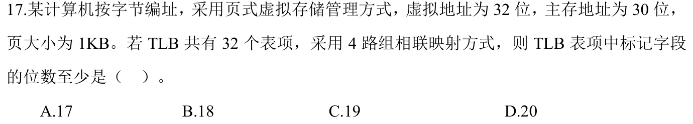
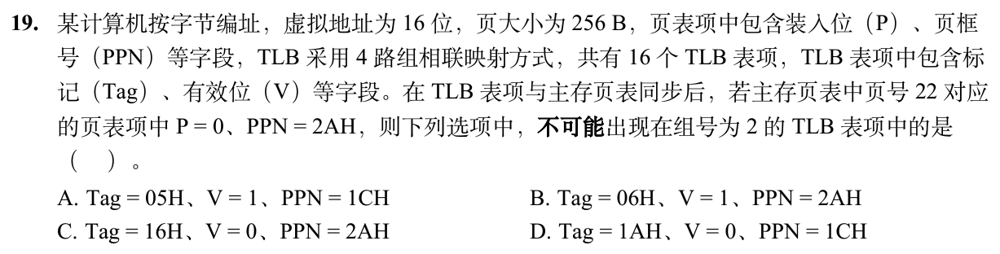

# 0816｜地址翻译链：虚拟地址怎样到达数据

> 这组题直接分成两截：
> 前面是**快速拿分题**，命中组合排查、MMU 职责与缺页本质，吃透概念直接秒；
> 后面是**耗时攻坚题**，虚实地址切分、TLB 组相联 Tag 位数、访存路径与页表级联计算，草稿纸画齐翻译流程。

---

## 一、 快速拿分题（组合排查与机制判定，概念秒杀）

### 01 · 2010-17
> *TLB、Cache、Page 命中组合。页在内存中才能进 Cache，TLB 命中则页必定在内存中，排除逻辑矛盾项。*

### 02 · 2019-14
> *缺页处理本质。CPU 硬件 MMU 在地址转换时检测到缺页异常，交由操作系统内核调页并重执原指令。*

### 03 · 2020-15
> *TLB 与 Cache 特性辨析。两者都利用局部性原理，TLB 缓存页表项以加速地址转换，Cache 缓存真实数据。*

### 04 · 2024-18
> *MMU 地址转换监控范围。MMU 负责检测访问越权和页面缺失；而 Cache 缺失由 Cache 控制器硬件处理，不归 MMU 管。*

---

## 二、 耗时攻坚题（虚实地址切分、查表推演与硬件标记精算）

### 05 · 2013-16
> *全相联 TLB 查表。从虚拟地址剥离出页内偏移，虚拟页号在 TLB 里逐项比对得出物理页框，拼出物理地址。*

### 06 · 2015-16
> *执行一条加法指令的访存次数。算清取指令、查页表、读操作数、写回的每一步访存开销，别漏指令本身。*

### 07 · 2022-15
> *多级页表查表推导。根据虚拟地址高位找到对应页表项，提取物理页框号再拼上页内偏移合成物理地址。*

### 08 · 2024-17
> *32 位虚拟地址、30 位物理地址、1KB 页。TLB 采用 4 路组相联，扣除组号和页内偏移后精确计算 Tag 位数。*

### 09 · 2026-19
> *TLB 采用 4 路组相联，16 个表项共 4 组（组号占 2 位）。虚拟页号 VPN 的低 2 位作为 TLB 组索引，高位作为 TLB Tag，比对组号为 2 的有效表项。*

