# 0817｜指令取数：格式、寻址与有效地址

> 这组题直接分成两截：
> 前面是**快速拿分题**，寻址方式分类、数组变址常识、操作数区分，概念清晰秒选；
> 后面是**耗时攻坚题**，变长指令扩展编码、相对寻址 PC 增量与位移量合成、定长指令字段精打细算。

---

## 一、 快速拿分题（寻址分类与常识速断，稳收基础分）

### 01 · 2011-16
> *偏移寻址包含基址、变址、相对寻址三大类；间接寻址属于多级寻址，不属于偏移寻址。*
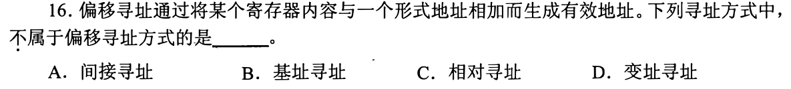

### 02 · 2017-15
> *顺序访问一维数组元素最适合变址寻址，基址固定在首地址，变址寄存器按元素大小自增。*
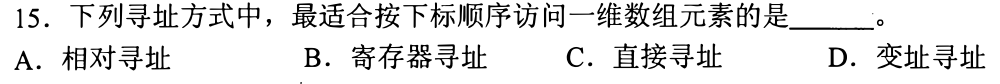

### 03 · 2018-18
> *double 数组变址寻址。每个 double 占 8 字节，变址步长是 8，算准每次循环有效地址的推进量。*
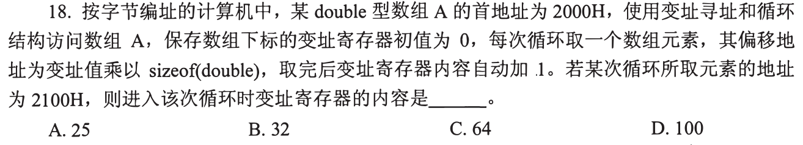

### 04 · 2023-17
> *通用寄存器中存的是操作数还是地址，CPU 完全由指令中的操作码和寻址方式位来区分，硬件不猜类型。*
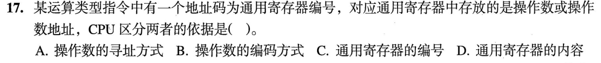

---

## 二、 耗时攻坚题（扩展操作码精算、相对转移与复杂寻址）

### 05 · 2009-16
> *相对寻址转移目标计算。牢记取指时 PC 已经自动增加，转移目标地址 = 当前 (PC) + 偏移量。*
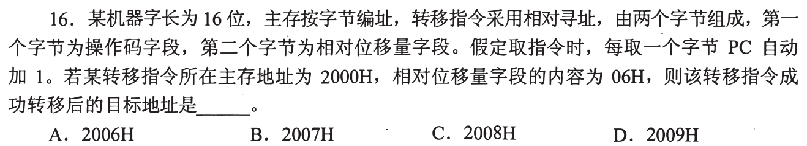

### 06 · 2013-17
> *变址寻址复合操作。看清是先变址再间接寻址，还是先间接寻址再变址，一步步查内存。*
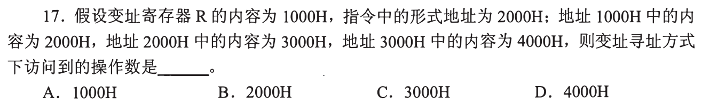

### 07 · 2014-17
> *32 位定长指令字。扣除 8 位操作码和通用寄存器编号后，剩下的基址寻址偏移量字段决定了寻址范围。*
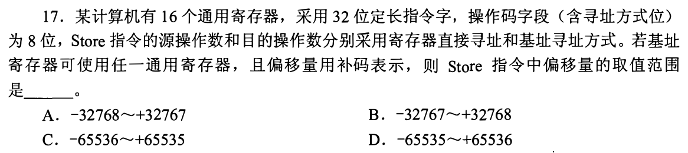

### 08 · 2016-17
> *扩展操作码编码设计。前缀不能与短操作码冲突，留给后续长操作码的状态数必须严格做减法。*
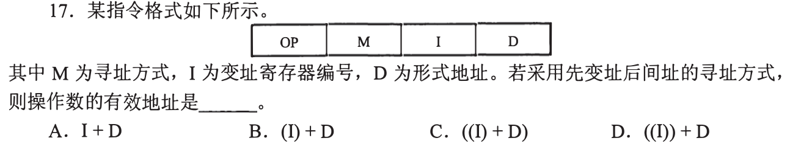

### 09 · 2017-16
> *固定字长容纳三地址和二地址指令。三地址指令未用的编码左移扩充给二地址，求最小合法指令字长。*
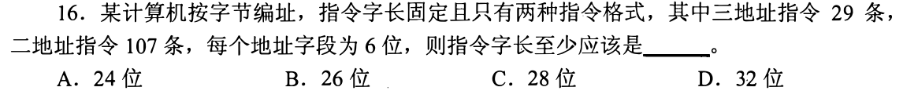

### 10 · 2019-15
> *基址寻址负偏移补码运算结合大端存储。算好物理地址后再从高字节往低字节按大端规则取数。*
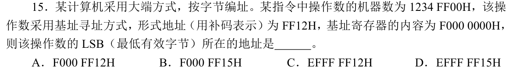

### 11 · 2020-16
> *16 位定长指令多寻址方式。扣除操作码和寻址方式位数后，算清直接寻址方式的可达地址范围。*
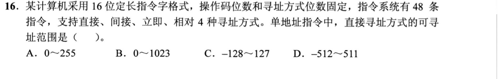

### 12 · 2022-19
> *扩展操作码最大指令数计算。二地址占完一部分状态，剩余状态左移留给一地址和零地址，算最大容量。*
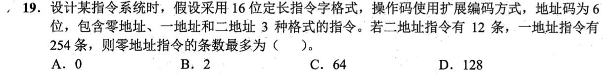

### 13 · 2026-17
<!-- 2026 压轴题位，已在 paper_html/408-2026.html 就绪 -->
