# 0818｜程序层级：从源程序到CPU真正执行的对象

> 这组题直接分成两截：
> 前面是**快速拿分题**，程序员可见寄存器、工具链翻译步骤、冯·诺依曼架构常识，1 分钟稳收；
> 后面是**耗时攻坚题**，ISA 与微架构分界、伪指令执行本质、RISC 现代边界推断，抠字眼别被绕晕。

---

## 一、 快速拿分题（架构分层与工具链流程，秒选过关）

### 01 · 2009-17
> *RISC 追求指令简单规整、单周期执行，普遍采用硬布线控制器而非微程序控制器。*
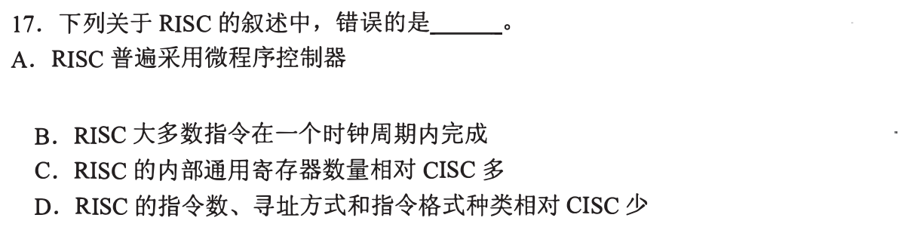

### 02 · 2010-18
> *汇编程序员可见寄存器包括 PC、通用寄存器、PSW；MAR、MDR、IR 是硬件内部透明的。*
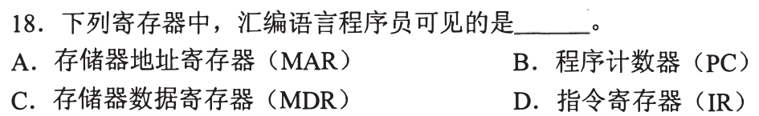

### 03 · 2011-18
> *指令格式规整、长度一致、边界对齐极其有利于流水线快速取指与译码。*
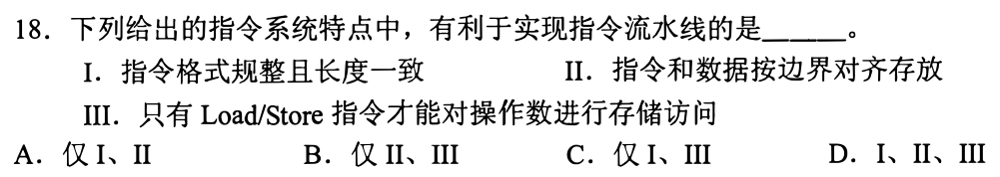

### 04 · 2015-12
> *计算机硬件唯一能直接执行的是机器语言程序，汇编程序和高级语言都要先翻译成机器码。*
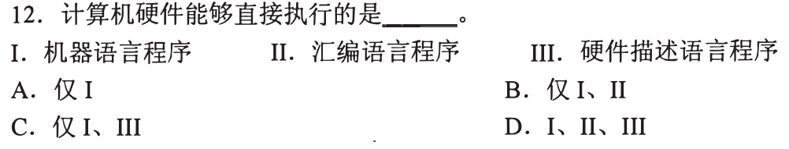

### 05 · 2016-12
> *将高级语言源程序翻译成目标机器代码的程序是编译器（Compiler）。*
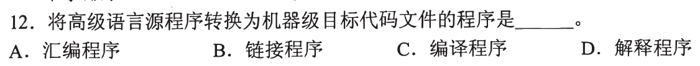

### 06 · 2018-12
> *冯·诺依曼计算机采用二进制，根本原因在于物理器件容易实现双稳态且运算规则简便。*
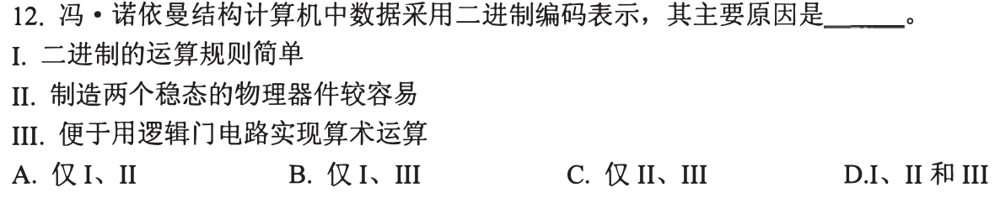

### 07 · 2019-12
> *冯·诺依曼核心思想是“存储程序、程序控制”，指令和数据以同等地位存放在主存储器中。*
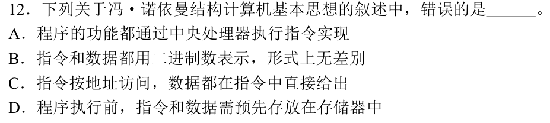

### 08 · 2021-17
> *汇编程序员可见的包括基址寄存器、标志寄存器；微指令寄存器、ROAR 对汇编完全透明。*
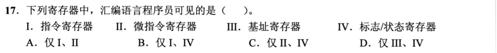

### 09 · 2022-20
> *高级语言到可执行文件全流程：预处理 $\to$ 编译 $\to$ 汇编 $\to$ 链接，先后次序绝不可颠倒。*
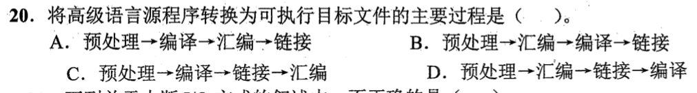

---

### 10 · 2026-12
> *微程序机器直接执行微指令，传统机器语言由微程序解释执行；高级语言和操作系统处于更高抽象层，各层之间通过定义明确的接口衔接。*
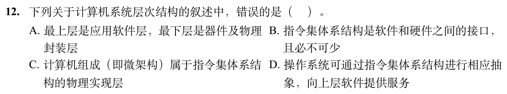

## 二、 耗时攻坚题（ISA 边界判定、字长内涵与微架构解耦）

### 11 · 2020-12
> *机器字长通常指 ALU 和通用寄存器的位数，指令寄存器 IR 的宽度由指令字长决定，两者未必相等。*
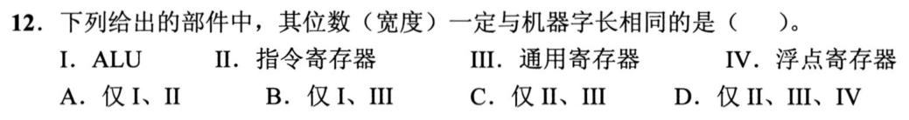

### 12 · 2022-18
> *ISA 规定的是软件能感知的属性（指令格式、寻址方式、寄存器），时钟周期和流水段数属于微架构实现。*
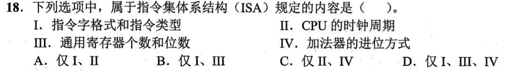

### 13 · 2024-13
> *伪指令是汇编器的语法糖，CPU 硬件无法直接执行，必须被汇编器展开为真实机器指令序列。*
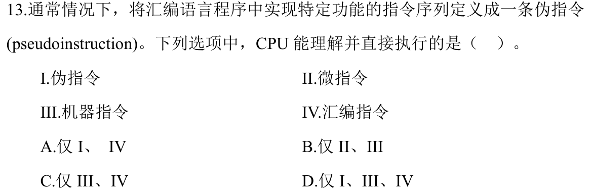

### 14 · 2025-16
> *是否定长指令字属于 ISA 规定范围；而是否使用阵列乘法器是硬件微架构实现，ISA 绝不过问。*
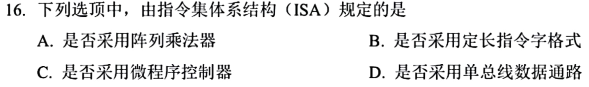

### 15 · 2025-17
> *RISC 深度辨析。硬连线控制、大量通用寄存器、单周期流水线紧密结合，抠准选项中的微小混淆点。*
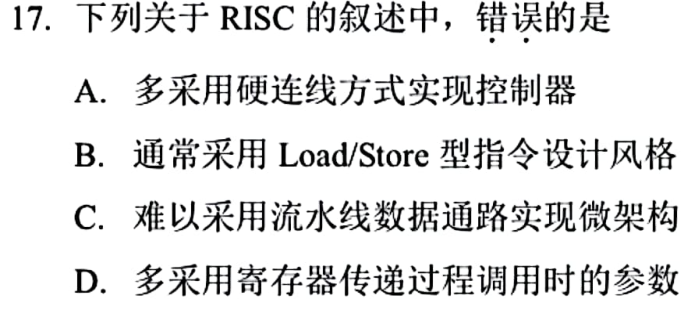

### 16 · 2026-16
> *ISA（指令集体系结构）规定软件开发者和编译器可见的机器特性（指令格式、寻址方式、通用寄存器个数等）；硬件部件实现方式（如流水线段数、ALU加法器结构）属于微架构。*
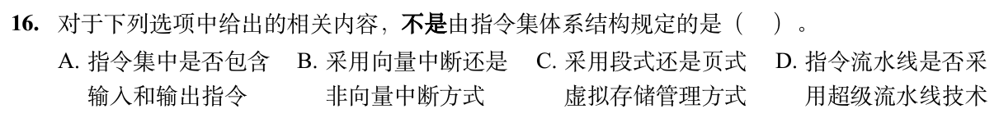
