# 0819｜数据通路：状态元件、操作元件与控制信号

> 当前显示 **5 题**（2020—2026 年）；**7 题暂缓**，原文保留在文件末尾的 HTML 注释中，未删除。

## 当前题单（2020—2026）

### 01 · 2021-18
> *数据通路包含 ALU、加法器等操作元件以及通用寄存器等状态元件，控制信号由控制器生成。*
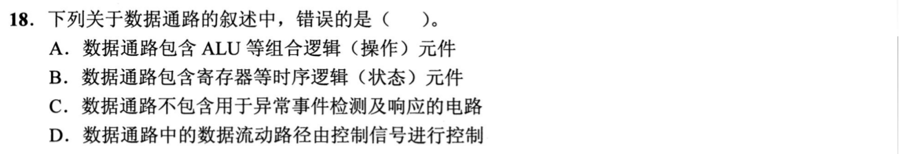

### 02 · 2022-22
> *并行体系结构分类，多核处理器属于 MIMD，向量处理器属于 SIMD，区分指令流与数据流。*
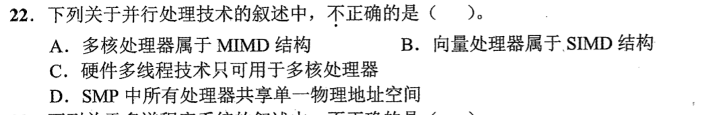

### 03 · 2023-18
> *操作元件是纯组合逻辑（ALU、多路选择器），状态元件是时序逻辑（寄存器、计数器）。*
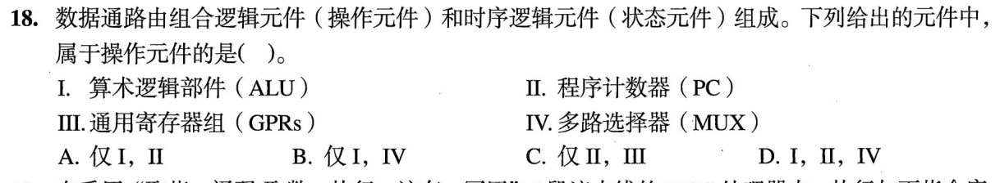

### 04 · 2025-19
> *CPU 内部数据通路与总线连接细节。PC 独立于通用寄存器组，掌握内部单总线与多总线区别。*
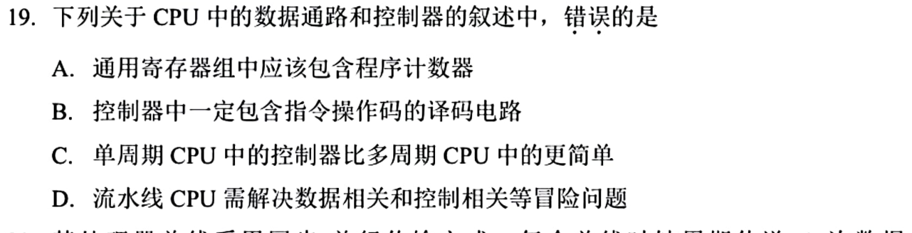

### 05 · 2026-20
> *单周期数据通路每条指令都在一个长时钟周期内完成（CPI=1，但时钟周期长）；多周期数据通路将指令拆为多步（CPI>1，但时钟频率高）。*
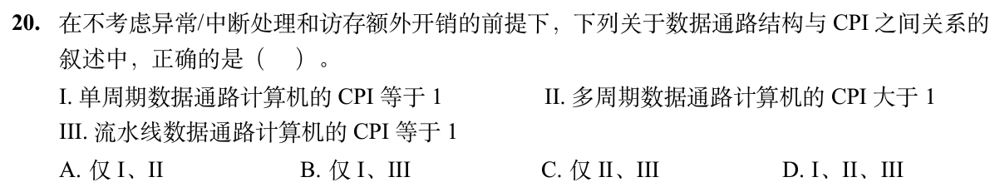

## 暂缓题目

以下题目仅暂时不处理；完整题目条目保留在 Markdown 源文件的 HTML 注释内，预览不显示题目。

<!-- 暂缓题：2009-19；暂时不处理，未删除。
### 01 · 2009-19
> *硬布线速度快但逻辑固定难扩展，微程序速度慢但规整灵活便于修改维护。*
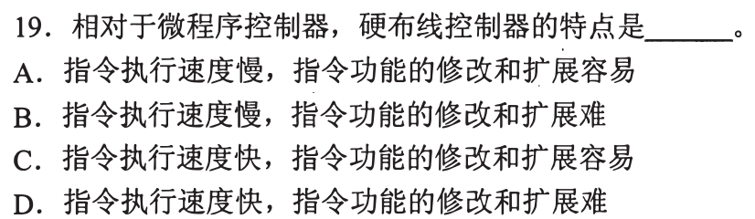
-->

<!-- 暂缓题：2016-20；暂时不处理，未删除。
### 02 · 2016-20
> *单周期处理器的时钟周期必须迁就最慢的那条指令，所有指令都强制在一个周期内完成。*
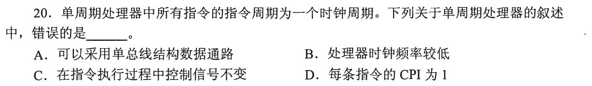
-->

<!-- 暂缓题：2011-19；暂时不处理，未删除。
### 06 · 2011-19
> *指令周期的微操作时序。取指公共操作、中断检查时机与执行周期的先后顺序必须分清。*

-->

<!-- 暂缓题：2012-18；暂时不处理，未删除。
### 07 · 2012-18
> *微指令字段直接编码。互斥微命令分组编码，每组要留一个状态表示不发命令（命令数加 1 向上取整）。*
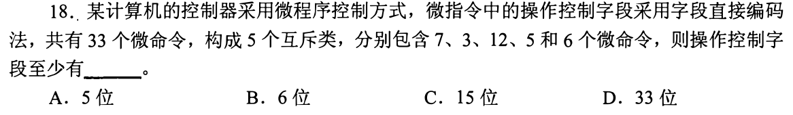
-->

<!-- 暂缓题：2014-18；暂时不处理，未删除。
### 08 · 2014-18
> *微程序断定法下地址位数。根据控制存储器总微指令条数向上取整为 2 的幂，确定下地址字段宽度。*
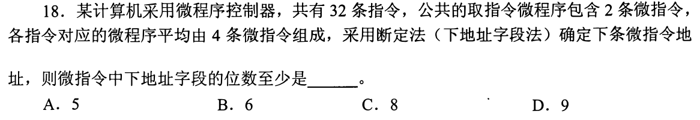
-->

<!-- 暂缓题：2016-18；暂时不处理，未删除。
### 09 · 2016-18
> *32 位定长指令且字边界对齐。按字节编址时 PC 低 2 位恒为 0，有效位数可减少 2 位，看清题目设问。*
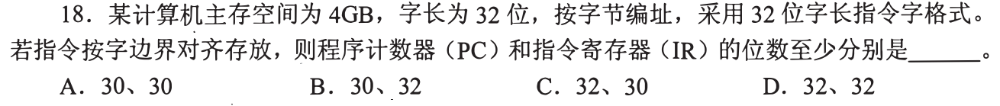
-->

<!-- 暂缓题：2019-17；暂时不处理，未删除。
### 10 · 2019-17
> *`R[r2] <- R[r1] + M[R[r0]]` 数据流分析。先用寄存器间接寻址访存取操作数，再送 ALU 运算写回。*
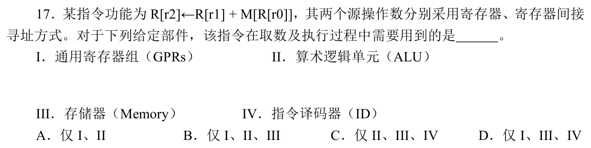
-->
