[« 0819-answer-sonnet](0819-answer-sonnet.md)　　[0821-answer-sonnet »](0821-answer-sonnet.md)

# 0820 Answer｜流水线：结果何时产生，下一条何时需要

> [原题 14 题](0820.md) · [0819 数据通路 · 0819-answer-sonnet](0819-answer-sonnet.md) · [能力账本](answer-quality/learning-ledger.md)

**进入本篇时已有**：流水线分段、周期由最慢段定（0818-03）；数据流映射到 GPR/存储器/ALU（0819-08）；操作元件＋状态元件＋控制信号选路（0819-09）；GPR 由指令字段选、PC 不在其中（0819-12）。
**读完新增**：01 周期＝最慢段，不是各段之和 · 02 三类冒险与转发的角色 · 03 无新台阶 · 04 n 条 k 段需 k+n−1 拍 · 05 无转发时相邻 RAW 的时间表 · 06 超标量＝同拍发射多条 · 07 无新台阶 · 08 周期＝最慢段＋段寄存器延迟 · 09 间隔 2 条仍冒险 · 10 CPI 按“拍/条”分类型 · 11 转发只搬已产出的值：load-use 与分支 · 12 无新台阶 · 13 Cache 缺失拉高 CPI · 14 无新台阶

<details><summary>速览</summary>

| # | 新增台阶 | 起手 | 最易错 → 先看什么 |
|---|---|---|---|
| [01](#q01) | 周期＝max 段 | 列四段时长，圈最大 | 把 300 当周期 → 题问相邻指令的节拍 |
| [02](#q02) | 冒险三类，转发是解法 | 每项问“后一条为何要等” | 把转发当冒险源 → 它搬的是已有结果 |
| [03](#q03) | 无 | 回 0818-03 画 5 段 | 无 → 无 |
| [04](#q04) | k+n−1 拍 | 画第 1、2 条的时间格 | 100 条×1 拍 → 第 1 条要 4 拍才完 |
| [05](#q05) | 相邻 RAW 时间表 | 每条写“读哪些/写哪个” | 看寄存器重名就判相关 → 看“先写后读” |
| [06](#q06) | 同拍多发射 | 问“一拍能启动几条” | 多发射＝单段变快 → 段时长不变 |
| [07](#q07) | 无 | 问“这部件产生信号还是搬数据” | 控制器算数据通路 → 它只发信号 |
| [08](#q08) | 周期含段寄存器延迟 | 写 max+20 | 只取最大段 → 题给了寄存器延时 |
| [09](#q09) | 隔一条仍冒险 | 给 4 条标 IF…WB 格 | 只查相邻 → 隔 1 条也读在写前 |
| [10](#q10) | CPI＝拍/条的四类 | 每类问“一条要几拍/一拍几条” | 超标量也 1 → 可小于 1 |
| [11](#q11) | 转发时刻：load 值晚一拍；分支阻塞 | 画 I1–I4 时间格并标值产出点 | 以为转发消灭一切 → 值产出点在 MEM 末 |
| [12](#q12) | 无 | 写 `load`+紧随 `add` | “旁路能解决全部” → load-use |
| [13](#q13) | 缺失拉高 CPI | 写 CPI＝理想＋停顿 | 把 CPI 与周期长度混 → 缺失增加的是拍数 |
| [14](#q14) | 无 | 回 0819-12 | 无 → 无 |

**反复信号**：值何时产出 vs 何时被读（05、09、11、12）；题问“错误”时逐项找反例（07、12、13、14）。
</details>

<a id="q01"></a>
## 01｜2009-18：周期由最慢段定，不是各段之和

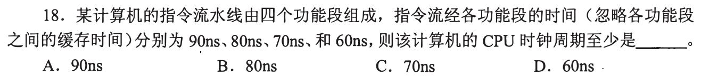

**新增**：0818-03 只说“周期由最慢段定”，这里定量：周期＝max(各段)，单条延迟＝Σ(各段)。**起手**：写 90、80、70、60，圈最大。**答案：A**

每拍各段同时处理不同指令，拍长必须让 90ns 那段做完（下界）；取全部段 90ns 时各段都做得完（可达）。题面“忽略缓存时间”，故不加别的。

| 选项 | 与题面的关系 |
|---|---|
| A 90 | max |
| B 80、C 70、D 60 | 小于 90，第一段做不完 |

300ns 是一条指令走完四段的时间，不是相邻两条指令进入的间隔。

<a id="q02"></a>
## 02｜2010-19：冒险让后一条等，转发是解法

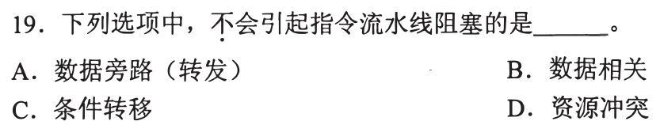

**新增**：后一条指令因**资源、数据、下一条地址**三类原因拿不到所需东西而等待，即结构、数据、控制冒险；转发是把前条已算出的结果直接送给后条输入、省去等写回的通路。**起手**：每项问“后一条为什么要等”。题问**不会**阻塞。**答案：A**

| 选项 | 后一条为何等 | 判断 |
|---|---|---|
| A 数据旁路 | 它本身是缩短等待的通路，不是等待的原因 | 不会 |
| B 数据相关 | 要的值前条还没写出 | 会 |
| C 条件转移 | 下一条取哪里要等条件算出 | 会 |
| D 资源冲突 | 两条同拍要同一部件 | 会 |

转发能否让等待降为零，取决于值何时产出，见 [11](#q11)。

<a id="q03"></a>
## 03｜2011-18：无新台阶

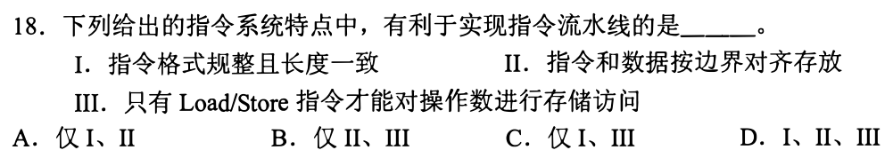

0818-03 的原题，三项均有利于各指令分段一致，见 [0818-03 · 0818-answer-sonnet](0818-answer-sonnet.md#q03)。**答案：D**

<a id="q04"></a>
## 04｜2013-18：有限条数要付装满流水线的拍数

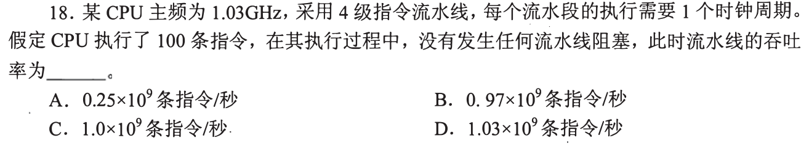

**新增**：n 条、k 段、无阻塞共 k+n−1 拍。**起手**：画前两条的时间格。**答案：C**

```
     c1 c2 c3 c4 c5
I1   S1 S2 S3 S4
I2      S1 S2 S3 S4
```

I1 第 4 拍完成，此后每拍完成一条，I100 在第 4+99＝103 拍完成。

```
T = 103 / 1.03×10⁹ = 1.0×10⁻⁷ s
吞吐 = 100 / 10⁻⁷ = 1.0×10⁹ 条/秒
```

| 选项 | 与题面的关系 |
|---|---|
| A 0.25×10⁹ | 对应 412 拍（103/0.25），题面无阻塞，不符 |
| B 0.97×10⁹ | 对应约 106.2 拍，非整数拍，不符 |
| D 1.03×10⁹ | 即每拍一条，忽略了前 3 拍只有部分段在工作 |

<a id="q05"></a>
## 05｜2016-19：写出每条读什么写什么，找“先写后读”

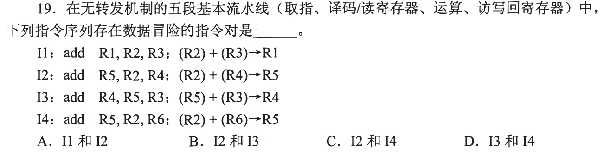

**新增**：无转发时，前条的结果到写回段才写入寄存器，后条在译码段读寄存器；相邻两条中后条读前条所写，就读到旧值。**起手**：每条写“读 / 写”。**答案：B**

| 指令 | 读 | 写 |
|---|---|---|
| I1 | R2, R3 | R1 |
| I2 | R2, R4 | R5 |
| I3 | R5, R3 | R4 |
| I4 | R2, R6 | R5 |

```
     c1 c2 c3 c4 c5
I2   IF ID EX MEM WB   ← 写 R5 在 c5
I3      IF ID          ← 读 R5 在 c3
```

| 选项 | 依据 |
|---|---|
| A I1,I2 | I1 写 R1，I2 不读 R1；共读 R2 无影响 |
| B I2,I3 | I2 写 R5，I3 读 R5，c3 读在 c5 写前 |
| C I2,I4 | 同写 R5，I4 不读 R5；按序流水中写回顺序不变 |
| D I3,I4 | I3 写 R4，I4 不读 R4 |

I2 读 R4、I3 写 R4 方向相反，I3 的写在 I2 读之后，不是先写后读。

<a id="q06"></a>
## 06｜2017-17：超标量＝同一拍发射多条

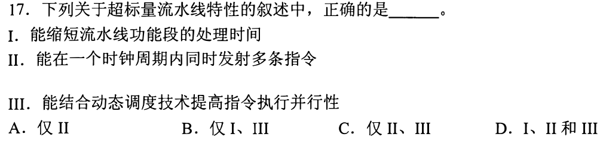

**新增**：超标量用多套部件，**每拍启动多于一条**指令；每段本身要多久不因此改变。**起手**：问“一拍能启动几条”。**答案：C**

| 项 | 判断 |
|---|---|
| I 缩短功能段处理时间 | 多发射增加的是同拍条数，不是单段时长；题面无任何使段变快的手段，错 |
| II 一拍发射多条 | 即超标量的定义，对 |
| III 结合动态调度 | 动态调度由硬件挑出互不相关的指令去发射，教材将其与超标量配合使用，对 |

故仅 II、III。依赖或资源不足时实际并不总能发射满。

<a id="q07"></a>
## 07｜2017-19：无新台阶——控制器发信号，数据通路被控制


调用 [0819-09 · 0819-answer-sonnet](0819-answer-sonnet.md#q09)（数据通路＝操作元件＋状态元件，路径由控制信号选）。题问**错误**项。**答案：A**

| 选项 | 依据 | 判断 |
|---|---|---|
| A 含生成控制信号的控制部件 | 控制信号是送进数据通路的输入，产生它的是控制器 | **错** |
| B 含 ALU | 操作元件 | 对 |
| C 含 GPR 组和取指部件 | 状态元件；取指也是数据流的一段（0819-08） | 对 |
| D 组合＋时序逻辑 | 即操作元件（组合）＋状态元件（时序） | 对 |

<a id="q08"></a>
## 08｜2018-20：每拍还要付段寄存器的延时

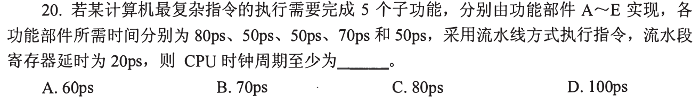

**新增**：与 [01](#q01) 比，本题给了流水段寄存器延时，每拍＝本段组合时间＋20ps。**起手**：写 80+20。**答案：D**

读法：A~E 五个子功能各占一段，每个部件不可再拆，故拍长至少 80+20＝100ps（下界）；五段都按 100ps 可行（可达）。把五个部件时间加起来（300ps）是单条指令的延迟，与 01 同理，不是拍长。

| 选项 | 与题面的关系 |
|---|---|
| A 60、B 70、C 80 | C 少了 20ps 寄存器延时；A、B 比最慢部件 80 还小，A 部件做不完 |
| D 100 | 80+20 |

<a id="q09"></a>
## 09｜2019-18：隔一条的先写后读也算冒险

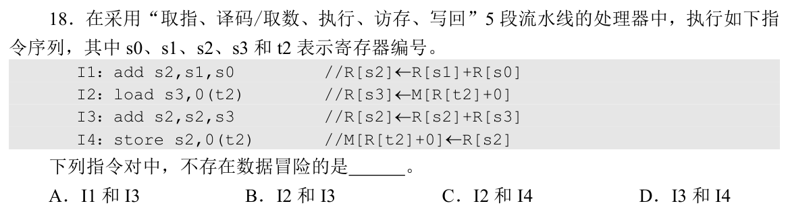

**新增**：沿用 05 的时间表，把间隔推广到隔一条：I_i 写在第 i+4 拍，I_j 读在第 j+1 拍。**起手**：每条标读/写寄存器。题问**不存在**冒险。**答案：C**

| 指令 | 读 | 写 |
|---|---|---|
| I1 | s1, s0 | s2 |
| I2 | t2 | s3 |
| I3 | s2, s3 | s2 |
| I4 | s2（存的数）, t2（地址基址） | 内存 |

| 选项 | 间隔 | 先写后读的寄存器 | 读在写前？ |
|---|---|---|---|
| A I1,I3 | 隔一条 | s2 | I3 读在第 4 拍，I1 写在第 5 拍，是 |
| B I2,I3 | 相邻 | s3 | 读第 4、写第 6 拍，是 |
| C I2,I4 | 隔一条 | 无（I2 写 s3，I4 读 s2、t2） | 无依赖 |
| D I3,I4 | 相邻 | s2 | 是 |

<details><summary>I2、I4 的内存访问</summary>
二者经 t2 访问同一地址，但 I2 在第 5 拍读、I4 在第 7 拍写，顺序未变，不构成寄存器数据冒险。
</details>

<a id="q10"></a>
## 10｜2020-17：CPI＝每条指令平均几拍

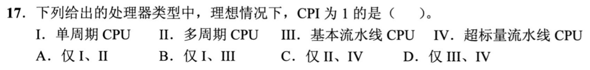

**新增**：CPI＝总拍数÷指令数；逐类问“一条要几拍”。沿用 04（稳态每拍完成一条）、06（一拍可完成多条）。**起手**：每类写“一条几拍/一拍几条”。**答案：B**

| 类型 | 理想情况 | CPI |
|---|---|---|
| I 单周期 | 一条一个周期 | 1 |
| II 多周期 | 一条分多个周期 | >1 |
| III 基本流水线 | 稳态每拍完成一条（04） | 1 |
| IV 超标量 | 每拍可完成多条（06） | 可<1 |

仅 I、III。装满阶段的几拍使有限程序的 CPI 略高于 1，题问“理想”，不计。

<a id="q11"></a>
## 11｜2023-19：转发只搬已经产出的值

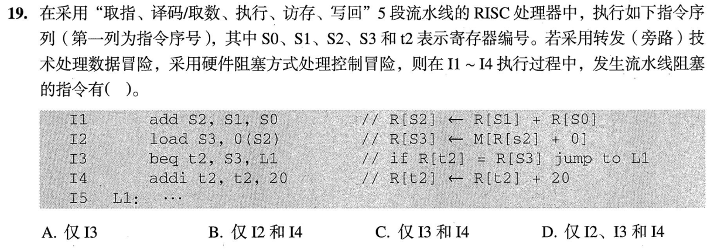

**新增**：ALU 结果在执行段末产出，load 的值在访存段末才产出，早一拍与晚一拍决定转发后是否还要等。另外题面指定分支用硬件阻塞。**起手**：画时间格，标每个值的产出点。**答案：C**

```
      c1 c2 c3 c4  c5  c6  c7
I1    IF ID EX MEM WB          s2 产出于 c3 末
I2       IF ID EX  MEM WB      EX 在 c4 用 s2；s3 产出于 c5 末
I3          IF ID  ──  EX      beq 要 s3，EX 只能 c6
```

| 指令 | 是否阻塞 | 依据 |
|---|---|---|
| I1 | 否 | 无前驱 |
| I2 | 否 | 需 s2，c3 末已产出，转发给 c4 的 EX |
| I3 | 是 | 需 s3，c5 末才产出，转发也要等一拍；若比较放在译码段则等更久，同样要等 |
| I4 | 是 | 题面指定硬件阻塞处理控制冒险，I3 的转移结果出来前 I4 不继续 |

I4 只写 t2 而 I3 读 t2，无数据冒险，它的阻塞来自控制。B、D 含 I2，漏看 s2 可转发；A 漏了 I4。

<a id="q12"></a>
## 12｜2024-19：无新台阶——转发不是万能

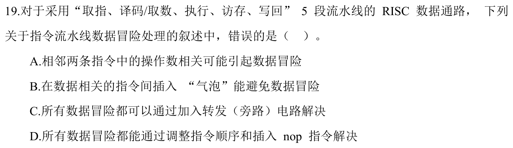

调用 11 的产出点、09 的间隔。题问**错误**项。**答案：C**

| 选项 | 依据 | 判断 |
|---|---|---|
| A 相邻指令操作数相关可能引起冒险 | 05 | 对 |
| B 插气泡避免冒险 | 气泡把消费者推后，读在写之后 | 对 |
| C 所有数据冒险都能靠转发解决 | `load R1,0(R2)` 紧跟 `add R3,R1,R4`：R1 在访存段末才产出，add 的执行段已开始（11） | **错** |
| D 调整顺序、插 nop 解决所有 | nop 只增大间隔；09 已说间隔拉大后读在写后，总能做到 | 对 |

<a id="q13"></a>
## 13｜2025-18：缺失让一条指令多花拍数

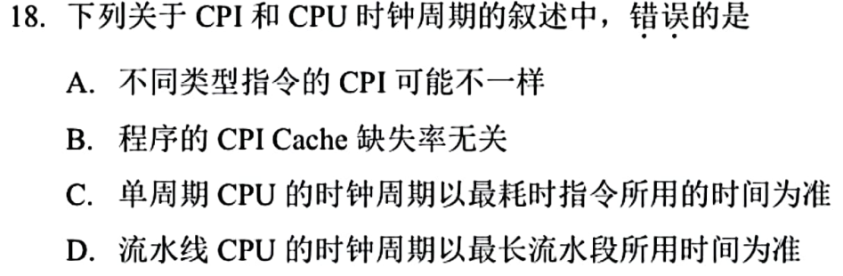

**新增**：Cache 缺失使取指或访存段多等若干拍，CPI＝理想 CPI＋平均每条的停顿拍数。**起手**：写 CPI＝理想＋缺失率×惩罚拍数（粗式）。题问**错误**项。**答案：B**

读法：B 的“与”字图上缺失，按“与 Cache 缺失率无关”读。

| 选项 | 依据 | 判断 |
|---|---|---|
| A 类型不同 CPI 可不同 | 10 中单周期与多周期已不同；同一机器各类指令拍数也可不同 | 对 |
| B 程序 CPI 与缺失率无关 | 缺失多等拍，缺失率升则平均拍数升 | **错** |
| C 单周期周期按最耗时指令 | 一条指令一个周期，周期必须容得下最长的那条 | 对 |
| D 流水线周期按最长段 | 01 | 对 |

<a id="q14"></a>
## 14｜2025-19：无新台阶——与 0819-12 同题

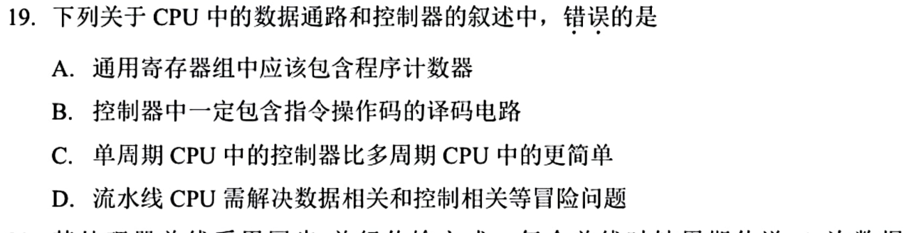

原题已在 [0819-12 · 0819-answer-sonnet](0819-answer-sonnet.md#q12) 逐项裁决：PC 不在寄存器字段选出的 GPR 组里，故 A 错。**答案：A**

本篇补一个对照：D“流水线要解决数据、控制冒险”现在由 02 直接支持。

[« 0819-answer-sonnet](0819-answer-sonnet.md)　　[0821-answer-sonnet »](0821-answer-sonnet.md)
