# 0820｜流水线：结果何时产生，下一条何时需要

> 这组题直接分成两截：
> 前面是**快速拿分题**，流水线时钟周期、超标量概念、理想 CPI 结论，公式秒出；
> 后面是**耗时攻坚题**，数据冒险（RAW）气泡数精确推演、转发旁路时序推断、结构冒险排查，画好时序甘特图。

---

## 一、 快速拿分题（周期公式与冒险分类，秒出答案）

### 01 · 2009-18
> *流水线时钟周期由最慢的功能段决定，瓶颈段耗时多长，CPU 时钟周期至少就要定多长。*
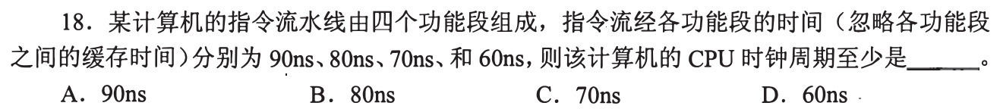

### 02 · 2010-19
> *数据旁路（转发）专门用于提前把计算结果送回后续指令输入端，是解决阻塞的手段，不会引起阻塞。*
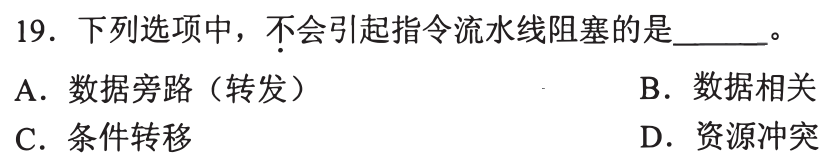

### 03 · 2013-18
> *4 级流水线执行 100 条无阻塞指令。第 1 条需 4 个时钟周期，后续 99 条每周期流出一条，总计 103 个周期。*
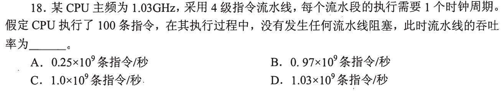

### 04 · 2017-17
> *超标量流水线靠配置多个执行部件在一个时钟周期内发射多条指令，不能缩短单段执行时间。*
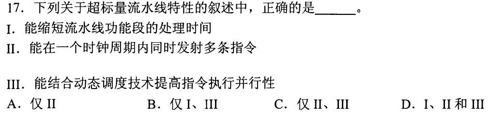

### 05 · 2017-19
> *流水线数据通路中必须包含流水寄存器，用于在相邻功能段之间暂存数据和传递控制信号。*
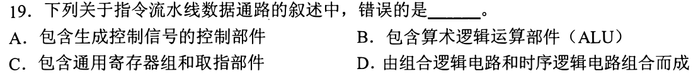

### 06 · 2020-17
> *理想 CPI 为 1 的只有单周期 CPU 和基本流水线 CPU；超标量 CPI 小于 1，多周期 CPI 大于 1。*
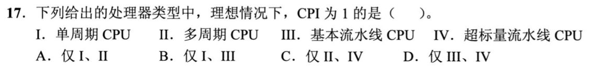

---

## 二、 耗时攻坚题（RAW 冒险推演、流水寄存器延迟与调度优化）

### 07 · 2016-19
> *无转发机制五段流水线。写回在第 5 段（WB），后序指令在第 2 段（ID）读，算清哪些指令对产生 RAW 冒险。*
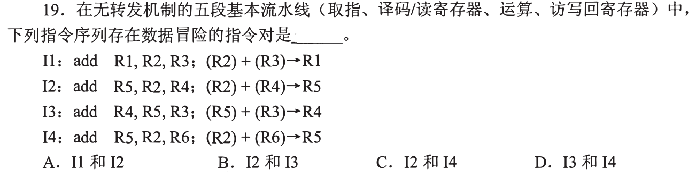

### 08 · 2018-20
> *考虑流水寄存器延迟。每个时钟周期 = 瓶颈段耗时 + 流水寄存器开销，别漏掉了寄存器延迟。*
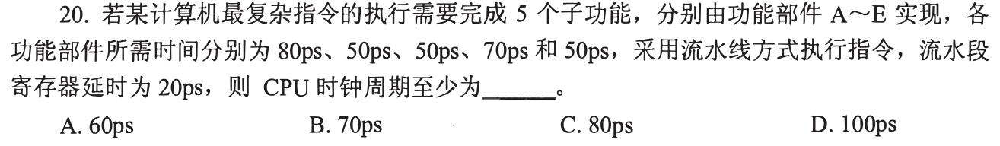

### 09 · 2019-18
> *5 段流水线指令序列气泡推演。画出 IF-ID-EX-MEM-WB 时序甘特图，看清 load-use 冒险插入的气泡数。*
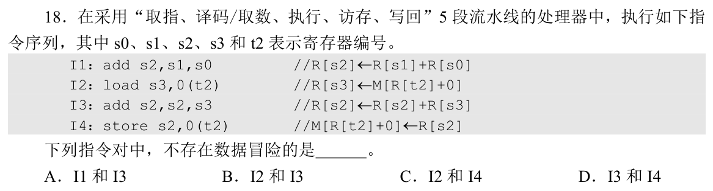

### 10 · 2023-19
> *带转发的 5 段流水线。ALU 运算结果可以直接转发，但 load 指令结果必须等到 MEM 段结束才能转发。*
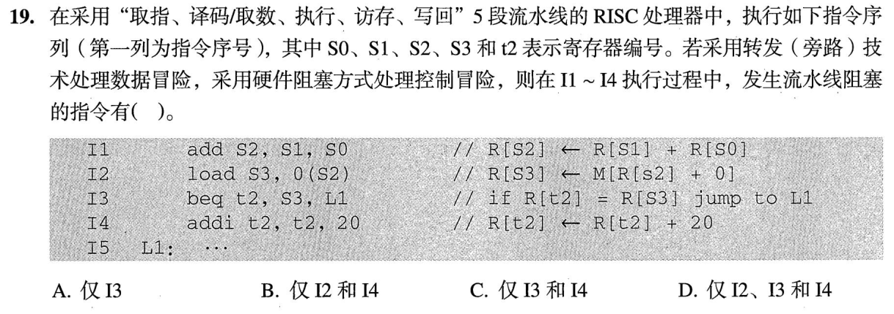

### 11 · 2024-19
> *数据冒险处理综合辨析。编译指令重排、硬件插入气泡以及旁路转发的适用边界与性能代价。*
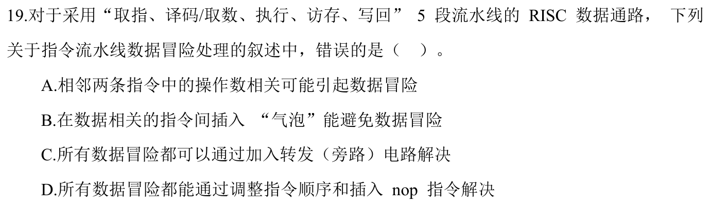
