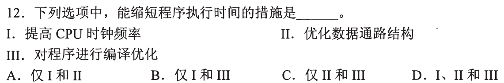
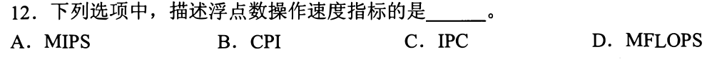
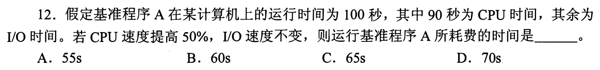
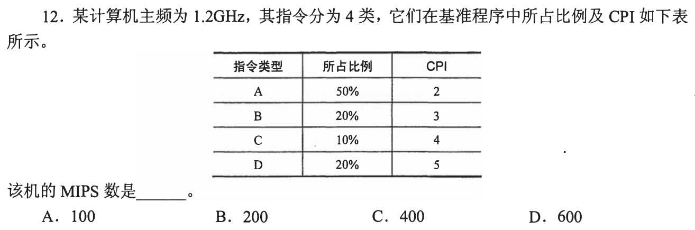
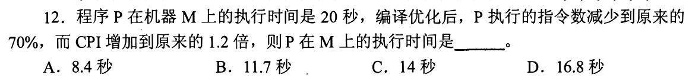
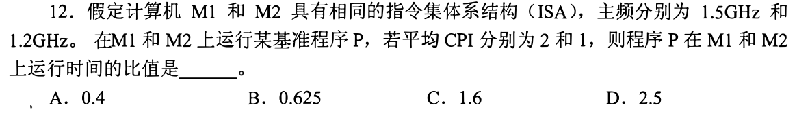
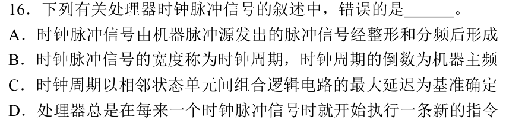
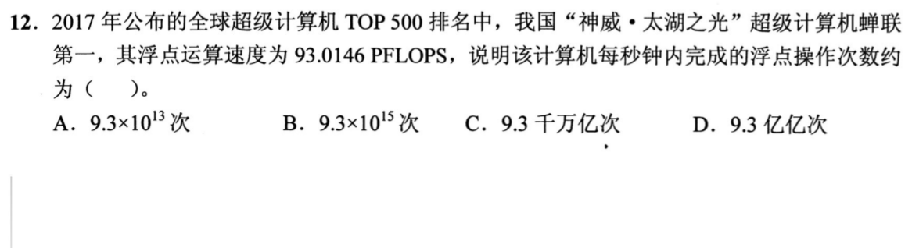
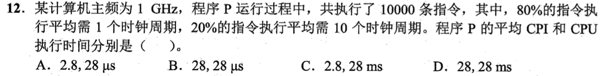
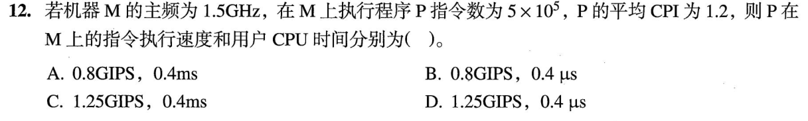

[« 0820-answer](0820-answer.md)　　[0822-answer »](0822-answer.md)

# 0821 Answer｜性能方程：时间由多少工作和每步多慢共同决定

> [原题 12 题](0821.md) · [0820 流水线](0820-answer.md) · [能力账本](answer-quality/learning-ledger.md)

**进入本篇时已有**：CPI＝拍/条，按指令类型分（0820-10）；周期由最慢段定（0820-01、0818-03）；停顿使一条指令多占拍（0820-11）；Cache 缺失拉高 CPI（0820-13）。
**读完新增**：01 时间＝指令数×CPI×周期，三个因子各有一类措施 · 02 指标的分子分母：MIPS／FLOPS／CPI／IPC · 03 只有被加速的那段缩短，其余段原样相加 · 04 平均 CPI 按条数加权，MIPS＝MHz÷CPI · 05 多个因子同时变，倍数相乘 · 06 比较两机：共同的指令数约去 · 07 时钟脉冲≠每拍发射一条 · 08 无新台阶 · 09 P＝10¹⁵，与“亿亿”换算 · 10 周期数÷主频＝时间，单位换算 · 11 无新台阶 · 12 无新台阶

<details><summary>速览</summary>

| # | 新增台阶 | 起手 | 最易错 → 先看什么 |
| --- | --- | --- | --- |
| [01](#q01) | T＝N×CPI×周期 | 写出乘积，三个措施各对应哪一项 | 以为“能”＝“必定” → 题问“能缩短” |
| [02](#q02) | 指标的分子分母 | 每个选项写“什么／什么” | 看到“速度”选 MIPS → 题干限定“浮点数” |
| [03](#q03) | 只缩短被加速的段 | 把 100s 拆成 90＋10 | 100÷1.5 → I/O 没被加速 |
| [04](#q04) | 条数加权 CPI；MIPS＝MHz÷CPI | 列 比例×CPI 四项求和 | 四个 CPI 取平均 → 比例不等 |
| [05](#q05) | 倍数相乘 | 写 20×0.7×1.2 | 只乘 0.7 → CPI 也变了 |
| [06](#q06) | 约去共同的 N | 写 CPI÷频率 的两个式子 | 比值颠倒 → 问的是 M1÷M2 |
| [07](#q07) | 脉冲不等于发射 | 想一次流水线停顿的那一拍 | 对“总是”不设防 → 找反例 |
| [08](#q08) | 无 | 回 0820-10 | — |
| [09](#q09) | P＝10¹⁵；亿亿＝10¹⁶ | 写 93×10¹⁵ | 少移一位 → 93 不是 9.3 |
| [10](#q10) | 周期数÷主频 | 先算总周期，再换 ns | 28 与 2.8 混 → 平均 CPI 不乘条数 |
| [11](#q11) | 无 | 回 04、10 | — |
| [12](#q12) | 无 | 回 0820-13 | — |

**反复信号**：先问“这一项是不是被改动的那一项”（03、05）；单位先写再算（04、09、10）；题问“错误”时找“总是／无关”这类绝对词（07、12）。
</details>

<a id="q01"></a>
## 01｜2010-12：时间＝指令数×CPI×周期



**新增**：执行时间由三个因子相乘。**起手 → 答案 D**

```
T = 指令条数 N × CPI × 时钟周期（＝1/主频）
```

| 措施 | 作用在哪个因子 | 结论 |
| --- | --- | --- |
| I 提高时钟频率 | 周期变短 | 能 |
| II 优化数据通路结构 | 缩短周期（关键路径）或减少 CPI | 能 |
| III 编译优化 | 减少 N（或改指令组合） | 能 |

A、B、C 各自漏掉一项，而这一项在乘积里都有对应因子。题问“能缩短”，只要求有可能；是否真缩短要重算乘积（频率升而 CPI 增大会抵消），本题不要求。

<a id="q02"></a>
## 02｜2011-12：指标看分子和分母数的是什么



**新增**：性能指标靠“数什么／每什么”区分。**起手 → 答案 D**：先写每个选项的分数。

| 选项 | 含义 | 是否数浮点操作 |
| --- | --- | --- |
| A MIPS | 百万条**指令**／秒 | 否，指令不一定是浮点指令 |
| B CPI | **周期**／条指令 | 否，不是速度，是每条的周期数 |
| C IPC | 指令／周期 | 否，同上，且是 CPI 的倒数 |
| D MFLOPS | 百万次**浮点操作**／秒 | 是 |


<a id="q03"></a>
## 03｜2012-12：只缩短被加速的那一段



**新增**：总时间分段计算，没被加速的段原样保留。**起手 → 答案 D**：把 100s 拆开。

```
CPU 90s ──速度×1.5──▶ 90 ÷ 1.5 = 60s
I/O 10s ──不变──────▶ 10s
合计 70s
```

| 选项 | 数值与题面的关系 |
| --- | --- |
| A 55s | 等于 90÷2＋10，对应 CPU 速度提高 100%，题面是 50% |
| B 60s | 只有 CPU 段，漏掉题面明说不变的 I/O 10s |
| C 65s | 没有对应的 CPU 缩短量（需 CPU 55s） |
| D 70s | 60＋10 |


<a id="q04"></a>
## 04｜2013-12：平均 CPI 按条数加权，MIPS＝MHz÷CPI



**新增**：加权平均 CPI，及主频到 MIPS 的单位换算。**起手 → 答案 C**：列四项求和。

```
CPI = 0.5×2 + 0.2×3 + 0.1×4 + 0.2×5 = 1 + 0.6 + 0.4 + 1 = 3
每秒指令 = 1.2GHz ÷ 3 = 1200MHz ÷ 3 = 400 百万条/秒 = 400 MIPS
```

加权平均必然落在最小与最大 CPI 之间（2～5），可直接检验选项：

| 选项 | 对应的 CPI（1200÷选项） | 判断 |
| --- | --- | --- |
| A 100 | 12 | 超过最大 CPI 5，不可能 |
| B 200 | 6 | 同上 |
| C 400 | 3 | 与加权结果一致 |
| D 600 | 2 | 等于最小 CPI，要求全是 A 类，但 A 只占 50% |


<a id="q05"></a>
## 05｜2014-12：多个因子同时变，倍数相乘



**新增**：回链 01 的乘积式，两个因子同时变时倍数相乘；题面主频未变，周期不动。**起手 → 答案 D**

```
新 T = 20 × 0.7 × 1.2 = 16.8s    （倍数 0.84）
```

| 选项 | 算式 | 与题面不符之处 |
| --- | --- | --- |
| A 8.4 | 20×0.7×0.6 | 题面是 CPI“增加到 1.2 倍”，不是 0.6 倍 |
| B 11.7 | 20×0.7÷1.2 | CPI 增大会让时间变长，不能用除 |
| C 14 | 20×0.7 | 只算了指令数，漏掉 CPI 的变化 |
| D 16.8 | 20×0.7×1.2 | 两处变化都用上 |


<a id="q06"></a>
## 06｜2017-12：比较两台机器，共同的指令数约去



**新增**：两机比较时先写各自 T，共同的 N 约掉，只剩 CPI÷频率。**起手 → 答案 C**

题面给“相同 ISA”和“同一程序 P”，因此取两机指令数相同（这是按题面作的读法，编译器不同时 N 可能不同，题面未提）。

```
T1 = N × 2 ÷ 1.5G        T2 = N × 1 ÷ 1.2G
T1 / T2 = (2/1.5) ÷ (1/1.2) = 2×1.2 / 1.5 = 1.6
```

| 选项 | 值 | 与题面的关系 |
| --- | --- | --- |
| A 0.4 | 1÷2.5 | 是 D 的倒数，同样不是 M1÷M2 |
| B 0.625 | 1÷1.6 | 是 T2÷T1，题问 M1 与 M2 的比（M1÷M2） |
| C 1.6 | T1÷T2 | 符合 |
| D 2.5 | 2×1.5÷1.2 | 把频率乘在分子，频率越高时间越长，方向错 |


<a id="q07"></a>
## 07｜2019-16：时钟脉冲不等于每拍发射一条指令



**新增**：脉冲数（周期、主频）与完成指令数（CPI）是两件事。**起手 → 答案 D（错误项）**：题问“错误”，先找带绝对词的项。

| 选项 | 内容 | 判断 |
| --- | --- | --- |
| A | 脉冲源发出，经整形、分频形成 | 与课本一致，未见矛盾 |
| B | 宽度称周期，周期倒数为主频 | 周期倒数是主频，正确；“宽度”按教材读法等同周期，题面未另作区分 |
| C | 周期取相邻状态单元间组合逻辑的最大延迟 | 与 0820-08 的“最慢段＋寄存器延迟”一致 |
| D | **总是**每来一个脉冲就开始新指令 | 错 |

D 的反例：多周期 CPU 一条指令占多个脉冲（CPI>1）；流水线遇 load-use 停顿（0820-11）时某拍没有新指令进入。只要有一个脉冲不启动新指令，“总是”就不成立。

<a id="q08"></a>
## 08｜2020-17：无新台阶，回链 0820-10


**无新台阶**：与 [0820-10](0820-answer.md#q10) 是同一道题，裁决沿用：**B（仅 I、III）**。

| 类型 | 理想情况每条占几拍 | CPI |
| --- | --- | --- |
| I 单周期 | 1 | 1 |
| II 多周期 | 每条几拍，不止 1 | >1 |
| III 基本流水线 | 稳态每拍完成 1 条 | 1 |
| IV 超标量 | 每拍同时完成多条 | <1 |

<a id="q09"></a>
## 09｜2021-12：P＝10¹⁵，“亿亿”＝10¹⁶



**新增**：前缀 P（peta）＝10¹⁵，以及中文数量级。**起手 → 答案 D**：先写 93.0146 PFLOPS＝93.0146×10¹⁵ 次／秒。

```
93.0146×10¹⁵ ≈ 9.3×10¹⁶
亿亿＝10⁸×10⁸＝10¹⁶ → 9.3 亿亿
千万亿＝10⁷×10⁸＝10¹⁵
```

| 选项 | 数值 | 与 9.3×10¹⁶ 比 |
| --- | --- | --- |
| A 9.3×10¹³ | | 小 1000 倍 |
| B 9.3×10¹⁵ | | 小 10 倍 |
| C 9.3 千万亿 | 9.3×10¹⁵ | 小 10 倍（与 B 相同） |
| D 9.3 亿亿 | 9.3×10¹⁶ | 相符 |


<a id="q10"></a>
## 10｜2022-12：周期数÷主频＝时间



**新增**：把周期数换成时间，1GHz→每周期 1ns。**起手 → 答案 A**：沿用 04 的加权，权重是指令条数。

```
CPI = 0.8×1 + 0.2×10 = 2.8
总周期 = 10000 × 2.8 = 28000
时间 = 28000 ÷ 1GHz = 28000 × 1ns = 28000ns = 28μs
```

| 选项 | 与题面不符之处 |
| --- | --- |
| B（28，28μs） | CPI＝28 超出各类指令的 1～10 周期范围，平均值不可能是 28 |
| C（2.8，28ms） | 28000 ns＝28 μs，不是 ms，差 1000 倍 |
| D（28，28ms） | 两处都不符 |

<a id="q11"></a>
## 11｜2023-12：无新台阶，04 与 10 合用



**无新台阶**。**起手 → 答案 C**：速度用 04 的“频率÷CPI”（单位 G），时间用 10 的“周期数÷主频”。

```
速度 = 1.5G ÷ 1.2 = 1.25 GIPS
时间 = 5×10⁵ × 1.2 ÷ 1.5×10⁹ = 4×10⁻⁴ s = 0.4 ms
```

| 选项 | 与题面不符之处 |
| --- | --- |
| A、B（0.8 GIPS） | 0.8＝1.2÷1.5，是把频率与 CPI 放反的结果 |
| D（0.4 μs） | 0.4μs＝4×10⁻⁷ s，比 4×10⁻⁴ s 小 1000 倍；每周期执行一条也要 5×10⁵÷1.5×10⁹≈0.33 ms，不可能更快 |

<a id="q12"></a>
## 12｜2025-18：无新台阶，回链 0820-13


**无新台阶**：与 [0820-13](0820-answer.md#q13) 是同一道题，题问“错误”，裁决沿用：**B**。

| 选项 | 判断 |
| --- | --- |
| A 不同类型指令 CPI 可能不同 | 正确（04、10 已按类型算过） |
| B CPI 与 Cache 缺失率无关 | **错**：缺失增加停顿拍，抬高 CPI |
| C 单周期周期以最耗时指令为准 | 正确 |
| D 流水线周期以最长段为准 | 正确（0820-01） |

[« 0820-answer](0820-answer.md)　　[0822-answer »](0822-answer.md)
