# 0821｜性能方程：时间由多少工作和每步多慢共同决定

> 当前显示 **4 题**（2020—2026 年）；**7 题暂缓**，原文保留在文件末尾的 HTML 注释中，未删除。

## 当前题单（2020—2026）

### 01 · 2021-12
> *PFLOPS 的量级是 $10^{15}$ 次浮点运算每秒，十进制词头换算标准基础分。*
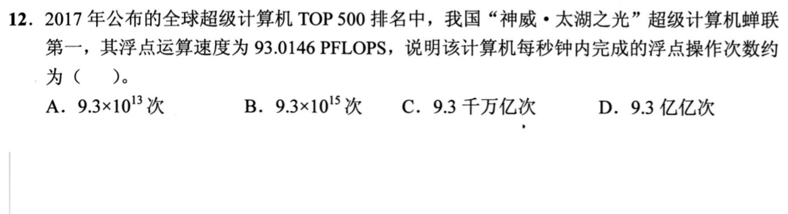

### 02 · 2022-12
> *80% 指令需 1 周期，20% 指令需 10 周期。先算出综合 CPI 为 2.8，再求 10000 条指令的总运行时间。*
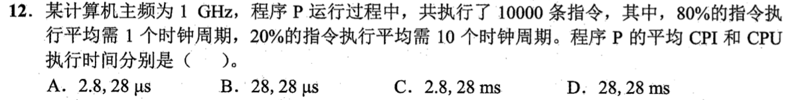

### 03 · 2023-12
> *平均 CPI 为 1.2，主频 1.5GHz。用 $f / CPI$ 算 MIPS，再算 $N \times CPI / f$ 求 CPU 时间。*
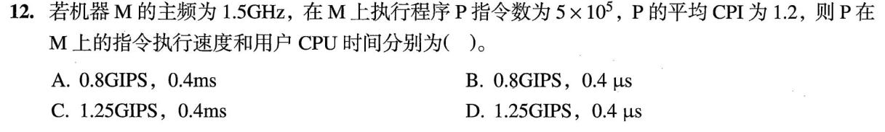

### 04 · 2025-18
> *不同指令的 CPI 可能不同，同一指令在不同微架构下的 CPI 也有差异，理清 CPI 的决定因素。*
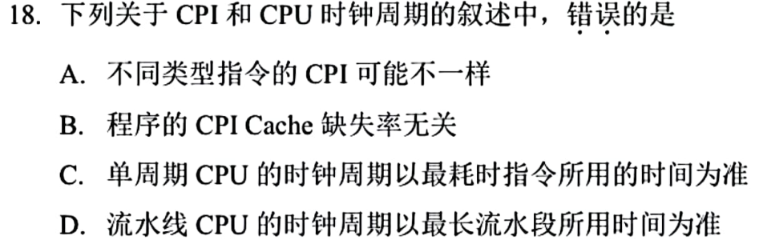

## 暂缓题目

以下题目仅暂时不处理；完整题目条目保留在 Markdown 源文件的 HTML 注释内，预览不显示题目。

<!-- 暂缓题：2010-12；暂时不处理，未删除。
### 01 · 2010-12
> *缩短程序执行时间可以靠提高主频、优化数据通路降低 CPI，或者优化编译器减少总指令数。*
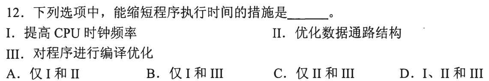
-->

<!-- 暂缓题：2011-12；暂时不处理，未删除。
### 02 · 2011-12
> *衡量浮点数运算速度的指标是 MFLOPS，MIPS 只衡量整型每秒百万条指令数。*
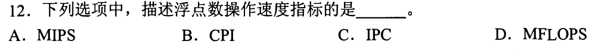
-->

<!-- 暂缓题：2019-16；暂时不处理，未删除。
### 03 · 2019-16
> *处理器时钟脉冲信号由机器脉冲源（晶振）发出后经整形和分频形成，掌握时钟周期的物理实质。*
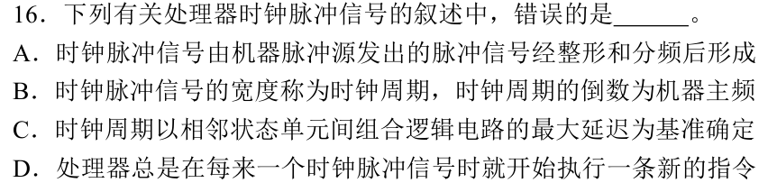
-->

<!-- 暂缓题：2012-12；暂时不处理，未删除。
### 06 · 2012-12
> *阿姆达尔定律经典计算。CPU 速度提高 50% 意味着 CPU 时间缩短为原来的 2/3，I/O 时间不变，分段加总。*
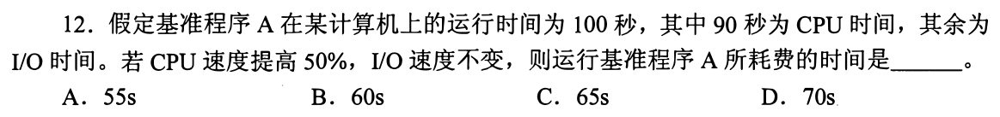
-->

<!-- 暂缓题：2013-12；暂时不处理，未删除。
### 07 · 2013-12
> *加权平均 CPI 计算。各类指令占比乘各自 CPI 累加得出平均 CPI，再用主频除以平均 CPI 算 MIPS。*
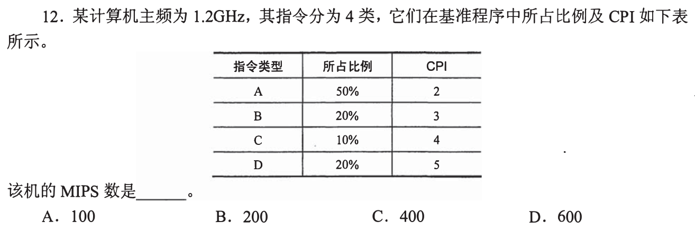
-->

<!-- 暂缓题：2014-12；暂时不处理，未删除。
### 08 · 2014-12
> *指令数减少到 70%，CPI 增加到 1.2 倍。新执行时间 = 原时间 $\times 0.7 \times 1.2$，直接求积。*
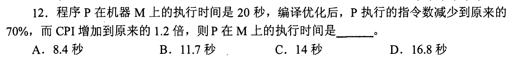
-->

<!-- 暂缓题：2017-12；暂时不处理，未删除。
### 09 · 2017-12
> *两台机器主频与 CPI 均不同。指令数相同时比总时间 $T = N \times CPI / f$，分别算准再求比值。*
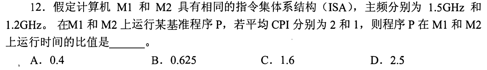
-->
