# 0822｜传输时间：宽度、频率、事务与瓶颈

> 这组题直接分成两截：
> 前面是**快速拿分题**，总线带宽定义、串行与并行优缺点、突发传输常识，公式代入秒出；
> 后面是**耗时攻坚题**，地址/数据复用周期拆解、突发传输多拍累计、双沿采样与高频总线吞吐精确推演。

---

## 一、 快速拿分题（带宽公式与总线概念，稳稳套用）

### 01 · 2009-20
> *总线带宽标准公式。每次传 4B，周期占 2 个时钟，时钟 10MHz，带宽 = 4B / (2 / 10M) = 20MB/s。*
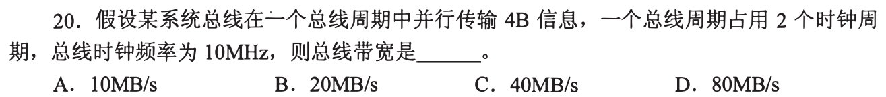

### 02 · 2011-20
> *系统总线数据线上可传输指令代码、操作数和中断类型号；地址和控制信号走专门总线。*
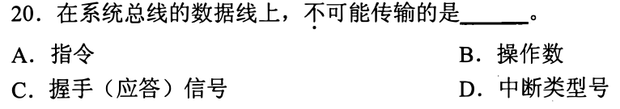

### 03 · 2014-20
> *只发一次首地址，连续读写若干数据的总线事务方式称为突发（Burst）传送方式。*
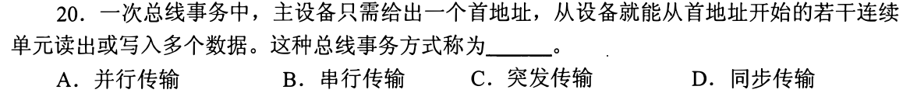

### 04 · 2015-19
> *异步总线握手协议中，全互锁方式必须双向确认信号都撤回才结束，可靠性最高但速度最慢。*
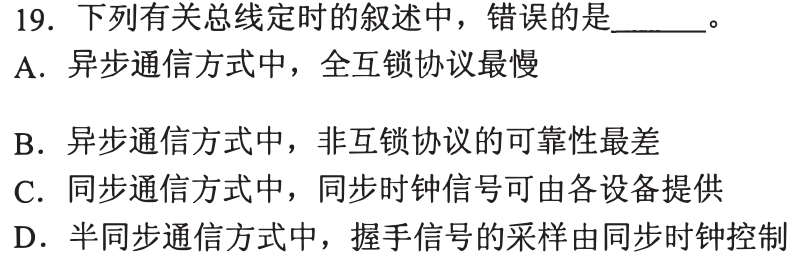

### 05 · 2016-21
> *高频下并行总线存在严重的线间串扰和时钟偏斜，现代高速总线（PCIe、USB）已全面采用差分串行。*
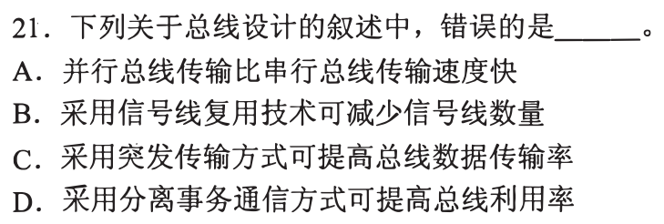

### 06 · 2017-20
> *多总线结构中，越靠近 CPU 的总线时钟频率越高；分离系统总线与慢速 I/O 总线可避免整机降速。*
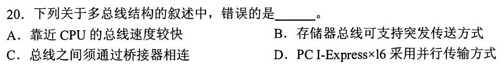

### 07 · 2018-21
> *提高总线数据传输率可通过增加位宽或提高工作频率；串行总线依靠极高的时钟频率取胜。*
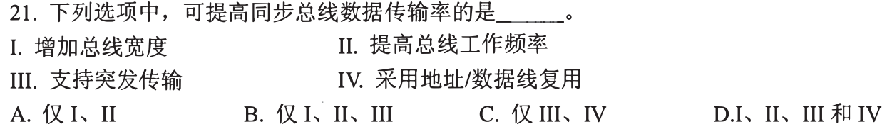

### 08 · 2021-19
> *总线本质是多部件分时共享的公用传输介质，任一时刻只允许一个主设备发送信息。*
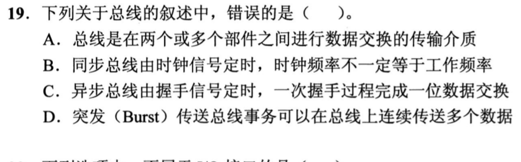

---

## 二、 耗时攻坚题（时钟复用拆解、突发节拍累计与显存带宽）

### 09 · 2010-22
> *显存刷新带宽计算。分辨率 $\times$ 色深 $\times$ 帧频算出屏幕刷新流量，再除以 50% 得出显存总带宽。*
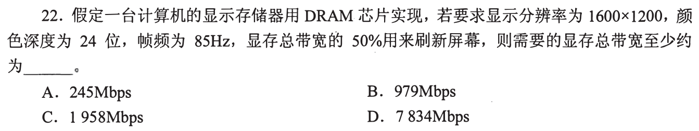

### 10 · 2012-19
> *同步总线突发写事务。首周期传地址，随后每个周期传一个数据，算清整个事务实际占用的时钟节拍数。*
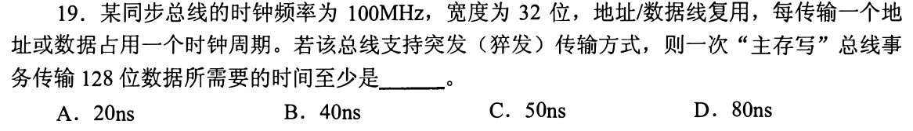

### 11 · 2012-20
> *USB 总线特性辨析。树型拓扑、差分信号传输、主从控制模式、支持热插拔，抠准每个细节。*
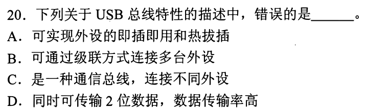

### 12 · 2014-19
> *复用总线双沿传输。时钟 66MHz，宽度 32 位（4B），每个时钟周期传送 2 次数据，最大数据传输率翻倍。*
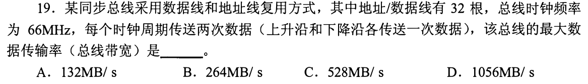

### 13 · 2019-19
> *3 通道 DDR3 存储器总线。总位宽为 $3 \times 64$ 位，乘以 DDR 的等效数据传输频率计算峰值带宽。*
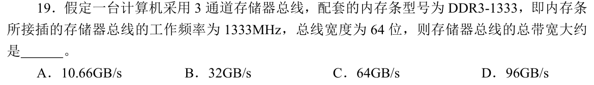

### 14 · 2020-19
> *QPI 点对点串行总线。算清双向全双工、有效数据位与校验位占比，推导数据包传输有效率。*
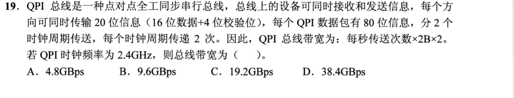

### 15 · 2023-20
> *非突发总线传输开销。每次读写都要重新发地址并等待主存准备，分步累计每个数据块的时钟周期。*
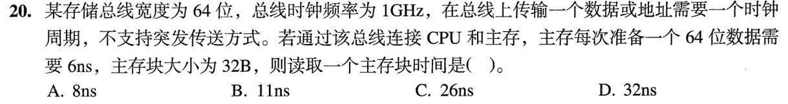

### 16 · 2024-20
> *突发总线事务时序。第 1 周期发地址与读命令，随后各周期双沿突发数据，按节拍精确求总时间。*
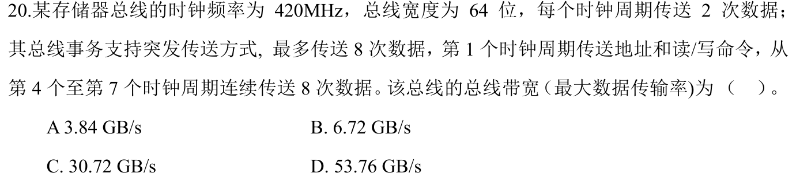

### 17 · 2025-20
> *四倍率（Quad-pumped）同步总线。每个总线周期传送 4 次数据，理清总线工作频率与实际传输率对应关系。*
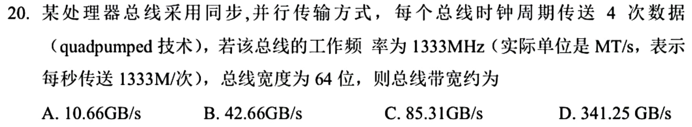
