# 0823｜I/O路径：轮询、中断与DMA怎样交接控制权

> 当前显示 **14 题**（2020—2026 年）；**16 题暂缓**，原文保留在文件末尾的 HTML 注释中，未删除。

## 当前题单（2020—2026）

### 01 · 2020-20
> *键盘控制器检测到按键后触发中断，CPU 从输入数据缓冲寄存器中读走按键扫描码。*
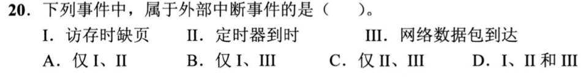

### 02 · 2020-21
> *DMA 周期窃取机制推导。设备准备好一个字就借用一个存取周期，推算 DMA 传送与 CPU 访存的重叠与冲突时间。*
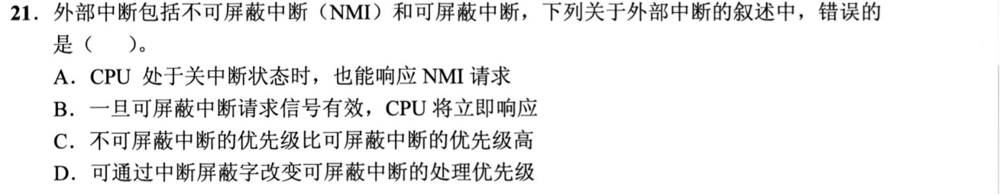

### 03 · 2020-22
> *多中断源并发响应。结合硬件判优逻辑与中断屏蔽字，推导出各中断最终被处理的先后顺序。*
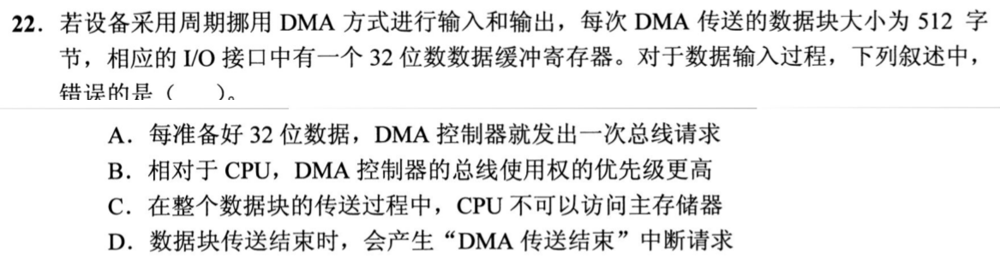

### 04 · 2021-20
> *突发性事件响应要求极高，中断驱动比程序轮询更节省 CPU 算力且响应更及时。*
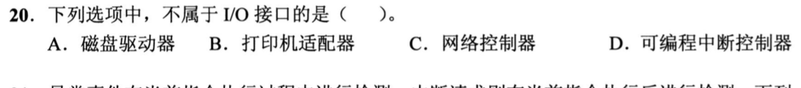

### 05 · 2021-21
> *中断向量表地址计算。中断类型号乘以向量表项长度作为基地址偏移，定位中断服务程序入口指针。*
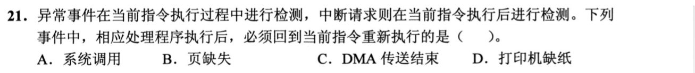

### 06 · 2021-22
> *DMA 传送期间，CPU 不能访问被 DMA 占用的主存总线，但若指令与数据命中 Cache 则 CPU 依然可以并行执行。*
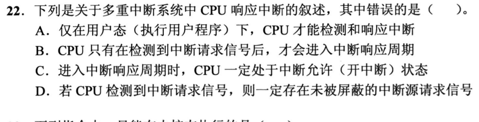

### 07 · 2022-21
> *磁盘 DMA 传输参数计算。根据扇区大小与转速推导传输率、缓冲区填满时间与 DMA 请求发生频率。*
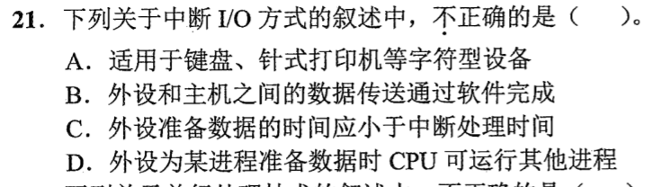

### 08 · 2023-22
> *复杂中断嵌套时序图绘制。沿时间轴推演压栈现场、嵌套打断与逐级恢复返回的完整历程。*
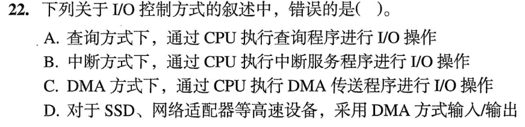

### 09 · 2024-21
> *现代 I/O 驱动与控制器交互时序。命令下发、状态等待与中断通知各阶段边界推断。*
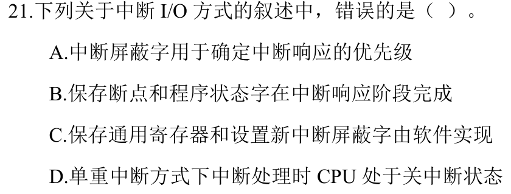

### 10 · 2024-22
> *高速设备采用 DMA 还是中断。计算中断额外开销占 CPU 吞吐比例的临界拐点。*
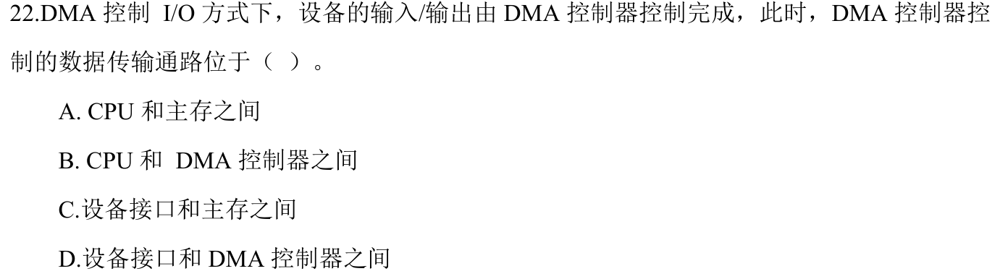

### 11 · 2025-21
> *中断现场保护深度辨析。区分硬件隐指令压入内核栈的内容与服务程序自行保护的通用寄存器。*
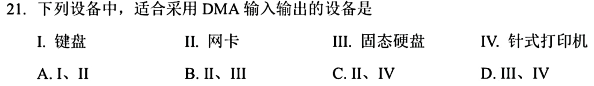

### 12 · 2025-22
> *DMA 控制器内部寄存器流转。CR、SR、MAR、BC 状态机流转与传送结束触发中断的时序分析。*
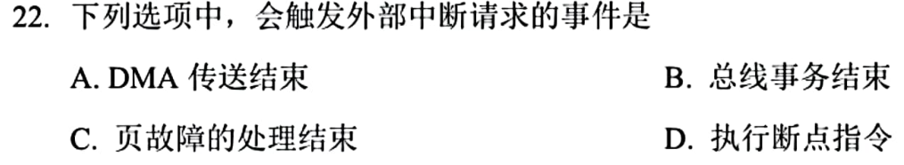

### 13 · 2026-21
> *特权指令涉及关键硬件资源和安全控制（如关中断、设置时钟、修改基址寄存器）；访管指令（trap/syscall）用于从用户态切换到内核态，属于普通指令。*
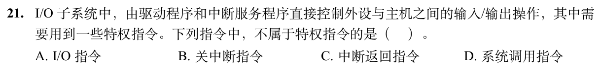

### 14 · 2026-22
> *中断响应由硬件中断隐指令自动完成：包括关中断、保存断点（PC 和 PSW）、引出中断服务程序。保护通用寄存器和执行具体处理由软件（中断服务程序）完成。*
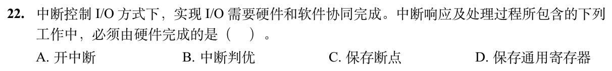

## 暂缓题目

以下题目仅暂时不处理；完整题目条目保留在 Markdown 源文件的 HTML 注释内，预览不显示题目。

<!-- 暂缓题：2009-22；暂时不处理，未删除。
### 01 · 2009-22
> *外部中断由 CPU 外部设备引发（如键盘敲击、时钟中断）；除法溢出属于 CPU 内部异常。*
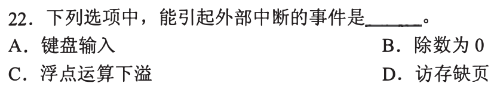
-->

<!-- 暂缓题：2010-21；暂时不处理，未删除。
### 02 · 2010-21
> *单级中断处理流程：关中断 $\to$ 保存断点与现场 $\to$ 执行服务程序 $\to$ 恢复现场 $\to$ 开中断并返回。*
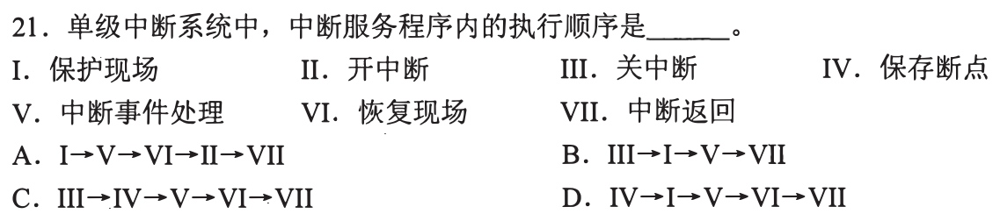
-->

<!-- 暂缓题：2012-21；暂时不处理，未删除。
### 03 · 2012-21
> *I/O 总线数据线上不仅传送数据，还能传送控制命令字、接口状态字以及中断类型号。*
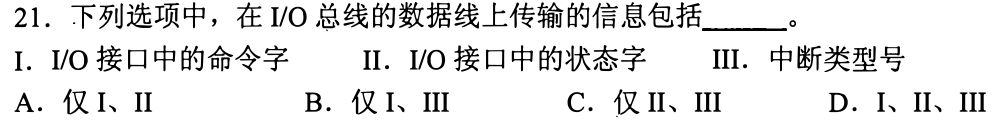
-->

<!-- 暂缓题：2012-22；暂时不处理，未删除。
### 04 · 2012-22
> *中断隐指令由硬件直接完成：关中断、保存断点（PC）、形成中断服务程序入口地址送 PC。*
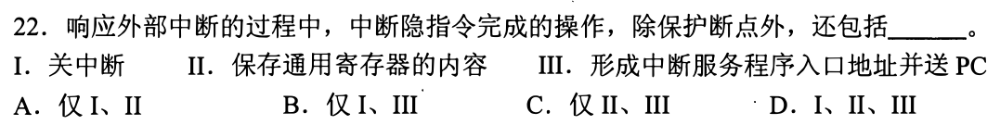
-->

<!-- 暂缓题：2013-22；暂时不处理，未删除。
### 05 · 2013-22
> *中断方式由 CPU 负责逐个传送数据（耗费 CPU 时间）；DMA 方式直接接管总线在设备与内存间倒腾数据。*
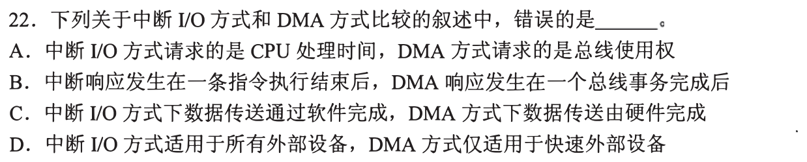
-->

<!-- 暂缓题：2014-21；暂时不处理，未删除。
### 06 · 2014-21
> *I/O 接口中的状态端口只读、控制端口只写，两者在逻辑上分离但在物理上可以共用同一端口地址。*
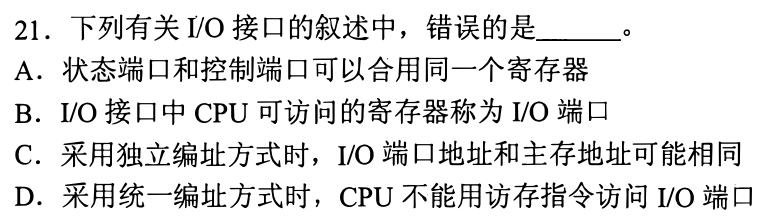
-->

<!-- 暂缓题：2015-22；暂时不处理，未删除。
### 07 · 2015-22
> *CPU 内部异常分类。故障（Fault，修复后重新执行原指令）、陷阱（Trap，系统调用）、终止（Abort，致命错误）。*
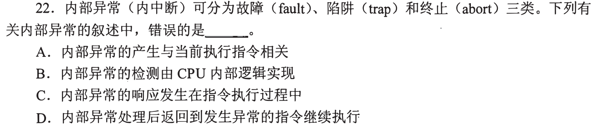
-->

<!-- 暂缓题：2016-22；暂时不处理，未删除。
### 08 · 2016-22
> *中断响应必须在每条指令执行周期的末尾；而 DMA 响应可以发生在每个存取周期或总线周期的结束点。*
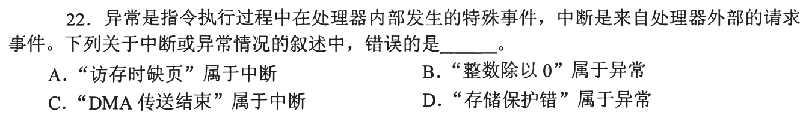
-->

<!-- 暂缓题：2017-21；暂时不处理，未删除。
### 09 · 2017-21
> *多重中断允许高优先级打断低优先级，关键是在保存完断点和现场后必须重新开中断。*
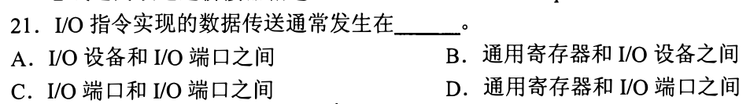
-->

<!-- 暂缓题：2017-22；暂时不处理，未删除。
### 10 · 2017-22
> *DMA 传送全过程。传送前由 CPU 预置参数，传送时不经 CPU，传送结束后发中断向 CPU 汇报。*
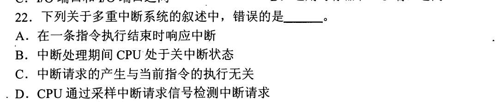
-->

<!-- 暂缓题：2018-22；暂时不处理，未删除。
### 11 · 2018-22
> *外部中断分为可屏蔽（INTR）与不可屏蔽（NMI），掉电告警等灾难性故障属于不可屏蔽中断。*
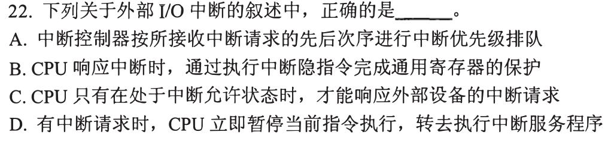
-->

<!-- 暂缓题：2019-21；暂时不处理，未删除。
### 12 · 2019-21
> *多中断源同时请求，硬件排队器按固定硬件优先级响应，软件可借由中断屏蔽字调整处理优先级。*
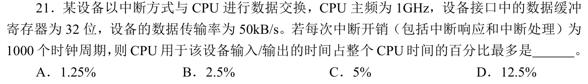
-->

<!-- 暂缓题：2011-21；暂时不处理，未删除。
### 16 · 2011-21
> *中断屏蔽字设计。看清屏蔽位为 1 还是 0 表示屏蔽，根据要求的新处理次序为各中断源逐一填写屏蔽字。*
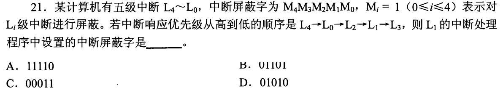
-->

<!-- 暂缓题：2011-22；暂时不处理，未删除。
### 17 · 2011-22
> *定时查询 CPU 开销计算。为防外设缓冲区溢出，求出最大允许轮询间隔，乘单次查询时钟周期算 CPU 占比。*
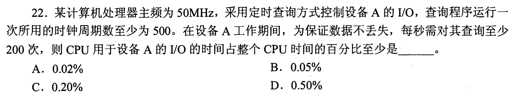
-->

<!-- 暂缓题：2014-22；暂时不处理，未删除。
### 18 · 2014-22
> *中断处理 CPU 占用率。中断服务耗时 100ns，周期 400ns，CPU 占用率即为 $100 / 400 = 25\%$。*
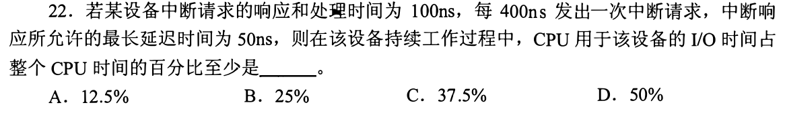
-->

<!-- 暂缓题：2019-22；暂时不处理，未删除。
### 19 · 2019-22
> *多重中断嵌套过程跟踪。根据当前屏蔽字状态，判定后续到来的中断能否打断正在运行的服务程序。*
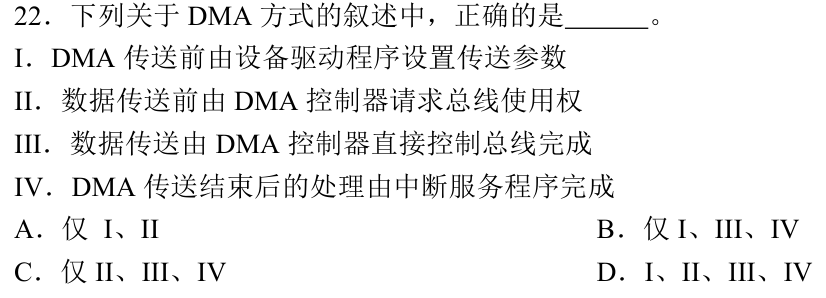
-->
