[« 0823-answer](0823-answer.md)　　[0825-answer »](0825-answer.md)

# 0824 Answer｜系统边界：应用如何进入内核

> [原题 25 题](0824.md) · [0823 I/O 路径](0823-answer.md) · [能力账本](answer-quality/learning-ledger.md)

**进入本篇时已有**：缺页后重执行原指令（0816-04）；外部中断＝事件不由当前指令产生（0823-01）；硬件响应与服务程序的分界、GPR 由软件保护（0823-02/07）；发起向下、完成向上（0823-05）；trap 返回下一条、fault 重试原指令（0823-13）；中断请求在指令结束处检测（0823-17）。系统调用、特权、内核结构从零开始。
**读完新增**：01 接口＝应用能调用的入口 · 02 事件发生时的态≠处理时的态 · 03 设备相关参数由驱动算 · 04 进内核的三个入口 · 05 特权指令的判据 · 06 “现场”＝会被服务程序改写的程序状态 · 07 “不可能”题只需为每个排除项找一个合法触发 · 08 批处理≠交互、单道/多道 · 09 系统调用四步的因果序 · 10 时钟中断的三个计数 · 11 接口规范各 OS 自定 · 12 trap 是内部同步事件 · 13 向量表由 OS 填 · 14 I/O 指令属特权 · 15 判据：应用主动请求 · 16 启动期必须先建入口映射 · 17 用户态集合 ⊂ 内核态集合 · 18 切态由硬件随陷入完成 · 19 请求与结束的方向 · 20 微内核＝服务移出内核 · 21 按号取入口＝数组 · 22 返回用户态的时刻 · 23 无新台阶（反例击穿全称句）· 24 进程私有 vs 系统共用 · 25 VMM 在来宾 OS 之下

<details><summary>速览</summary>

| # | 新增台阶 | 起手 | 最易错 → 先看什么 |
| --- | --- | --- | --- |
| [01](#q01) | 接口＝应用能调用 | 逐项问“应用用它向内核要服务吗” | 库函数也“调用” → 它在用户态 |
| [02](#q02) | 发生态≠处理态 | 写“发生那刻 CPU 在跑谁” | 把整段处理算用户态 → 题问发生 |
| [03](#q03) | 设备参数由驱动算 | 写四段链 | 选系统调用处理程序 → 它只分派 |
| [04](#q04) | 三个入口 | 逐项问是否触发入口 | 函数调用都进内核 → 看有无 trap/异常 |
| [05](#q05) | 特权判据 | 问“会不会伤到别的程序” | trap 当特权 → 它必须用户可执行 |
| [06](#q06) | 现场＝被改写的状态 | 问“服务程序会不会改它” | TLB/Cache 也要存 → 不影响正确性 |
| [07](#q07) | 为排除项找触发 | 给 A/B/D 各写一个触发 | 说“不一定除零” → 题问可能 |
| [08](#q08) | 批处理无交互 | 逐句对 单/多道、交互 | 多道＝交互 → 交互属分时 |
| [09](#q09) | 因果序 | 写 read 调用前后 | 服务先于 trap → 服务是内核代码 |
| [10](#q10) | 三个计数 | 写一次中断各量变化 | 嫌 III 递减 → 它也是更新 |
| [11](#q11) | 接口各 OS 自定 | 逐句归位 | 默认“统一” → 规范随 OS |
| [12](#q12) | 内部同步 | 问事件源在哪条指令 | 因“中断”二字归外部 → 源是本指令 |
| [13](#q13) | OS 填向量表 | 按时间切硬件/OS | 把断点算 OS → 服务程序前已存 |
| [14](#q14) | I/O 指令特权 | 问“用户直接执行会怎样” | 选 trap → 用户可发 |
| [15](#q15) | 主动请求→系统调用 | 问“应用主动提了吗” | 页置换/调度也是内核工作 → 入口不是调用 |
| [16](#q16) | 启动先建入口 | 想象刚启动来了中断 | 选磁盘结构 → 非启动期创建 |
| [17](#q17) | 集合包含 | 画 2×2 表 | “只能” → 找反例 |
| [18](#q18) | 切态靠硬件 | 对四项问“软件能做吗” | 把模式切换给 OS → 05 |
| [19](#q19) | 请求与结束 | 标信号方向 | C 的“开中断”读法 → 取字面 |
| [20](#q20) | 服务移出内核 | 写好处与代价各一栏 | 四项全选 → I 反向 |
| [21](#q21) | 按号取 | 写 表[n] | 选链表 → 要 n 步 |
| [22](#q22) | 返回时刻 | 画每项完成时 CPU 位置 | 调度后必回用户态 → 题面未给 |
| [23](#q23) | 反例 | 为 A 找合法反例 | 以“处理时在内核”推发生时 → 02 |
| [24](#q24) | 私有 vs 共用 | 逐个问“换进程要换吗” | 把两个“基址”混 → 一属进程一属系统 |
| [25](#q25) | VMM 层级 | 画四层 | 当同级 → 特权指令管不住 |

跨题信号：“只能/总是” → 举合法反例（17、23）；“发生时” vs “处理时”（02、23）；特权/普通（05、14、17）；硬件先于服务程序（06、13、18）。

</details>

<a id="q01"></a>
## 01｜2010-23：接口＝应用能直接调用的入口

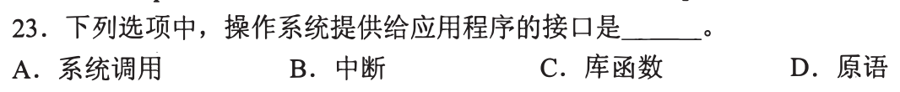

**新增**：区分“应用的入口”与“内核内部/硬件机制”。**起手**：逐项问“应用用它向内核要服务吗”。→ **A**

| 选项 | 题面依据 |
| --- | --- |
| A 系统调用 | 应用经 trap 请求内核服务的入口，正是题问的“提供给应用程序的接口” ✓ |
| B 中断 | 由外设或异常引起的控制转移，应用不“调用”它 |
| C 库函数 | 运行在用户态的库代码；其中读文件类函数内部才发系统调用，库函数本身不是 OS 内核提供的接口 |
| D 原语 | 内核内部不可被打断的操作序列（如进程控制原语），是内核的实现手段，不是应用的入口 |

<a id="q02"></a>
## 02｜2012-23：发生时 CPU 在哪个态，与处理时在哪个态分开

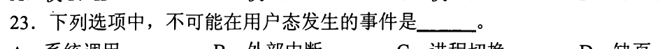

**新增**：题问“可能在用户态发生”，只看事件出现那一刻。**起手**：每项写“发生那刻 CPU 在跑谁”。→ **C**

- 系统调用：用户程序自己执行 trap 指令，发生在用户态。
- 外部中断：事件由外设产生（0823-01），用户程序运行时可以到来。
- 缺页：用户指令访问不在内存的页，翻译时发现（0816-04），那刻仍是用户指令。
- 进程切换：保存旧进程现场、选下一个、恢复新现场，是调度程序（内核代码）的动作，不能由用户态执行。

四项的处理程序随后都进内核；若问“处理在哪个态”，则前三项也在内核，题面问的不是这个。

<a id="q03"></a>
## 03｜2013-25：命令发出前，设备相关参数由驱动算好

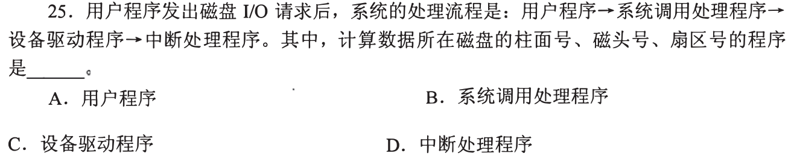

沿用 0823-05 的“发起向下、完成向上”，题给链条逐段标一句：

```
用户程序          提出读写（只知道文件/逻辑位置）
系统调用处理程序  进内核，分派到设备管理
设备驱动程序      逻辑位置 → 柱面号/磁头号/扇区号，向控制器发命令   ← 新增
中断处理程序      I/O 完成后才运行，收尾
```

**新增**：柱面/磁头/扇区是具体磁盘的参数，必须在发命令前由懂该设备的驱动算出。→ **C**。A 不了解设备；B 只分派；D 在完成之后才运行，赶不上给命令提供参数。

<a id="q04"></a>
## 04｜2013-28：用户态进内核只有三个入口

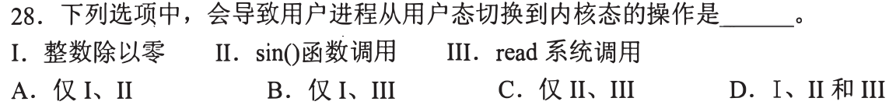

**新增**：进内核的入口＝异常（本指令出错）、系统调用（trap）、中断（外部）。**起手**：逐项问“它是否触发这三者之一”。

| 项 | 判断 |
| --- | --- |
| I 整数除以零 | 本条指令产生的内部异常，进内核 ✓ |
| II sin() 函数调用 | 一次普通函数调用加算术，没有 trap，也没有题给的异常，留在用户态 |
| III read 系统调用 | trap，进内核 ✓ |

→ **B**。信号：“函数调用”本身不进内核，看有没有 trap 或异常。

<a id="q05"></a>
## 05｜2014-25：特权指令＝用户随便执行就会伤到全机

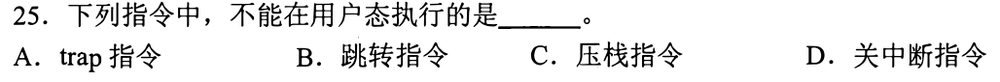

**新增**：判据“这条指令一旦任何程序都能执行，会不会影响其他程序或整个系统”。

- 跳转、压栈：只改自己的 PC 和栈，普通。
- trap：就是用户态进内核的入口（04），必须允许用户执行。
- **关中断**：用户程序关中断后再死循环，时钟中断进不来，OS 失去控制 → 特权，用户态不能执行。→ **D**

<a id="q06"></a>
## 06｜2015-23：需要保存的“现场”，是服务程序会改写的程序状态

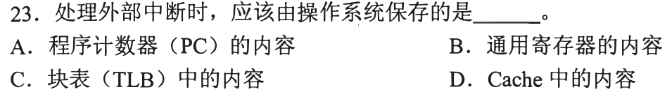

**新增**：现场＝被打断程序之后还要用、而服务程序又会改写的状态。沿用 0823-02/07：硬件响应时先存断点。

| 选项 | 依据 |
| --- | --- |
| A PC | 响应时硬件已存断点，不是 OS 存 |
| B 通用寄存器 | 服务程序也要用 GPR，不先存就毁了原程序 → OS 在服务程序里存 ✓ |
| C 块表（TLB） | 访存加速结构，丢了只是重新装入，不影响程序正确性，不属于要保存的程序状态 |
| D Cache | 同上，对程序透明 |

→ **B**。

<a id="q07"></a>
## 07｜2015-24：“不可能”题——只需为每个排除项找一个合法触发

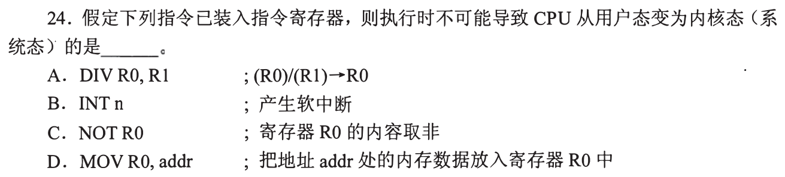

**新增**：用 04 的三个入口，给 A、B、D 各写一个合法触发；剩下找不到的就是答案。题问“可能”，所以不必每次都触发。

```
A DIV R0,R1   R1=0 时除零异常（题未限定 R1≠0）
B INT n       软中断指令，本身就是 trap 类入口
D MOV R0,addr 访问 addr 可能缺页或越界访存
C NOT R0      只在寄存器内取非：无除法、无 trap、无内存访问，找不到触发 → 选 C
```

<a id="q08"></a>
## 08｜2016-23：批处理不交互；单道/多道是另一维度

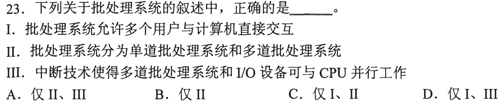

**新增**：批处理＝作业提交后成批运行，用户不在线干预；与之相对的交互属分时系统（课本分类）。

- I 多用户直接交互：与批处理的“成批、不干预”相反 ✗。
- II 分为单道与多道 ✓。
- III 多道时，作业 A 等 I/O，CPU 转去算作业 B；I/O 完成靠中断通知（0823-05）✓。

→ **A**。B 漏 III；C、D 含 I。

<a id="q09"></a>
## 09｜2017-24：系统调用四步按因果排序

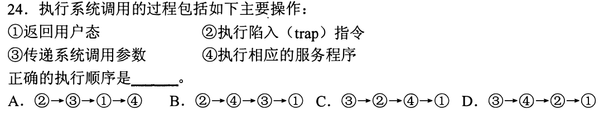

**起手**：写一次 `read(fd, buf, n)` 的前后。**新增**：约束只有两条——服务程序是内核代码，必须先进内核（04）；参数要在 trap 前放好，内核入口按约定取。

```
③ 传递参数      用户程序里，放进约定的寄存器/栈
② 执行 trap     进内核
④ 服务程序      内核态
① 返回用户态
```

→ **C**。A：返回在服务之前；B：服务在传参之前；D：服务在 trap 之前，那时还在用户态，没有权限执行。

<a id="q10"></a>
## 10｜2018-29：一次时钟中断，三个计数同时动

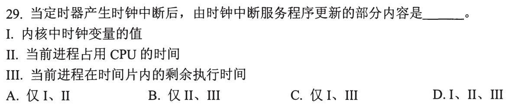

**起手**：写“来一个时钟中断，每个量怎么变”。时间片＝一个进程每次连续占用 CPU 的最长时长。

| 量 | 变化 |
| --- | --- |
| I 内核时钟变量 | +1 个滴答 |
| II 当前进程占用 CPU 时间 | +1 个滴答 |
| III 当前进程时间片剩余 | −1 个滴答，减到 0 才触发调度 |

三个都由时钟中断服务程序更新，**D**。III 是递减，同样是“更新”。

<a id="q11"></a>
## 11｜2019-25：系统调用四句话，逐句归位

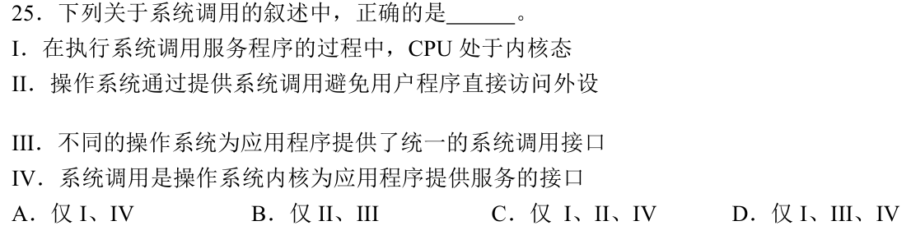

无全新机制，合并 01、05、09；新增一点：接口规范随 OS 自定。

| 句 | 依据 |
| --- | --- |
| I 服务程序在内核态 | trap 之后进内核（09）✓ |
| II 避免直接访问外设 | 受保护操作用户态做不了（05），只能经系统调用由内核代做 ✓ |
| III 不同 OS 统一 | 调用号、参数约定各 OS 自定（如 Linux 与 Windows 不同）✗ |
| IV 内核提供服务的接口 | 01 ✓ |

→ **C**（A 漏 II）。

<a id="q12"></a>
## 12｜2020-18：trap 是本指令产生的内部事件

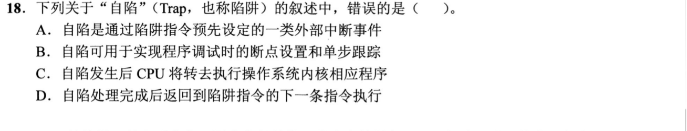

**新增**：用 0823-01 的判据反过来问——事件源是本条指令，还是独立外设？

- A“一类**外部**中断事件”：陷阱指令自己引发，事件源是当前指令，是内部同步事件 → 说法错，题问错误，**选 A**。
- B 调试断点/单步：题面说可用于实现，不是错的。
- C 进入内核处理程序：与 04 一致。
- D 返回下一条：与 0823-13 的“trap 往后、fault 重试”一致。

<a id="q13"></a>
## 13｜2020-25：按时间切——服务程序开始前归硬件，之后归 OS

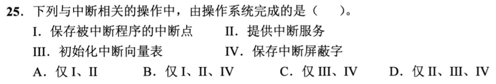

| 项 | 归属 |
| --- | --- |
| I 保存中断点 | 响应时硬件完成（0823-02/07）✗ |
| II 提供中断服务 | 服务程序是 OS 代码 ✓ |
| III 初始化中断向量表 | 硬件按表找入口，表内容由 OS 填 ✓ |
| IV 保存中断屏蔽字 | OS 在服务程序里处理旧屏蔽字（0823-03/16 的多重中断）✓ |

→ **D**。**读法说明**：0823-28 把 PSW 随断点由硬件存；本题把“屏蔽字”单列，按公布答案 D 取“由 OS 保存”，教材对屏蔽字的硬件/软件界线并不清晰，这是此题的约定读法。

<a id="q14"></a>
## 14｜2021-23：I/O 指令只能在内核态

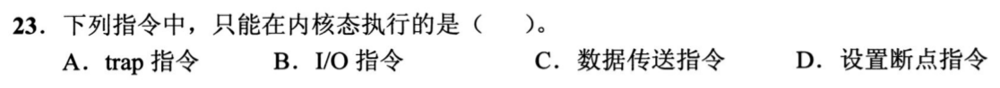

**新增**：I/O 指令归特权（05）。**起手**：逐项问“用户态直接执行行不行”。

- A trap：用户态进内核的入口（04），必须能执行。
- C 数据传送：普通指令。
- D 设置断点：12-B 说断点靠陷阱实现，按此读法用户可发。
- **B I/O 指令**：直接操作设备，用户随便发会绕过 OS → 只能内核态。→ **B**

<a id="q15"></a>
## 15｜2021-32：判据——应用主动请求的才是系统调用

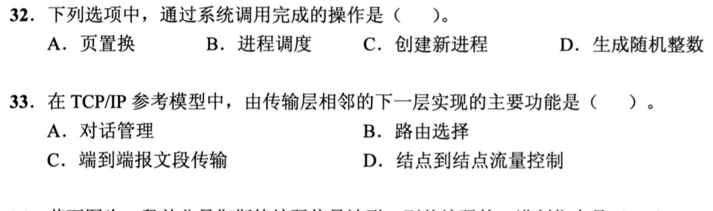

**新增**：看“为什么进内核”，而不是“最后谁干活”。

| 选项 | 进内核的原因 |
| --- | --- |
| A 页置换 | 缺页异常触发（0816-04），内核自己选页 |
| B 进程调度 | 内核在时间片用完或阻塞时自行决定（10），应用不提“请调度” |
| C 创建新进程 | 应用主动请求（如 fork）→ **系统调用** ✓ |
| D 生成随机整数 | 常规由库函数在用户态计算，不需内核权限 |

D 的读法：若某实现从内核取随机源，则会用系统调用，题取常规读法。

<a id="q16"></a>
## 16｜2022-24：启动期必须先建好中断入口映射

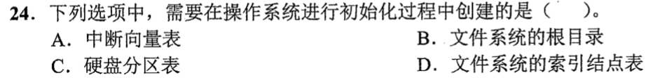

**起手**：设想内核刚启动，此时来了一个中断。硬件靠向量表找入口（13），表没填就无处可去 → 初始化必须建 **A**。

B 根目录、D 索引结点表、C 硬盘分区表：都是磁盘上的数据结构，分别在划分分区、建立文件系统时写到磁盘；OS 启动是读取并挂载它们，不是创建。**读法**：“初始化过程中创建”按此理解。

<a id="q17"></a>
## 17｜2022-27：用户态能做的⊂内核态能做的

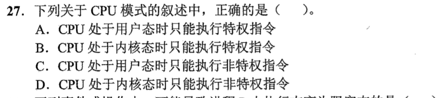

| | 非特权指令 | 特权指令 |
| --- | --- | --- |
| 用户态 | ✓ | ✗（05） |
| 内核态 | ✓ | ✓ |

- A 用户态“只能特权”：用户程序执行 ADD（非特权）合法，反例成立 ✗。
- B 内核态“只能特权”：内核里服务程序也做 ADD ✗。
- D 内核态“只能非特权”：内核态可关中断（特权）✗。
- C ✓ → **C**。信号：“只能”→ 先找合法反例。

<a id="q18"></a>
## 18｜2022-31：切态必须随陷入由硬件完成

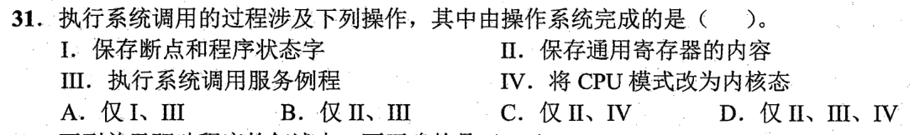

**新增**：模式切换若由软件做，则用户态程序就能自己切进内核态——那是特权操作（05）。所以必须随 trap 由硬件完成。**起手**：对四项问“软件能不能做”。

- I 保存断点和 PSW：硬件（0823-02/07）。
- II 保存通用寄存器：OS（06）。
- III 执行服务例程：OS。
- IV 改为内核态：硬件。

OS 完成的是 II、III，**B**。

<a id="q19"></a>
## 19｜2023-21：设备发请求；结束不是设备发的

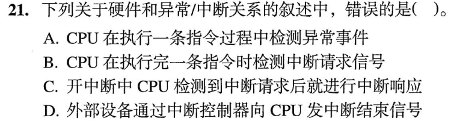

题问**错误**。

| 项 | 判断 |
| --- | --- |
| A 异常 | 在指令执行中检测（除零在运算时，缺页在访存时）✓ |
| B 中断请求 | 在一条指令执行完时检测（0823-17）✓ |
| C 开中断后检测到请求就响应 | 题面把“开中断”作为允许前提，取字面读，不另加屏蔽、NMI 等条件（0823-21），不判错 |
| D 设备经控制器发中断**结束**信号 | 设备发的是中断**请求**；处理结束由服务程序执行中断返回体现，不是设备给 CPU 的信号 ✗ |

→ **D**。

<a id="q20"></a>
## 20｜2023-23：微内核＝服务移出内核

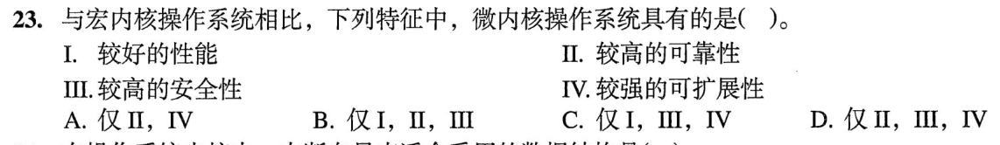

**新增**：微内核只留最核心机制，文件、驱动等作为用户态服务进程。好处与代价各一栏：

| 好处 | 代价 |
| --- | --- |
| II 可靠：服务崩溃只影响该进程 | I 性能：服务之间、与应用之间走消息传递，多次切态与拷贝 |
| III 安全：内核代码少，服务权限低 | |
| IV 可扩展：增加服务＝增加进程，不改内核 | |

→ **D**（II、III、IV）。A 漏 III；B、C 含 I。

<a id="q21"></a>
## 21｜2023-24：按中断号取入口＝按下标取

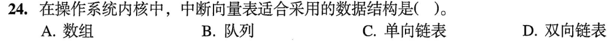

**起手**：写 `入口 = 表[n]`。向量表按中断号索引，号码固定，表在启动时填好（16）。

- **A 数组**：按下标一次取到。
- B 队列：只能从队头取。
- C、D 链表：要从头走 n 步才到第 n 项。

→ **A**。

<a id="q22"></a>
## 22｜2023-26：什么时候“完成”才是回到用户态

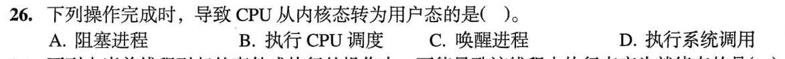

**起手**：画每项完成时 CPU 所在位置。

- 阻塞进程、唤醒进程、执行 CPU 调度：都是内核函数，完成时仍在内核里；之后运行哪个进程、它上次停在哪段代码，题面没给。例如调度选中的进程，之前可能正停在系统调用内部（阻塞过），则仍在内核态 —— 所以不能断言回用户态。
- **执行系统调用**：服务例程完成后，返回指令回到调用者的用户程序（09 的 ①）→ 内核态转为用户态。→ **D**

<a id="q23"></a>
## 23｜2024-23：无新台阶——用反例击穿全称句

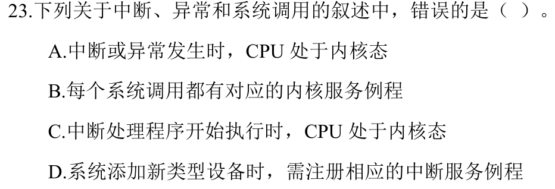

题问**错误**。A 说“中断或异常发生时，CPU 处于内核态”：用户程序除零（04）是异常，发生那刻 CPU 在用户态（02），反例合法 → A 错，**选 A**。

- B 每个系统调用有服务例程：09 的 ④ ✓。
- C 处理程序**开始**执行时在内核态：入口之后已切态（18）✓。
- D 新设备要注册服务例程：入口映射由 OS 管（16）✓。

<a id="q24"></a>
## 24｜2025-23：换进程换私有状态，不换系统共用结构

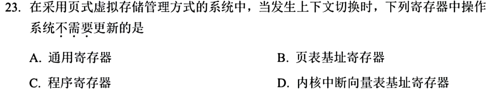

**新增**：逐个问“这个寄存器的内容属于某个进程，还是属于整个系统”。题问“不需要更新”。

| 选项 | 判断 |
| --- | --- |
| A 通用寄存器 | 属进程，旧值存起来、装入新值（06）需要换 |
| B 页表基址 | 每个进程有自己的地址空间，同一虚地址对应不同物理页，需要换 |
| C 程序寄存器 | 图上写作“程序寄存器”，按程序计数器理解：要跳到新进程的指令，需要换 |
| D 内核中断向量表基址 | 全系统共用一份内核表（16、21），换进程后入口不变，不需要换 ✓ |

→ **D**。C 的读法：题面没有写成“程序计数器”，若指别的程序状态，同样属进程私有，结论不变。

<a id="q25"></a>
## 25｜2025-24：VMM 在来宾 OS 之下

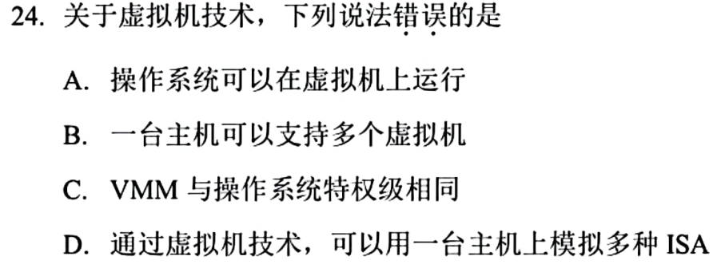

**新增**：画层次，并问“来宾 OS 的特权指令（05）谁来管”。

```
硬件
VMM        拦截并代为执行来宾的特权操作
来宾 OS
应用
```

题问**错误**。A、B 由此层次可成立；D 用软件模拟可在一台主机上呈现多种 ISA ✓。C“VMM 与 OS 特权级相同”：若同级，来宾 OS 的特权指令会直接作用于真实硬件，VMM 无法隔离多个来宾 → ✗，**选 C**。

[« 0823-answer](0823-answer.md)　　[0825-answer »](0825-answer.md)
