# 0824｜系统边界：应用如何进入内核

> 这组题直接分成两截：
> 前面是**快速拿分题**，分清库函数与系统调用、特权指令与用户指令，扫一眼题干 30 秒选完走人；
> 后面是**耗时攻坚题**，软硬件分工极度细碎，中断隐指令与操作系统到底谁存哪个寄存器、缺页异常在哪个阶段触发，必须拿草稿纸把时序画准。

---

## 一、 快速拿分题（秒杀概念，看清主体直接选）

### 01 · 2013-28
> *除 0 是硬件直接抓包的异常，read 是要特权的系统调用，而 sin() 只是在用户态算数学的纯库函数。*
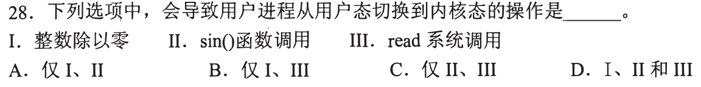

### 02 · 2014-25
> *关中断指令一执行就会关掉整个 CPU 的中断响应，这种能危及全系统的特权大招，绝对禁止在用户态碰。*
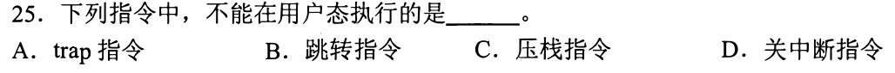

### 03 · 2015-24
> *NOT R0 只是寄存器内部按位取反，不访存、不除零、不发软中断，根本没有任何理由进内核。*
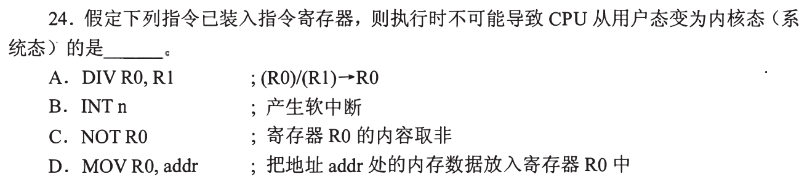

### 04 · 2018-29
> *中断向量表里放的全是中断服务程序的入口地址，硬件根据中断号查表，直接拿到跳转目标。*
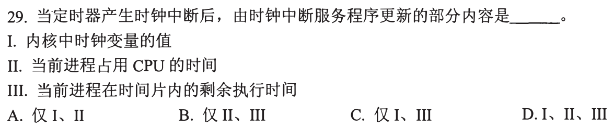

### 05 · 2019-25
> *系统调用必须由用户态程序主动发起，通过 trap 指令跨过大门，在内核态由操作系统替你干脏活。*
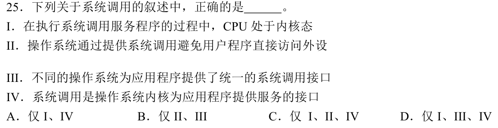

### 06 · 2021-32
> *普通函数调用是同级跳转，只用用户栈；系统调用必须跨特权级，由硬件切到内核栈并借道陷入门。*
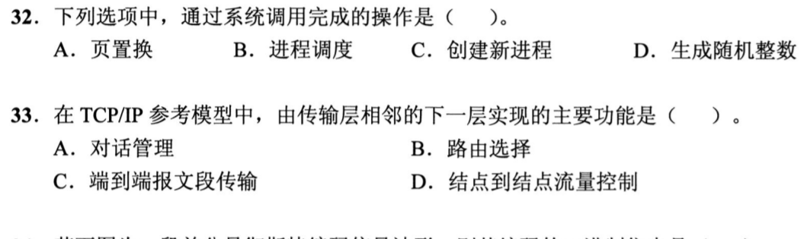

### 07 · 2022-31
> *陷入指令（访管指令）是用户程序主动呼叫操作系统的唯一合法大门，它本身在用户态执行，但一执行就立马进内核。*
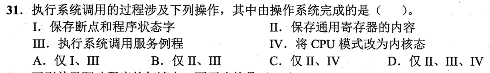

### 08 · 2023-23
> *系统调用服务例程干完活准备收工时，执行中断返回指令，由硬件负责把 CPU 从内核态切回用户态。*
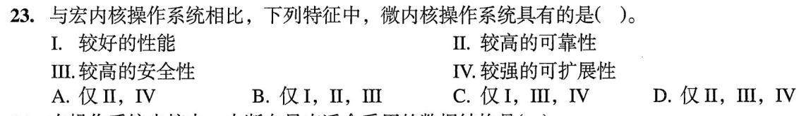

### 09 · 2024-23
> *硬件负责检测异常信号并打断流水线，具体的异常处理服务例程全是操作系统软件写好的代码。*
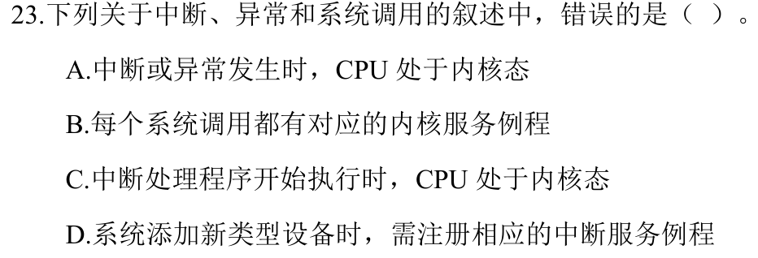

### 10 · 2025-24
> *特权指令只能在内核态执行，用户程序要想碰硬件或改寄存器，必须老老实实用系统调用请求内核代劳。*
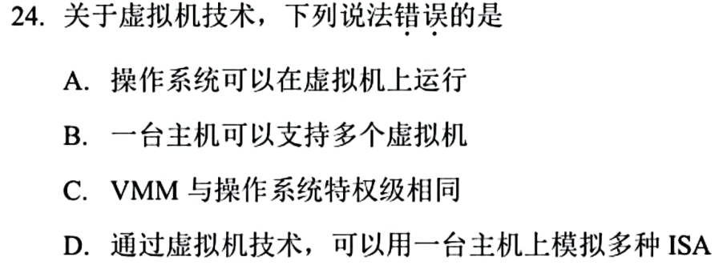

---

## 二、 耗时攻坚题（软硬件配合与多层嵌套，画准时序）

### 11 · 2012-23
> *进程切换涉及保存全部寄存器、换页表和特权保护，这种核心底层调度绝对不可能在用户态完成。*
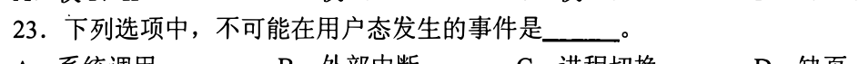

### 12 · 2013-25
> *用户只管说‘读第几块’，驱动程序负责把逻辑块号折算成具体的柱面号、磁头号和扇区号。*
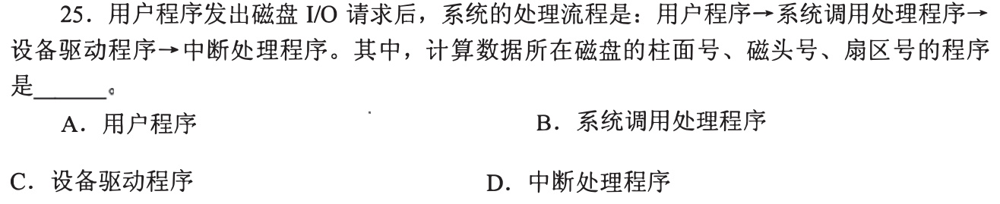

### 13 · 2015-23
> *硬件中断隐指令只负责保命把 PC 和 PSW 压栈，操作系统服务程序接手后才负责把通用寄存器存起来。*

### 14 · 2016-23
> *分清异常分类：陷入是故意为之，故障（缺页）能修好重试，终止直接判死刑，外中断则是时钟和外设在异步敲门。*
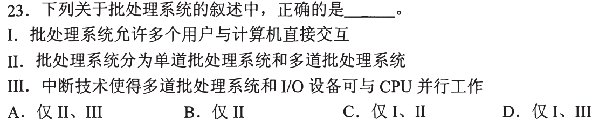

### 15 · 2020-18
> *计组与操作系统交叉送命题：关中断、保护断点 PC、取向量全是硬件硬件隐指令自动完成的，软件插不上手。*
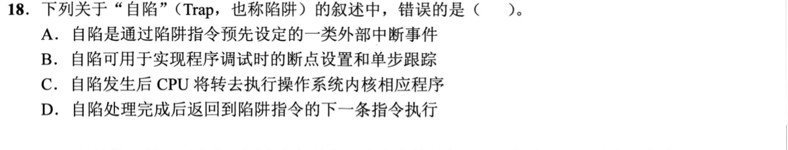

### 16 · 2020-25
> *初始化中断向量表和提供服务都是操作系统软件干的活，硬件只负责在发生中断时照单执行隐指令。*
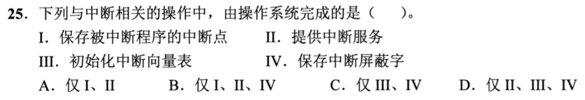

### 17 · 2021-23
> *缺页、主动 trap、外设时钟中断，不管是主动还是被动，只要触发了异常或中断，CPU 必定从用户态滑入内核态。*
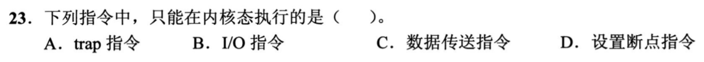

### 18 · 2022-24
> *故障返回的是引起故障的那条指令重新执行（比如缺页）；中断返回的是下一条指令继续往下走。*
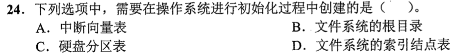

### 19 · 2022-27
> *用户栈在用户空间跑普通局部变量，内核栈专门驻留在内核空间，存放特权级切换时的现场和陷阱帧。*
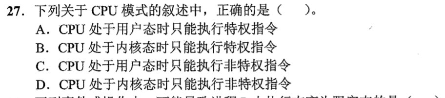

### 20 · 2023-21
> *指令执行阶段检测到底层硬件异常，不能假装没看见，必须立刻停下流水线打断当前指令，交由内核异常处理。*
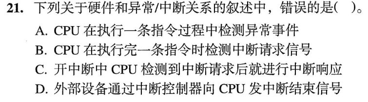

### 21 · 2023-24
> *模式切换只是特权级变了，不用切页表和地址空间；进程切换要切 PCB、换页表、刷新 Cache，开销大得多。*
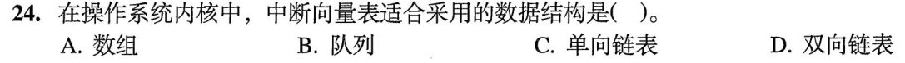

### 22 · 2023-26
> *进程上下文切换的完整流水账：关中断、保存老进程上下文到 PCB、调度选新人、更新页表基址、恢复新进程上下文。*
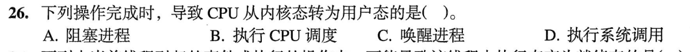

### 23 · 2025-23
> *处理中断时什么时机开中断极其考究，太早开会导致嵌套重入破坏现场，太晚开又会丢掉高优先级的紧急事件。*
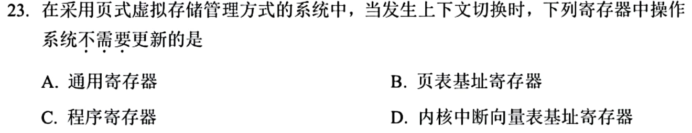

### 24 · 2026-23
<!-- 2026 压轴题位，已在 paper_html/408-2026.html 就绪 -->

### 25 · 2026-24
<!-- 2026 压轴题位，已在 paper_html/408-2026.html 就绪 -->
