# 0825｜执行生命线：进程、线程、状态与调度

> 这组题直接分成两截：
> 前面是**快速拿分题**，线程共享什么、进程状态怎么跳，牢记‘栈独享、堆共享’，一分钟搞定；
> 后面是**耗时攻坚题**，抢占式调度与多级反馈队列，草稿纸画好时间轴，算准到达时刻与优先级动态变化，防手滑掉坑。

---

## 一、 快速拿分题（结构与状态转换，牢记口诀）

### 01 · 2009-23
> *单 CPU 上同一时刻只能跑一个进程（并发），但 CPU、通道和各种外设之间完全可以同时各忙各的（并行）。*

### 02 · 2010-24
> *分配设备只是拿个句柄，只有用户登录成功或启动一个程序时，操作系统才会真正为你开辟 PCB 创建新进程。*

### 03 · 2011-24
> *Shell 命令解释程序是普通用户态程序，进程调度、缺页处理和时钟中断处理全是地地道道的内核功能。*

### 04 · 2011-25
> *同进程的多线程共享代码段、全局变量和堆，但每个线程有自己独立的寄存器状态和栈指针，栈绝对不能混用。*

### 05 · 2015-25
> *进程从执行态退回就绪态只有两种可能：时间片用光了，或者半路杀出个高优先级进程把你抢占了。*

### 06 · 2018-23
> *PCB 是进程存在的唯一身份证，操作系统核心数据结构常驻内存，绝不能被当作垃圾换出到外存。*
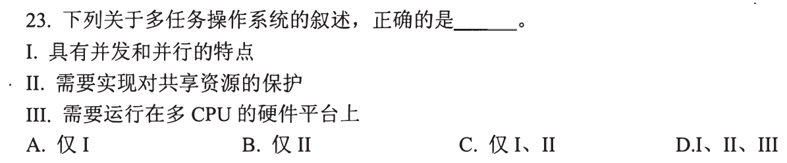

### 07 · 2018-25
> *同进程内线程切换只用换寄存器和栈，不用切换页目录和虚拟地址空间，比跨进程切换轻量一个数量级。*
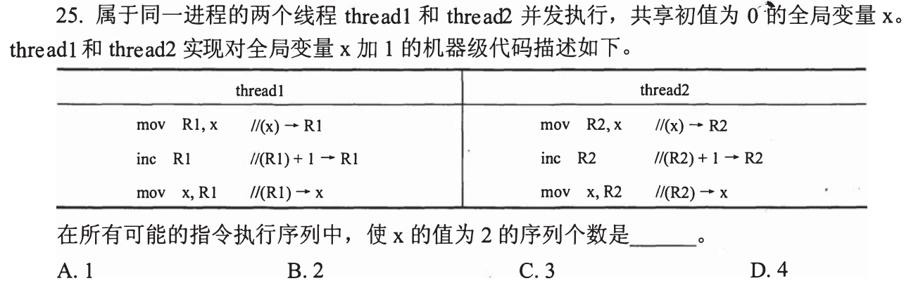

### 08 · 2019-23
> *阻塞态的进程必须等到了它盼望的事件被唤醒后，才能进就绪队列排队，绝不能直接爬上 CPU 运行。*
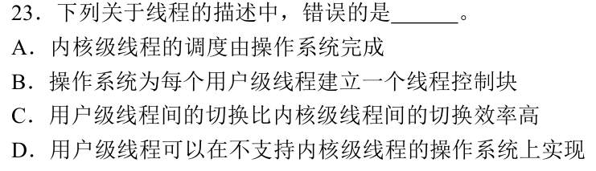

### 09 · 2021-25
> *进程是操作系统分配资源的最小独立单位，线程是 CPU 调度执行的最小独立单位，两句话焊死在脑子里。*
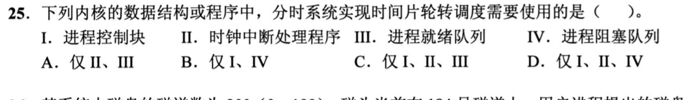

### 10 · 2022-28
> *一对一线程模型下，一个用户线程阻塞不会拖累同进程其他线程，但频繁在内核创建线程会带来可观开销。*

---

## 二、 耗时攻坚题（时序推演与开销掂量，草稿纸画轴）

### 11 · 2010-26
> *时间片用完的计算密集型进程主动降级，把高优先级让给刚从磁盘 I/O 醒来的交互型进程，全系统利用率最高。*

### 12 · 2017-23
> *纯用户级线程对操作系统内核隐形，一个线程调用了阻塞系统调用，内核直接把整个进程全挂起，全员陪葬。*
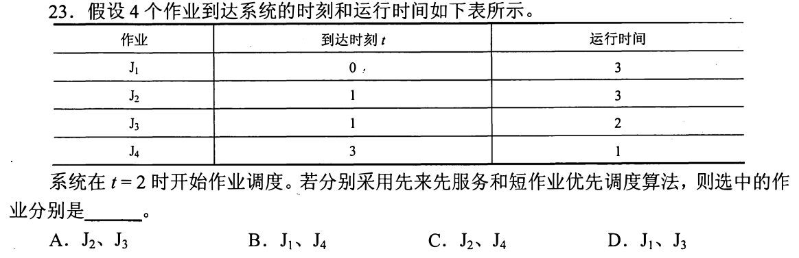

### 13 · 2017-27
> *高响应比优先算法：响应比等于 (等待时间 + 要求服务时间) / 要求服务时间，长作业等够了时间也能翻身。*

### 14 · 2018-24
> *算周转时间和带权周转时间，草稿纸上把完成时刻减到达时刻老实列出，千万别把到达时刻当成 0。*
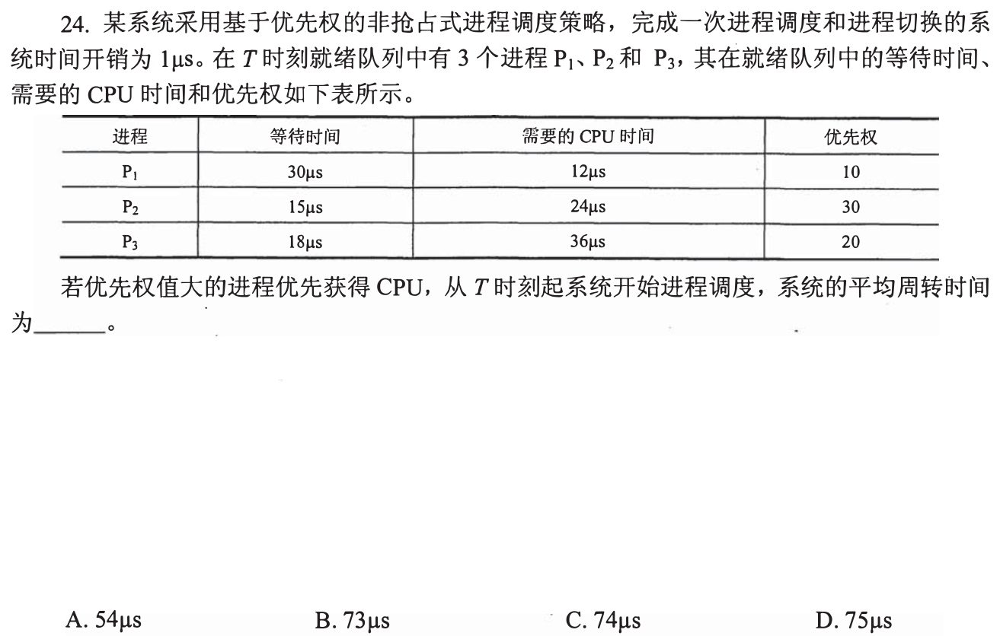

### 15 · 2019-27
> *多级反馈队列：新进程先进最高优先级小时间片队列，没跑完降一级，遇到 I/O 阻塞唤醒后返回原队列。*
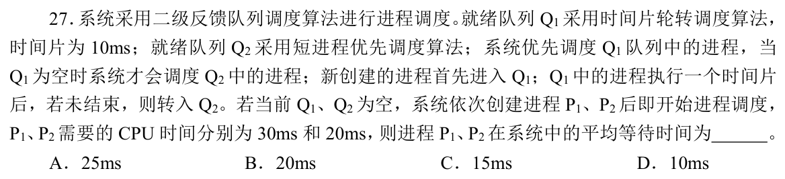

### 16 · 2020-26
> *内核眼里的实体只有内核级线程，弄清用户级线程在用户空间做分发与内核真实调度的对应关系。*
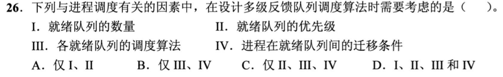

### 17 · 2020-29
> *实时系统周期性任务调度：算各任务执行时间与周期的比值之和，总利用率一旦超过 100% 必定不可调度。*
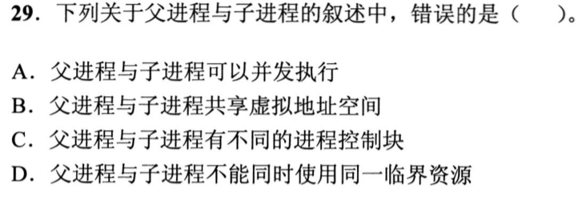

### 18 · 2021-24
> *fork() 系统调用后父子进程共享只读代码，写入时复制数据空间，子进程完全继承父进程的打开文件与环境变量。*
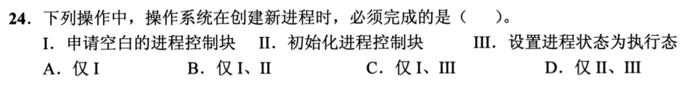

### 19 · 2021-27
> *时间片太小会导致 CPU 全在忙着切上下文做无用功，时间片太大就会退化成先来先服务，交互响应极差。*
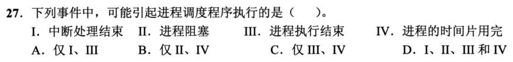

### 20 · 2022-23
> *父进程先死子进程变成孤儿由 init 收养，子进程先死而父进程不收尸 wait，子进程就会一直顶着僵尸进程占着 PCB。*
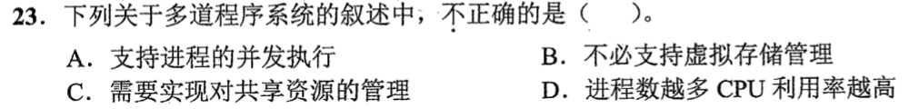

### 21 · 2022-25
> *抢占与非抢占的核心分界线：当新进程到达或 I/O 唤醒时，当前正在 CPU 上跑的进程能不能被立刻赶下来。*
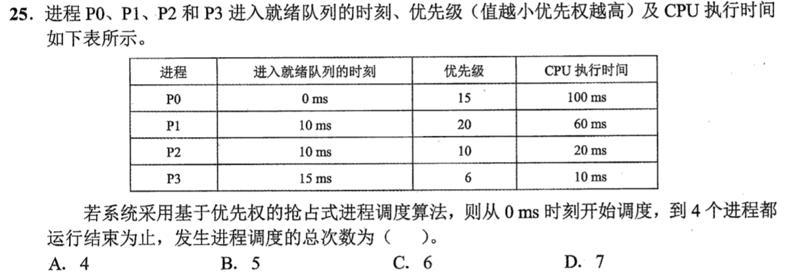

### 22 · 2023-27
> *跨进程切换会彻底切断页表映射，导致 TLB 和硬件 Cache 大面积失效，冷启动缺失是切换耗时隐形杀手。*

### 23 · 2023-29
> *时钟中断处理完毕返回用户态前的那一瞬间，是操作系统检查调度标志并执行进程调度的绝佳天然时机。*
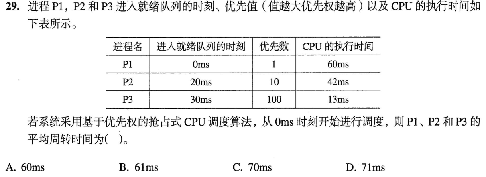

### 24 · 2024-24
> *内存不足时把就绪或阻塞进程换到外存对换区，形成挂起状态，理清活跃就绪、静止就绪的跨界流动。*

### 25 · 2025-25
> *最新压轴。现代混合调度器对不同线程类型的权重分配，注意时间片耗尽与事件等待交错时的状态机跳跃。*
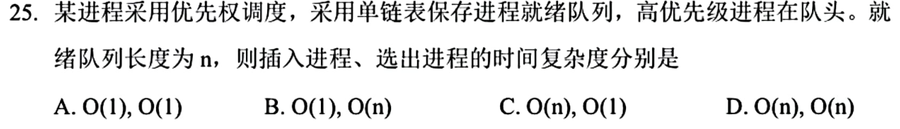

### 26 · 2026-25
> *内核级线程（KLT）是 CPU 调度的独立实体，一个线程阻塞不会导致所属进程的其他线程阻塞；用户级线程（ULT）的调度由用户态线程库完成，内核无法感知。*

