[« 0825-answer](0825-answer-sonnet.md)　　[0827-answer »](0827-answer-sonnet.md)

# 0826 Answer｜并发约束：把交错执行压成可证明的顺序

> [原题 15 题](0826.md) · [0825 进程与调度](0825-answer-sonnet.md) · [能力账本](answer-quality/learning-ledger.md)

**进入本篇时已有**：x++ 是读改写三步（0825-16）；线程私有现场 vs 进程共享资源（0825-07）；运行→就绪缺 CPU、运行→阻塞缺事件（0825-11）；抢占与调度时刻（0825-23/25）；轮转等待上界（0825-10）；虚存（0825-08）。信号量、互斥算法、管程本篇从零开始。
**读完新增**：01 信号量符号 · 02 turn 最后写者 · 03 交错终值集合 · 04 持锁≠占 CPU · 05 人人差一台 · 06 TSL 原子读改写＋自旋 · 07 先标变量归属 · 08 管程＝互斥入口＋条件等待 · 09 wait 睡的是调用者 · 10 等待分支阻塞还是循环 · 11 唤醒是阻塞→就绪 · 12 互斥机制的必须准则 · 13 线程共享/私有清单 · 14 轮转队尾的轮次 · 15 最少页框看单条指令

<details><summary>速览</summary>

| # | 起手 | 最易错 → 先看什么 |
| --- | --- | --- |
| [01](#q01) | 写 S≥0 与 S<0 各对应 M、N | 用 3−1 当等待数 → 当前值是正是负 |
| [02](#q02) | 列两种 turn 写入顺序 | 以为同时申请会同时进 → 最后写 turn 者等 |
| [03](#q03) | 写两条三步链，排三个交错 | 以为值域含 −1、3 → 每线程只读一次 |
| [04](#q04) | 分开写“谁持锁”“谁在 CPU” | 把互斥当禁止调度 → 谁被挡的是进入者 |
| [05](#q05) | 写各占最大需求−1 的状态 | 只加最大需求 → 空闲数 vs 各自还差几台 |
| [06](#q06) | 逐轮写 lock 与 TSL 返回值 | 把忙等当会睡 → 循环体是否为空 |
| [07](#q07) | 给每个 x 标 P1.x/P2.x | 同名即共享 → 在哪个进程里声明 |
| [08](#q08) | 找“只能”的反例 | 管程＝锁 → 条件变量 |
| [09](#q09) | 在 wait/signal 旁写谁睡谁醒 | 混淆 wait 与 signal → 动作主体 |
| [10](#q10) | 写出各机制等不到时的动作 | 以为能互斥就让权 → 分支是循环还是入队 |
| [11](#q11) | 写被唤醒者的原状态 | 把换人当唤醒 → 原状态是否阻塞 |
| [12](#q12) | 用 02 的算法逐条检验 | 把让权当必须 → 合法算法是否违反它 |
| [13](#q13) | 分进程共享/线程私有两列 | 栈也共享 → 现场是否各自一份 |
| [14](#q14) | 写 P 每片的结束时刻 | 以为排最后只等一轮 → 其余九个是否提前退出 |
| [15](#q15) | 写一条指令同时涉及的页 | 看地址空间大小 → 单条指令需同时留住几页 |

**反复出现的信号**：“能互斥”不等于“会睡”（06、10、12）；同名≠同一变量（07）；状态变化要写出原状态与新状态（11、09）；构造极端状态再加一份（05、14）。

</details>

<a id="q01"></a>
## 01｜2010-25：信号量的符号区分“可用数”与“等待数”

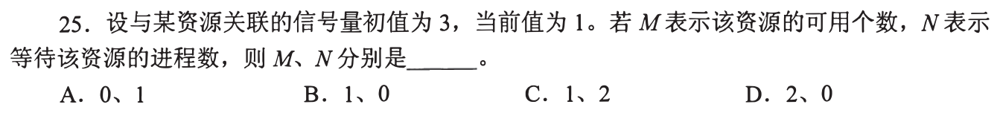

**新增**：信号量值 S 的读法（教材约定：P 先 S−−，S<0 则阻塞）。**起手**：写 `S≥0 → M=S, N=0；S<0 → M=0, N=−S`。本题 S=1 → **M=1，N=0，选 B**。

| 选项 | 需要的 S | 与题面 |
| --- | --- | --- |
| A 0、1 | S=−1 | 当前值是 1 |
| C 1、2 | S=−2 | 同上；3−1=2 只是初值与现值之差，不是等待数 |
| D 2、0 | S=2 | 当前值是 1，不是 2 |

S>0 时 P 不会阻塞，故没有等待者；初值 3 只给总数。

<a id="q02"></a>
## 02｜2010-27：Peterson 型算法，最后写 turn 的一方等

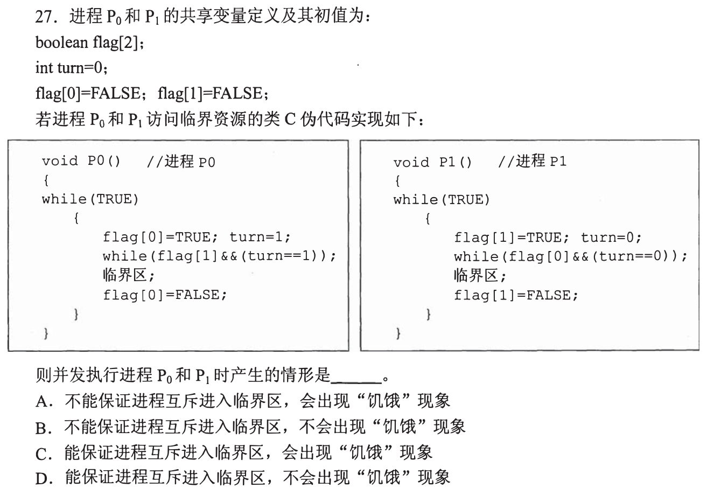

**新增**：用 turn 的最终值判定谁进谁等。**起手**：两进程同时到达，各先写 flag（图上写 `turn=1`/`turn=0`，是把 turn 让给对方），排两种写 turn 的顺序 → **D**。

```
P0 先写 turn=1，P1 后写 turn=0 → turn=0
  P0: flag[1]&&turn==1 → 假 → 进        P1: flag[0]&&turn==0 → 真 → 等
P1 先写，P0 后写           → turn=1，P1 进，P0 等
P0 退出: flag[0]=FALSE → P1 的条件变假 → P1 进
```

**互斥**：一方在区内时其 flag 为 TRUE 且不再写 turn，对方后写的 turn 恰让自己被卡。**不饥饿**：P0 退出后即使立刻再来，它先写 `turn=1`，P1 条件 `turn==0` 已假，P1 必进；所以 P1 至多再让 P0 进一次。

| 选项 | 题面不符处 |
| --- | --- |
| A、B“不能保证互斥” | 上面推演中两方不会同时通过 |
| A、C“会出现饥饿” | 退出清 flag 且重进先让 turn，等待者必进 |

<details><summary>互斥的反证</summary>

设两方同在区内，则两 flag 皆 TRUE，P0 通过检查时 turn==0，P1 通过时 turn==1。但各自写 turn 都在自己检查之前，区内又无人再写 turn；所以后写 turn 的一方检查时 turn 是对自己不利的值，被卡，矛盾。前提：读写原子、顺序可见。
</details>

<a id="q03"></a>
## 03｜2011-32：每线程只读一次、写一次，终值由最后写者决定

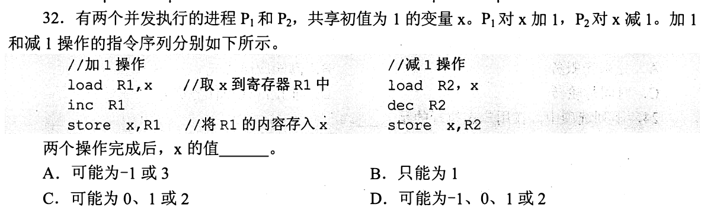

**新增**：把交错写成链并求终值集合（0825-16 只给了“三步”）。**起手**：写两条链 `l1 inc s1`、`l2 dec s2`，x 初值 1，排三个交错 → **C**。

```
l1 inc s1 l2 dec s2   → 2 再读 2 减成 1        x=1
l1 l2 inc dec s1 s2   → R1=2, R2=0，后写 0     x=0
l1 l2 inc dec s2 s1   → 后写 2                 x=2
```

值域：每线程只读一次，且只能读到 1 或对方的写入。P1 写 2（读 1）或 1（读到 P2 的 0）；P2 写 0（读 1）或 1（读到 P1 的 2）。终值是某一方的写入，∈{0,1,2}。脚本枚举全部 20 种交错，值域恰为 {0,1,2}。

| 选项 | 与上面不符处 |
| --- | --- |
| A 可能 −1 或 3 | 写入值只有 0、1、2 |
| B 只能为 1 | 第二、三行交错得 0、2 |
| D 含 −1 | 同 A |

<a id="q04"></a>
## 04｜2012-30：持有临界区是锁的事，在不在 CPU 上是调度的事

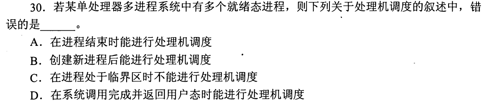

**新增**：把“持锁者”与“占 CPU 者”分成两列。**起手**：画 P1 进区、时钟中断、P2 被调度 → **选 C（题问错误项）**。

```
P1 进临界区（持锁） → 时间片到，P1 运行→就绪 → 调度程序选 P2 上 CPU
P2 若要进同一临界区 → 被挡（阻塞或自旋）；若不进 → 照常运行
```

C 句说临界区内“不能调度”，上面是合法时序，互斥只禁止第二个进程进入同一临界区。0825-23 的时刻中，结束（A）、创建后（B）、系统调用返回用户态（D）都是调度机会。

<a id="q05"></a>
## 05｜2014-24：让每个进程都只差最后一台

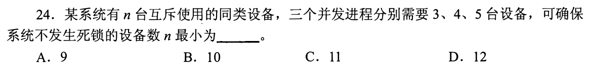

**新增**：死锁＝各占设备又都等更多、无人能完成；用“各占最大需求−1”构造最坏状态。**起手**：写 `2+3+4=9` → n=9 时分到 (2,3,4)，空闲 0，每人还差 1，卡死。**选 B（10）**。

n≤9 同理可卡死（脚本核对 n=5..9）。n=10 不可能卡死：设卡死时空闲 f，每人还差 need_i，卡死要求 need_i ≥ f+1：

```
12 = Σ最大需求 = Σ已占 + Σ还差 ≥ (10−f) + 3(f+1) = 13+2f ≥ 13   矛盾
```

故 10 台总有人能完成并归还。A（9）有卡死状态；C、D 不是最小。

<a id="q06"></a>
## 06｜2016-27：TSL 把“读旧值并置锁”做成一步，等待者在原地空转

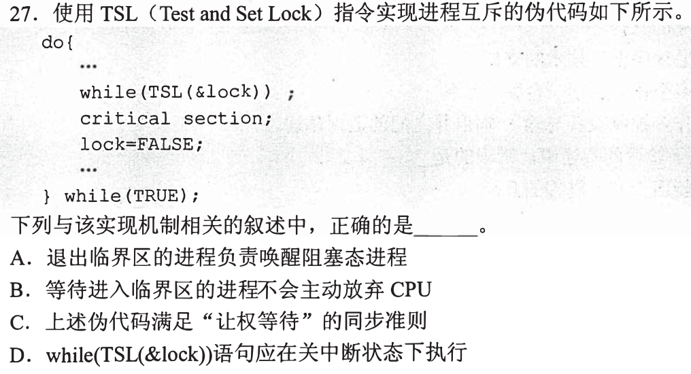

**新增**：TSL＝原子地返回旧值并置 TRUE；让权等待＝进不去时让出 CPU。**起手**：逐轮写 lock 与 TSL 返回值 → **B**。

```
lock=FALSE: P0 TSL 返回 FALSE（并置 TRUE）→ 出循环进区
lock=TRUE : P1 TSL 返回 TRUE → 循环体是空语句 → 再 TSL …（占着 CPU）
P0 执行 lock=FALSE → P1 下一次 TSL 返回 FALSE → 进区
```

| 选项 | 题面依据 |
| --- | --- |
| A 退出者唤醒阻塞进程 | 退出只有 `lock=FALSE`，无唤醒语句；等待者在循环，不处于阻塞态 |
| B | 循环体为空，没有任何让出动作 |
| C 满足让权等待 | 同上，等待时仍占 CPU |
| D 应关中断执行 | 互斥由 TSL 的原子性保证；若在单核上关中断自旋，持锁者无法被调度来写 `lock=FALSE`，永远循环 |

<a id="q07"></a>
## 07｜2016-30：先判归属，冲突＝同一变量、至少一方写

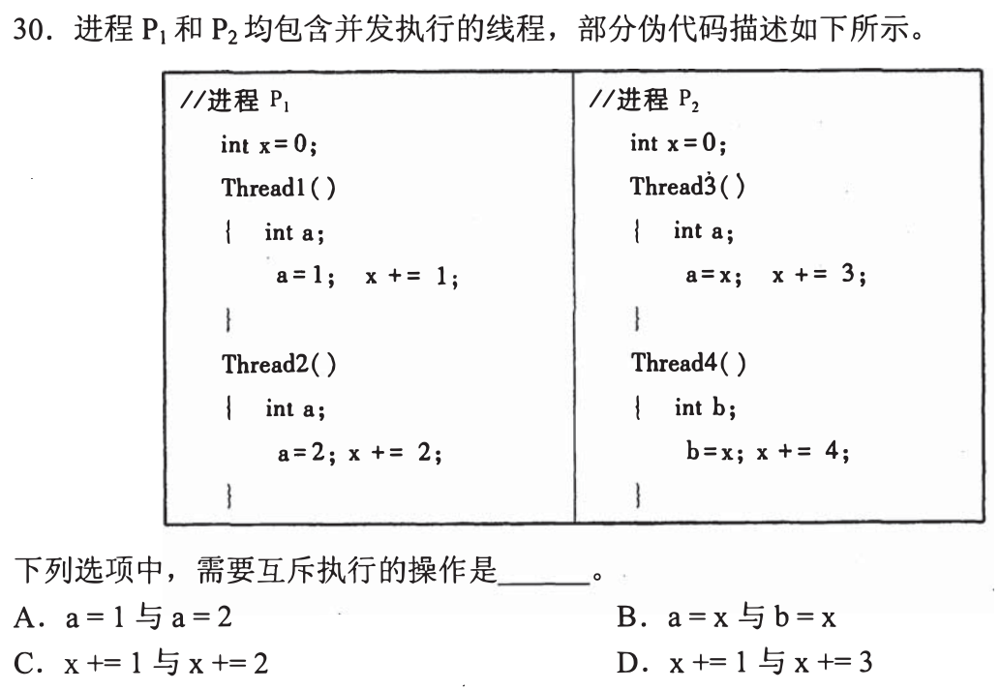

**新增**：给变量标所属范围（进程全局 vs 线程局部）。**起手**：把 x 标为 `P1.x`、`P2.x`，a、b 标为各线程私有 → **C**。

| 选项 | 涉及变量 | 结论 |
| --- | --- | --- |
| A `a=1` 与 `a=2` | Thread1、Thread2 各自声明的 `int a` | 局部，不同变量 |
| B `a=x` 与 `b=x` | 都在 P2，读同一个 P2.x，但只读；a、b 局部 | 不覆盖，无需互斥 |
| C `x+=1` 与 `x+=2` | 同在 P1，同一个 P1.x，都是读改写 | 可丢更新（03 的机制） |
| D `x+=1`（P1）与 `x+=3`（P2） | 两进程各声明自己的 `int x=0` | 不同变量 |


<a id="q08"></a>
## 08｜2016-32：管程除了一次只进一个，还能让进程等条件

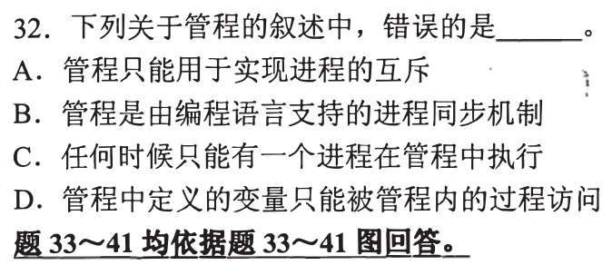

**新增**：管程含两部分——互斥入口、条件变量（可在其上 wait/signal 等条件）。具体动作见 09，本题只用“它存在、用来等条件”。**起手**：对 A 找“只能”的反例 → 题问**错误**项，**选 A**。

反例：消费者进入管程发现缓冲区空，在条件变量上等待，直到生产者放入数据后通知。这是“等条件”的同步，不是互斥。

| 选项 | 判断 |
| --- | --- |
| B 编程语言支持的同步机制 | 教材对管程的定义，不与题面冲突 |
| C 任何时候只能有一个进程在管程中执行 | 入口互斥的内容 |
| D 管程内变量只能被管程内过程访问 | 封装的内容 |

<a id="q09"></a>
## 09｜2018-28：wait 睡调用者，signal 唤醒别人

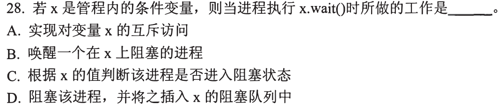

**新增**：`x.wait()` 的实际动作。**起手**：在管程里写 `if(缓冲区空) x.wait();`，问调用者之后的状态 → **D**。

```
C 执行 x.wait() → C 阻塞，入 x 的阻塞队列，并让出管程
P 进管程，放入数据，x.signal() → 唤醒 x 队列中的一个
```

必须让出管程：否则 P 进不来，永远无人 signal。

| 选项 | 与题面不符处 |
| --- | --- |
| A 对变量 x 的互斥访问 | 互斥由管程入口给出，不是 wait 做的 |
| B 唤醒一个阻塞的进程 | 这是 signal 的动作；wait 的主语是调用者自己 |
| C 根据 x 的值判断 | 条件变量没有像 01 信号量那样的数值；判断条件写在程序的 if 里 |

<a id="q10"></a>
## 10｜2018-32：看等不到时执行的是循环还是入队

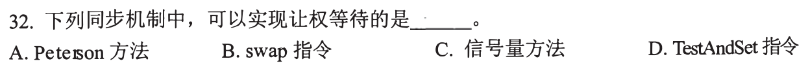

**新增**：信号量 P 的阻塞实现。**起手**：为每个选项写“进不去时做什么” → **C**。

| 选项 | 进不去时 | 依据 |
| --- | --- | --- |
| A Peterson | `while(...)` 空体循环 | 02 的代码 |
| B swap | 反复交换并检查 | 题面只给名称；取教材通常用法，同 06 的自旋 |
| C 信号量 | S−− 后 S<0 → 阻塞入队（01 中 S<0 才有等待者） | 阻塞即让出 CPU |
| D TestAndSet | 与 06 的 TSL 同型，循环 | 同 06 |


<a id="q11"></a>
## 11｜2019-24：唤醒＝阻塞→就绪，写出被唤醒者的原状态

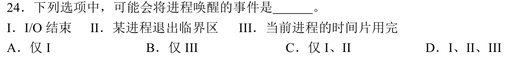

**新增**：把“唤醒”落到状态边上。**起手**：对每个事件写“谁，从什么状态到什么状态” → **C（I、II）**。

| 事件 | 变化的进程 | 状态变化 |
| --- | --- | --- |
| I I/O 结束 | 等该 I/O 的进程 | 阻塞→就绪 |
| II 某进程退出临界区 | 等该临界资源的进程（若有） | 阻塞→就绪 |
| III 时间片用完 | 当前进程自己 | 运行→就绪（0825-11） |

III 没有“原来阻塞”的进程，故不是唤醒。题问“可能”，II 只需存在等待者即成立；A 漏 II，B 只选 III，D 含 III。

<a id="q12"></a>
## 12｜2020-32：用合法的互斥算法逐条检验准则

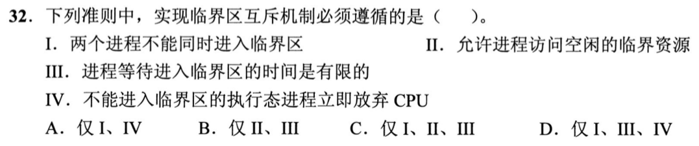

**新增**：互斥机制的必须准则＝互斥、空闲让进、有限等待。**起手**：拿 02 的算法逐条试 → **C（I、II、III）**。

| 准则 | 02 的算法 |
| --- | --- |
| I 不能同时进入 | 满足（02 推演） |
| II 空闲可进 | 对方 flag 为 FALSE 时条件为假，直接进 |
| III 等待有限 | 退出清 flag、重进先让 turn，等待者必进 |
| IV 进不去立即放弃 CPU | **不满足**：while 空转（06 同型） |

02 是题面认可的互斥算法却违反 IV，所以 IV 不是此题所问“必须”。按此题读法，教材虽把让权等待列为设计准则，但归入“应当”而非三项必须；这是对答案的读法，不是图上字样。A、D 含 IV，B 缺 I。


<a id="q13"></a>
## 13｜2024-28：同进程的线程共享资源，各留一份执行现场

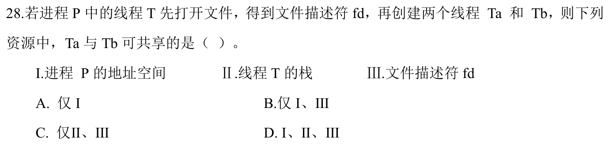

**新增**：线程共享/私有清单（沿用 0825-07 “恢复执行点所需的私有”）。**起手**：画两列 → **B（I、III）**。

| 共享（属于进程 P） | 私有（线程各一份） |
| --- | --- |
| I 地址空间；III 打开的文件（fd） | II 栈、寄存器、PC |

Ta、Tb 都是 P 内的线程，T 打开文件早于创建它们，fd 属于 P，所以可用。II 是 **T 的**栈，Ta、Tb 各有自己的栈。

> 同一地址空间里指针技术上能读到别的线程的栈；题按“栈是私有现场”读，这是约定。

A 漏 III；C、D 含 II。

<a id="q14"></a>
## 14｜2024-30：队尾的 P 要等 4 整轮和第 5 轮的 9 个人

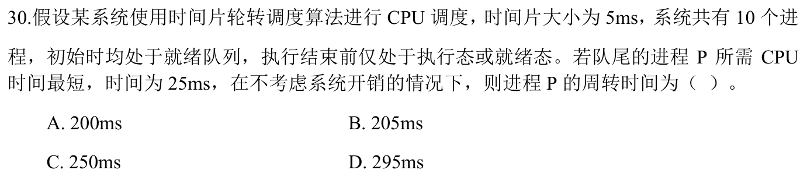

**新增**：确认其余进程在 P 完成前不退出队列。**起手**：写 P 每片结束时刻 → **C（250ms）**。

条件：10 个进程同时在 0 时刻就绪，P 在队尾，只在执行/就绪态（无阻塞），P 需 25ms＝5 片，且 P 是最短者。

```
第 k 轮: 先 9 个进程各 5ms（45ms），再 P 的 5ms
第1轮 P 结束于 50；第2轮 100；第3轮 150；第4轮 200；第5轮 250
周转 = 完成 − 到达 = 250 − 0 = 250ms
```

其余九个所需时间都 ≥25ms，前四轮每人仅用 20ms，没有人提前退出，所以每轮仍是 10 个人。即使有人恰好需要 25ms，也在第五轮 P 之前才结束，P 的结束时刻不变。

200、205 不含第五轮前的 9 个人；295 比这一排程多出一个 45ms，题面无此排程。

<a id="q15"></a>
## 15｜2025-27：最少页框看单条指令同时必须在内存的页

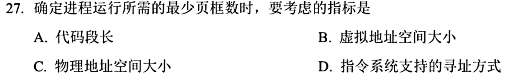

**新增**：最少页框＝一条指令执行时必须同时驻留的页数（接 0825-08 的缺页）。**起手**：写假想指令 `指令在页1 → 间接地址在页2 → 操作数在页3`，同时需要 3 页 → **D**。

这只是例子，题面没给指令集；它说明下限由**寻址方式**（间接、跨页等）决定。页框少于该数，指令会反复缺页而无法完成。

| 选项 | 与题面不符处 |
| --- | --- |
| A 代码段长 | 代码长不改变一条指令同时要几页 |
| B 虚拟地址空间大小 | 决定可编址范围和页表大小，不是单条指令的同时需求 |
| C 物理地址空间大小 | 是页框总量上限，不是最少需要量 |

题面未给 A、B、C 与同时驻留页数的关系，按教材“最少物理块数取决于指令格式与寻址方式”读。

[« 0825-answer](0825-answer-sonnet.md)　　[0827-answer »](0827-answer-sonnet.md)
