# 0826｜并发约束：把交错执行压成可证明的顺序

> 当前显示 **6 题**（2020—2026 年）；**11 题暂缓**，原文保留在文件末尾的 HTML 注释中，未删除。

## 当前题单（2020—2026）

### 01 · 2020-32
> *双循环累加计数器交错，必须把汇编的三步拆开：读出、累加、写回，谁最后写回谁就决定内存最终值。*
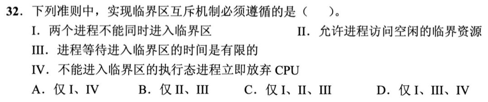

### 02 · 2024-28
> *软件互斥算法漏洞分析：只要检查 flag 与修改 flag 之间能插进别人的指令，就必定会双双闯入临界区。*
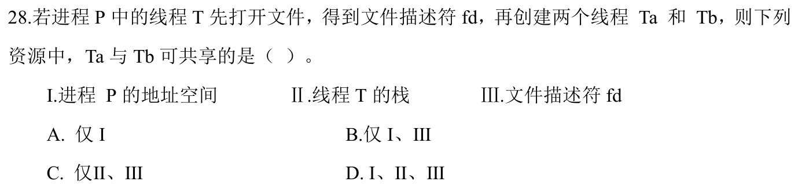

### 03 · 2024-30
> *多资源非对称申请容易形成交叉等待，排查时盯紧两个进程申请锁的顺序是否形成了‘你等我、我等你’的死锁闭环。*
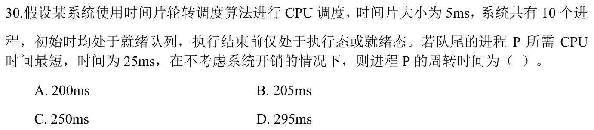

### 04 · 2025-27
> *最新压轴。现代多核内存乱序与并发可见性，结合条件变量与互斥锁的组合使用分析边界条件。*

### 05 · 2026-26
> *信号量 S 初值为 5，当 S > 0 时表示可用资源数；当 S < 0 时，|S| 表示等待队列中的进程数。根据并发执行进程数和进入临界区的数量推导 S 和 n。*

### 06 · 2026-27
> *两并发进程 P、Q 可并发执行且结果确定的充要条件是 Bernstein 条件：$R(P) \cap W(Q) = \emptyset$ 且 $W(P) \cap R(Q) = \emptyset$ 且 $W(P) \cap W(Q) = \emptyset$。*
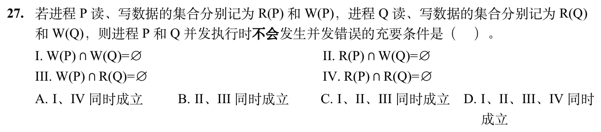

## 暂缓题目

以下题目仅暂时不处理；完整题目条目保留在 Markdown 源文件的 HTML 注释内，预览不显示题目。

<!-- 暂缓题：2010-25；暂时不处理，未删除。
### 01 · 2010-25
> *信号量大于 0 时，数值就是当前还剩几个空闲资源；小于 0 时，绝对值就是正在队伍里排队等着的进程数。*
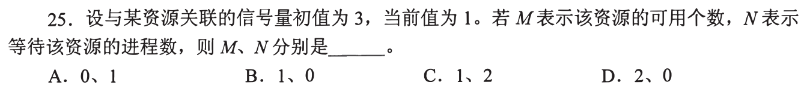
-->

<!-- 暂缓题：2014-24；暂时不处理，未删除。
### 02 · 2014-24
> *抽屉原理破死锁：3、4、5 台需求各给它们少发 1 台（2+3+4=9），系统只要有 10 台设备就绝对不可能死锁。*
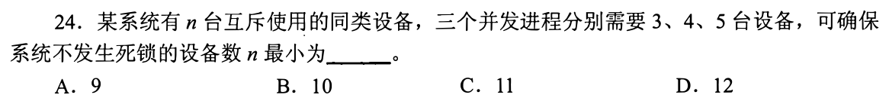
-->

<!-- 暂缓题：2016-27；暂时不处理，未删除。
### 03 · 2016-27
> *信号量当前值为负，直接反映了有多少个进程在 wait 后被挂入等待队列，不需要额外去数 PCB。*
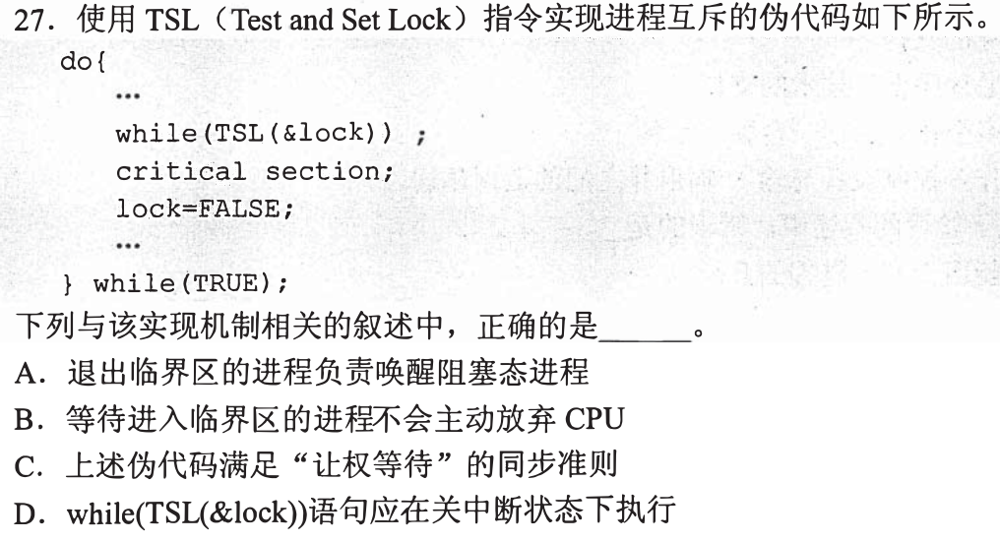
-->

<!-- 暂缓题：2016-30；暂时不处理，未删除。
### 04 · 2016-30
> *TestAndSet 读旧值同时写入新值由硬件原子保证，执行中绝不会被中断打断，是自旋锁的核心基石。*
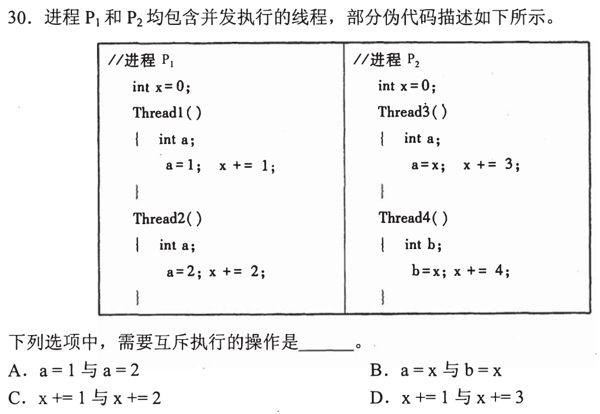
-->

<!-- 暂缓题：2018-28；暂时不处理，未删除。
### 05 · 2018-28
> *让权等待要求进不去临界区就主动睡眠让出 CPU，像 Peterson 这类纯软件忙等算法全都没做到让权等待。*
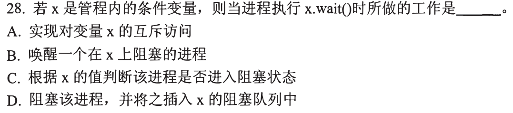
-->

<!-- 暂缓题：2018-32；暂时不处理，未删除。
### 06 · 2018-32
> *前趋图同步：每个前趋关系箭头设一个信号量，前一个进程干完发 signal，后一个进程开工前执行 wait。*
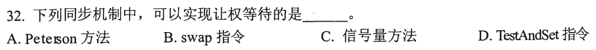
-->

<!-- 暂缓题：2019-24；暂时不处理，未删除。
### 07 · 2019-24
> *互斥锁要紧紧贴住真正读写共享变量的那几行代码，千万别把等待条件的同步 wait 也包进互斥锁里导致自锁。*
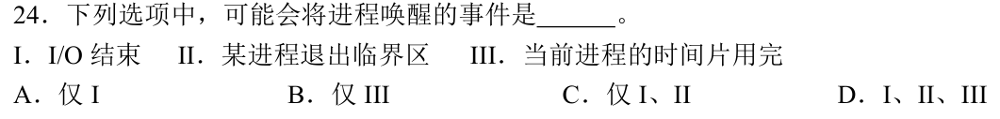
-->

<!-- 暂缓题：2010-27；暂时不处理，未删除。
### 09 · 2010-27
> *Peterson 算法经典两步：先举手表达进临界区意图，紧接着客气地把谦让变量 turn 赋给对方，逻辑非常精妙。*
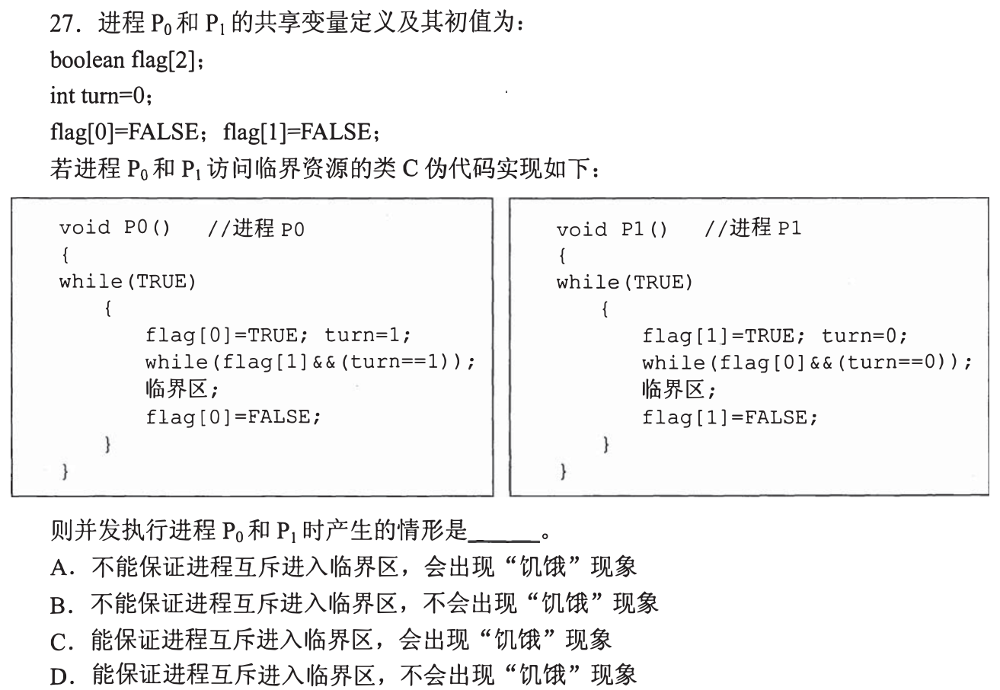
-->

<!-- 暂缓题：2011-32；暂时不处理，未删除。
### 10 · 2011-32
> *并发加一减一交错：写回操作不是原子的，只要按 load-modify-store 细化步骤交替走，就能推演所有可能结果。*
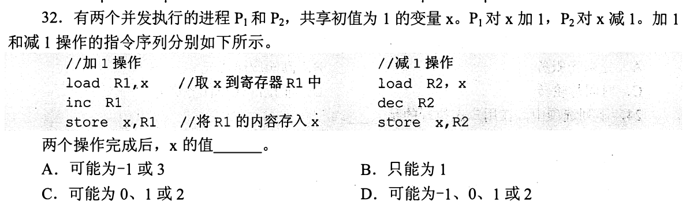
-->

<!-- 暂缓题：2012-30；暂时不处理，未删除。
### 11 · 2012-30
> *进程进入普通用户临界区完全可以被正常抢占调度，只有在内核关中断临界区内才严禁发生进程调度。*
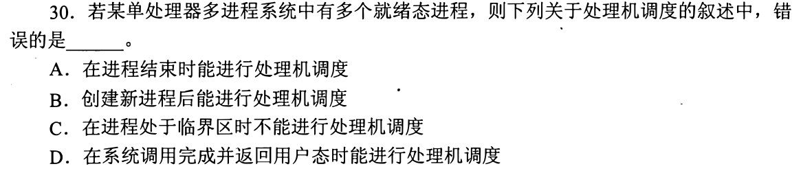
-->

<!-- 暂缓题：2016-32；暂时不处理，未删除。
### 12 · 2016-32
> *多进程并发写共享全局变量，穷举极端时序：一个人算完全步写回，或者另一个人在最后一步写回前将其覆盖。*
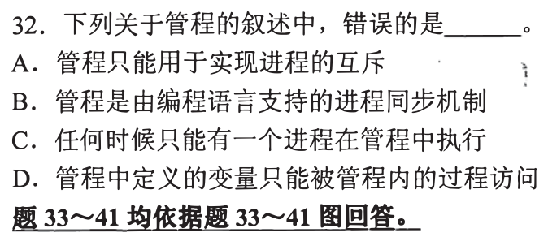
-->
