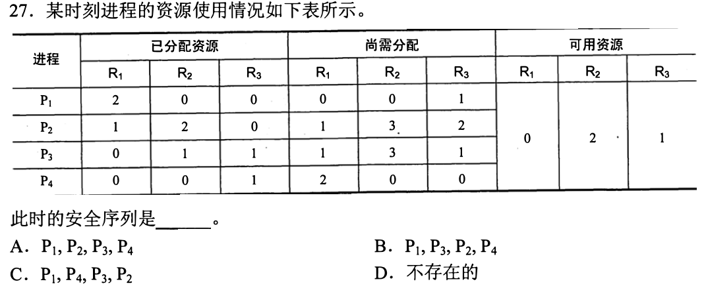
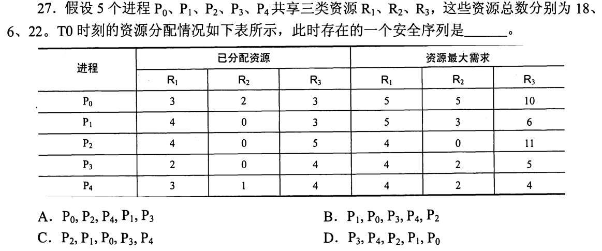
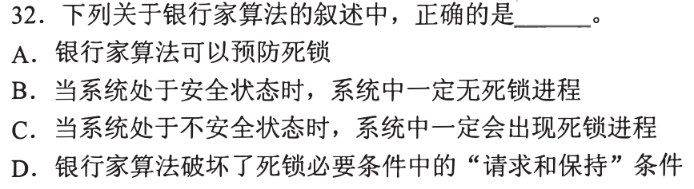
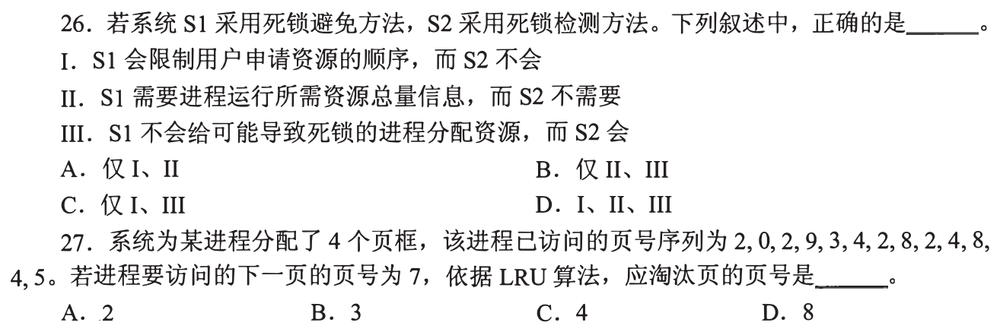
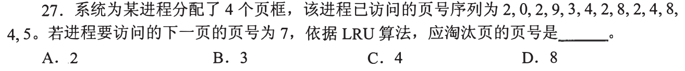
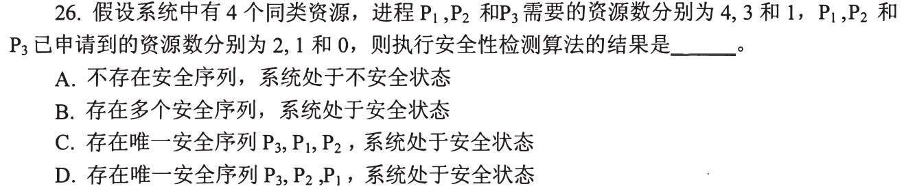
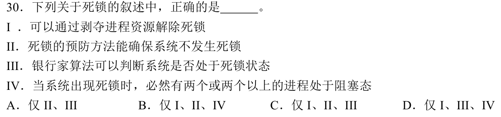
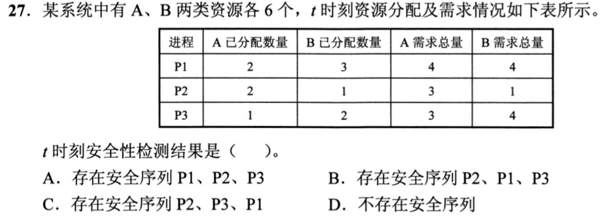
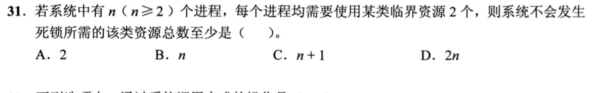
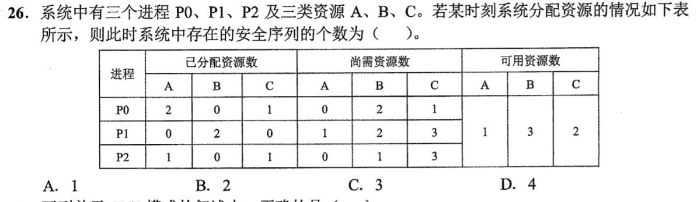

[« 0826-answer](0826-answer-sonnet.md)　　[0828-answer »](0828-answer-sonnet.md)

# 0827 Answer｜资源闭环：死锁、避免与检测

> [原题 13 题](0827.md) · [0826 并发约束](0826-answer-sonnet.md) · [能力账本](answer-quality/learning-ledger.md)

**进入本篇时已有**：各占最大需求−1 的卡死态与 Σ(max−1)+1（0826-05）；进程共享地址空间、线程私有栈（0825-07、0826-13）；缺页与页框（0825-08、0826-15）。安全序列、死锁分类本篇从零开始。
**读完新增**：01 把“可能死锁”落成卡死态 · 02 安全序列的一轮：Need≤Work，Work+=Allocation · 03 可用＝总量−已分配，Need＝Max−Allocation · 04 资源分配单位与用户级线程切换 · 05 安全⇒无死锁，不安全⇏死锁 · 06 避免（分配前）/检测（分配后） · 07 LRU：看最后一次使用 · 08 死锁要成环，找最小环 · 09 完成者归还的是已持有量 · 10 预防/剥夺恢复/死锁最少阻塞进程 · 11 复用 02、03 · 12 把 01 的论证符号化 · 13 数安全序列条数

<details><summary>速览</summary>

| # | 新增台阶 | 起手 | 最易错 → 先看什么 |
| --- | --- | --- | --- |
| [01](#q01) | 卡死态构造 | 算 K×2 与 8 | 以为 K=3 也能卡 → 卡死时空闲是否 >0 |
| [02](#q02) | Work 更新 | 列 Work，逐个试 Need | 把“能开头”当“安全” → 走完全部进程了吗 |
| [03](#q03) | 可用与 Need | 总量−各列已分配 | 用最大需求比 Work → Need 是否已减去已持有 |
| [04](#q04) | 资源单位 | 分两列：资源归谁/谁被调度 | 单位说反 → 分配 vs 调度 |
| [05](#q05) | 三态关系 | 写出三个蕴含方向 | “不安全＝死锁” → 不安全只是无保证 |
| [06](#q06) | 避免/检测时刻 | 每句话标“分配前/后” | 避免＝限制申请顺序 → 它限制的是批准 |
| [07](#q07) | LRU | 从尾往前取不同页 | 数次数 → 看最后一次位置 |
| [08](#q08) | 最小环 | 画 进程→持有→等待 | 把 P4 算进环 → 它有没有“持一等一” |
| [09](#q09) | 归还量＝已持有 | 算 Need、可用 | 能完成就能解救别人 → 归还多少 |
| [10](#q10) | 恢复/预防/检测 | 每句标事前/事后 | 银行家＝死锁检测 → 它判的是安全性 |
| [11](#q11) | 复用 | 两列分别算 | 两类相加 → 逐分量比较 |
| [12](#q12) | 符号化论证 | 先令 n 份各占 1 | 选 n → 空闲是否为 0 |
| [13](#q13) | 数条数 | 先找唯一可开头者 | 重复计 → 每一步可选谁 |

**反复出现的信号**：Need≤Work 且完成后加的是已持有量（02、03、09、11、13）；“不安全”≠“已死锁”（05、09、10）；构造卡死态时空闲为 0（01、12）。

</details>

<a id="q01"></a>
## 01｜2009-25：把“可能死锁”落成一个卡死态


**新增**：用 0826-05 的“各占最大需求−1”构造卡死态，并说明更小的 K 构不成。**起手**：每人占 2（最大 3 减 1），写 K×2 与 8 比 → **K=4，选 C**。

| K | 全员各占 2 | 空闲 | 能否卡死 |
| --- | --- | --- | --- |
| 2 | 4 | 4 | 否 |
| 3 | 6 | 2 | 否 |
| 4 | 8 | 0 | 是：4 人各差 1 台，无人能继续 |

K=3 时，只要有人尚未满足就持有 ≤2（持 3 台已满足、会归还），3 人至多持 6，空闲 ≥2，任一人再要 1 台都能满足，所以不卡。选项 A、B 即此情形。D（K=5）也可能卡死（如持 2,2,2,1,1，空闲 0），但题问最小值。

<a id="q02"></a>
## 02｜2011-27：安全序列：Need≤Work，完成后 Work 加已持有量



**新增**：一轮检查＝找 Need≤Work 的进程，完成后 `Work += 它的已分配`；所有进程都能排完才是安全序列。**起手**：Work＝可用 (0,2,1)，逐个比较“尚需分配” → **D，不存在**。

```
Work=(0,2,1)
P1 需(0,0,1)≤Work → Work+=(2,0,0)=(2,2,1)
P4 需(2,0,0)≤Work → Work+=(0,0,1)=(2,2,2)
P2 需(1,3,2)：R2 3>2 ✗     P3 需(1,3,1)：R2 3>2 ✗
```
首轮只有 P1 可开头（P2 R2 3>2、P3 R2 3>2、P4 R1 2>0），随后只有 P4 可接，之后停住，没有完整序列。

| 选项 | 在哪一步不合 |
| --- | --- |
| A P1,P2,… | P1 后 Work=(2,2,1)，P2 需 R2=3 ✗ |
| B P1,P3,… | P3 需 R2=3 ✗ |
| C P1,P4,P3,P2 | 前两步合法，P3 需 R2=3，Work 的 R2 只有 2 ✗ |

信号：序列只验证到某一步时不能停，必须验完最后一个进程。

<a id="q03"></a>
## 03｜2012-27：可用和 Need 都要自己算



**新增**：表里只给总量、已分配、最大需求时，先 `可用＝总量−各列已分配之和`，`Need＝Max−Allocation`。**起手**：按列加已分配 → 可用 **(2,3,3)**，答案 **D**。

```
已分配列和 R1=3+4+4+2+3=16  R2=2+0+0+0+1=3  R3=3+3+5+4+4=19
Work=(18,6,22)−(16,3,19)=(2,3,3)
Need: P0(2,3,7) P1(1,3,3) P2(0,0,6) P3(2,2,1) P4(1,1,0)
```
只需看每个选项的开头：

| 选项 | 首个/卡住处 |
| --- | --- |
| A | P0 先：R3 需 7>3 ✗ |
| B | P1 合法→Work=(6,3,6)；下一个 P0 需 R3 7>6 ✗ |
| C | P2 先：R3 需 6>3 ✗ |
| D | 完整通过 |

D 的轨迹：P3→(4,3,7)，P4→(7,4,11)，P2→(11,4,16)，P1→(15,4,19)，P0→(18,6,22)，最后 Work 恰等于总量，可作自检。

<a id="q04"></a>
## 04｜2012-31：资源分配单位是进程；用户级线程切换不进内核


**新增**：不在 0825-07、0826-13 里的一个事实——用户级线程由用户态线程库管理，内核不知道它们，切换可不陷入内核。其余选项用已有能力。**起手**：写两列“资源（地址空间、文件）归谁”“被调度执行的是谁” → **A**。

| 选项 | 依据 | 结论 |
| --- | --- | --- |
| A | 进程拥有资源，不因是否支持线程而变 | 对 |
| B | 单位说反：资源归进程，线程是被调度的执行流 | 错 |
| C | “都需要”：用户级线程切换在用户态完成，不必内核 | 错 |
| D | 同一进程的线程共享该进程地址空间（0826-13） | 错 |

本题与死锁无直接计算关系，只有这一个事实是新的。

<a id="q05"></a>
## 05｜2013-32：安全、不安全、死锁的蕴含方向



**新增**：安全态＝存在一个安全序列（02、03 的那种）；其方向性。**起手**：写 `安全 ⇒ 无死锁`，再问反向是否成立 → **B**。

安全序列存在，说明按它走，每个进程都能拿到所需并结束，所以当前无死锁进程。不安全只是找不到这样的序列，后续申请未必按最坏情形发生，因此不一定死锁（C 错）。

本题还要用两个词（这里取教材口径，细节见 06）：**预防**＝破坏死锁四个必要条件之一；**避免**＝每次分配前检查能否保持安全。

| 选项 | 依据 |
| --- | --- |
| A | 银行家算法在分配前试探安全性，属避免，不是预防（口径如上） |
| C | 不安全只是无保证 |
| D | 银行家允许进程持有一部分再申请，并未破坏“请求和保持” |

<a id="q06"></a>
## 06｜2015-26：避免在分配前，检测在分配后



**新增**：检测＝允许分配，事后根据当前分配与请求找出死锁进程；对比 05 的避免。**起手**：每句话旁标“分配前”或“分配后” → **B（仅 II、III）**。

| 命题 | 判断 |
| --- | --- |
| I S1 限制申请顺序 | 错：避免（银行家）不规定用户按什么顺序申请，只决定当次申请批不批；规定顺序属另一类（预防）手段 |
| II S1 需要总量信息，S2 不需要 | 对：避免要最大需求才能试算安全；检测用当前分配与请求 |
| III S1 不分配、S2 会分配 | 对：避免拒绝使系统不安全的分配；检测不拒绝，事后处理 |

只要判 I 错，A、C、D 都含 I，即排除。

<a id="q07"></a>
## 07｜2015-27：LRU 看每个页最后一次出现的位置



**新增**：LRU 淘汰“最近一次使用离现在最远”的驻留页。**起手**：给序列标位置，只记每页最后一次位置 → **A，淘汰 2**。

```
位置: 1:2 2:0 3:2 4:9 5:3 6:4 7:2 8:8 9:2 10:4 11:8 12:4 13:5
最后位置: 5→13  4→12  8→11  2→9   （3→5，9→4，0→2 更早）
```
4 页框保留最近使用的 4 个不同页 {5,4,8,2}，其中最早的是 2（位置 9）。访问 7 缺页，淘汰 2。

不要数出现次数：2 出现 4 次最多，但最后一次最早；B（3）早已被挤出内存，不在驻留页里。C（4）、D（8）的最后位置是 12、11，比 2 的 9 晚。

<a id="q08"></a>
## 08｜2016-25：死锁要成环，最小环里每人持一等一


**新增**：死锁进程集合里每个进程都持有一种资源、等待集合里别人持有的另一种；找最小环。**起手**：写需求对 `P1{R1,R2} P2{R2,R3} P3{R1,R3} P4{R2}`。本题读法：每种资源各 1 个，进程需要两种时可持一种、等另一种。→ **C，3**。

```
P1 持R1 等R2   P2 持R2 等R3   P3 持R3 等R1   → 3 进程环
```
下界：
- 1 个进程：自己等自己持有的资源不构成死锁，A 排除。
- 2 个进程：需要两者互持对方所需，即两者需求中有两种共同资源；任意两进程只共享一种（P1P2 共 R2，P1P3 共 R1，P2P3 共 R3），B 排除。
- P4 只需 R2：它无需持一等一，进不了环，故最小环不含 P4（D 的 4 也不是最少）。

<a id="q09"></a>
## 09｜2018-26：能完成的人不一定能归还资源



**新增**：完成者归还的是它已持有量，持 0 个就归还 0。**起手**：算可用 `4−(2+1+0)=1`，算 Need `(2,2,1)` → **A**。

```
Work=1
P1 需2>1 ✗   P2 需2>1 ✗   P3 需1≤1 ✓ → Work+=0 → 1
此后 P1、P2 仍需2>1，停住
```
P3 能完成，但它原来持 0，完成后可用仍为 1，救不了别人。

| 选项 | 与题面不符 |
| --- | --- |
| B、C、D | 都说存在安全序列；任何以 P1 或 P2 开头者 Need 2>1，以 P3 开头后仍无人能接 |

与 05 一致：这里只是不安全，不是已死锁（P3 此时还能拿到最后 1 个）。

<a id="q10"></a>
## 10｜2019-30：四句话分属事前、事后、恢复



**新增**：恢复手段（剥夺）、预防（事前）与检测（事后）分类，以及死锁的最少阻塞进程数。题含四个命题，台阶不止一个，如实说明。**起手**：每句旁标“事前/事后/恢复” → **B（I、II、IV）**。

| 命题 | 依据 | 判断 |
| --- | --- | --- |
| I 剥夺资源解除死锁 | 发生后抢回资源让他人推进，是恢复手段 | 对 |
| II 预防确保不发生 | 破坏必要条件之一，死锁就不可能成立 | 对 |
| III 银行家判断是否死锁 | 它判的是“分配后是否安全”（05），不是当前是否已死锁 | 错（按教材口径） |
| IV 死锁时 ≥2 个进程阻塞 | 环里每个进程都在等别人持有的资源，环至少 2 个（08） | 对 |

III 错即可排除 A、C、D（均含 III）。

<a id="q11"></a>
## 11｜2020-27：没有新台阶，复用 02、03



**新增**：无；用 02 的 Work 更新与 03 的 Need 算法，两类资源逐分量比较。**起手**：分别算 A、B 两列 → **B，P2→P1→P3**。

```
已分配 A=2+2+1=5 B=3+1+2=6 → Work=(6−5,6−6)=(1,0)
Need(需求总量−已分配): P1(2,1) P2(1,0) P3(2,2)
P2 (1,0)≤(1,0) ✓ → Work=(3,1)
P1 (2,1)≤(3,1) ✓ → Work=(5,4)
P3 (2,2)≤(5,4) ✓
```
选项直接验：A 以 P1 开头，Need A 2>1 ✗；C 在 P2 后接 P3，Need B 2>Work B 1 ✗；D 说不存在，与已找到的序列矛盾。每步按分量比较，不是 A+B 总数比较。

<a id="q12"></a>
## 12｜2021-31：把 01 的论证写成 n 的函数



**新增**：对符号 n 做证明：n 份能卡死，n+1 份不能。**起手**：令 n 个进程各占 1、都再申请 1 → **C，n+1**。

- 资源数 n：各占 1，空闲 0，每人还要 1 → 死锁。所以 B（n）不够；A（2）也不够：任取两个进程各占 1 再要 1，即死锁。
- 资源数 n+1，假设所有进程都被阻塞：被阻塞者持有 <2，即 ≤1，总持有 ≤n，空闲 ≥1。此时任一阻塞者再要 1 个就能满足，与“都被阻塞”矛盾，故不死锁。
- D（2n）也能保证不死锁，但不是最少。

<a id="q13"></a>
## 13｜2022-26：数安全序列条数：每一步数可选者



**新增**：对 02 的检查按分支计数。**起手**：Work＝(1,3,2)，逐个比较 Need → **B，2**。

```
Need: P0(0,2,1) P1(1,2,3) P2(0,1,3)；Allocation: P0(2,0,1) P1(0,2,0) P2(1,0,1)
首步 Work=(1,3,2): 仅 P0 可（P1、P2 的 C 需 3>2）
P0 后 Work=(3,3,3): P1 ✓ P2 ✓
 P0,P1 → (3,5,3) → P2 ✓
 P0,P2 → (4,3,4) → P1 ✓
```
共 P0,P1,P2 和 P0,P2,P1 两条。选项 A（1）漏了 P1、P2 的两种顺序；C、D 要求首步有多于一个选择，但首步只有 P0。

[« 0826-answer](0826-answer-sonnet.md)　　[0828-answer »](0828-answer-sonnet.md)
