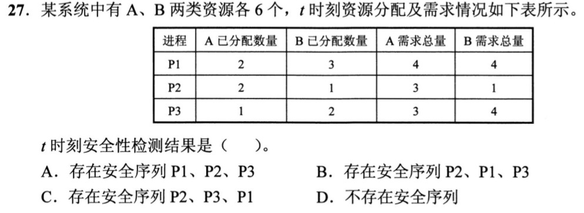
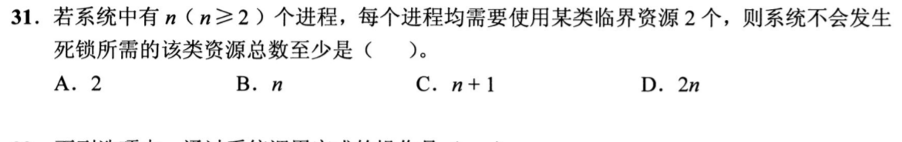
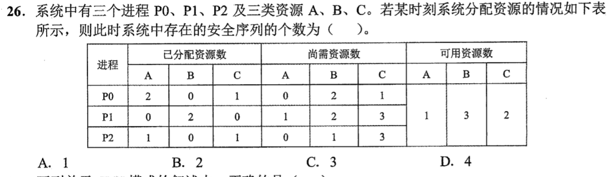
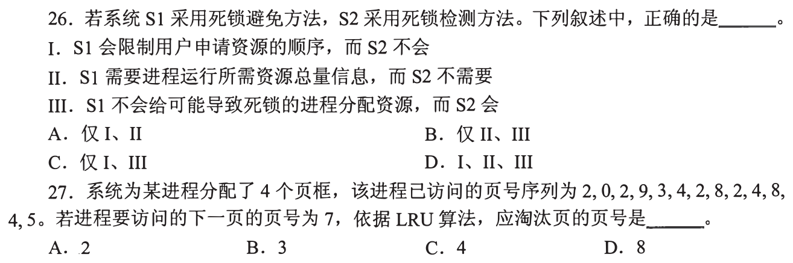
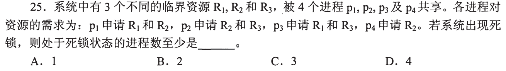
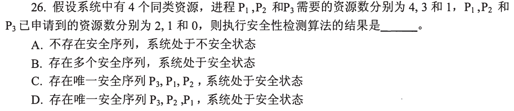
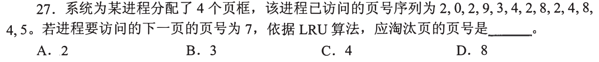
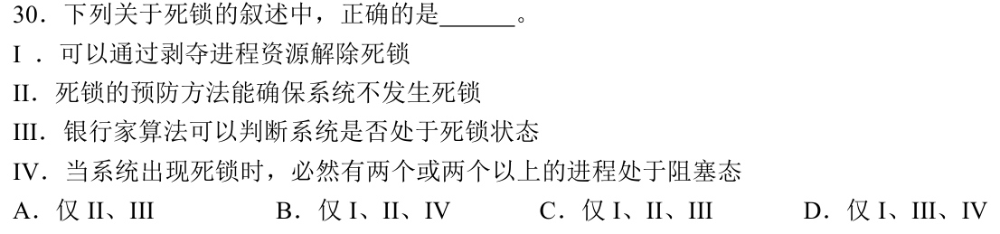

# 0827｜资源闭环：死锁、避免与检测

> 当前显示 **3 题**（2020—2026 年）；**6 题暂缓**，原文保留在文件末尾的 HTML 注释中，未删除。

## 当前题单（2020—2026）

### 01 · 2020-27
> *银行家算法找安全序列：心算剩余资源向量，先挑 Need 小于等于 Available 的进程让它执行并回收全部 Allocation。*

### 02 · 2021-31
> *死锁检测后的恢复代价：选优先级低、占用资源多、回退成本小的软柿子捏，挂起或终止该进程以释放资源。*

### 03 · 2022-26
> *死锁避免不限制用户的申请，但每次分配前都要做沙盘推演，如果分出去后找不到任何安全序列，就坚决不分。*

## 暂缓题目

以下题目仅暂时不处理；完整题目条目保留在 Markdown 源文件的 HTML 注释内，预览不显示题目。

<!-- 暂缓题：2009-25；暂时不处理，未删除。
### 01 · 2009-25
> *每个进程各拿最大需求减 1 台，全拿满时系统刚好处于死锁悬崖边，再加 1 个进程就必定掉进死锁深渊。*

-->

<!-- 暂缓题：2015-26；暂时不处理，未删除。
### 02 · 2015-26
> *死锁预防是事前下死命令破除四个必要条件之一；强制所有资源按编号递增申请，可以彻底摧毁环路等待。*

-->

<!-- 暂缓题：2016-25；暂时不处理，未删除。
### 03 · 2016-25
> *互斥、不可剥夺、请求并保持、循环等待，只要打破其中任何一个，死锁这个魔咒就立刻瓦解。*

-->

<!-- 暂缓题：2018-26；暂时不处理，未删除。
### 04 · 2018-26
> *死锁定理：只要在资源分配图里能找到一个能被满足的非孤立点，就能一路消枝，全部消光就说明绝无死锁。*

-->

<!-- 暂缓题：2015-27；暂时不处理，未删除。
### 06 · 2015-27
> *资源分配图消边法：看当前空闲资源够满足谁的申请边，满足后把该进程所有边拔掉，资源回收入库再看下一家。*

-->

<!-- 暂缓题：2019-30；暂时不处理，未删除。
### 07 · 2019-30
> *安全状态必定没有死锁；不安全状态只是有死锁风险，并不等同于已经死锁，概念界限千万别混淆。*

-->
