# 0828｜内存边界：分配、回收与保护

> 这组题直接分成两截：
> 前面是**快速拿分题**，分段分页优缺点、保护寄存器与连续分配，看清概念 1 分钟拿分；
> 后面是**耗时攻坚题**，十六进制多级页表虚实地址转换与有效访存时间，按位切分展开，绝不马虎。

---

## 一、 快速拿分题（机制与策略辨析，概念清爽）

### 01 · 2009-26
> *段式存储逻辑地址结构：高位段号查段表，段内偏移必须严格小于段长，一旦大于等于直接报越界中断。*

### 02 · 2009-27
> *首次适应算法从链表头顺着找第一个能塞下的空闲块，速度最快，而且高地址的大空闲区能完整保留。*
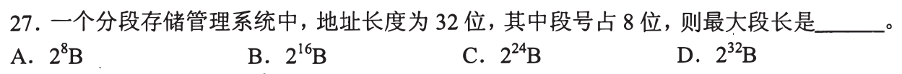

### 03 · 2014-28
> *最佳适应算法每次都选大小最接近的空闲块，虽然省地，但切剩下来的小边角料极难利用，外部碎片最严重。*
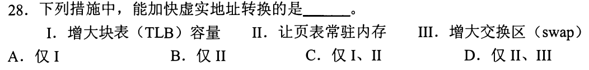

### 04 · 2016-28
> *分页是系统维度的物理划分，大小固定对程序员透明；分段是按逻辑模块划分，段长可变，利于共享和保护。*
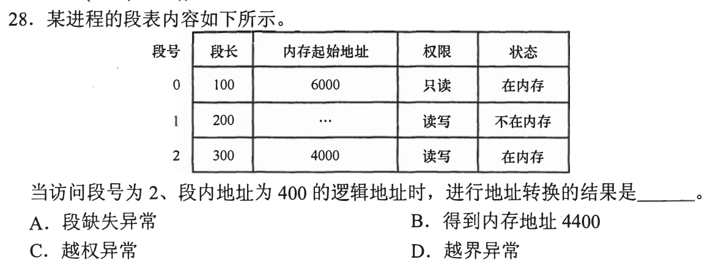

### 05 · 2017-25
> *基址寄存器负责物理地址加法重定位，界限寄存器负责范围越界检查，两者硬件联手实现内存绝对隔离。*
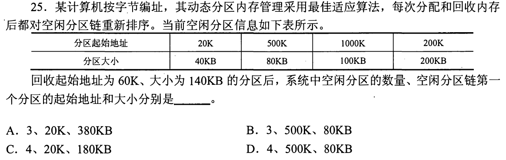

### 06 · 2023-30
> *多个进程共享同一个内存物理段，各自逻辑地址里的段号可以完全不一样，但段表项映射的物理基地址必须相同。*
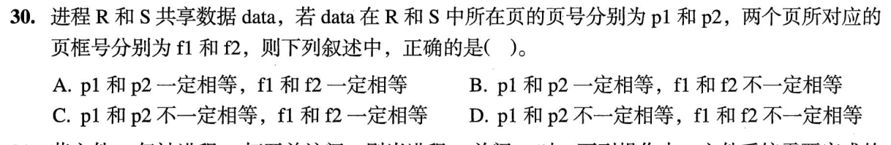

---

## 二、 耗时攻坚题（多级切分与有效访存时间，动手算位）

### 07 · 2010-28
> *顶级页表必须正好能装进一个页框中！页大小除以页表项大小算出每页能装几项，倒推顶级页表占用的位数。*
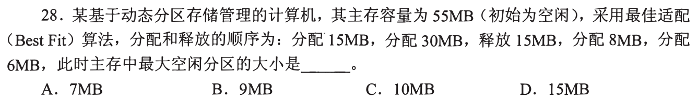

### 08 · 2017-30
> *两级页表地址拆分：把十六进制逻辑地址先转成二进制，按页目录位、页表位、页内偏移切成三段，按段查表。*
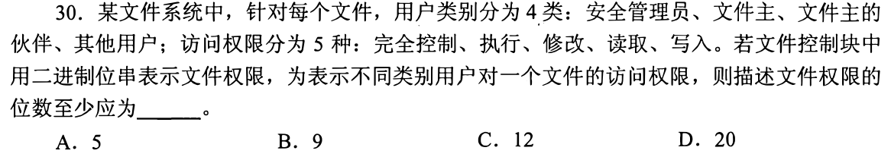

### 09 · 2019-28
> *页面大小决定了页内偏移占多少位；逻辑地址总位数减去偏移位数就是总页号位数，再按单页容纳项数切分多级。*
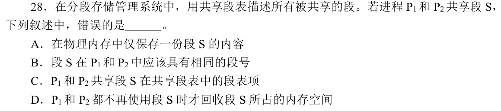

### 10 · 2019-32
> *虚实地址转换捷径：页内偏移永远保持原样不动，只把虚拟页号扔进页表查出物理页框号，拼在偏移前面。*
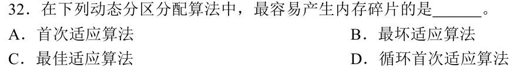

### 11 · 2020-24
> *有效访存时间别算漏：TLB 命中只需访存 1 次，未命中时查二级页表要访存 2 次，最后读数据还要访存 1 次，共 3 次。*
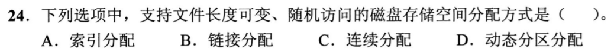

### 12 · 2024-27
> *内存空闲分区回收合并：回收一个区时必须检查前后两个邻居是否也空闲，能合并必须当场合并，防止碎片化。*
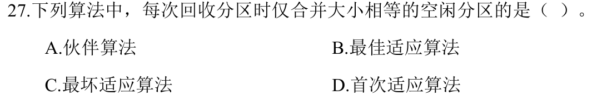

### 13 · 2026-28
> *64位三级页表，虚拟地址各层划分明确。页表项占 8 字节，求一个进程满负荷使用时第三级页表所占用的最大页框数，自顶向下逐级推算。*
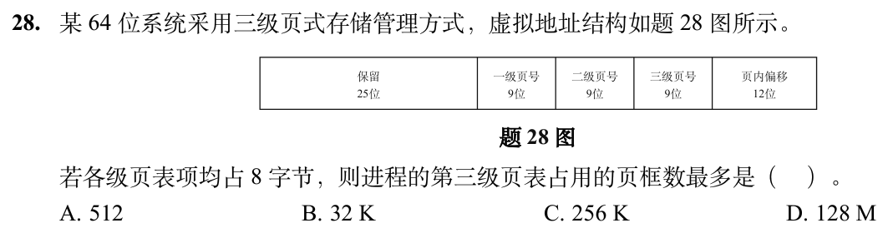
